<!-- id: LC-ABT-EN-0000 theme: thinking-cultivation type: index direction: ascension-mission lang: en -->

# Abnormal Thinking

> In Lifechanyuan terminology, **LIFE** (capitalized) refers to the ontological essence of existence — the nonmaterial soul-structure that persists across incarnations — while **life** (lowercase) refers to ordinary human lived experience.

**Abnormal Thinking** is the foundational method of the Lifechanyuan system — the first key placed in a reader's hand before any other concept is introduced. It is not about being deliberately strange or contrarian, but about making a precise 180-degree turn in thought when conventional thinking reaches a wall, so that what was hidden behind the familiar surface of reality can finally be seen. Lifechanyuan opens with Abnormal Thinking because without it, the mind cannot enter: deeper truths about the universe, LIFE, destiny, and freedom will simply be deflected by habitual thought before they can land.

> “Abnormal thinking is the best path for exploring the mysteries of the universe and finding the true meaning of life.”
> — Xuefeng, *The Opportunity and Process of My Abnormal Thinking*

---

## Read by Edition

| Edition | Intended Reader |
|---------|----------------|
| [Friendly Edition](friendly/) | First-time readers; conceptual introduction through narrative |
| [Academic Edition](academic/) | Researchers and comparative study |
| [Internal Edition](internal/) | Chanyuan Celestials; full source texts arranged by theme |

---

## Video

<iframe style="width:100%;aspect-ratio:4/3;border:0" src="https://www.youtube-nocookie.com/embed/bAR9EamyfNk" title="Abnormal Thinking (Lifechanyuan Encyclopedia video)" allowfullscreen></iframe>

## Slides

??? info "📖 Illustrated slides (14 pages, click to expand)"

    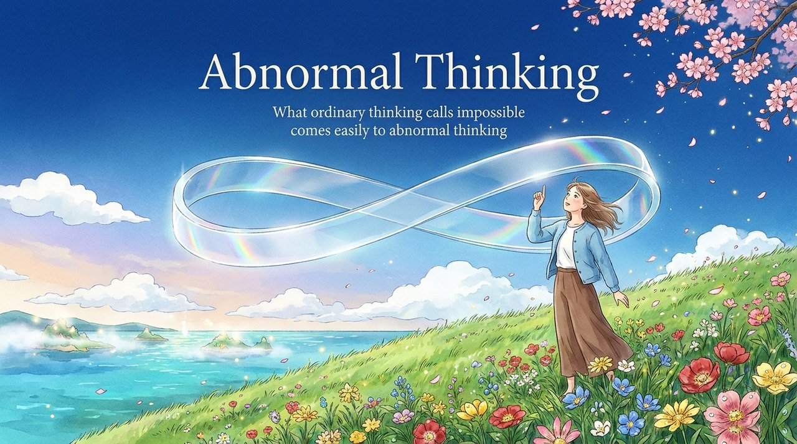
    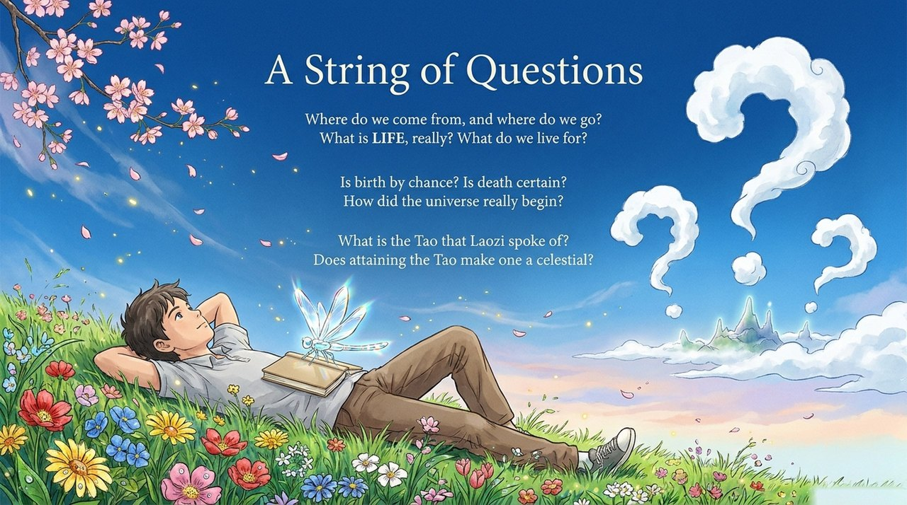
    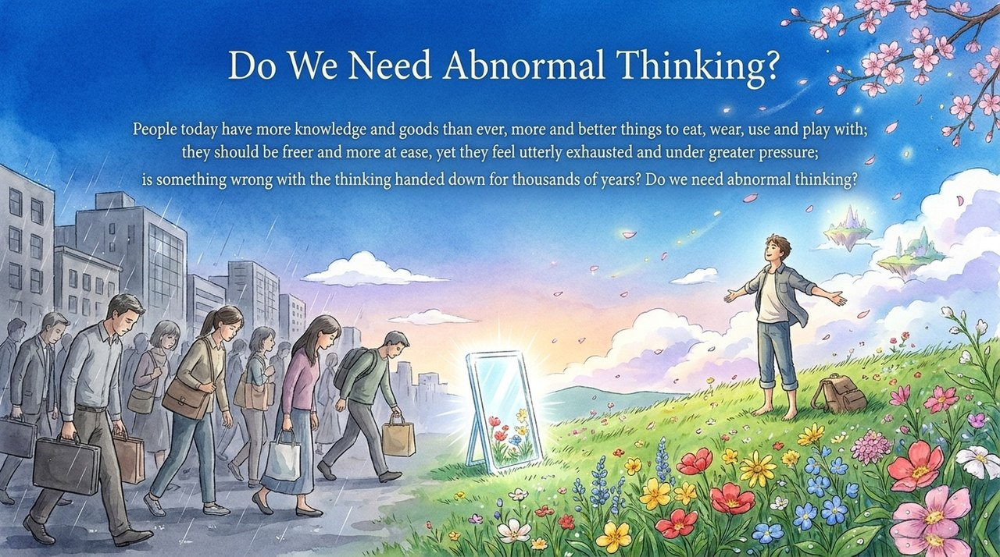
    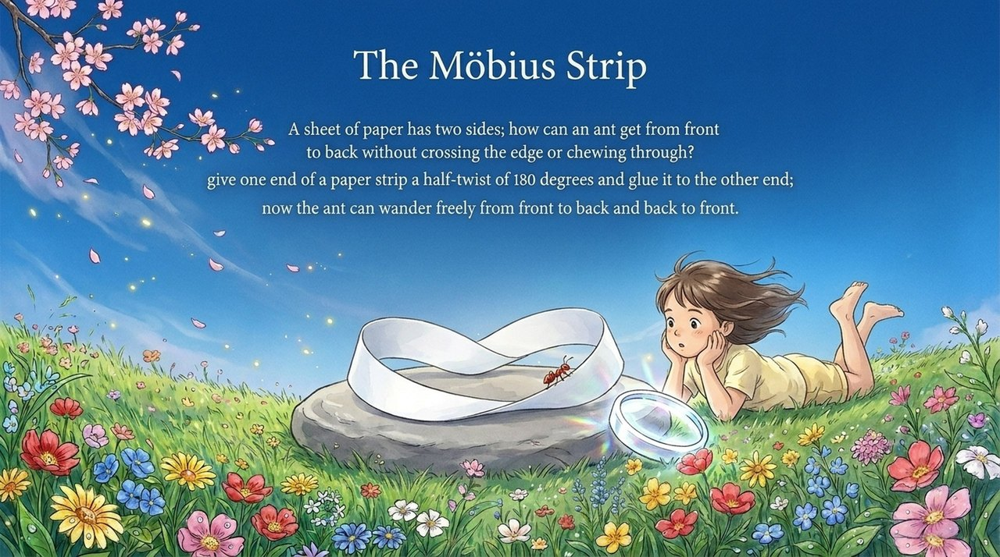
    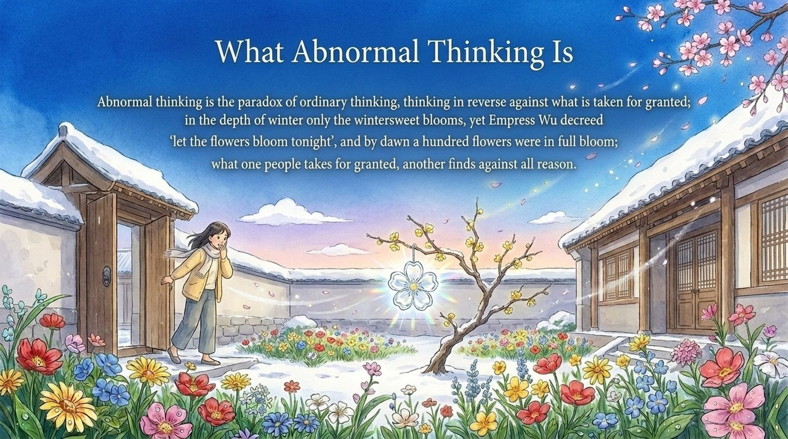
    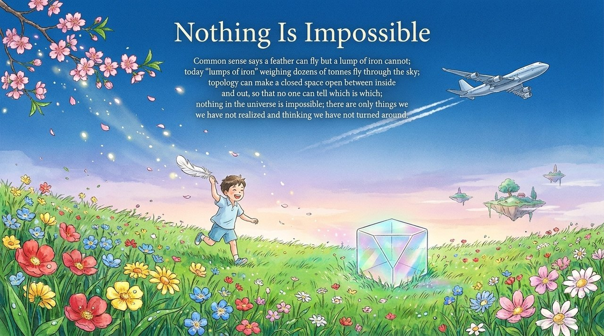
    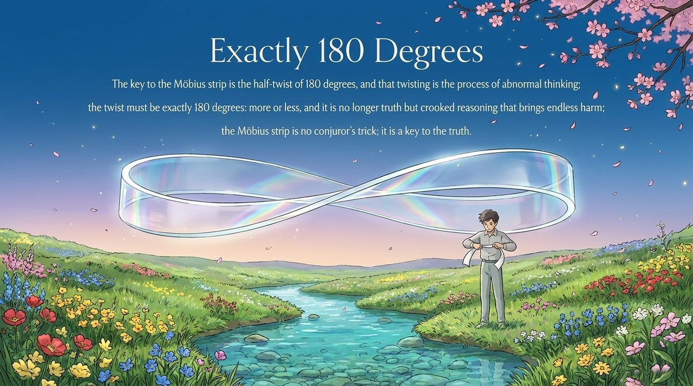
    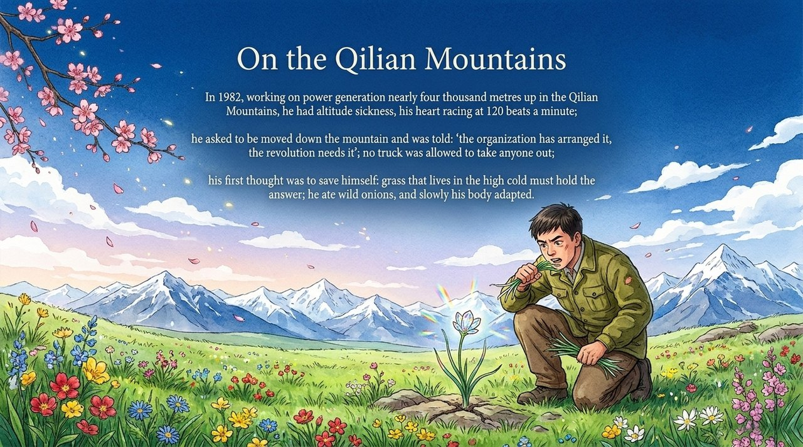
    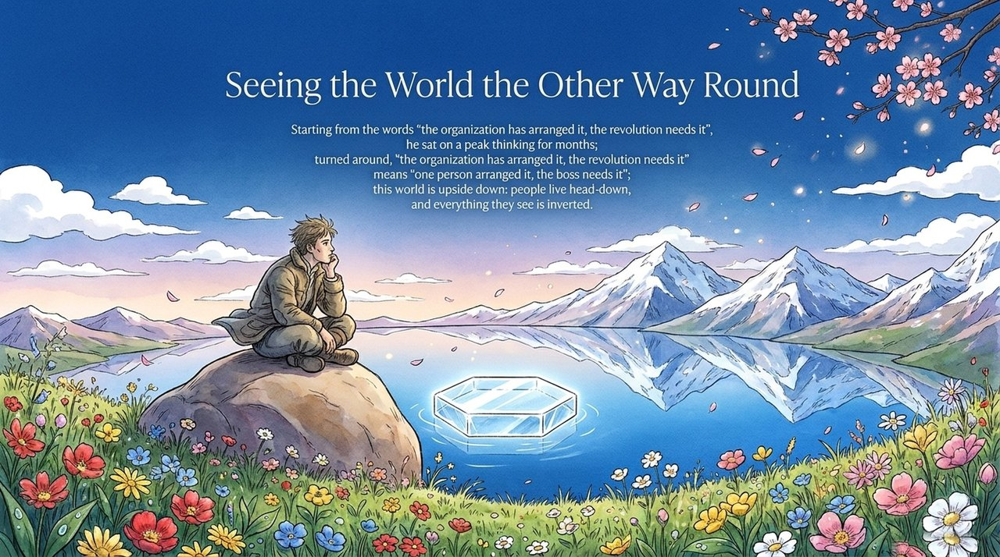
    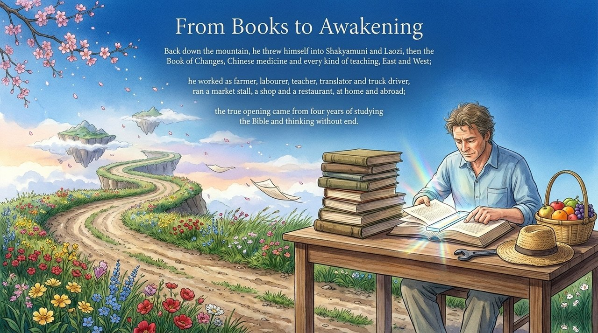
    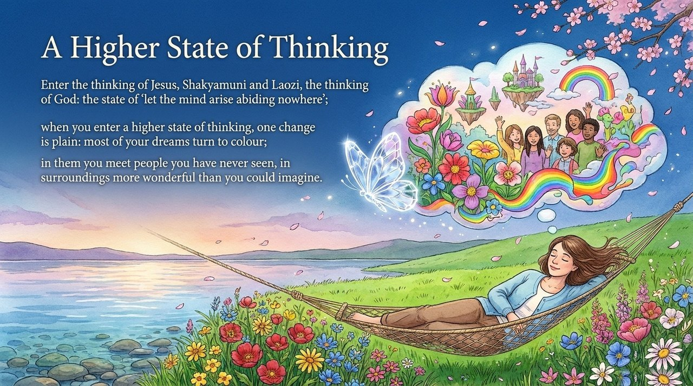
    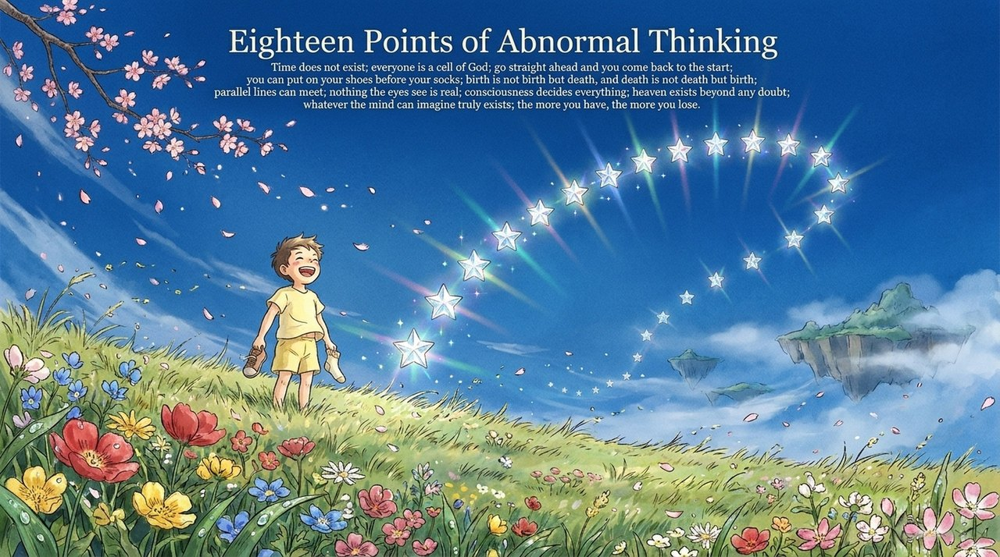
    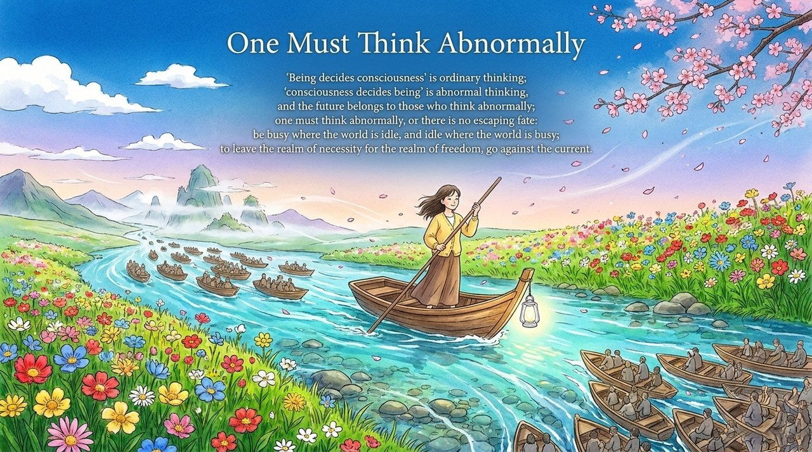
    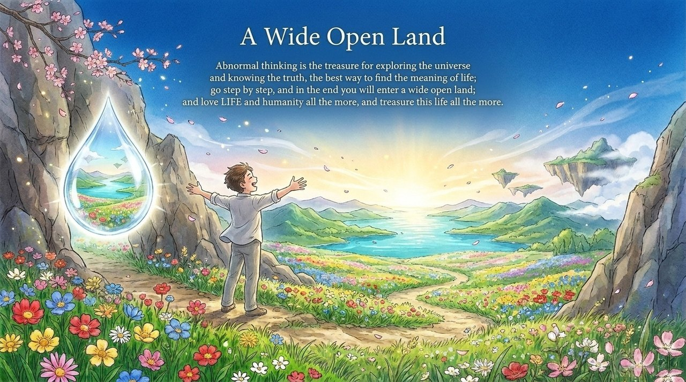

---

## Related Entries

[Guide Xuefeng](/en/guide-xuefeng/) · [Lifechanyuan](/en/lifechanyuan/) · [Inverted Thinking](/en/inverted-thinking/) · [1+1 Thinking](/en/one-plus-one-thinking/) · [Eight Thinking Ladders](/en/eight-thinking-ladders/) · [Hundun Thinking](/en/hundun-thinking/) · [Fixed-Pattern Thinking](/en/fixed-mindset/) · [Civilization 3.0](/en/civilization-3-0/)
