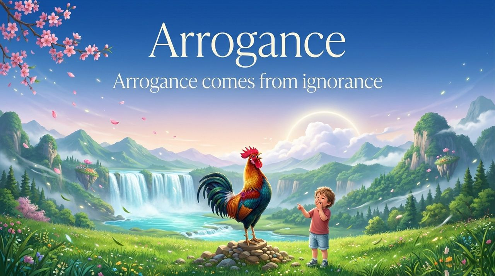
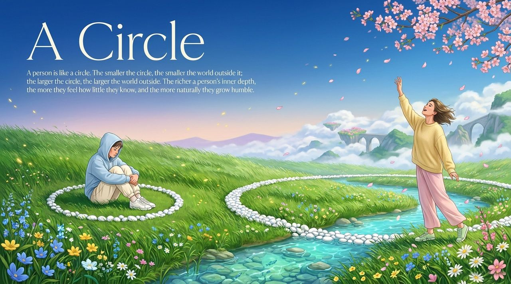
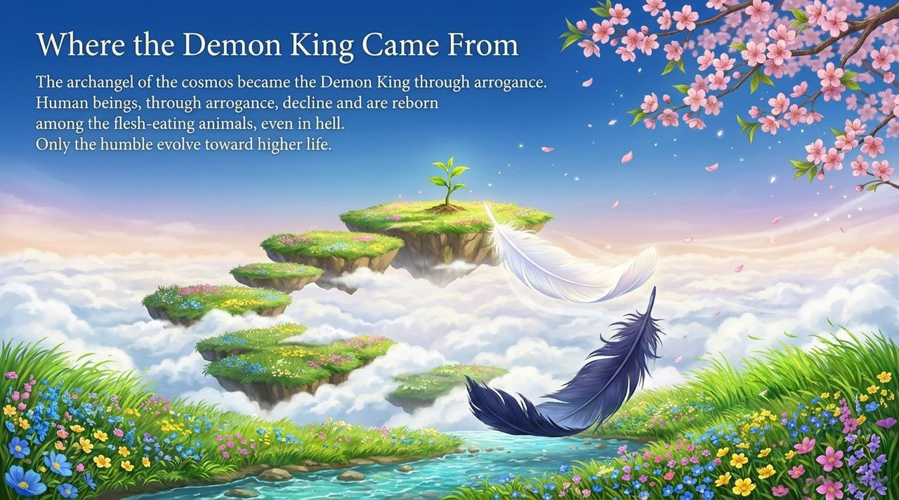
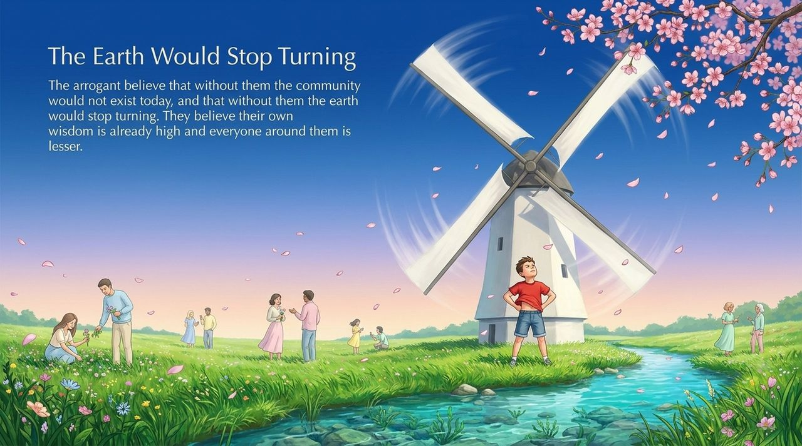
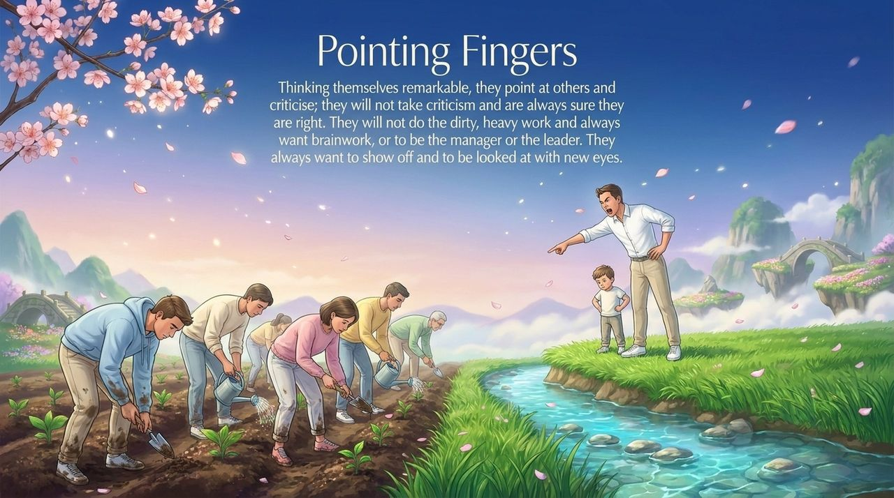
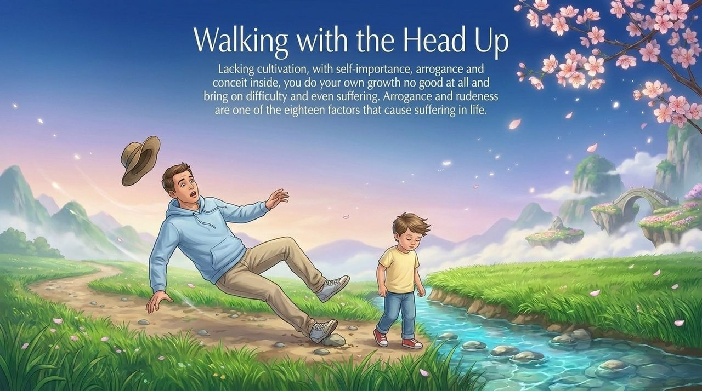
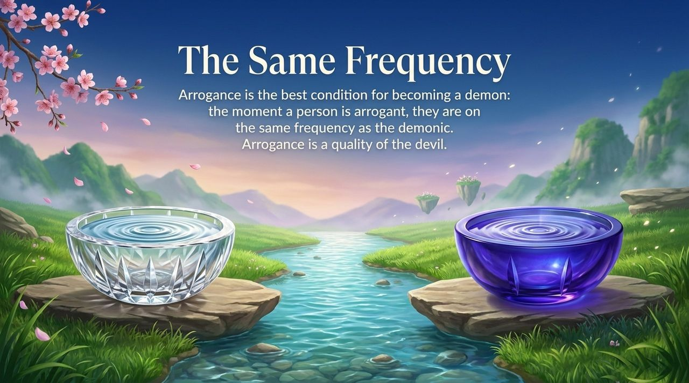
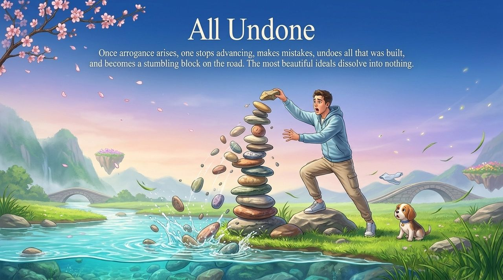
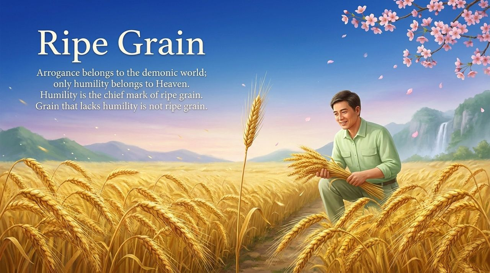
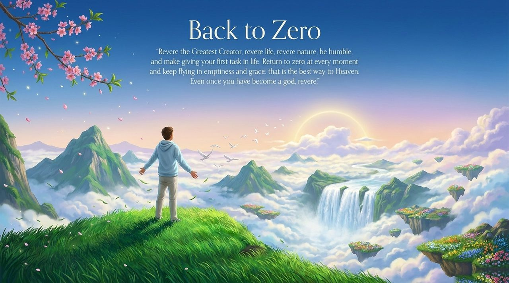

<!-- id: LC-AM-0001-EN theme: Cultivation type: Navigation direction: Character Cultivation lang: en -->

# Arrogance (Aoman)

Arrogance (傲慢, àomàn) is the inevitable outward expression of ignorance — the first step by which a life falls into resonance with demonic energy, and the most dangerous weed in the soul-garden of anyone pursuing sublimation. The cosmic archangel became the Demon King through arrogance; the devoted practitioner squanders all progress through the same fault.

---

## Version Navigator

## Video

<iframe style="width:100%;aspect-ratio:4/3;border:0" src="https://www.youtube-nocookie.com/embed/zjKxqVhMOn0" title="Arrogance (Lifechanyuan Encyclopedia video)" allowfullscreen></iframe>

## Slides

??? info "📖 Illustrated slides (14 pages, click to expand)"

    
    
    
    
    
    
    
    
    
    
    
    
    
    

---

| Version | Best for | Focus |
|---------|----------|-------|
| [Friendly](friendly.md) | First-time readers | Real-life situations · Self-examination · Path from arrogance to humility |
| [Academic](academic.md) | Scholars · Cross-cultural comparison | Superbia, māna, Dunning-Kruger, the "watershed" proposition |
| [Internal](internal.md) | Practitioners · Researchers | Full citations · Six-section framework · In-system understanding |

---

## Related Entries

[Humility](/en/humility/) · [Ego-Clinging](/en/wo-zhi/) · [Gratitude](/en/gratitude/) · [Innate Nature · Inherent Character · Habitual Disposition](/en/tianxing-bingxing-xixing/) · [Becoming a Celestial Being and a Buddha](/en/becoming-celestial-buddha/) · [Soul Garden](/en/soul-garden/) · [Return to Zero](/en/return-to-zero/)
