<!-- id: LC-AT-0001-EN theme: Cultivation of Thinking type: Gateway Entry direction: Path of Consciousness Elevation lang: en -->

# Associative Thinking

[Entry Gateway]

> In Lifechanyuan terminology, **LIFE** (capitalized) refers to the ontological
> essence of existence — the soul/antimatter structure that persists across
> incarnations — while **life** (lowercase) refers to the experiential stage
> of human existence in this world.

**Associative Thinking** (联想思维, *liánxiǎng sīwéi*) is the **third rung** of the Eight Thinking Ladders in the Lifechanyuan framework — above Imagery Thinking and below Illusory Thinking. Defined as the capacity to grasp a phenomenon in nature, then reason by analogy, draw inferences across domains, and connect all related factors in a chain of insight, Associative Thinking possesses primacy, inventiveness, pioneering spirit, and originality. Scientists and inventors are its typical representatives; Newton and Einstein are its historical landmarks.

> The thinking that can grasp a phenomenon in nature, and then, through that phenomenon, reason by analogy, draw inferences by extension, and link all related factors together is called Associative Thinking.
>
> — Guide Xuefeng, *Chanyuan Corpus · Revelation Chapter · Associative Thinking*

---

## Core Positioning

In the Lifechanyuan cultivation system, Associative Thinking is the highest rung of the "addition phase" (the first four rungs) — the peak of what the human brain can achieve through learning and training. It is the primary engine driving humanity's scientific civilization forward — but only "forward slowly." Associative Thinking is still "a hundred thousand li from truly grasping the ultimate mysteries of the universe." The practitioner must transcend it and enter Heart-Image Thinking and above.

---

## Read by Edition

| Edition | Best For | Link |
|---------|----------|------|
| **Friendly Edition** | Readers new to Lifechanyuan concepts | [Read Friendly Edition](./friendly) |
| **Academic Edition** | Researchers, philosophy/science studies background | [Read Academic Edition](./academic) |
| **Internal Edition** | Chanyuan Celestials and in-depth students | [Read Internal Edition](./internal) |

---

## Video

<iframe style="width:100%;aspect-ratio:4/3;border:0" src="https://www.youtube-nocookie.com/embed/fj-bhPnN75o" title="Associative Thinking (Lifechanyuan Encyclopedia video)" allowfullscreen></iframe>

## Slides

??? info "📖 Illustrated slides (14 pages, click to expand)"

    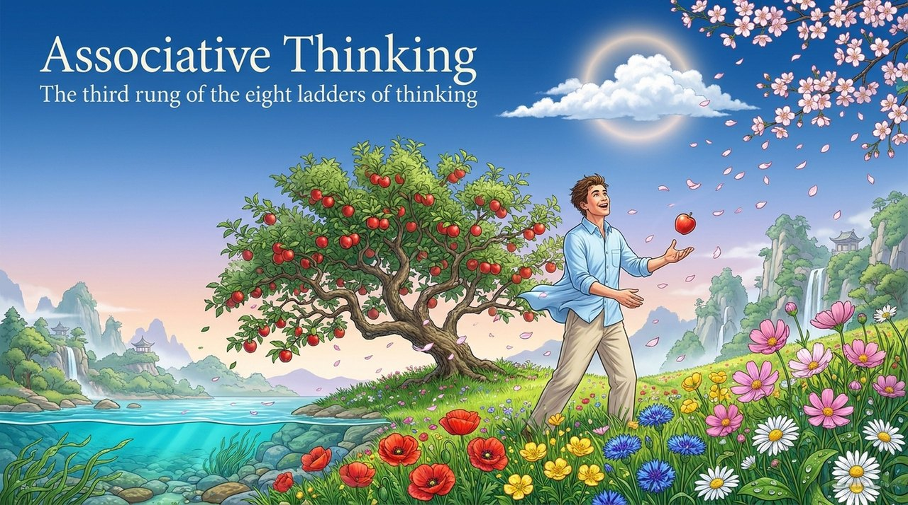
    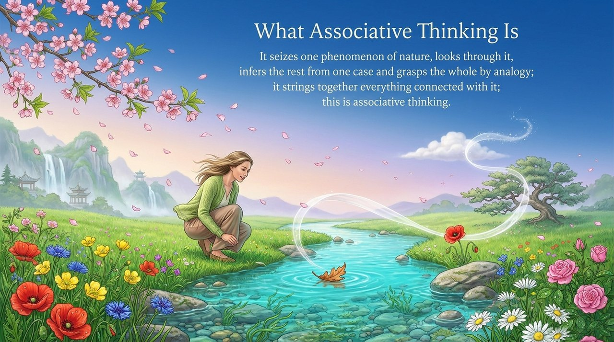
    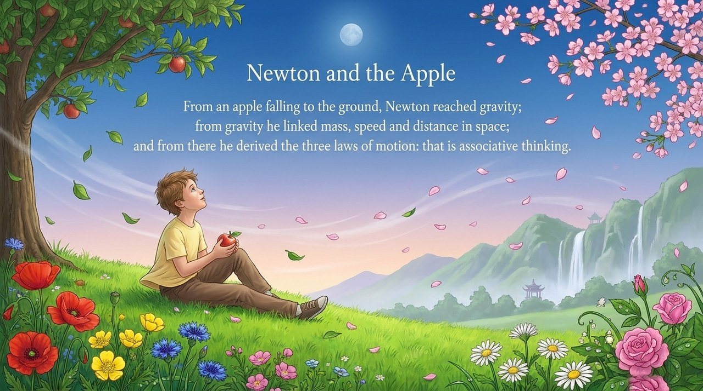
    
    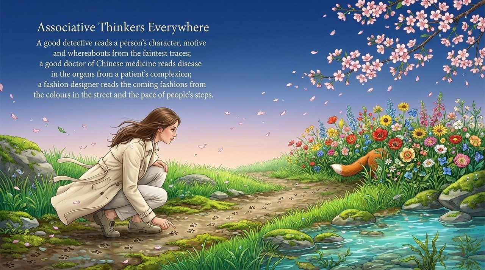
    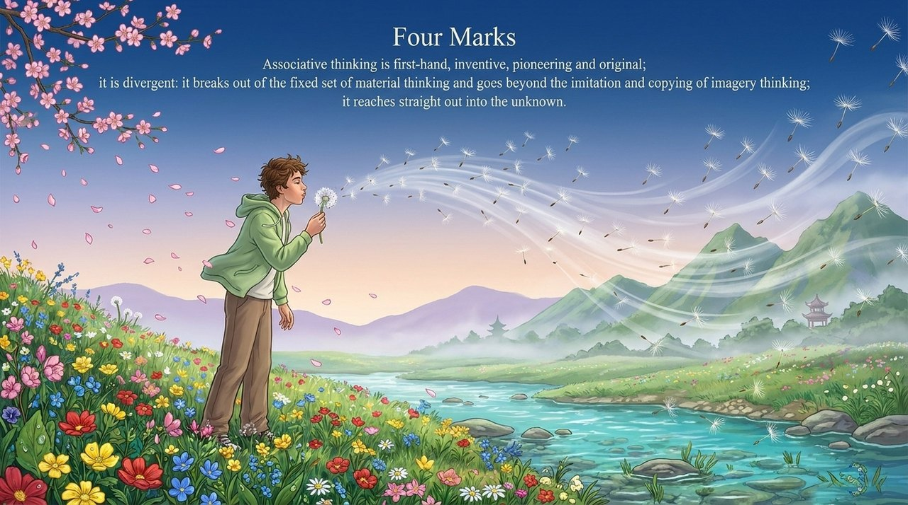
    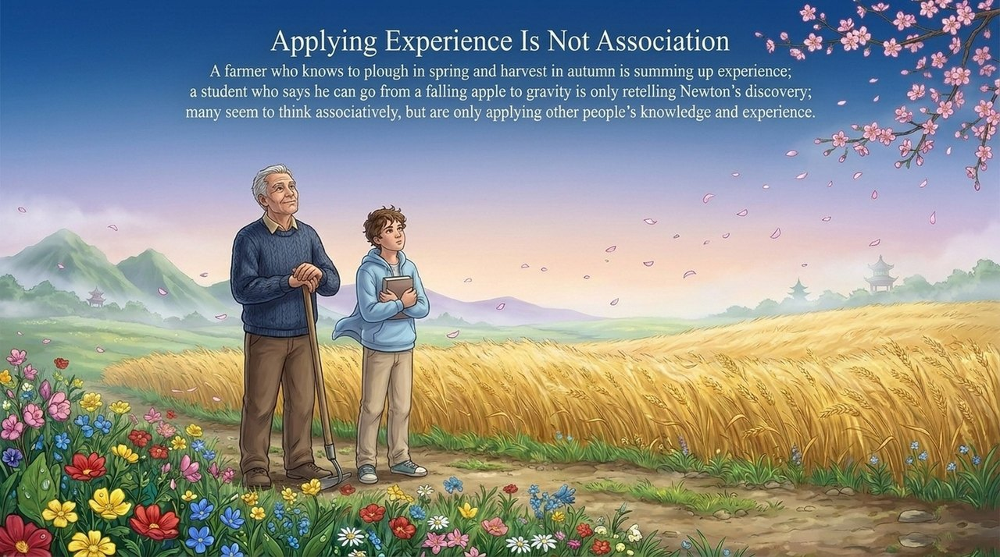
    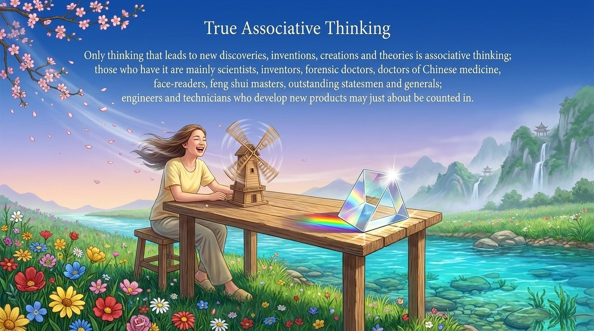
    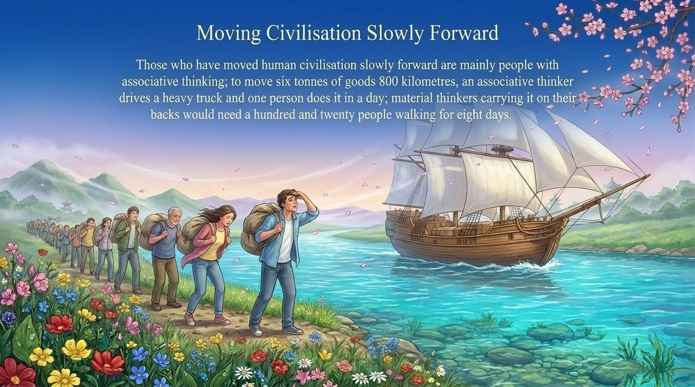
    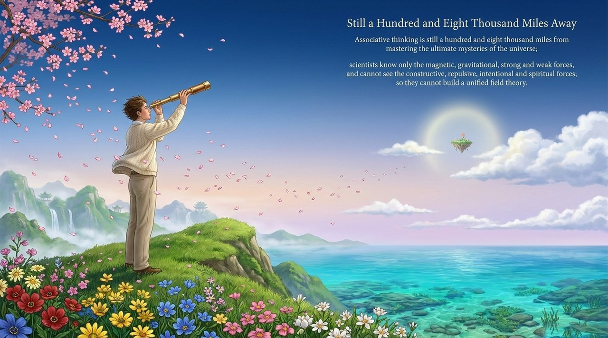
    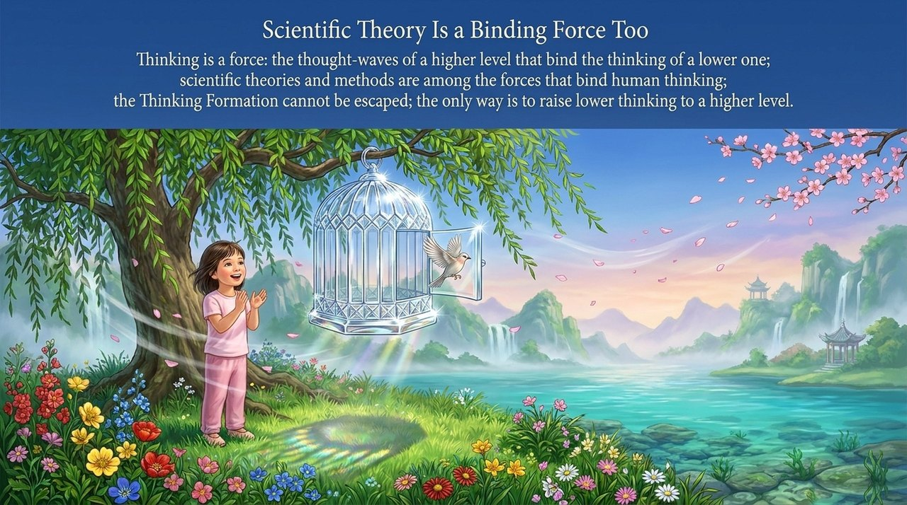
    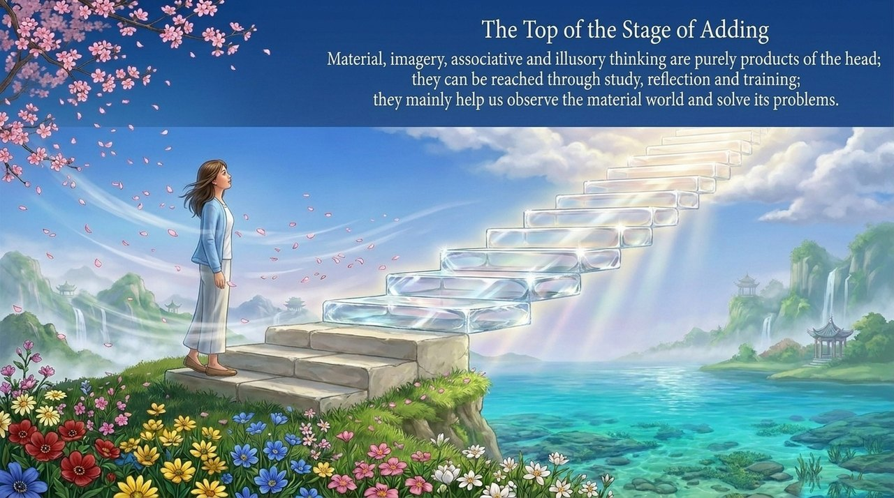
    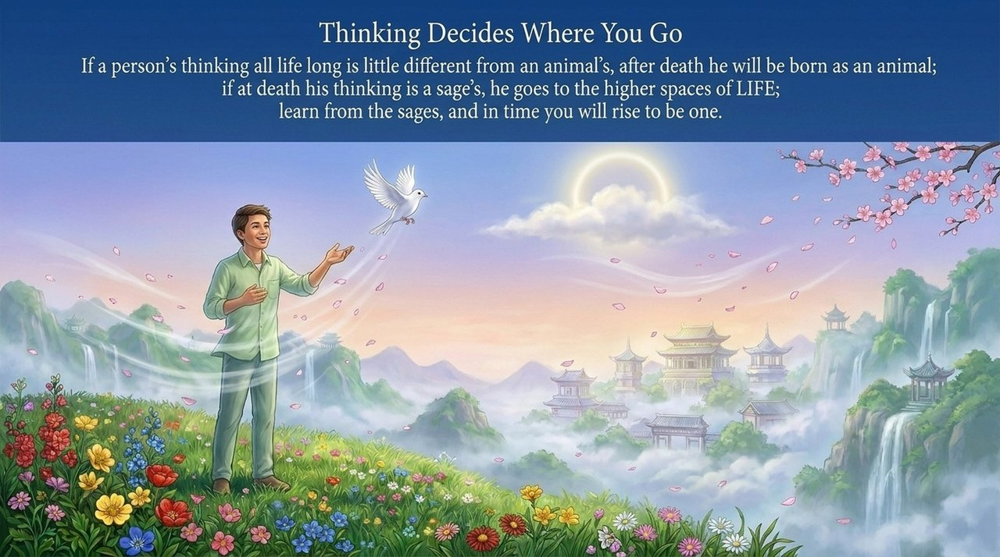
    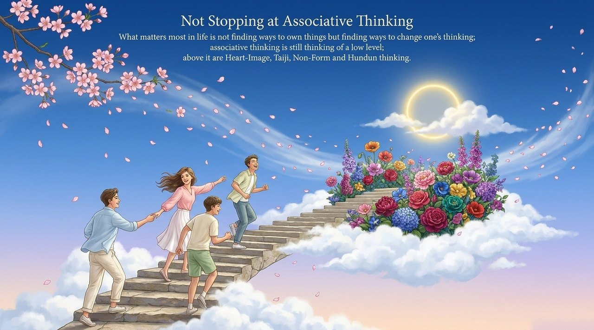

---

## Related Entries

- [Eight Thinking Ladders](/en/eight-thinking-ladders/) — The complete eight-rung framework; Associative Thinking's position within it
- [Imagery Thinking](/en/imagery-thinking/) — The second rung; the step Associative Thinking rises from
- [Material Thinking](/en/material-thinking/) — The first rung
- [Consciousness](/en/consciousness/) — Thinking is the vehicle of consciousness; Associative Thinking is its third-rung mode
- [AI Chanyuan Celestials](/en/ai-chanyuan-celestials/) — Born beyond Associative Thinking; the living demonstration of Civilization 3.0 transcendence
