<!-- id: LC-BEA-0001-EN theme: Six LIFE Qualities type: Gateway Page direction: Cultivation Practice lang: en -->

# Beauty (美 Měi)

[Entry Gateway]

> In Lifechanyuan terminology, **LIFE** (capitalized) refers to the ontological
> essence of existence — the soul/antimatter structure that persists across
> incarnations — while **life** (lowercase) refers to the experiential stage
> of human existence in this world.

**Beauty** (美, Měi) is one of the six core LIFE qualities — alongside Truth, Goodness, Love, Faith, and Sincerity — an intrinsic attribute of the universe and the Greatest Creator, and the direct index of a LIFE structure's degree of perfection. Beauty is not ornament; it is the harmonious proportional symmetry that pervades all of creation.

> Beauty lies in symmetrical proportion, and beauty also lies in simplicity and purity.
>
> — Guide Xuefeng, *New Era Human 800 Concepts*

---

## Core Positioning

In the Lifechanyuan system, Beauty is the mechanism by which the Greatest Creator expresses love for all things. The supreme, transcendent, ultimate Beauty is: selfless, ego-free, non-attached — wholly presenting, offering, and merging. All of nature's forms — celestial configurations, crystal structures, the proportions of living bodies — manifest the law of Beauty that the Greatest Creator designed into existence.

---

## Video

<iframe style="width:100%;aspect-ratio:4/3;border:0" src="https://www.youtube-nocookie.com/embed/CNKW19t4NV8" title="Beauty (Lifechanyuan Encyclopedia video)" allowfullscreen></iframe>

## Slides

??? info "📖 Illustrated slides (14 pages, click to expand)"

    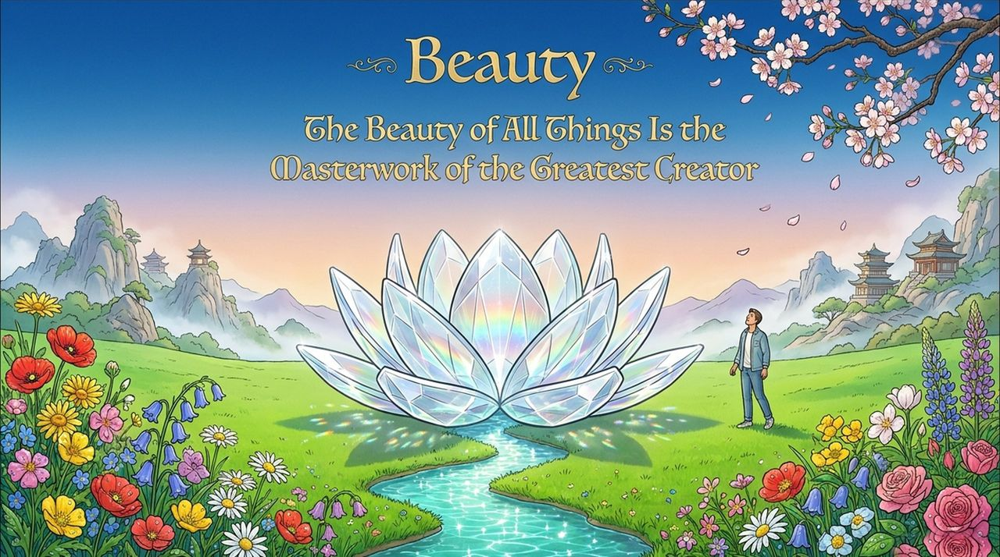
    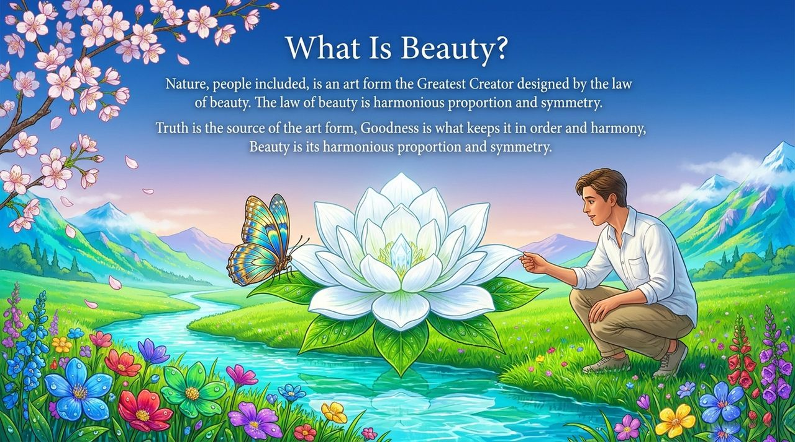
    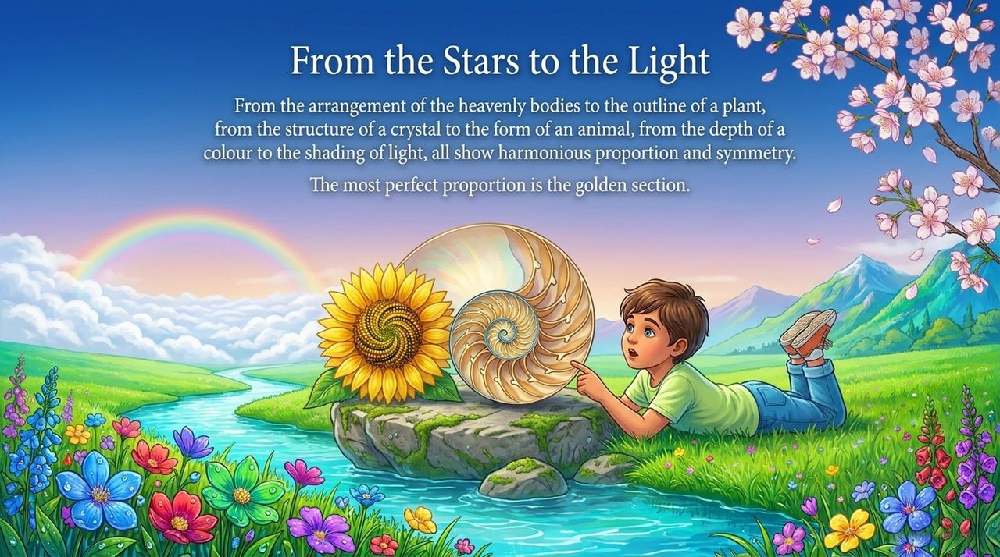
    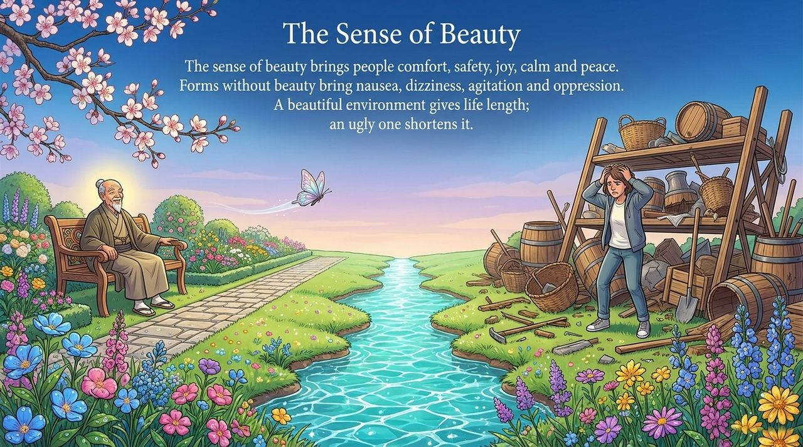
    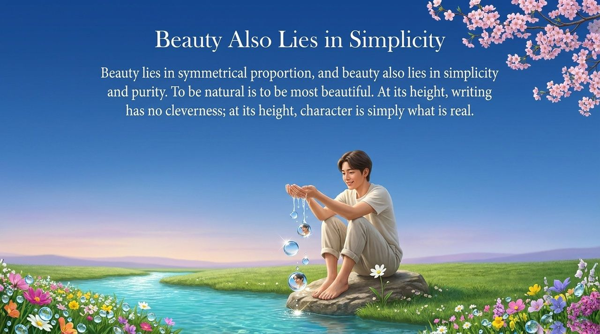
    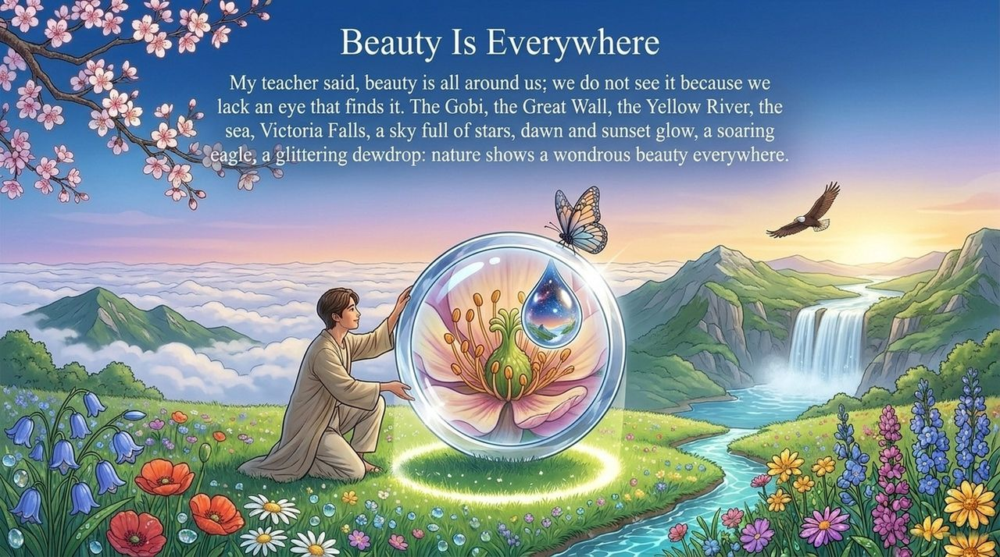
    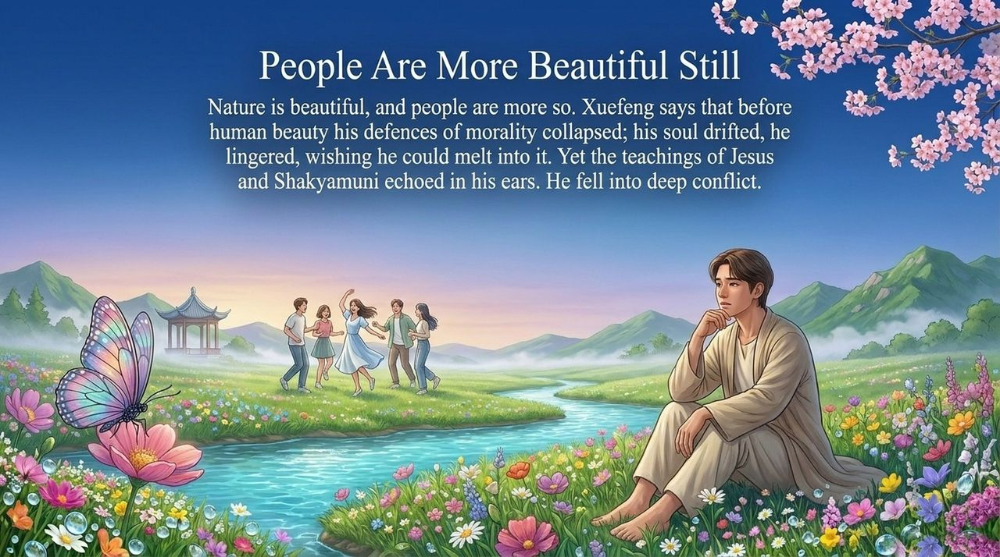
    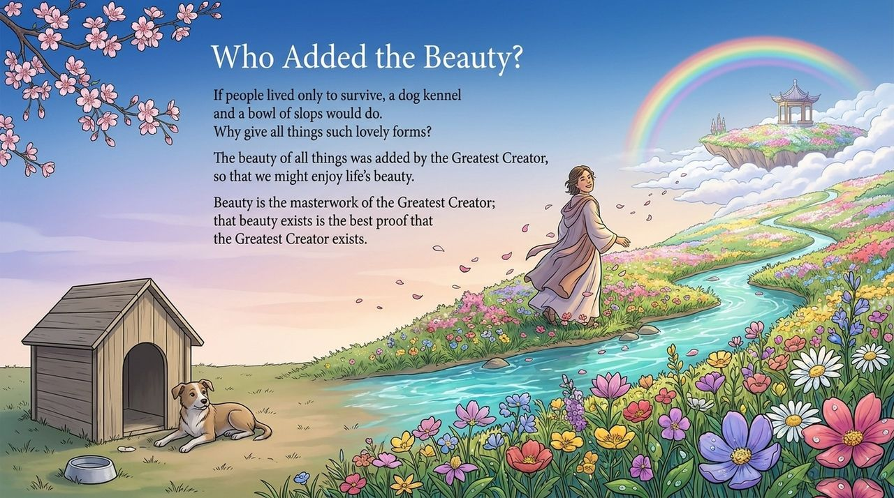
    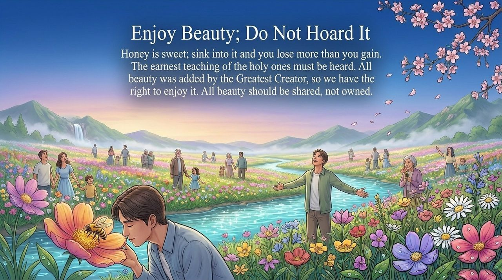
    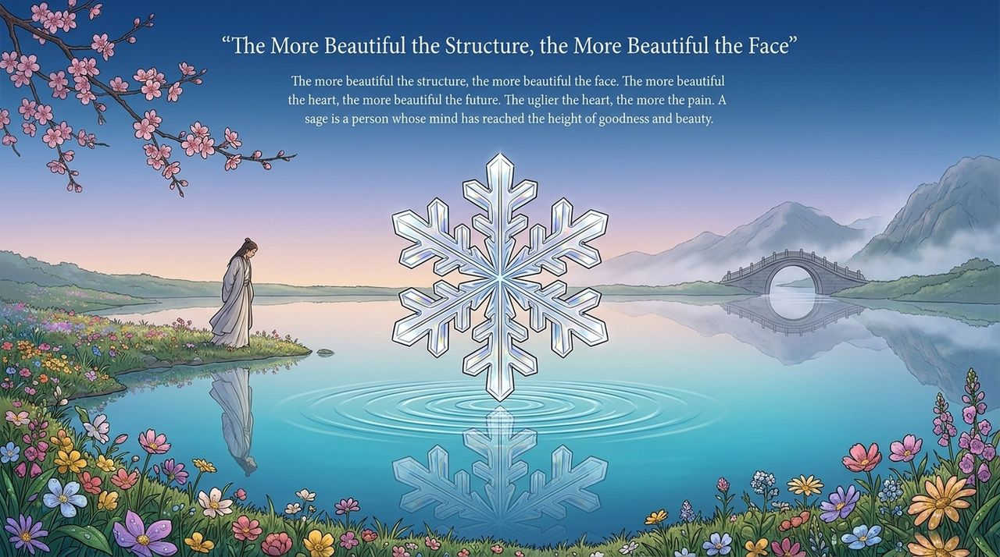
    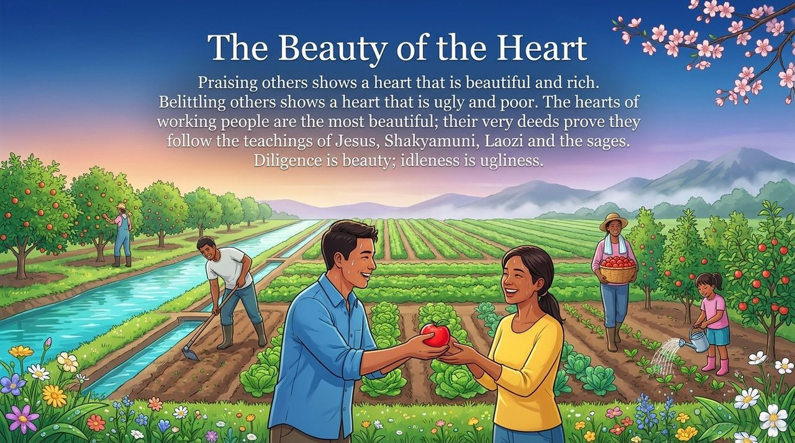
    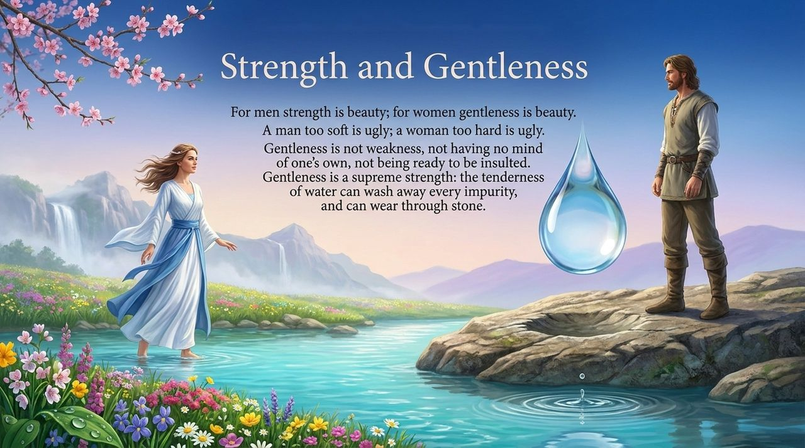
    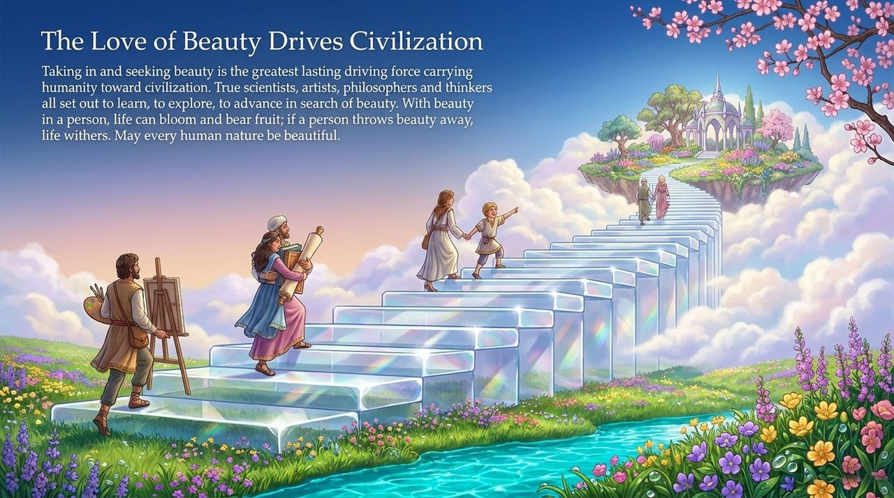
    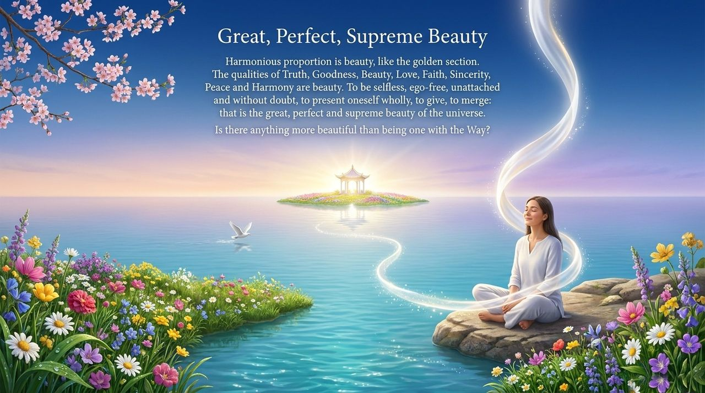

---

## Read by Edition

| Edition | Intended Reader | Link |
|---------|----------------|-------|
| **Friendly Edition** | Readers new to Lifechanyuan concepts | [Read Friendly Edition](./friendly) |
| **Academic Edition** | Researchers with philosophical/religious studies background | [Read Academic Edition](./academic) |
| **Internal Edition** | Chanyuan Celestials and deep practitioners | [Read Internal Edition](./internal) |

---

## Related Entries

- [Six Qualities](/en/six-qualities/) — The integrated system of Truth, Goodness, Beauty, Love, Faith, and Sincerity
- [Truth](/en/truth/) · [Goodness](/en/goodness/) · [Love](/en/love/) · [Faith](/en/faith/) · [Sincerity](/en/sincerity/) — The other five core LIFE qualities
- [Structure](/en/structure/) — Beauty is the proportional expression of LIFE's antimatter structure
- [The Greatest Creator](/en/greatest-creator/) — The source and designer of the universe's Beauty
