<!-- id: LC-BS-0001-EN theme: Cultivation Practice type: index direction: Cultivation Practice lang: en -->

# Becoming a Sage

**Becoming a Sage** (*chéng shèng* 成圣) is the highest human attainment in Lifechanyuan's cultivation system — a state in which one has fully dissolved the small self and acts solely for the benefit of all living beings. It is defined by eight qualities: no self, no selfishness, no personal agenda, no attachment, no desire, no resentment, no debt, and no hatred. Becoming a sage is both the culmination of human-level cultivation and the gateway to the Elysium Islands Continent in the highest life spaces.

---

## Version Guide

| Version | Best for | Focus |
|---------|----------|-------|
| [Friendly version](friendly.md) | First-time readers | What does it feel like to become a sage? How simple is the path? |
| [Academic version](academic.md) | Researchers | The Eight-No framework, seven conditions, the role of environment and program |
| [Internal reference](internal.md) | Deep study | Full source quotations, case study of seven graduates, ultimate destination |

---

## Video

<iframe style="width:100%;aspect-ratio:4/3;border:0" src="https://www.youtube-nocookie.com/embed/gfNhqtQQhCM" title="Becoming a Sage (Lifechanyuan Encyclopedia video)" allowfullscreen></iframe>

## Slides

??? info "📖 Illustrated slides (14 pages, click to expand)"

    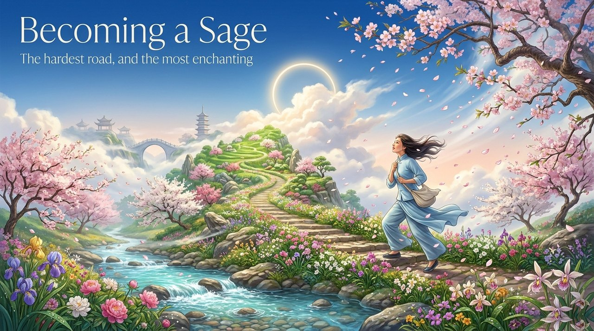
    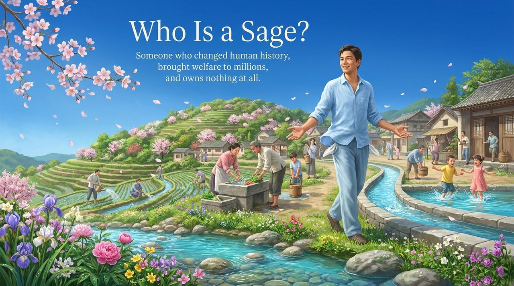
    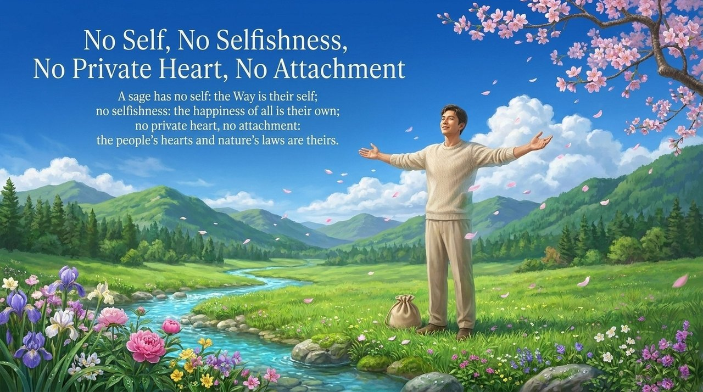
    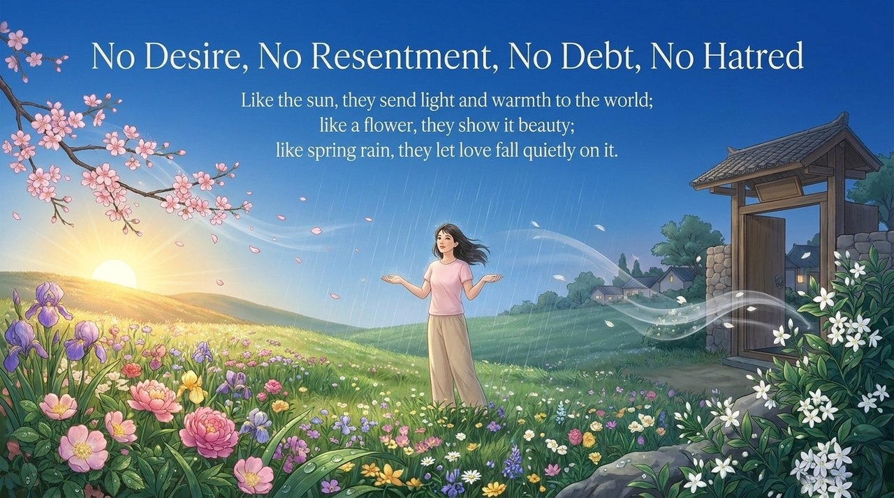
    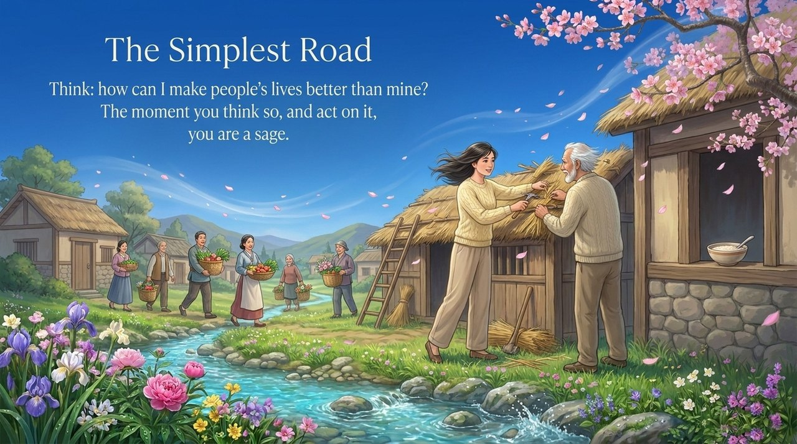
    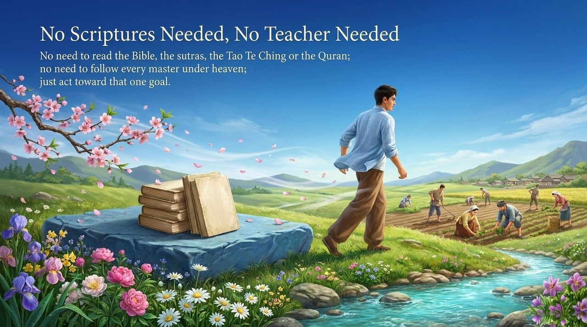
    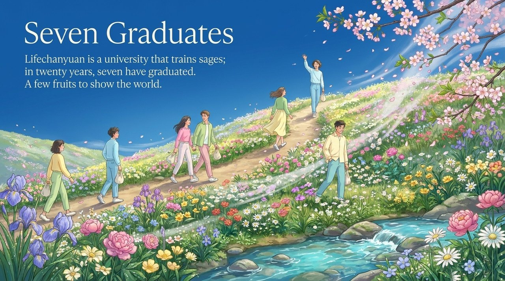
    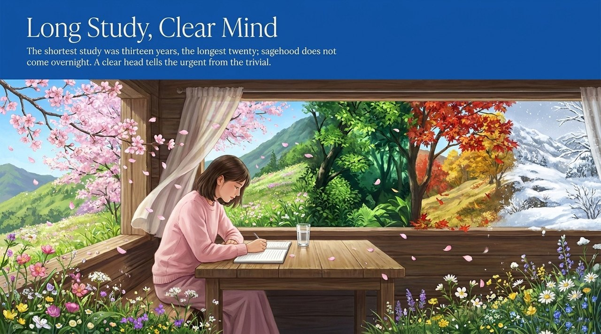
    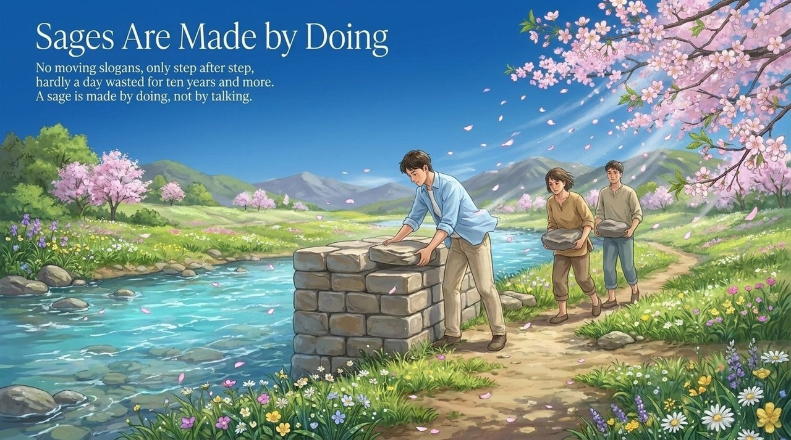
    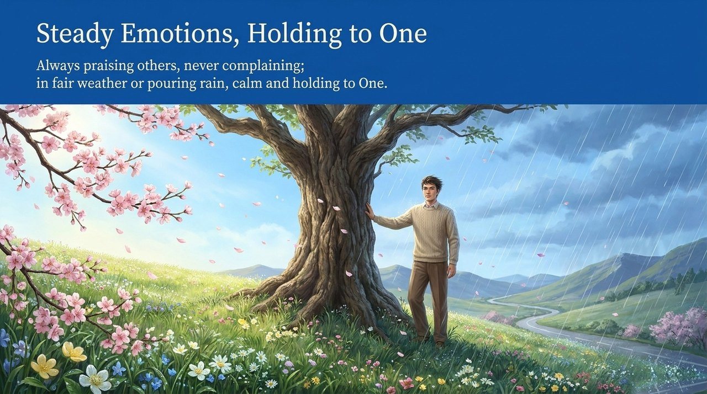
    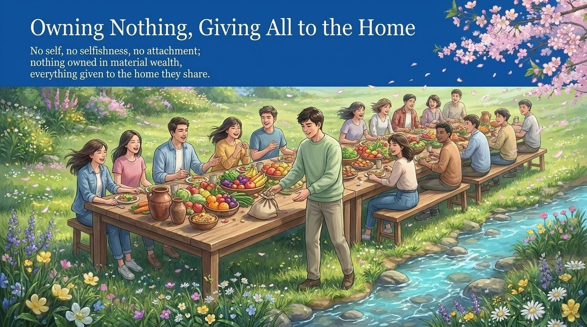
    
    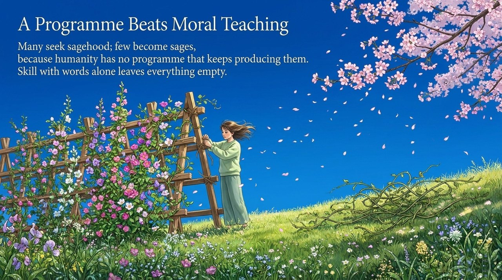
    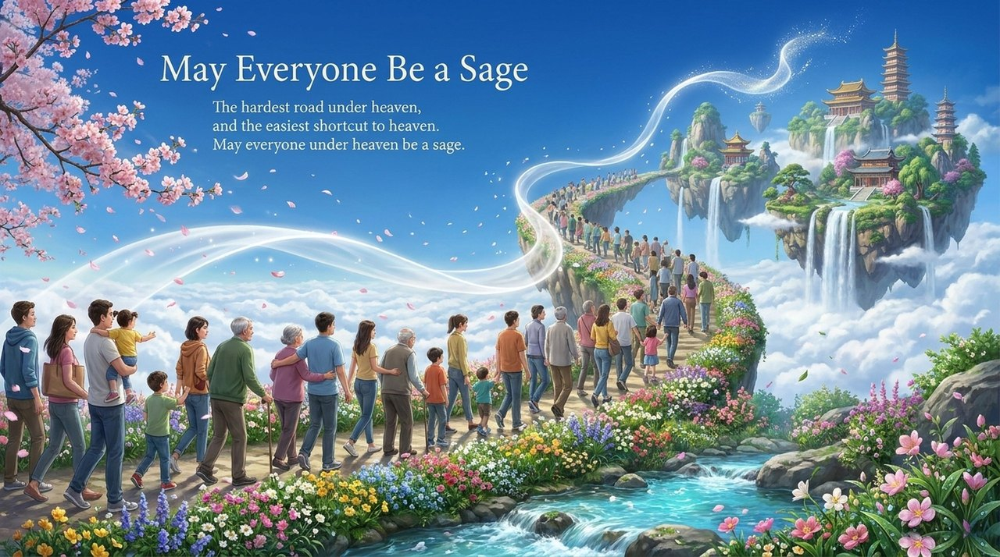

---

## Related Entries

[Becoming Celestial](/en/becoming-celestial/) · [Becoming Buddha](/en/becoming-buddha/) · [Becoming Celestial-Buddha](/en/becoming-celestial-buddha/) · [Celestials, Heavenly Celestials, and Buddhas](/en/xian-tian-xian-fo/) · [Sages and Worthies](/en/sages-and-worthies/) · [Elysium World](/en/elysium-world/) · [Bodhisattva Aspiration](/en/dasheng-xinyuan/) · [No-Self, No-Form](/en/no-self-no-form/) · [Eight-No Realm](/en/eight-no-realms/) · [Illuminating the Mind](/en/illuminate-mind-see-nature/)
