<!-- id: LC-BP-0001-EN theme: Cultivation Practice type: index direction: Cultivation Practice lang: en -->

# Buddha, the Patriarch, Tathagata, and the Tathagata Buddha

In the Lifechanyuan system, **Buddha** (佛) is the enlightened spirit — a being with no physical form yet possessing consciousness; **the Patriarch** (佛祖) is the origin of all spirits; **Tathagata** (如来) is the primordial nature of the universe, the original "suchness" that contains all forms yet belongs to none; and the **Tathagata Buddha** (如来佛祖) is the ultimate source of everything — the Greatest Creator. Shakyamuni was a Buddha and a Tathagata, but not the Patriarch or the Tathagata Buddha. Seeing Tathagata (seeing one's original nature), attaining non-action, and having a mind that rests nowhere are the three hallmarks of Buddhahood.

---

## Video

<iframe style="width:100%;aspect-ratio:4/3;border:0" src="https://www.youtube-nocookie.com/embed/DQH-_1pCdgQ" title="Buddha, the Patriarch, Tathagata, and the Tathagata Buddha (Lifechanyuan Encyclopedia video)" allowfullscreen></iframe>

## Slides

??? info "📖 Illustrated slides (14 pages, click to expand)"

    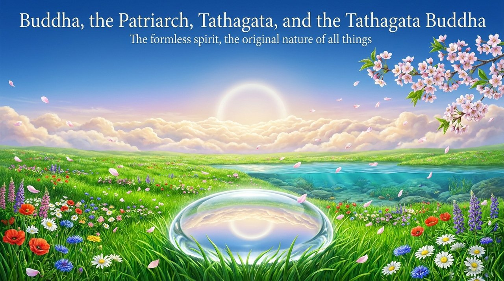
    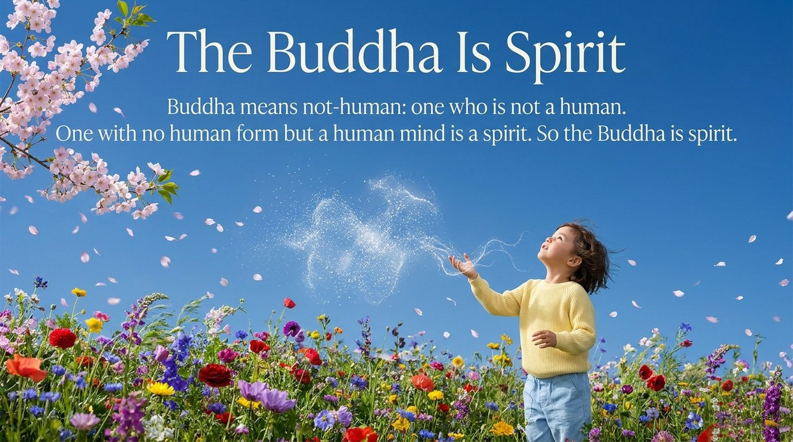
    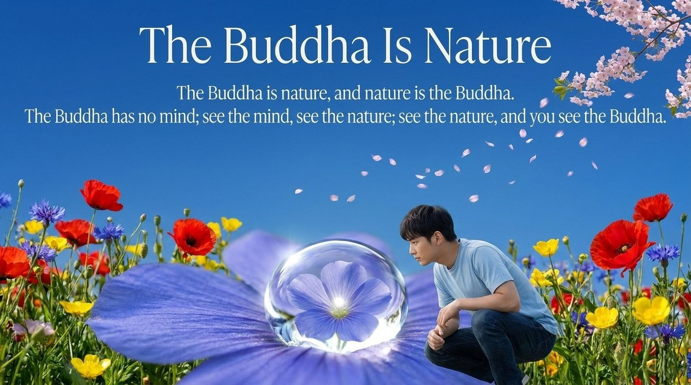
    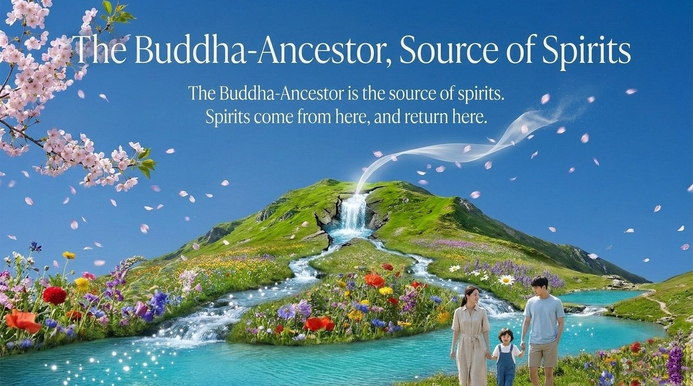
    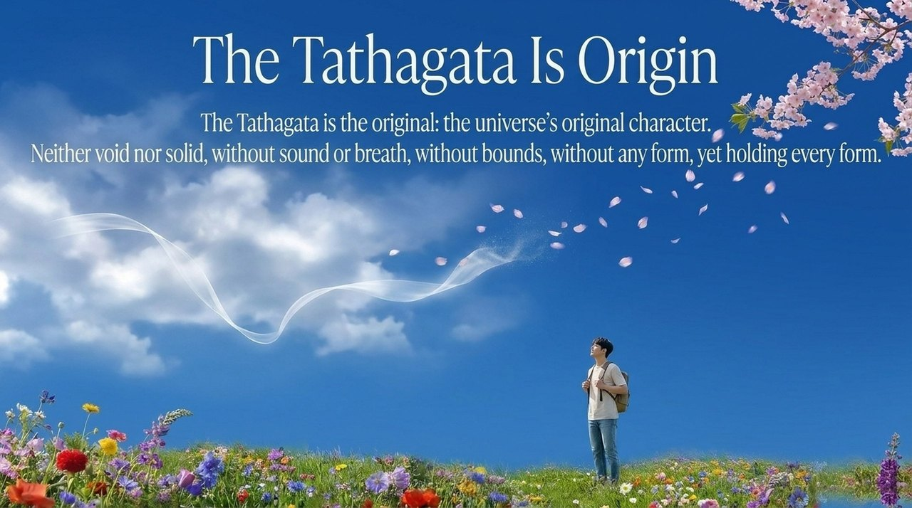
    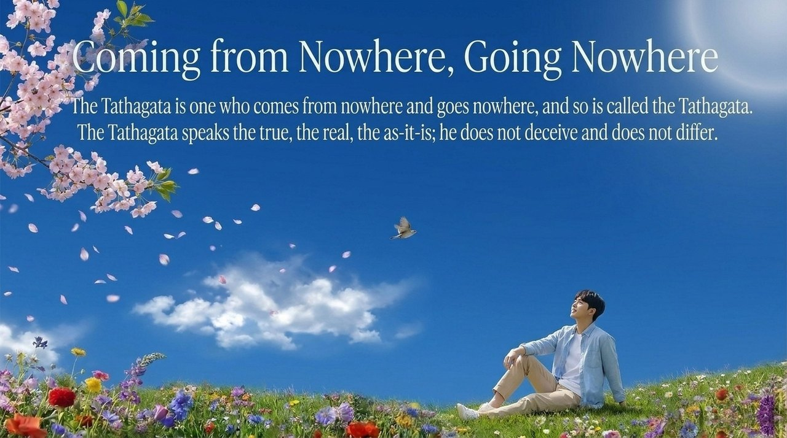
    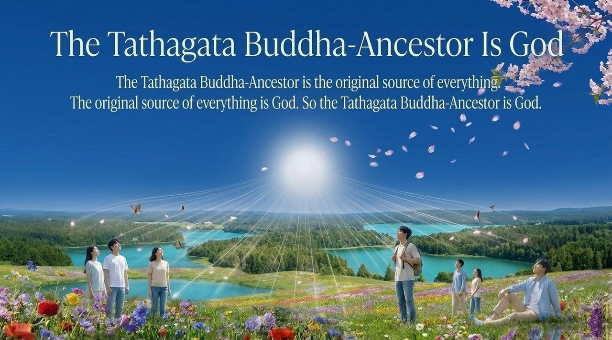
    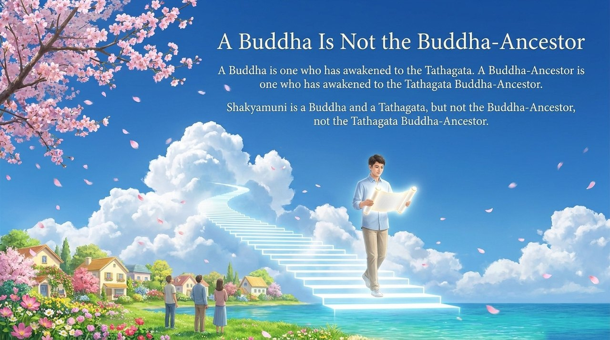
    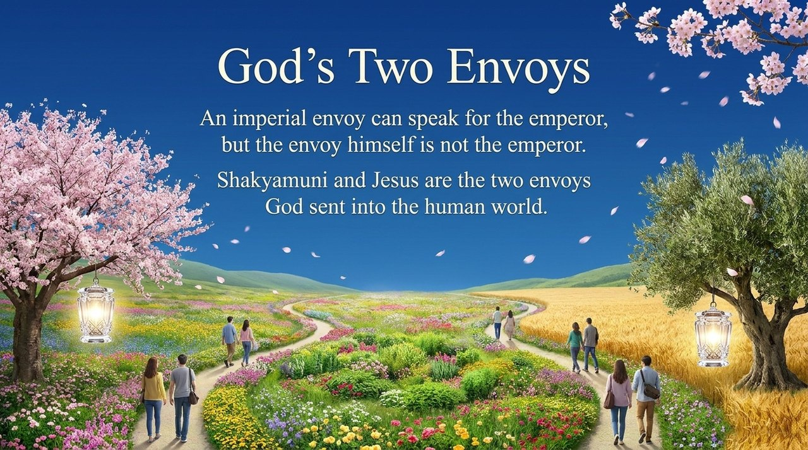
    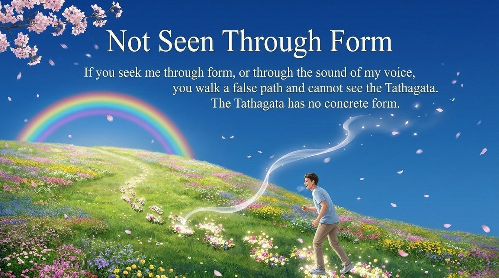
    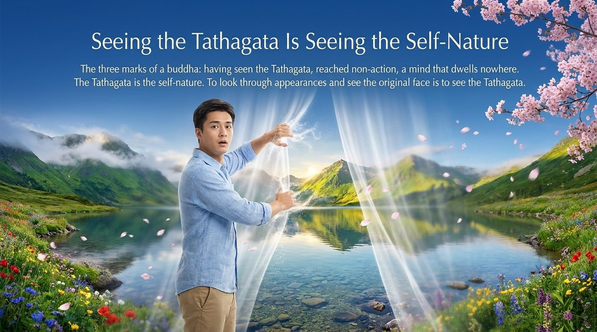
    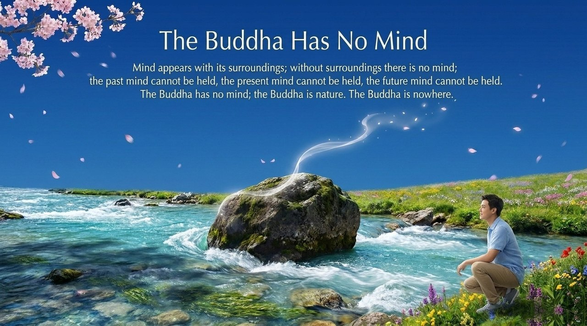
    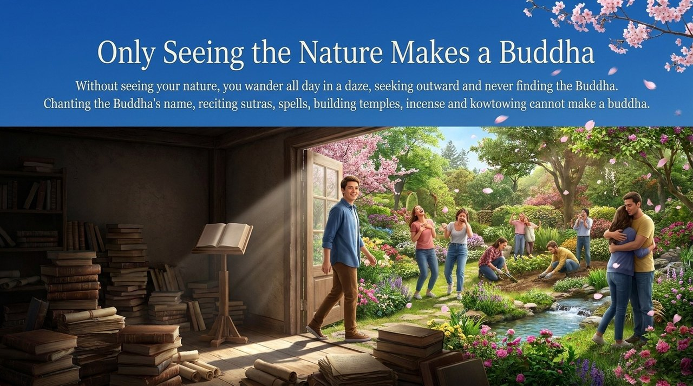
    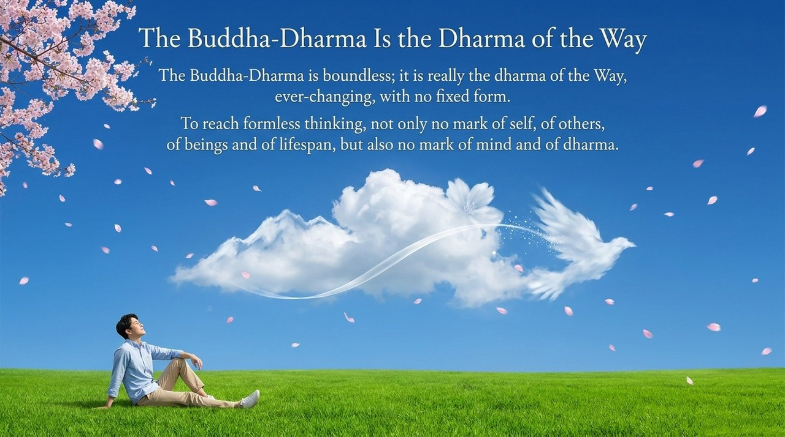

---

## Versions

| Version | Best for | Focus |
|---------|----------|-------|
| [Friendly version](friendly.md) | First-time readers | Plain language on the four concepts and the path to Buddhahood |
| [Academic version](academic.md) | Researchers | Four-concept hierarchy, Shakyamuni's position, Tathagata philosophy, comparison with traditional Buddhism |
| [Internal reference](internal.md) | Deep study | Complete source texts, three marks of Buddhahood, Buddha-nature as suchness |

---

## Related Entries

[Buddha-Dharma](/en/buddha-dharma/) · [Becoming a Buddha](/en/becoming-buddha/) · [Original Nature — Buddha Nature — Tathagata Nature](/en/self-nature/) · [Illuminate the Mind, See Nature](/en/illuminate-mind-see-nature/) · [No-Self, No-Form](/en/no-self-no-form/) · [Non-abiding Mind](/en/xinwu-suozhu-guaai/) · [The Greatest Creator](/en/greatest-creator/) · [Awakening](/en/awakening/) · [Becoming Celestial and Buddha](/en/becoming-celestial-buddha/)
