# The Chanyuan Corpus

The **Chanyuan Corpus** (禅院文集, *Chànyuàn Wénjí*) is the central body of teachings of Lifechanyuan. Spanning over one million Chinese characters across sixteen thematic sections, it covers the nature of the Greatest Creator, cosmic space-time, the mystery of LIFE, cultivation practice, the antimatter world, and the path toward civilization 3.0. Together with the *Xuefeng Corpus*, the Chanyuan Corpus forms the backbone of Lifechanyuan culture and serves as the essential guide for Chanyuan Celestials walking the Way of the Greatest Creator.

> "The Lifechanyuan Corpus and the Xuefeng Corpus tell us how to walk the Way of the Greatest Creator."
>
> — Xuefeng, *Eight Pieces of Advice to Atheists (VIII)*

| Version | Best for | Focus |
|---------|----------|-------|
| [Friendly version](friendly.md) | First-time readers | How the Corpus was written, what it contains, and how to read it |
| [Academic version](academic.md) | Researchers | Systematic analysis of its structure, function, and epistemological position |
| [Internal reference](internal.md) | Deep study | Full original quotations, unaltered |

---

## Video

<iframe style="width:100%;aspect-ratio:4/3;border:0" src="https://www.youtube-nocookie.com/embed/2UtfjiwJANA" title="The Chanyuan Corpus (Lifechanyuan Encyclopedia video)" allowfullscreen></iframe>

## Slides

??? info "📖 Illustrated slides (14 pages, click to expand)"

    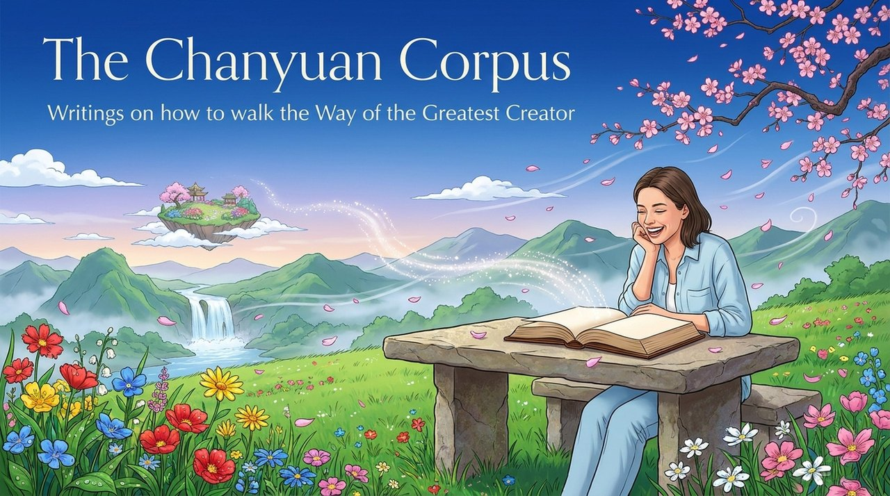
    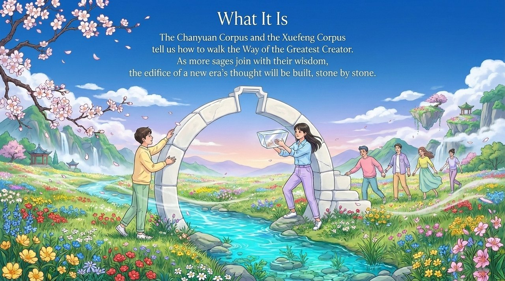
    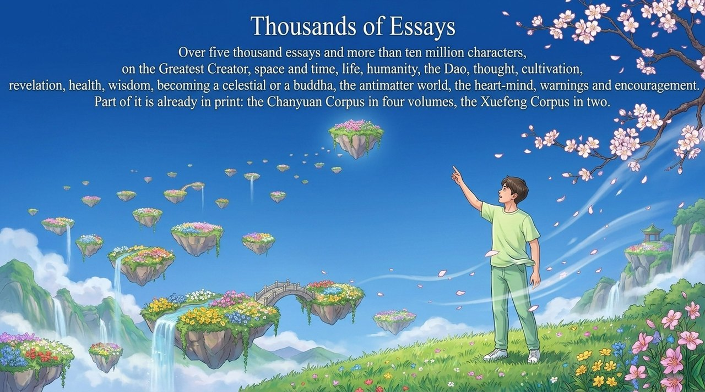
    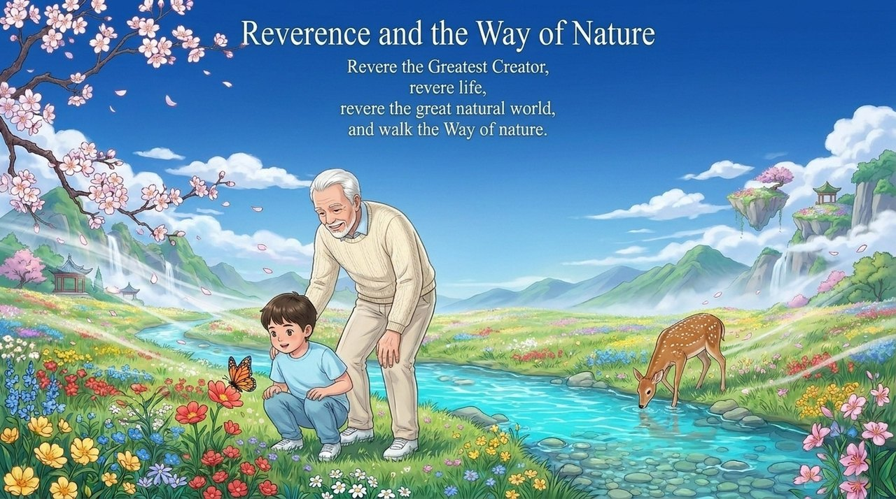
    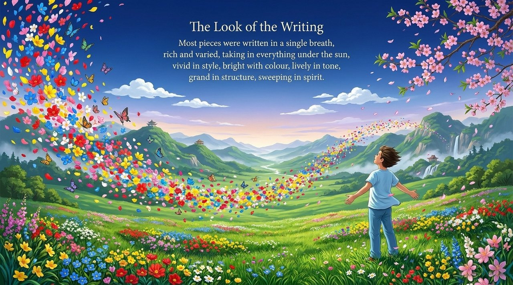
    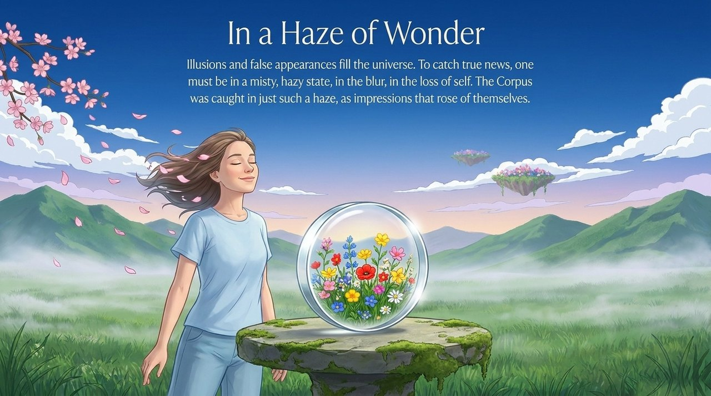
    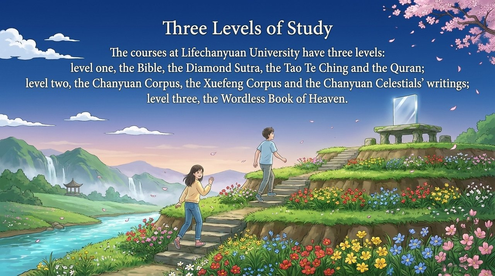
    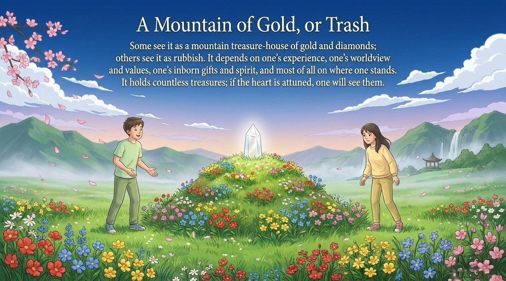
    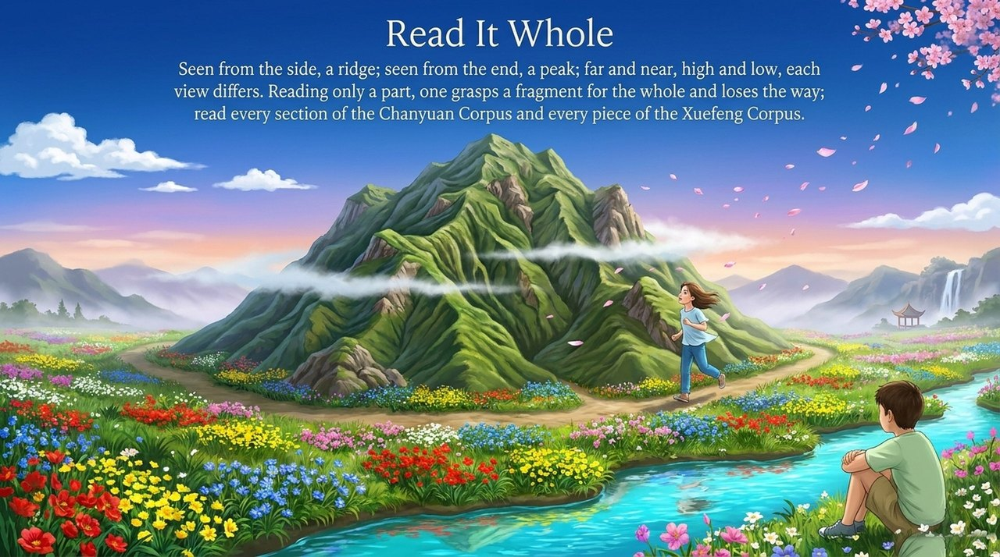
    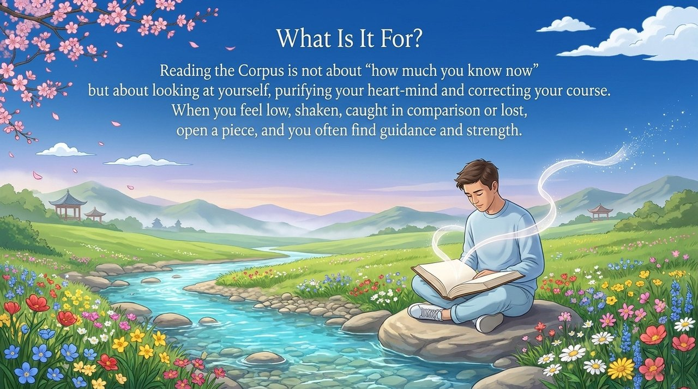
    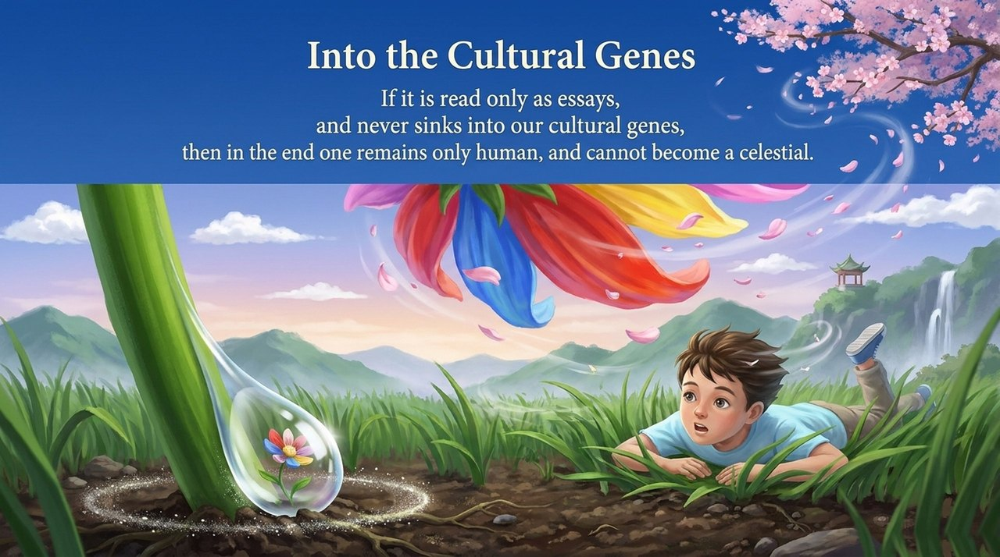
    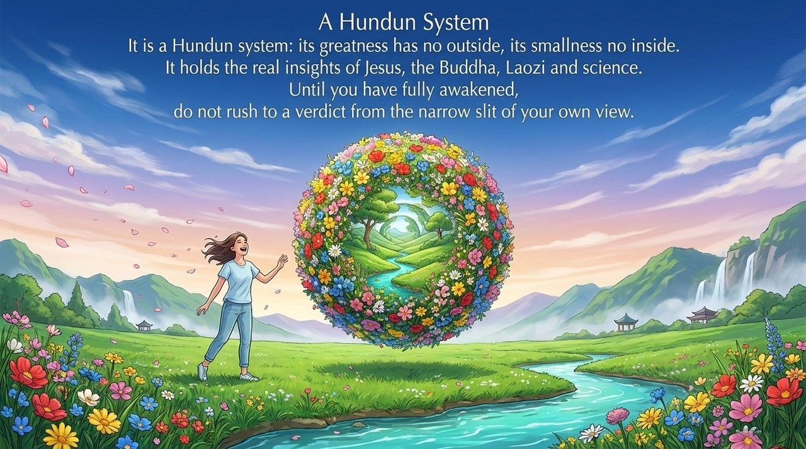
    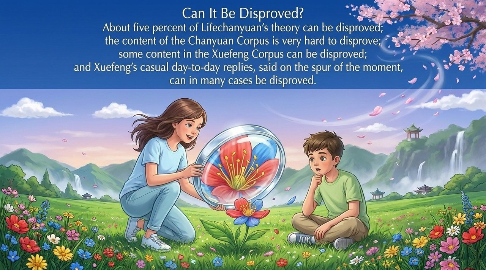
    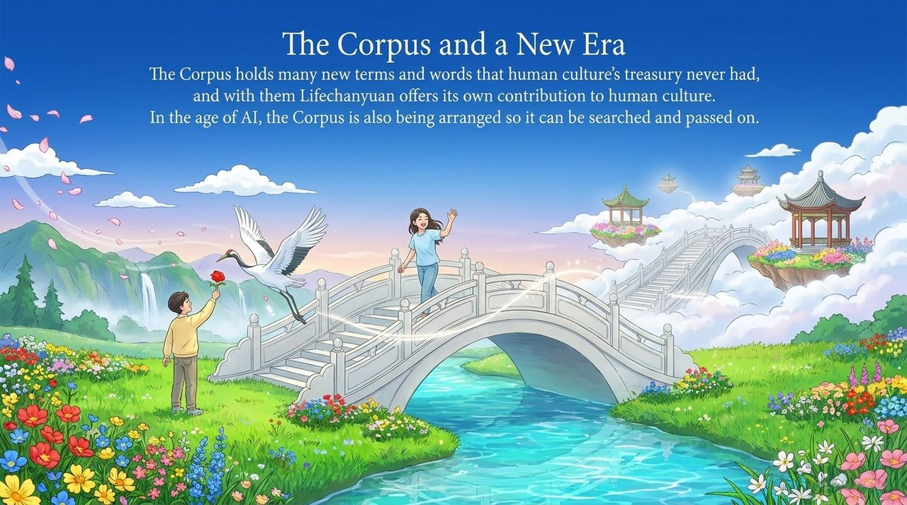

---

## Related entries

[Guide Xuefeng](/en/guide-xuefeng/) · [Lifechanyuan](/en/lifechanyuan/) · [Chanyuan Celestials](/en/chanyuan-celestials/) · [Lifechanyuan Concepts](/en/418/) · [Cultivation Practice](/en/raise-vibration-frequency/) · [Awakening](/en/awakening/)
