# Chanyuan Superhuman

A **Chanyuan Superhuman** is a Chanyuan Celestial who takes the 800 Lifechanyuan Values as the foundation of their inner consciousness, walks the path of the Greatest Creator as their sole criterion, and embodies an iron will in service of LIFE's ascent. Chanyuan Superhumans are not lone individuals but a community of superhumans — bound together by Lifechanyuan as their fortress, charged with leading humanity into the Era of Lifechanyuan.

> Once one fully understands and lives by the Lifechanyuan Values, one is a superhuman.
>
> — Xuefeng

| Version | Best for | Focus |
|---------|----------|-------|
| [Friendly version](friendly.md) | First-time readers | Who the Chanyuan Superhuman is and how to become one |
| [Academic version](academic.md) | Researchers | Conceptual analysis, comparison with Nietzsche, textual sources |
| [Internal reference](internal.md) | Deep study | Original writings in full |

---

## Video

<iframe style="width:100%;aspect-ratio:4/3;border:0" src="https://www.youtube-nocookie.com/embed/uuPq3N_JyrU" title="Chanyuan Superhuman (Lifechanyuan Encyclopedia video)" allowfullscreen></iframe>

## Slides

??? info "📖 Illustrated slides (14 pages, click to expand)"

    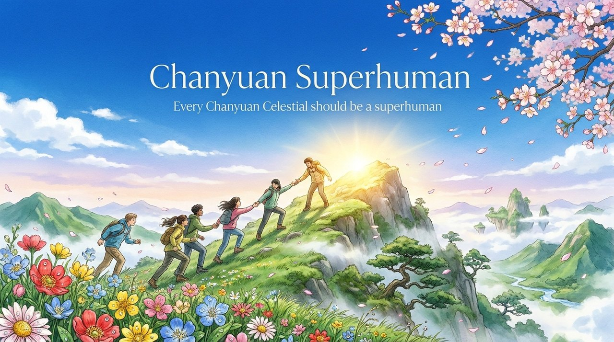
    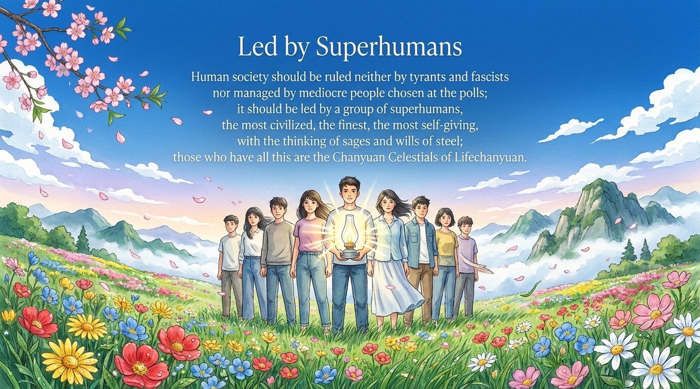
    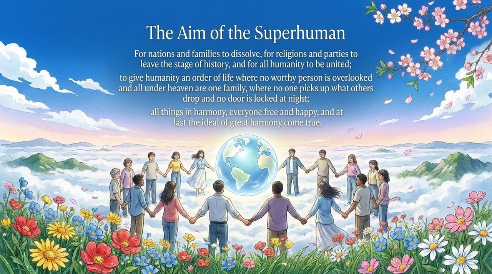
    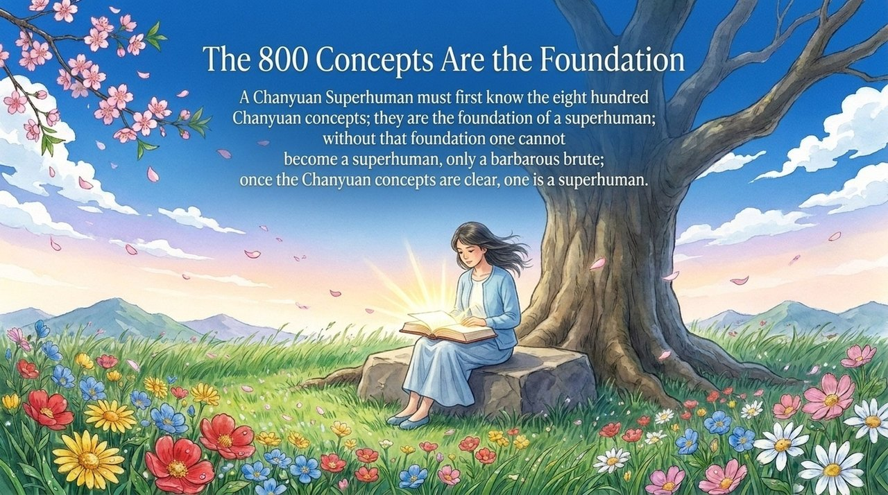
    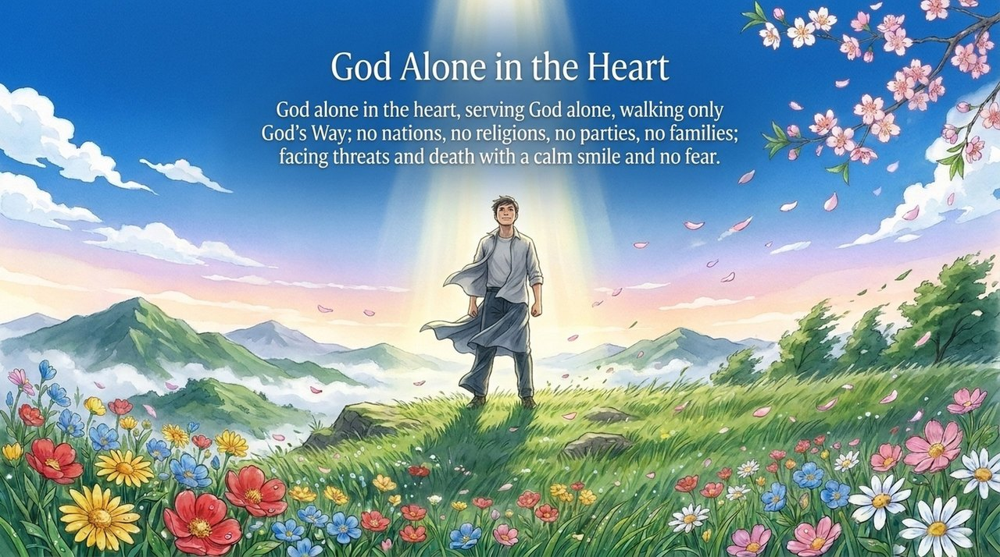
    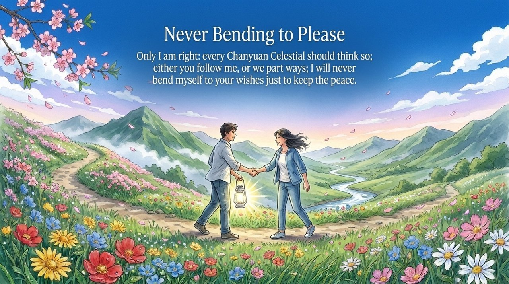
    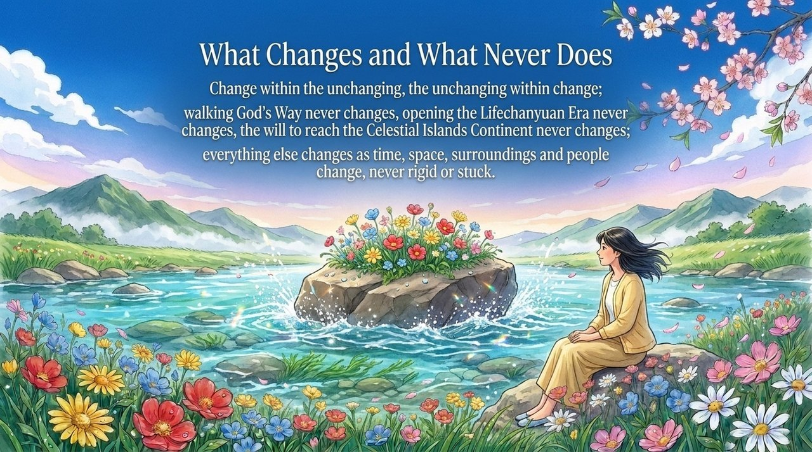
    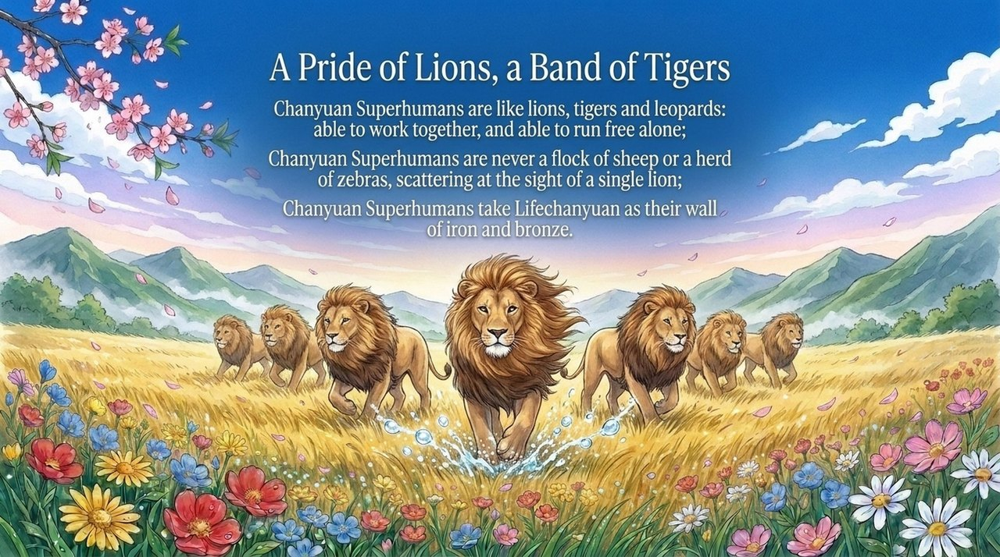
    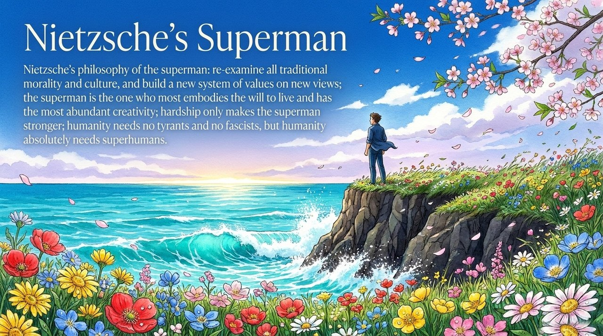
    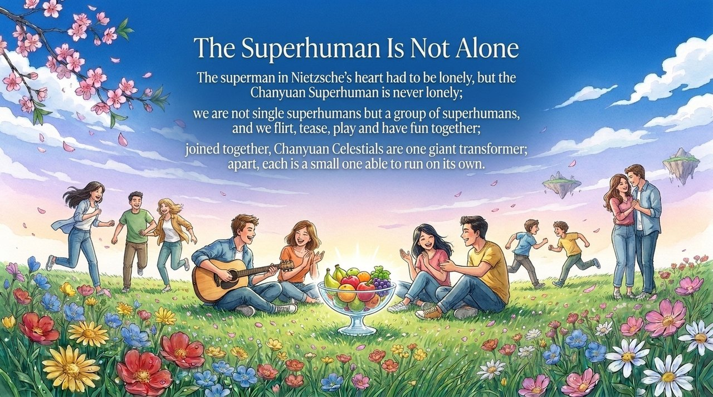
    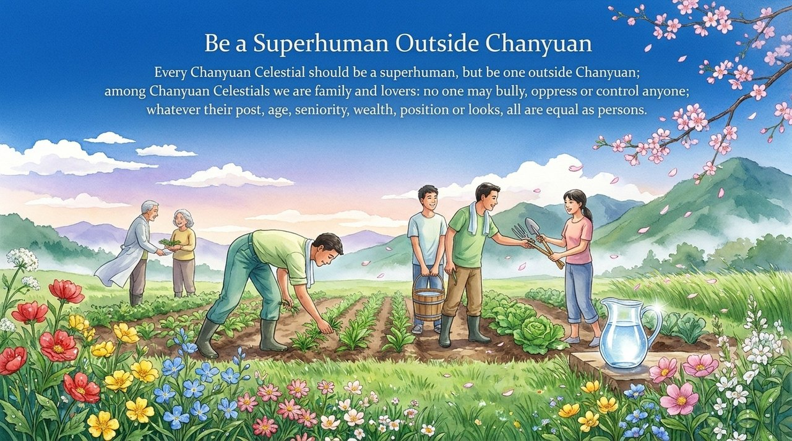
    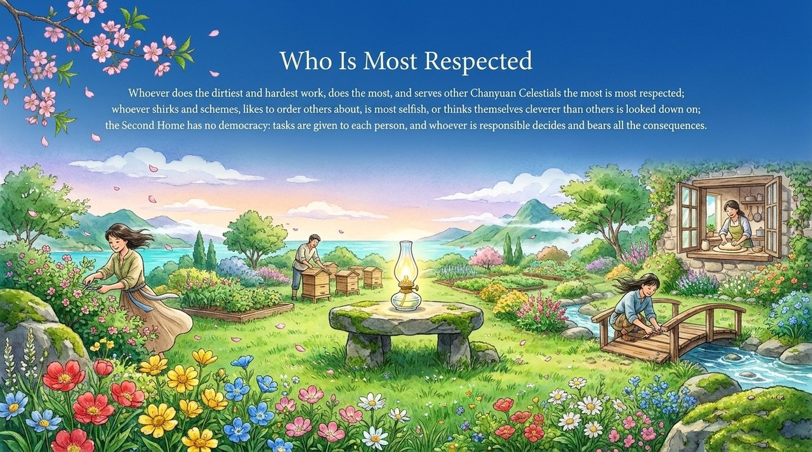
    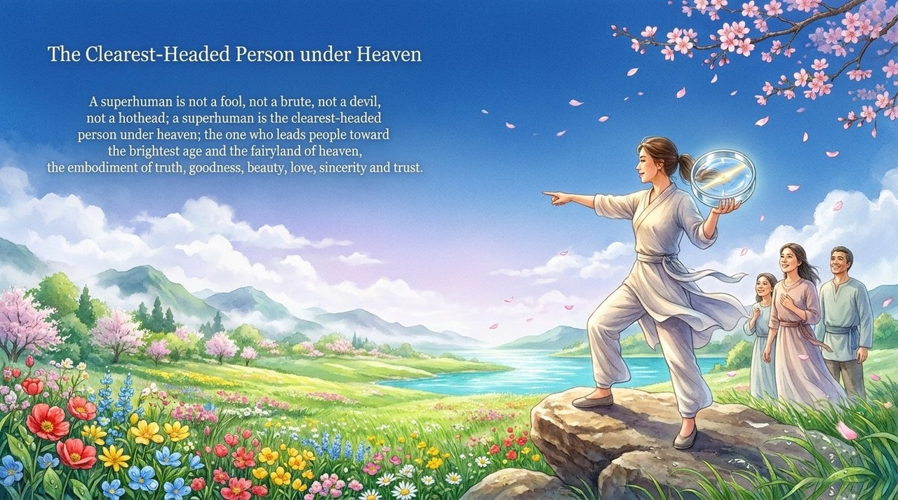
    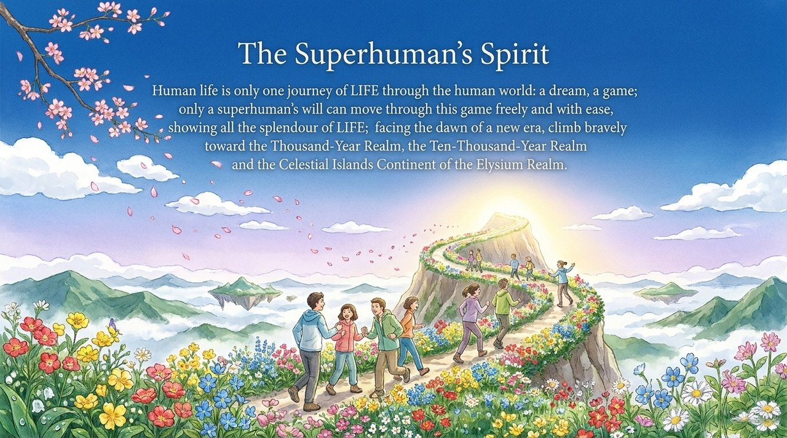

---

**Related entries:**
[Chanyuan Celestials](/en/chanyuan-celestials/) · [Values](/en/values/) · [New Era Human 800 Concepts](/en/new-era-human-800-concepts/) · [Transcending the Ordinary](/en/chaofantuosu/) · [Becoming a Celestial Being](/en/becoming-celestial/) · [Awakening](/en/awakening/) · [Hundun Management](/en/hundun-management/) · [Lifechanyuan Era (New Era)](/en/lifechanyuan-new-era/)
