<!-- id: LC-CLN-0001-EN theme: Cultivation Practice type: index direction: Life Cultivation lang: en -->

# Childlike Nature

**Childlike Nature** (小孩子模样, *xiǎo háizi múyàng*) is a central attainment concept in the Life Chanyuan cultivation system. Rooted in Jesus Christ's teaching — "Unless you turn and become like children, you will never enter the kingdom of heaven" — it is understood in Life Chanyuan as pointing toward the same spiritual state as Laozi's "return to the infant" and the Buddha's "liberation from all forms": a heart of natural purity, carefree joy, and free play, unencumbered by worldly ambition, social masks, or moral rigidity. This childlike state is described as a necessary condition for entering the Thousand-Year World and higher celestial realms.

> The appearance of a child means: mischievous, lively, playful, simple, innocent, naive, sincere — in a word, the appearance of joyful, happy play. That is the appearance of a child.
>
> — Xuefeng's Collected Works · Chanyuan Essays · Playing in the Game, Building in the Game

---

## Version Navigation

| Version | Best for | Focus |
|---------|----------|-------|
| [Friendly version](friendly.md) | First-time readers | What does "becoming like a child" feel like? Why does Heaven need it? How to reclaim it? |
| [Academic version](academic.md) | Researchers | Three-tradition synthesis, purity mechanism, two types of "not grown up," Life Chanyuan cosmology |
| [Internal reference](internal.md) | Deep study | Complete source texts, cultivation methods, obstacles, celestial descriptions |

---

## Video

<iframe style="width:100%;aspect-ratio:4/3;border:0" src="https://www.youtube-nocookie.com/embed/Ka3-o5_5hsQ" title="Childlike Nature (Lifechanyuan Encyclopedia video)" allowfullscreen></iframe>

## Slides

??? info "📖 Illustrated slides (14 pages, click to expand)"

    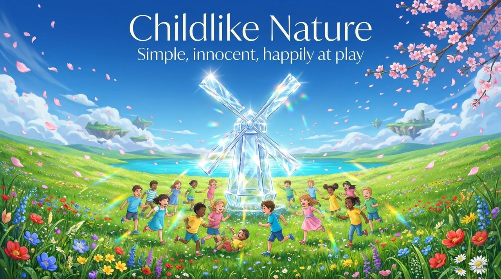
    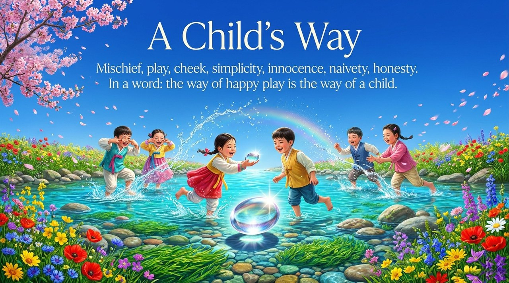
    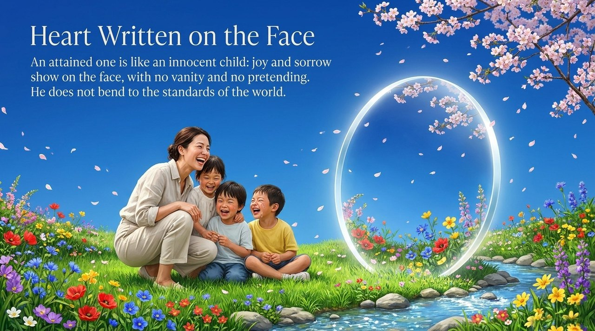
    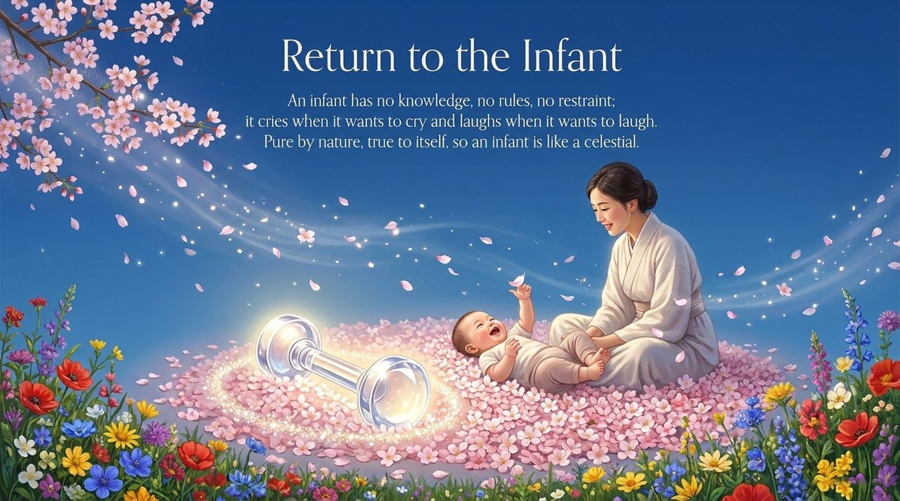
    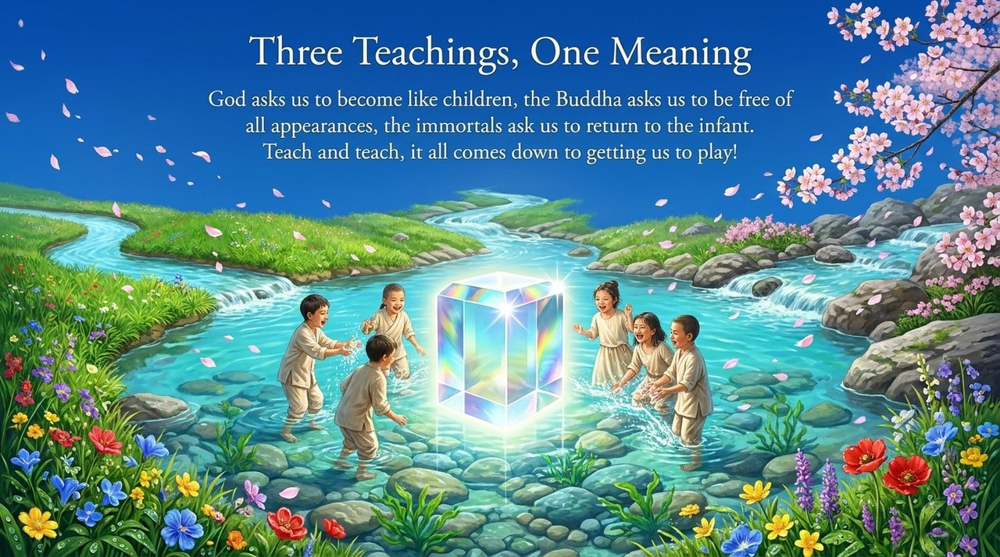
    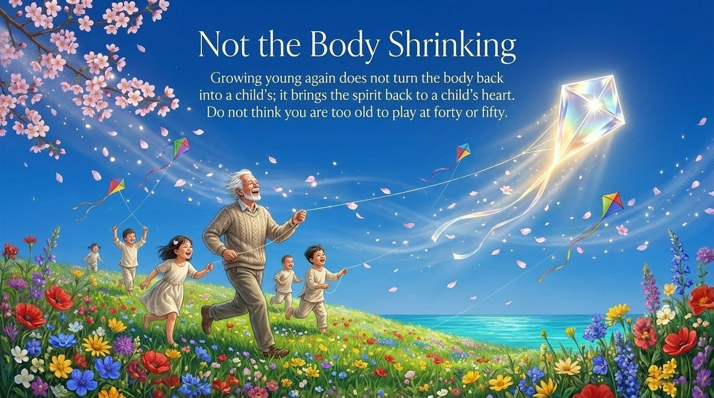
    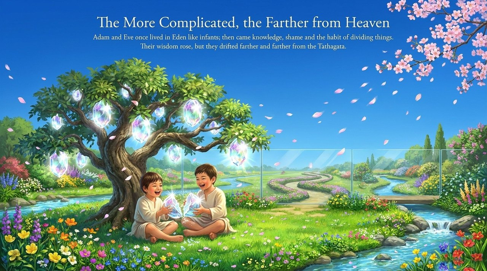
    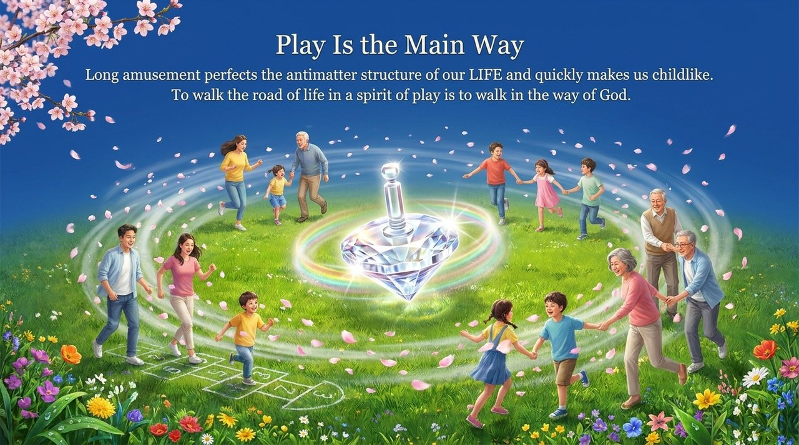
    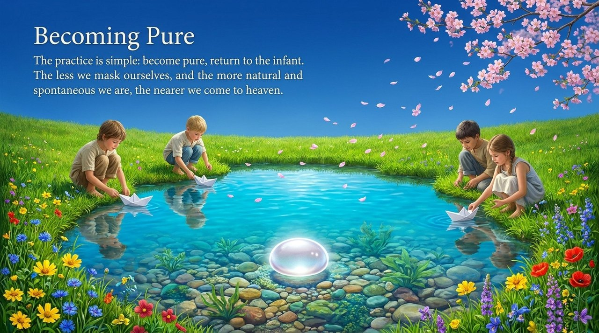
    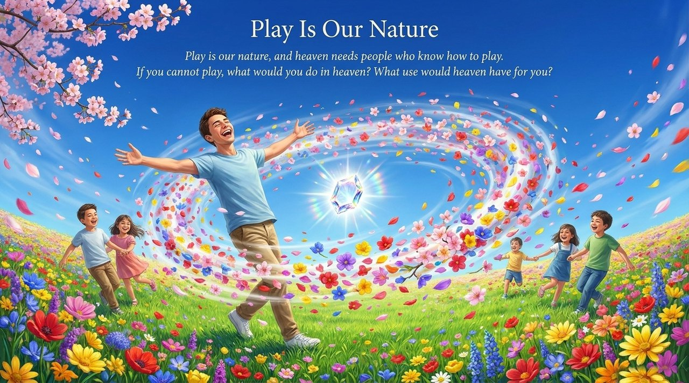
    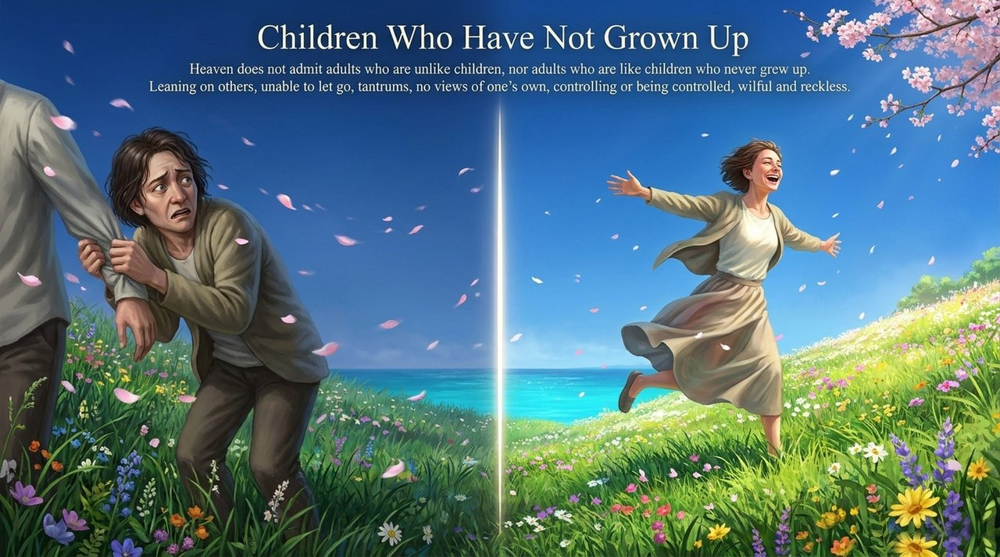
    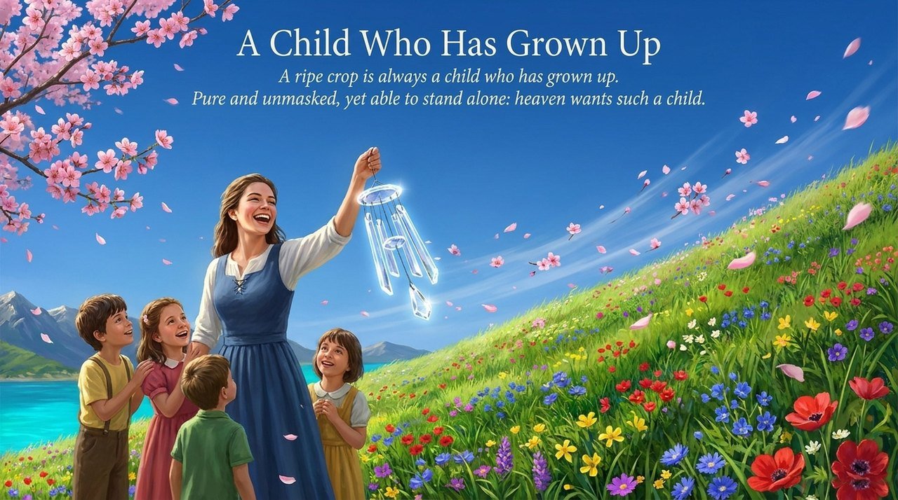
    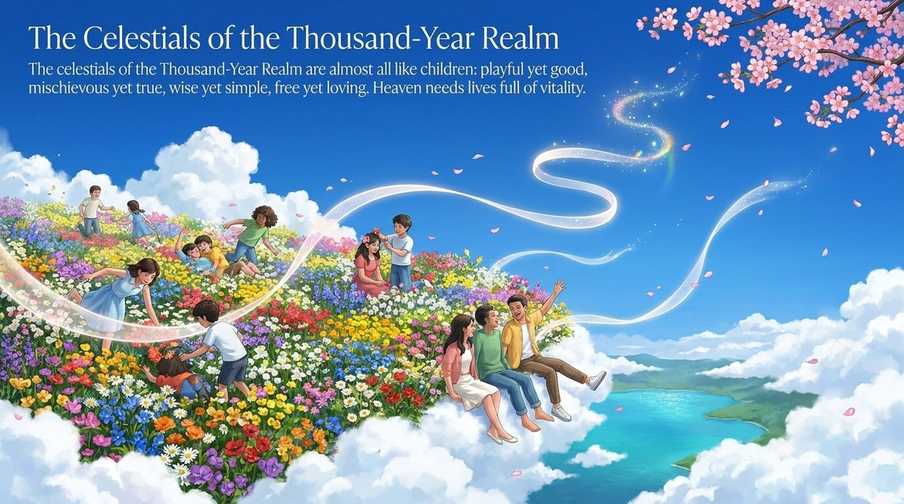
    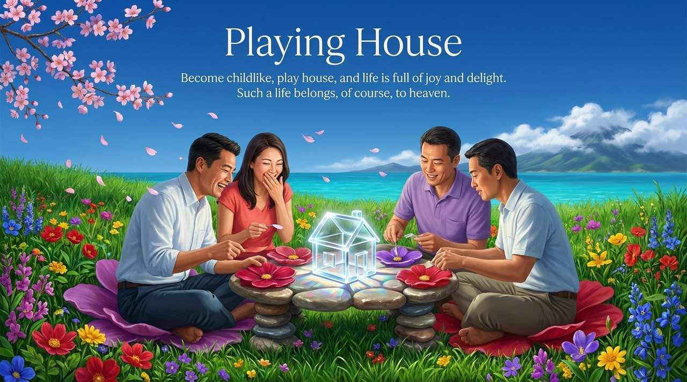

---

## Related Entries

[Rejuvenation (Eternal Youth · Immortality)](/en/fanlaohuantong/) · [Following Natural Impulse](/en/suixing-er-dong/) · [Fluid Adaptability](/en/linghuoyuanrong/) · [No-Self, No-Form](/en/no-self-no-form/) · [Illuminating the Mind, Seeing True Nature](/en/illuminate-mind-see-nature/) · [Self-Nature · Buddha-Nature · Tathāgata Nature](/en/self-nature/) · [Primordial Hundun](/en/hundun-baby/) · [Heavenly Treasures](/en/heavenly-treasures/) · [Route to Heaven](/en/route-to-heaven/) · [Meditation and Stillness Practice](/en/settled-stillness/)
