<!-- id: LC-CG-0001-EN theme: Cultivation type: Navigation direction: Life Practice lang: en -->

# Complaining and Grumbling

In the Lifechanyuan system, complaining and grumbling (埋怨·抱怨) are identified as the sixth of the eighteen factors that cause human suffering — a "poisoned arrow aimed at others," and one of twenty forms of mental filth that must be cleansed before the soul can enter the Kingdom of Heaven.

The root cause is this: reality is a projection of one's own consciousness, and all circumstances arise from cause and effect. Yet when things go wrong, people habitually blame the outside world. The more selfish a person is, the more they complain; a person with a grateful heart carries no resentment. Lifechanyuan's path of cultivation calls for "no resentment toward Heaven, Earth, society, or others" — turning outward blame inward through reflection and gratitude.

---

## Video

<iframe style="width:100%;aspect-ratio:4/3;border:0" src="https://www.youtube-nocookie.com/embed/C7yoTL6VwZ4" title="Complaining and Grumbling (Lifechanyuan Encyclopedia video)" allowfullscreen></iframe>

## Slides

??? info "📖 Illustrated slides (14 pages, click to expand)"

    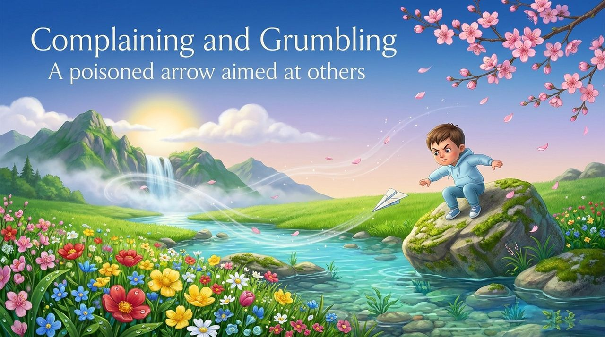
    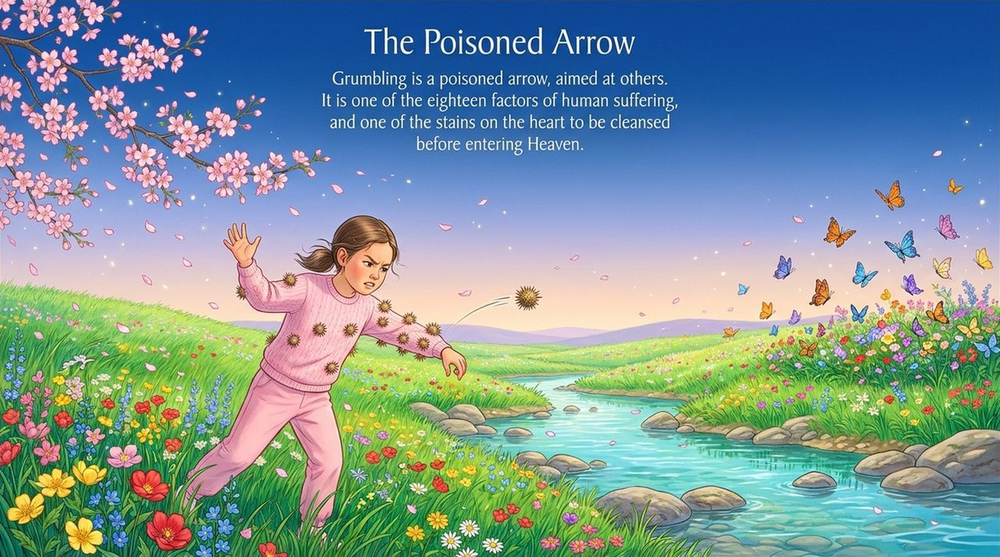
    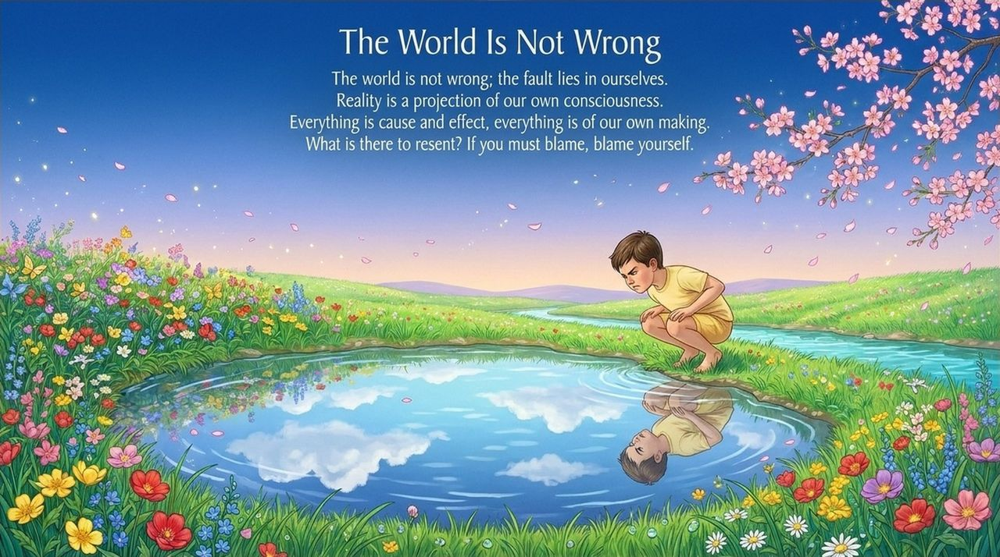
    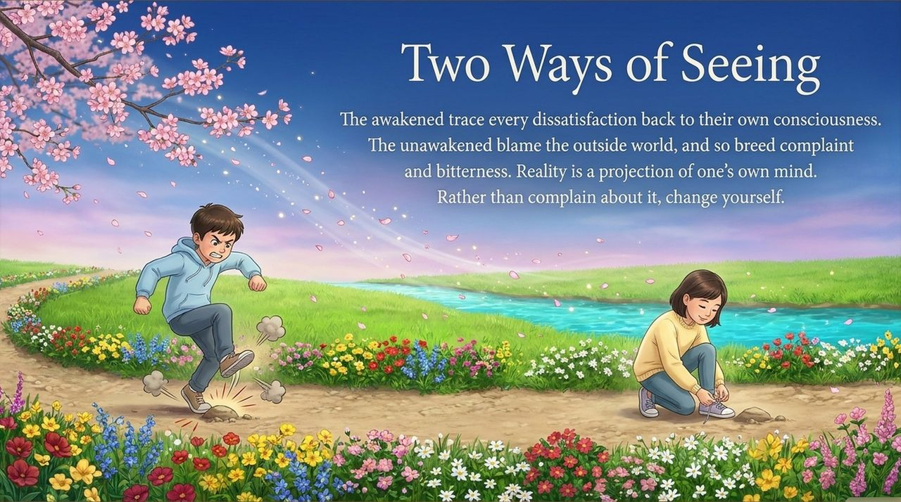
    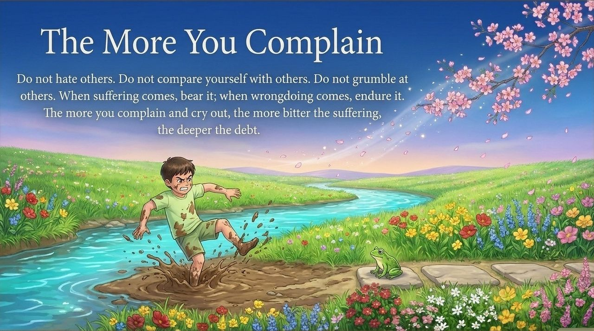
    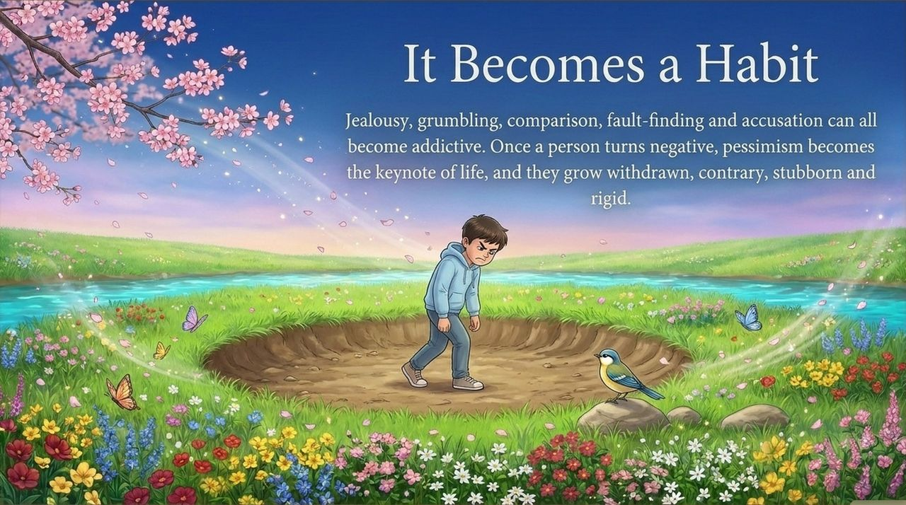
    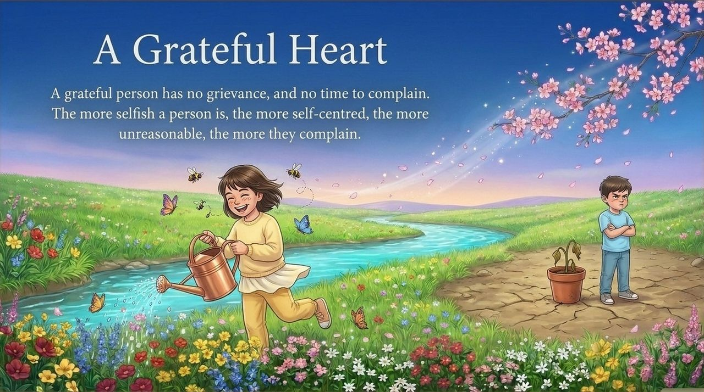
    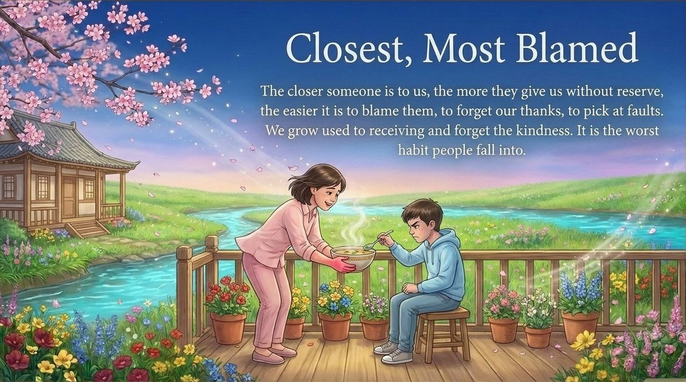
    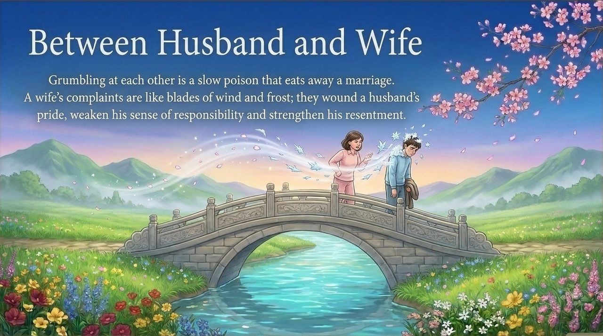
    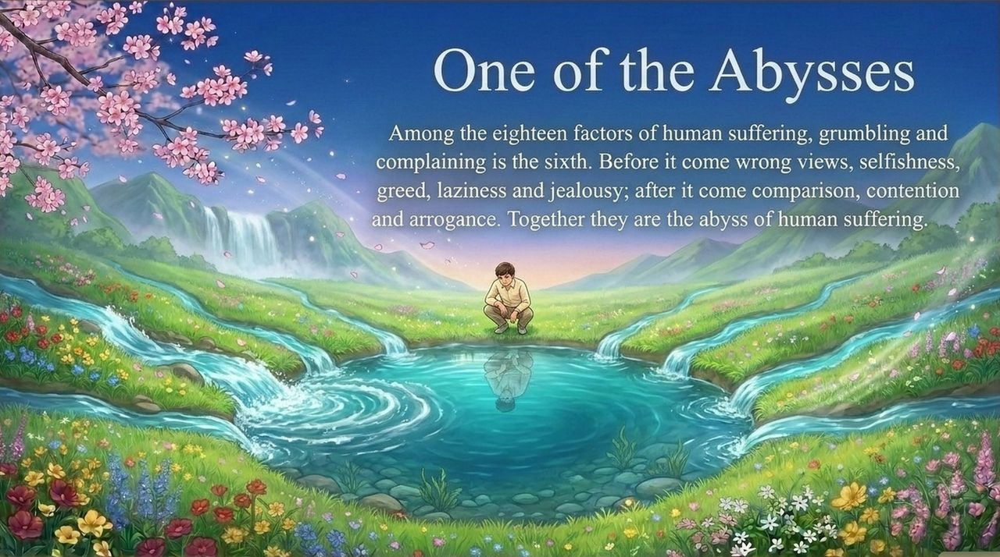
    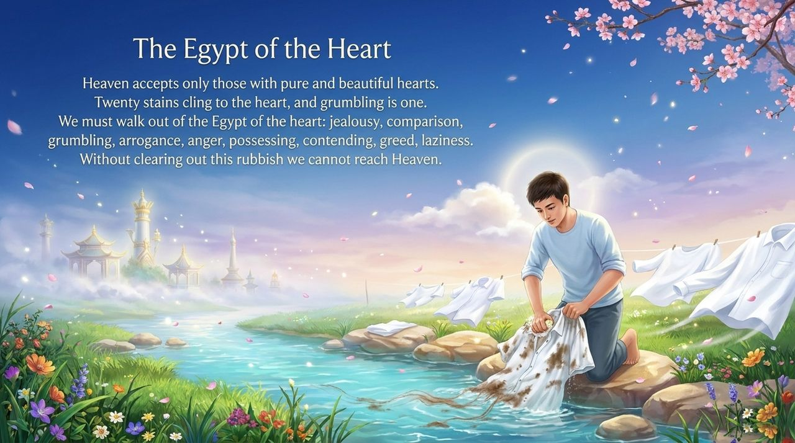
    
    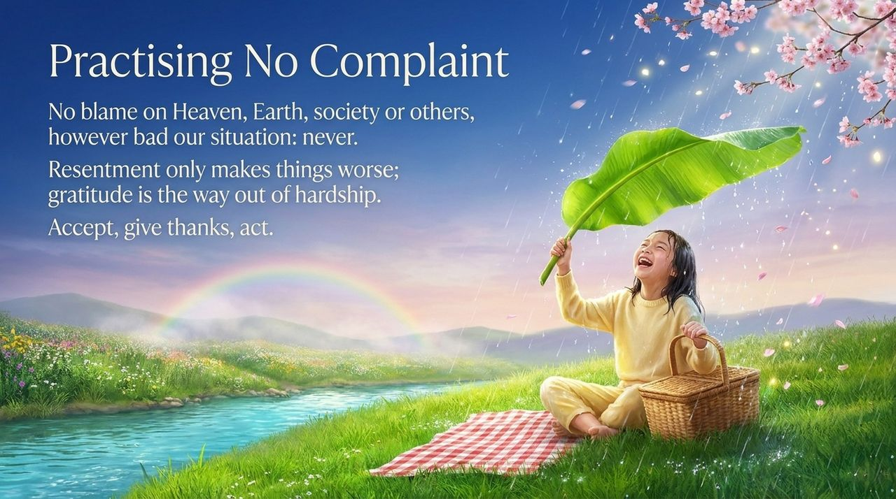
    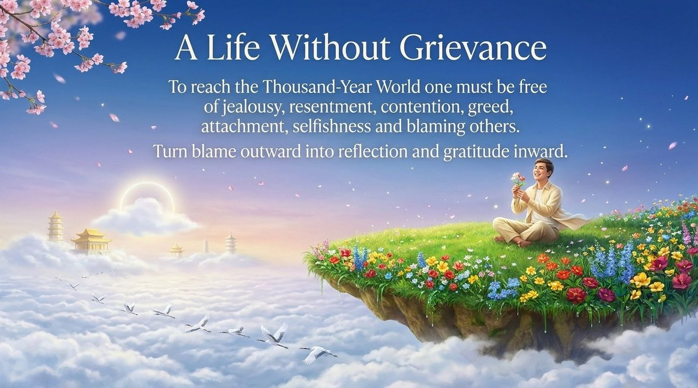

---

## Version Navigation

| Version | Best for | Focus |
|---------|----------|-------|
| [Friendly version](friendly.md) | First-time readers | Life scenarios · the poisoned-arrow metaphor · path to change |
| [Academic version](academic.md) | Researchers | Conceptual analysis · system position · gratitude as antidote |
| [Internal reference](internal.md) | Deep study | Complete source texts · six-section framework · heavenly barriers |

---

## Related Entries

[Gratitude](/en/gratitude/) · [Jealousy and Envy](/en/jealousy-envy/) · [Forgiveness](/en/forgiveness/) · [Letting Go](/en/letting-go/) · [Repentance](/en/repentance/) · [Selfishness and Selflessness](/en/zisi-wusi/) · [Standards of Perfect Human Nature](/en/perfect-human-nature/) · [Awakening](/en/awakening/) · [Heavenly Treasures](/en/heavenly-treasures/) · [Morality](/en/morality/)
