<!-- id: LC-CIC-0001-EN theme: Mystery of LIFE type: Index lang: en -->

# Complete Independent Consciousness

Complete Independent Consciousness is one of the central concepts of Lifechanyuan's cultivation system. It describes a state in which a person's worldview, life-view, values, and cosmology align with the Way of the Greatest Creator — and on that foundation, the person can handle all affairs of the human journey with ease, without being swayed or controlled by other people's consciousness. It is the prerequisite for Self-Coherence (the highest state of cultivation) and the key by which Chanyuan Celestials move from the Kingdom of Necessity into the Kingdom of Freedom.

---

- [Friendly Edition](friendly.md) — Understanding Complete Independent Consciousness in everyday terms
- [Academic Edition](academic.md) — Systematic analysis and source references
- [Internal Edition](internal.md) — Original texts and complete exposition

---

## Video

<iframe style="width:100%;aspect-ratio:4/3;border:0" src="https://www.youtube-nocookie.com/embed/Q58JwqJfnvU" title="Complete Independent Consciousness (Lifechanyuan Encyclopedia video)" allowfullscreen></iframe>

## Slides

??? info "📖 Illustrated slides (14 pages, click to expand)"

    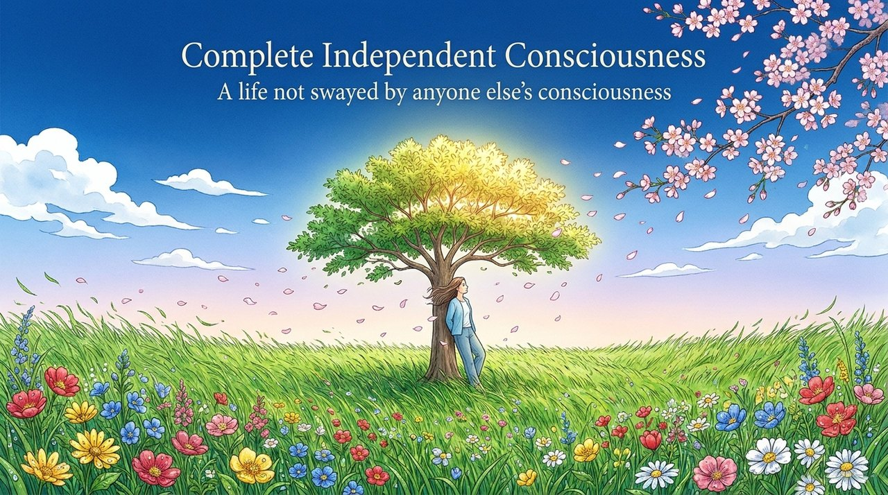
    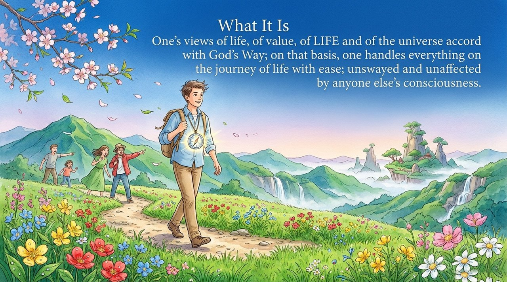
    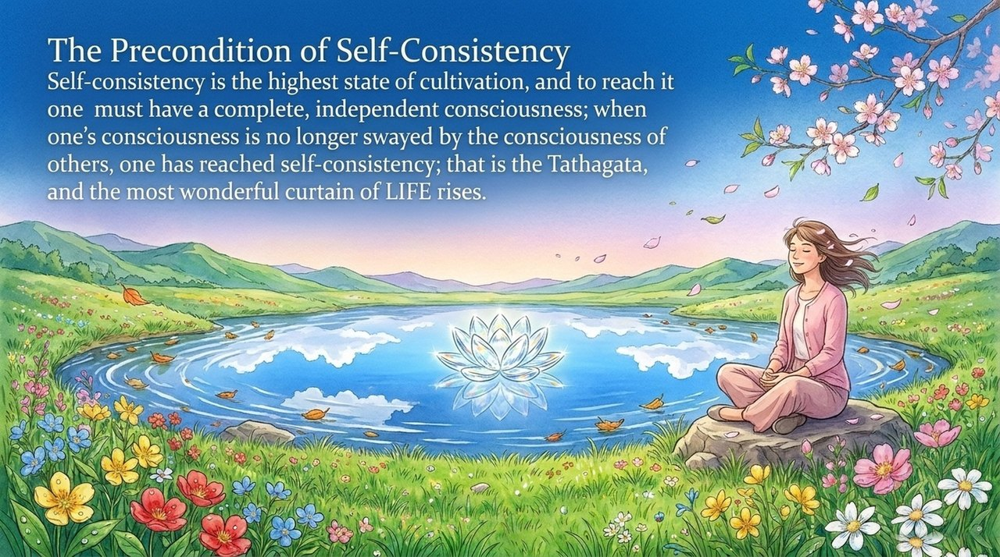
    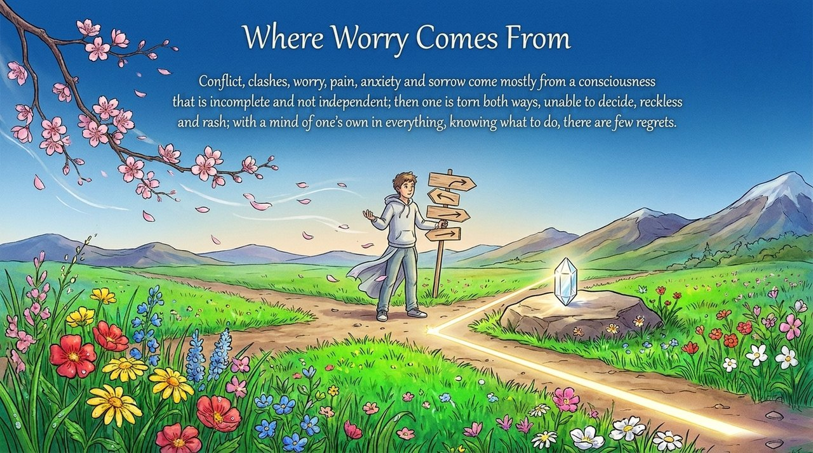
    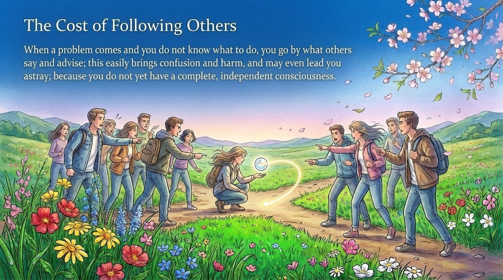
    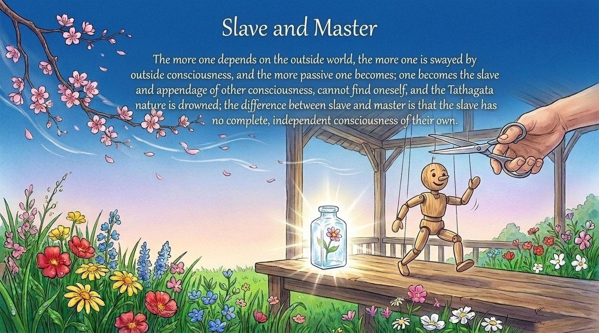
    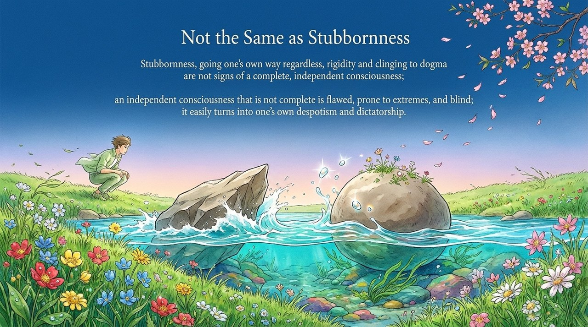
    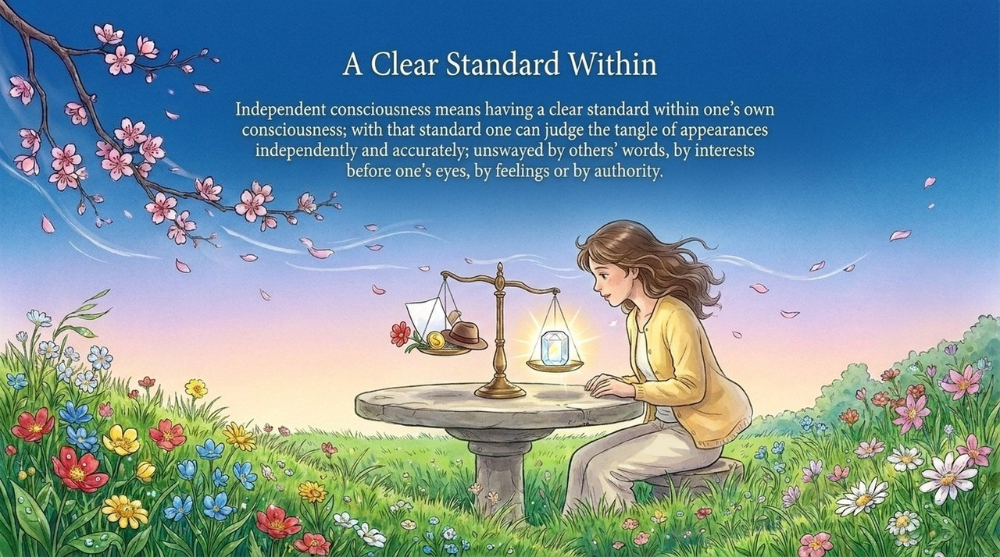
    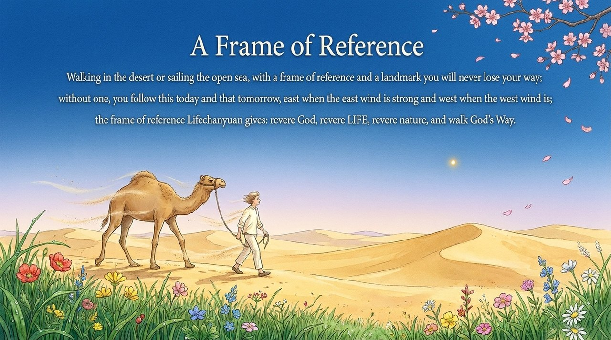
    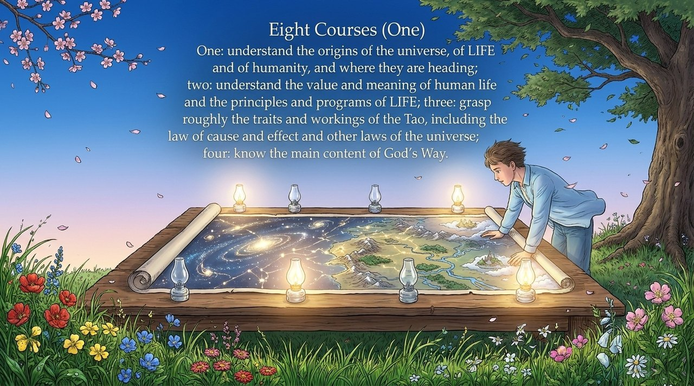
    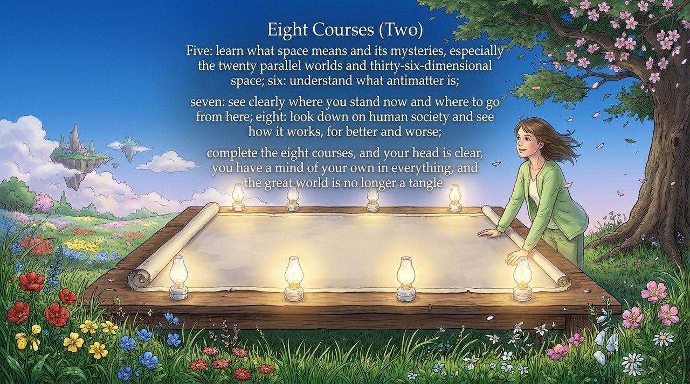
    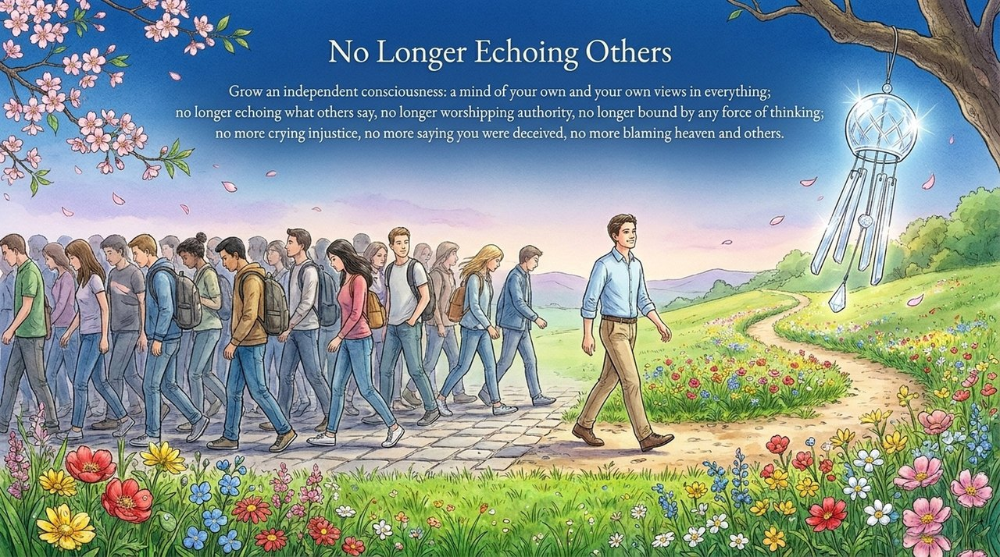
    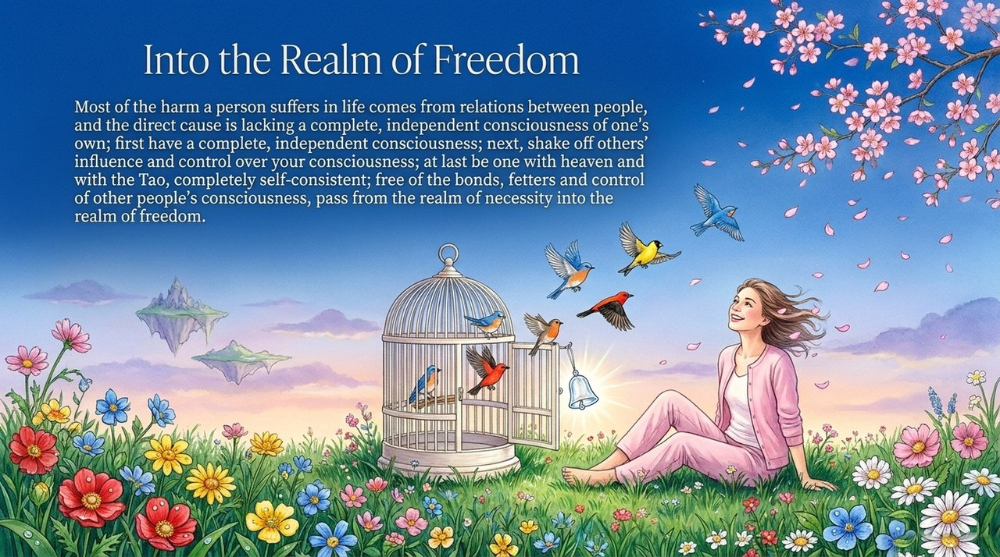
    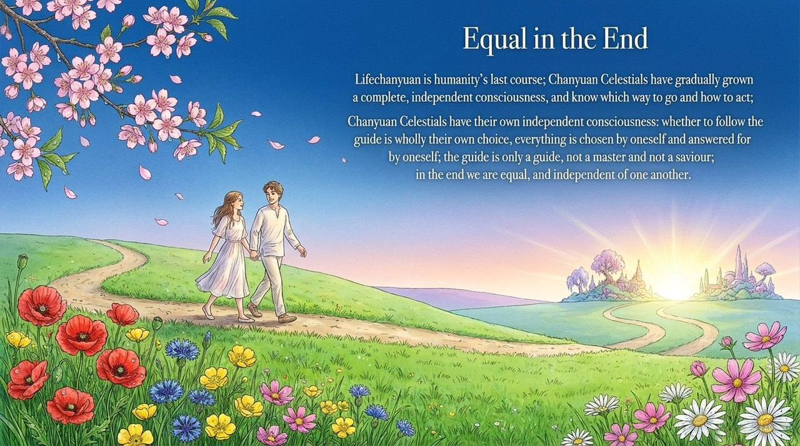

---

**Related entries:** [Self-Coherence](/en/self-coherence/) · [Awakening](/en/awakening/) · [Consciousness](/en/consciousness/) · [Dao](/en/dao/) · [Thirty-Six-Dimensional Space](/en/thirty-six-dimensional-space/) · [Antimatter Structure](/en/antimatter-structure/)
