# Detachment and Serenity

**Detachment and Serenity** (淡泊明志·宁静致远, *dàn bó míng zhì · níng jìng zhì yuǎn*) draws on the classical Chinese saying "Only through detachment can the will be clarified; only through serenity can the distant be reached." In the Lifechanyuan system, Guide Xuefeng interprets this as the foundational inner disposition for cultivation: detachment cuts through the fog of worldly ambition to reveal the true path, while serenity is the dwelling place of divine wisdom — only in stillness can higher guidance be received, and only then can life reach its true potential.

> Detachment clarifies the will; serenity reaches the distant. Those who seek transcendence must not overlook this.
>
> — Chanyuan Corpus · Immortal Cultivation · "Detachment and Serenity"

## Video

<iframe style="width:100%;aspect-ratio:4/3;border:0" src="https://www.youtube-nocookie.com/embed/0FncHKNzshw" title="Detachment and Serenity (Lifechanyuan Encyclopedia video)" allowfullscreen></iframe>

## Slides

??? info "📖 Illustrated slides (14 pages, click to expand)"

    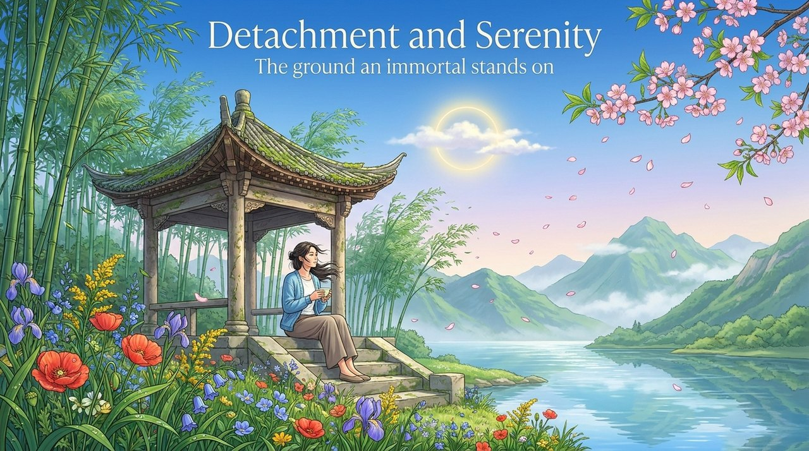
    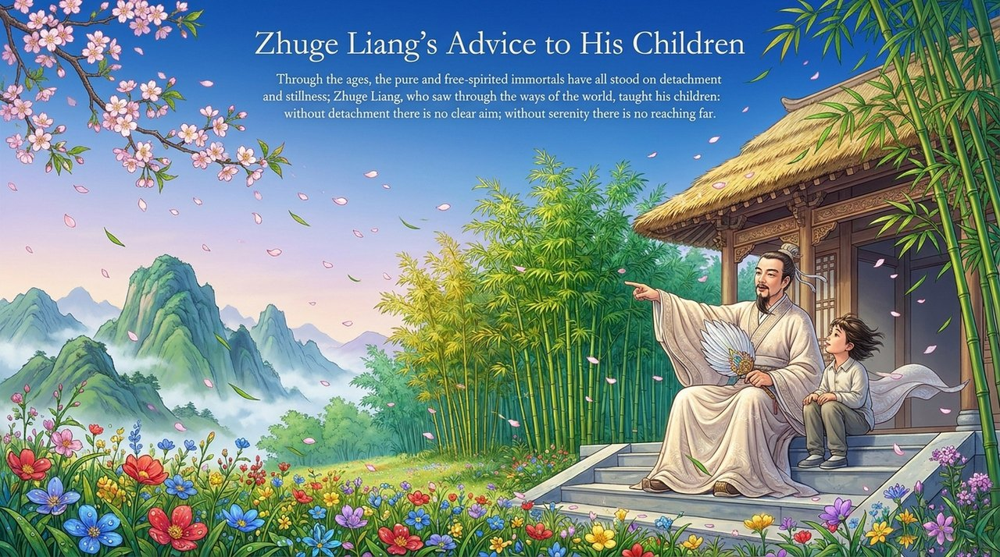
    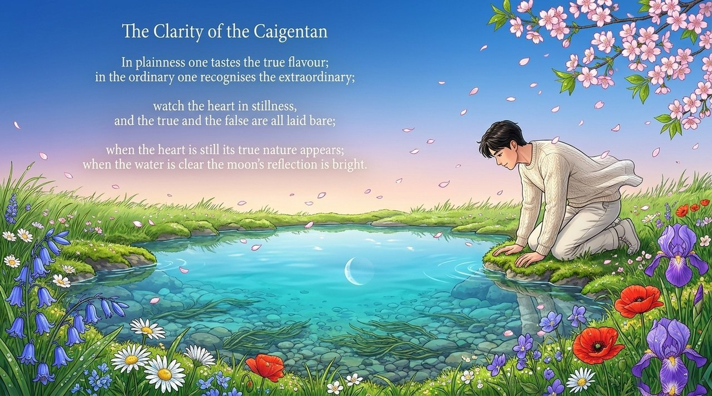
    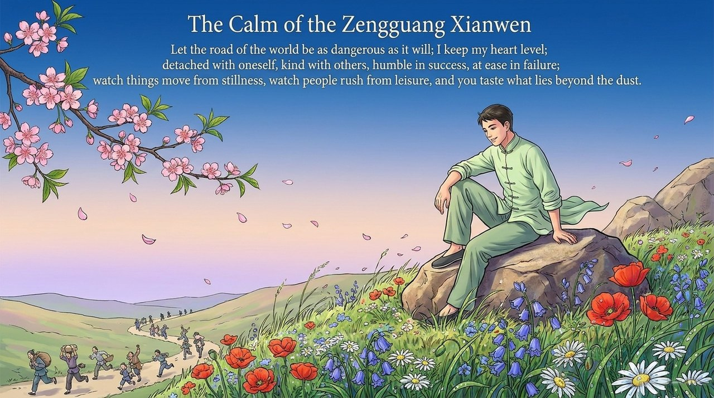
    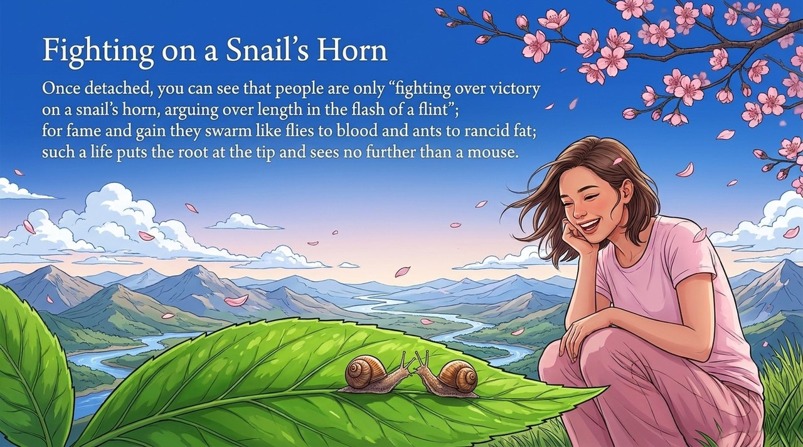
    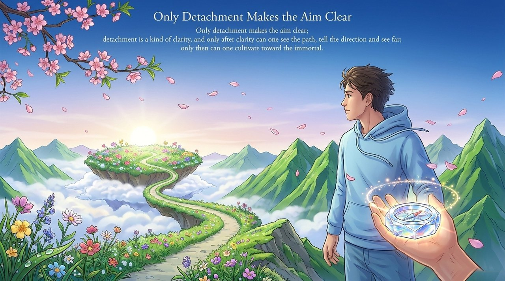
    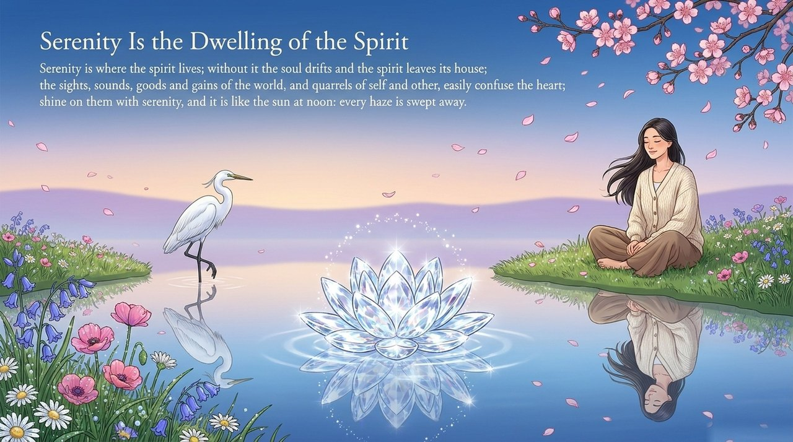
    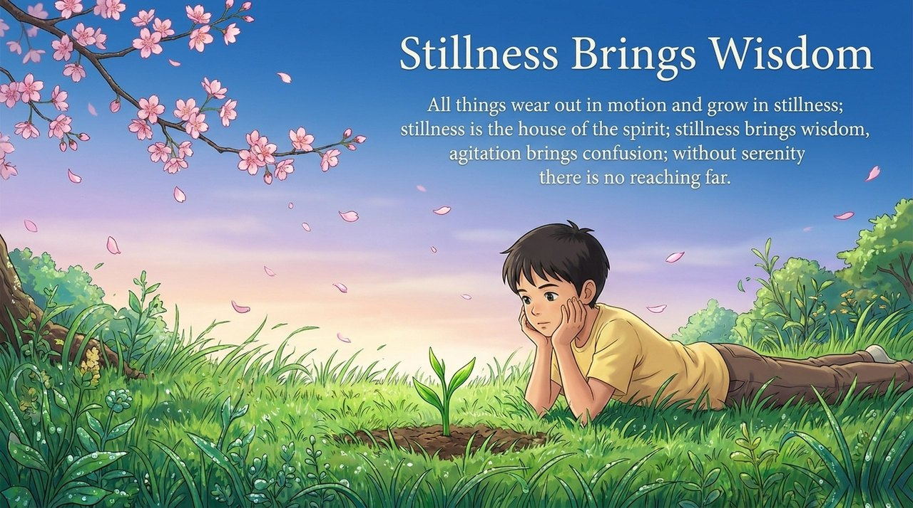
    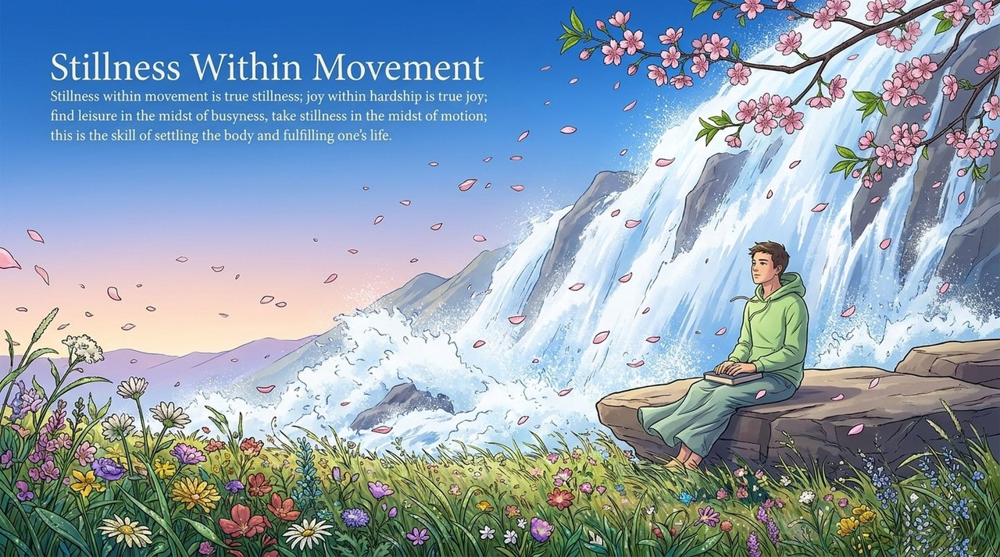
    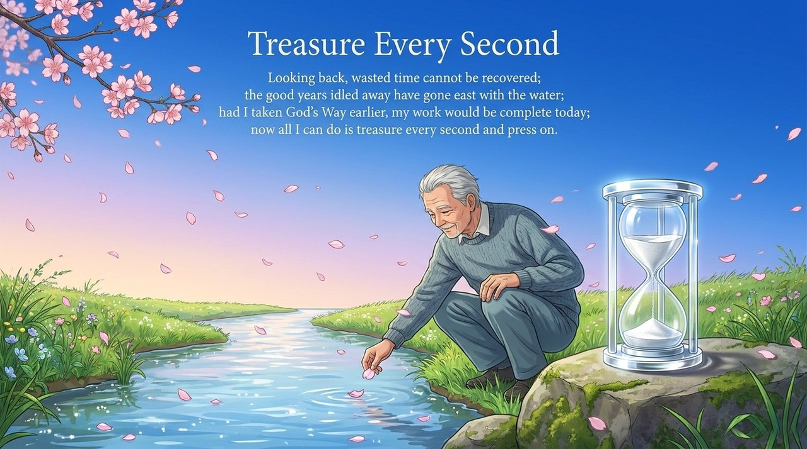
    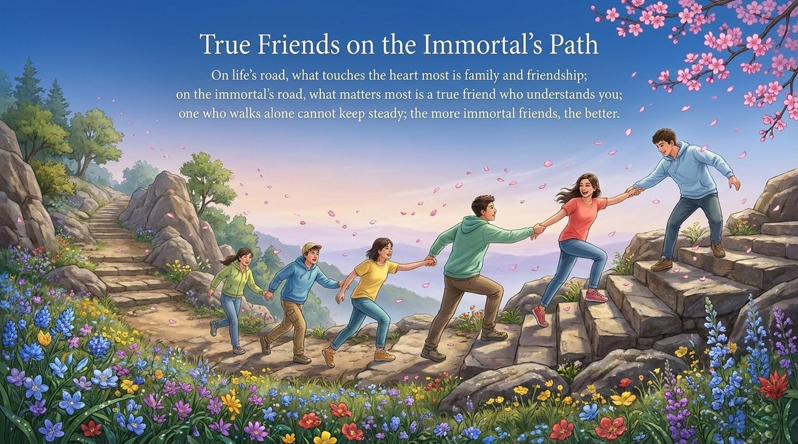
    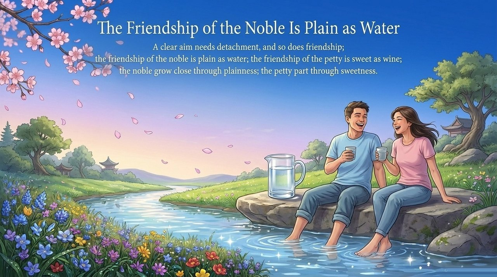
    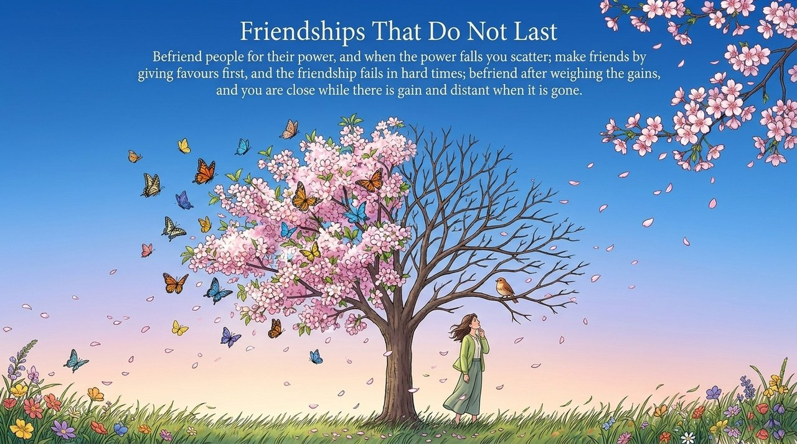
    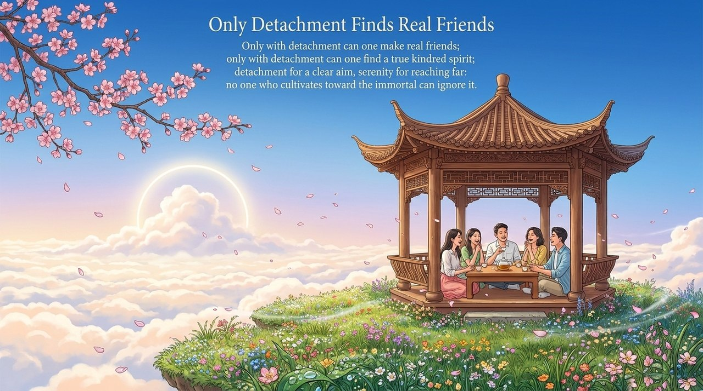

---

## Versions

| Version | Best for | Focus |
|---------|----------|-------|
| [Friendly version](friendly/) | First-time readers | Life wisdom and spiritual insight |
| [Academic version](academic/) | Researchers | Systematic analysis and cross-cultural comparison |
| [Internal reference](internal/) | Deep study | Guide Xuefeng's original texts |

## Related entries

[Minimal Desires, Unshaken Composure](/en/shao-si-gua-yu/) · [Going with the Flow, Free and Easy](/en/sui-yuan-fangguan/) · [Deep Roots, Lasting Vision](/en/shen-gen-gu-di/) · [The Golden Mean](/en/golden-mean/) · [Non-action yet All-accomplished](/en/wu-wei/) · [Self-coherence](/en/self-coherence/) · [Return to Zero](/en/return-to-zero/) · [Becoming a Celestial Being](/en/becoming-celestial/) · [Transcending the Mundane](/en/chaofantuosu/)
