# Democracy

**Democracy**, in the Lifechanyuan system, is analyzed from two distinct angles. The first is "true democracy": Guide Xuefeng argues that genuine democracy must carry universal, global, and holistic attributes — only those who see themselves as world citizens working for all humanity are qualified to speak of it. The second is the question of democracy's fit with Lifechanyuan itself: Xuefeng holds that "democracy is a good thing, but it does not suit Lifechanyuan" — because Lifechanyuan follows the Way of the Greatest Creator (natural law, which cannot be changed by vote) and carries the angelic mission of "harvesting the ripened grain" (a task that cannot be accomplished through democratic discussion among ordinary people). Lifechanyuan internally employs *Hundun* Management (the Superman Philosophy) instead: whoever is responsible makes decisions and bears all consequences.

> Democracy is a good thing, but it does not suit Lifechanyuan — just as salt is a good thing, but you do not put salt in honey.
>
> — *Xuefeng Anthology · Chanyuan Section · Why Democracy Doesn't Suit Lifechanyuan*

## Version Guide

## Video

<iframe style="width:100%;aspect-ratio:4/3;border:0" src="https://www.youtube-nocookie.com/embed/2ikteZ3aTbc" title="Democracy (Lifechanyuan Encyclopedia video)" allowfullscreen></iframe>

## Slides

??? info "📖 Illustrated slides (14 pages, click to expand)"

    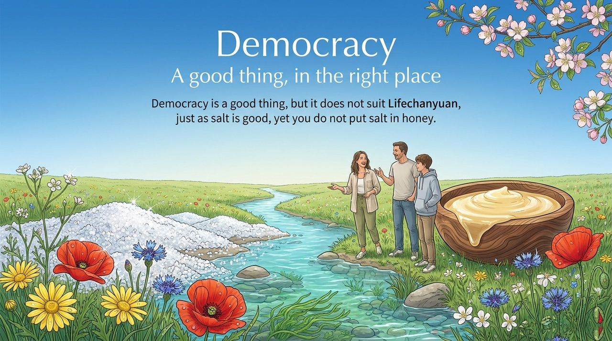
    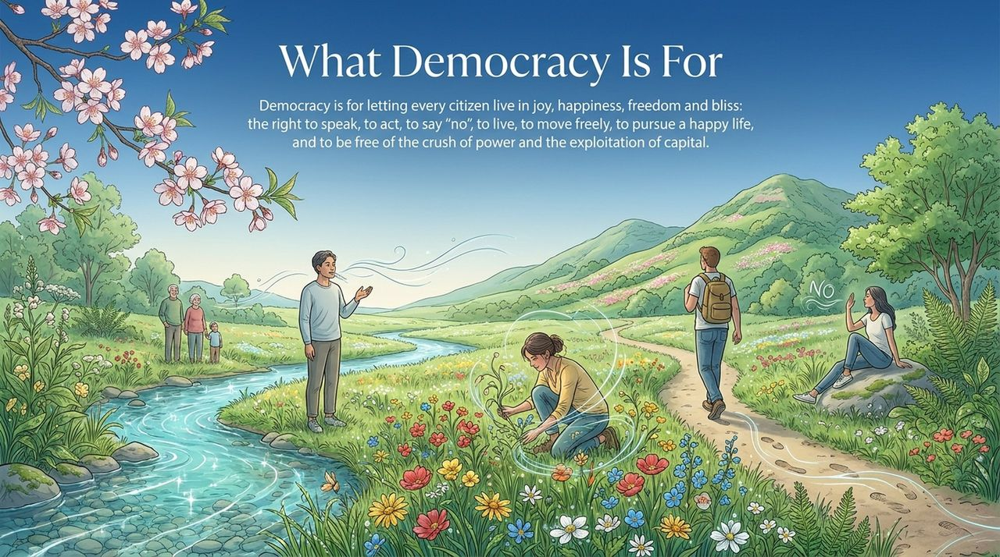
    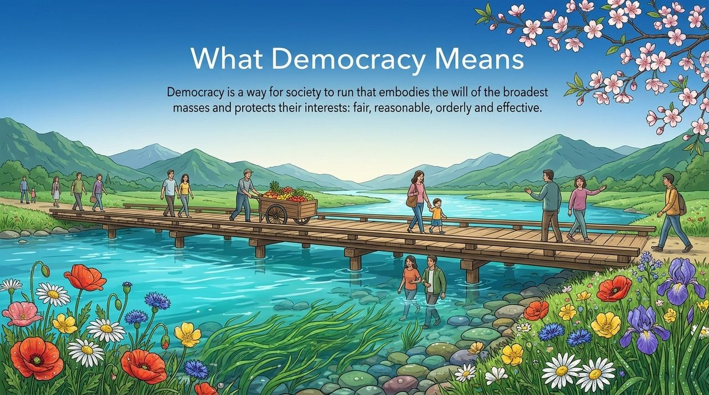
    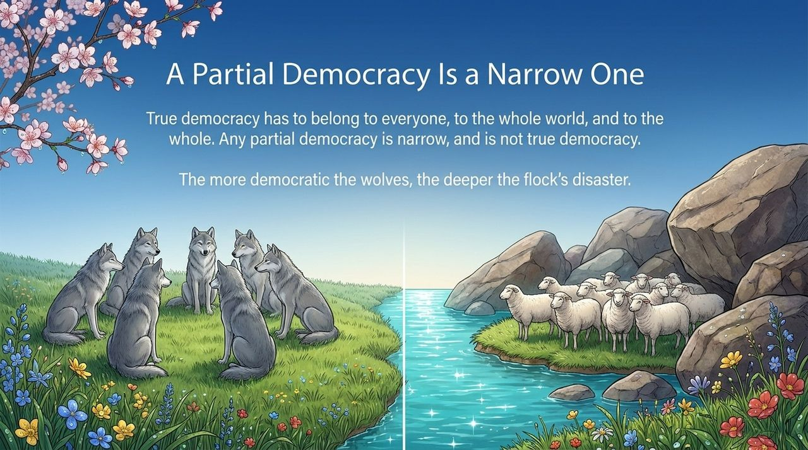
    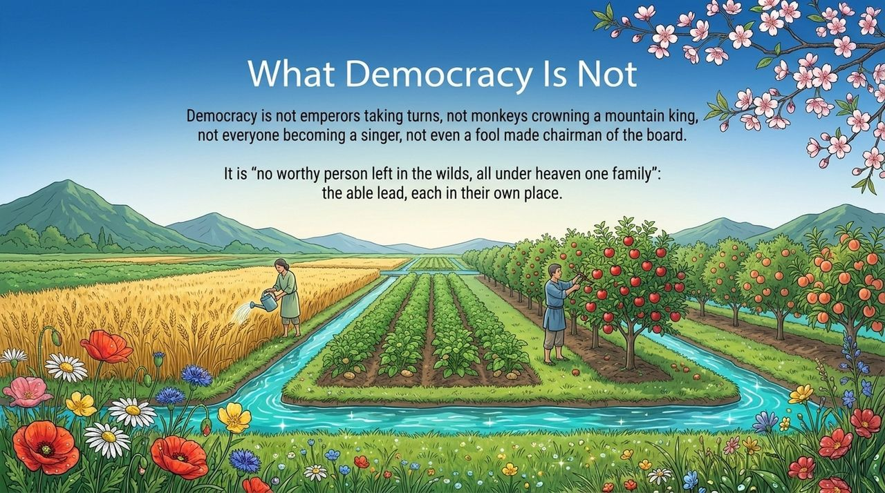
    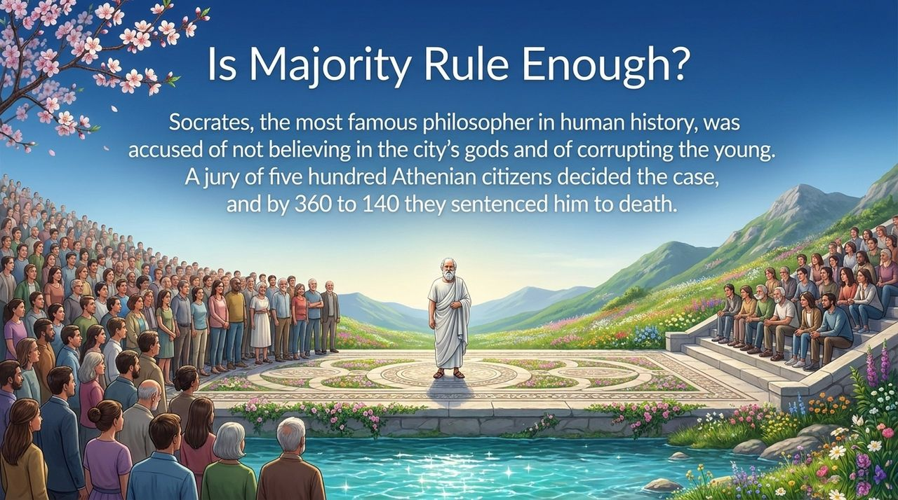
    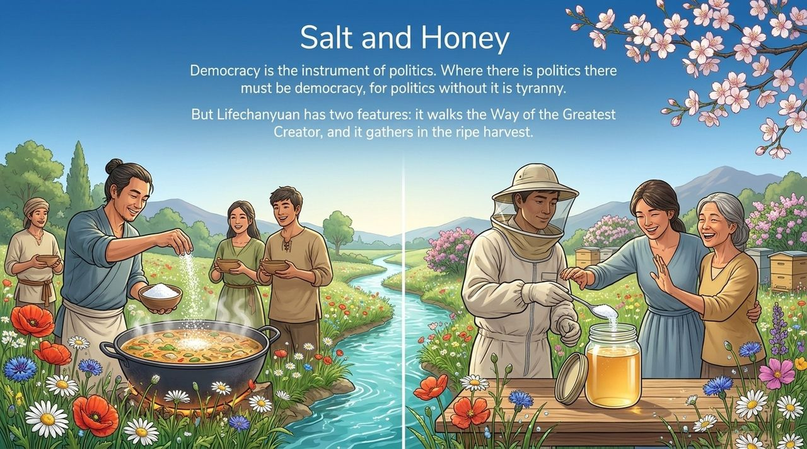
    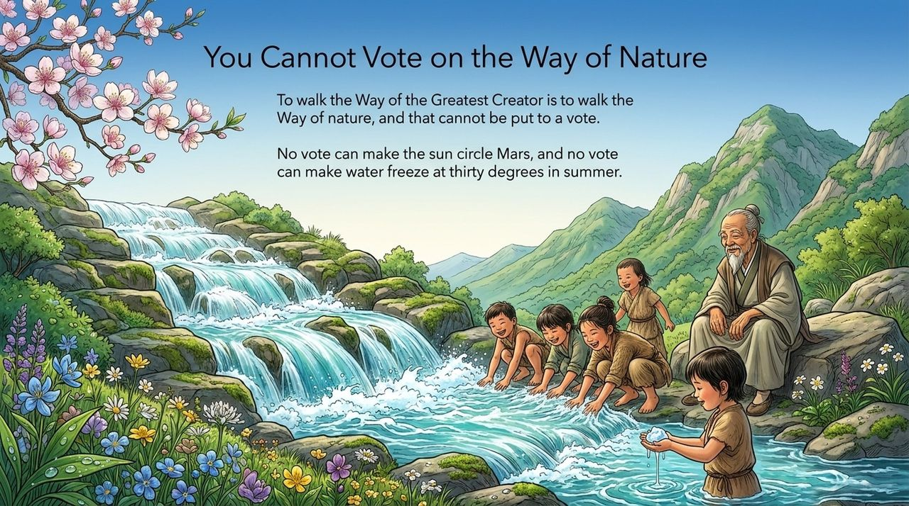
    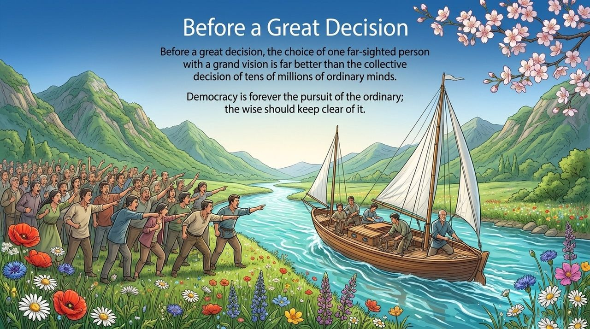
    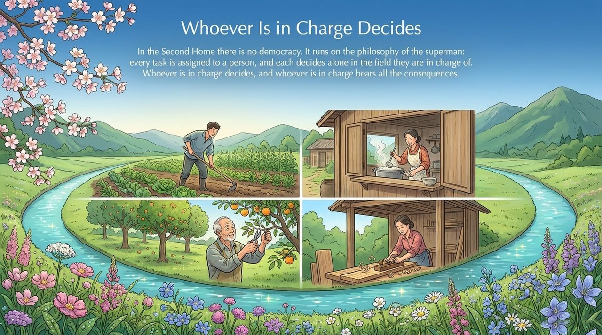
    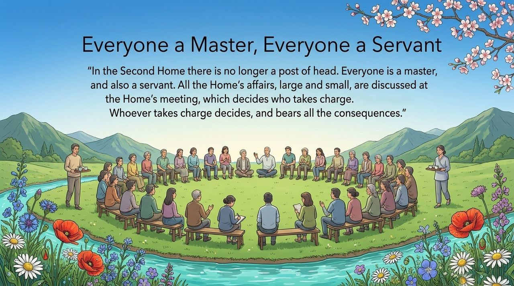
    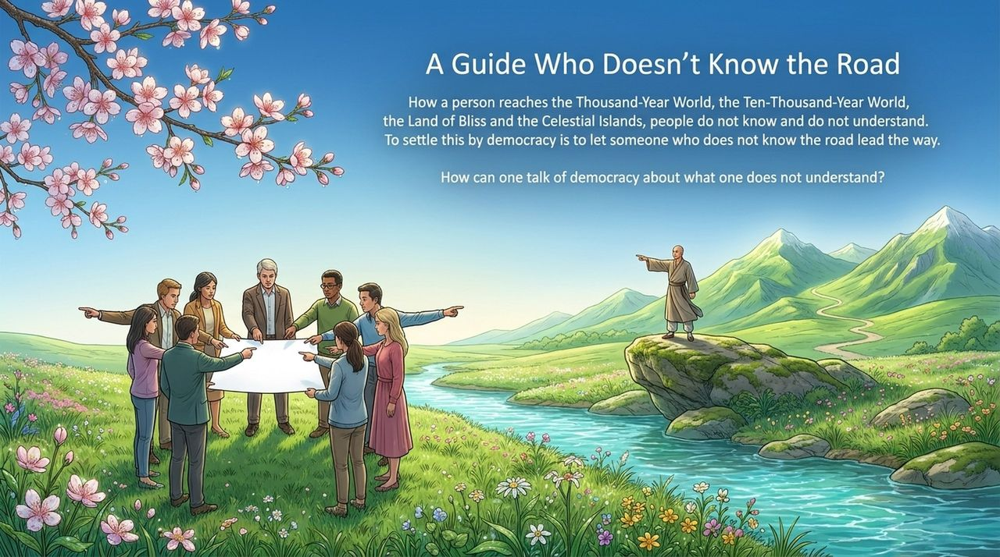
    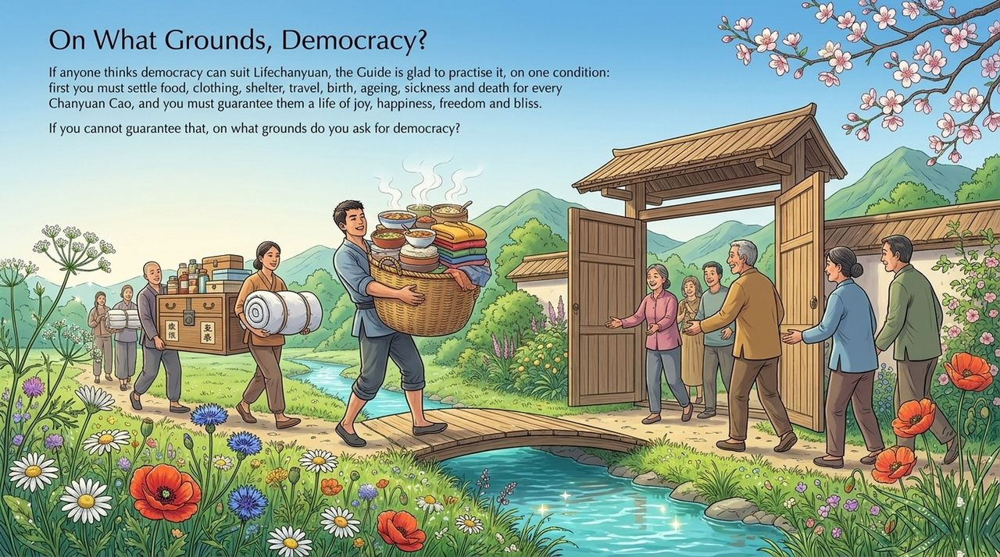
    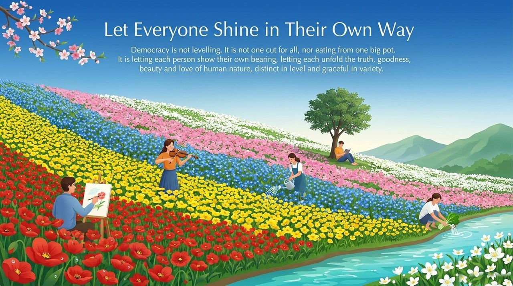

---

| Version | Best for | Focus |
|---------|----------|-------|
| [Friendly version](friendly/) | First-time readers | The salt-and-honey analogy — why democracy doesn't fit |
| [Academic version](academic/) | Researchers | Systematic analysis of both democracy critiques and the Hundun alternative |
| [Internal reference](internal/) | Deep study | Guide's original texts · source archive |

## Related Entries

[Hundun Management](/en/hundun-management/) · [Xuefeng-Style Communism](/en/xuefeng-communism/) · [Lifechanyuan Values](/en/values/) · [Civilization Overview](/en/civilization-overview/) · [The Greatest Creator as First Productive Force](/en/greatest-creator-first-productive-force/) · [International Extended Family](/en/guoji-dajiating/) · [One World Family](/en/one-world-family/) · [The Ripened Grain](/en/ripened-grain/)
