<!-- id: LC-DS-0001-EN theme: Cultivation Practice type: index direction: Cultivation Practice lang: en -->

# The Diamond Sutra

**The Diamond Sutra** (《金刚经》, *Vajracchedikā Prajñāpāramitā Sūtra*) is, in the Lifechanyuan system, the supreme source of all Buddhist scriptures — "the Himalayan peak of wisdom." The Buddha Śākyamuni taught it exclusively for those aspiring to the Great Vehicle and the Supreme Vehicle. Its three core teachings — all forms are illusory (无相), the four marks must be relinquished (无我), and the mind must dwell nowhere (心无所住) — align perfectly with Lifechanyuan's Non-Form Thinking and Hundun (Primordial Chaos) Thinking. Xuefeng, under his dharma name Hundun Yuanchu, took up the transmission of the Dharma lineage that ended after the Sixth Patriarch Huineng, and authored the twenty-four essays of *Becoming a Buddha* as a systematic commentary on the Diamond Sutra. Lifechanyuan understands itself as the continuation of the Diamond Sutra's unfinished work.

---

## Version Navigation

| Version | Best for | Focus |
|---------|----------|-------|
| [Friendly version](friendly.md) | First-time readers | Three core teachings and the path to Buddhahood right now |
| [Academic version](academic.md) | Researchers | Doctrinal structure, four-tier vehicle system, comparison with traditional Buddhism |
| [Internal reference](internal.md) | Deep study | Complete source quotations, three marks of Buddhahood, inconceivable merit |

---

## Video

<iframe style="width:100%;aspect-ratio:4/3;border:0" src="https://www.youtube-nocookie.com/embed/ncHS43Ma6r8" title="The Diamond Sutra (Lifechanyuan Encyclopedia video)" allowfullscreen></iframe>

## Slides

??? info "📖 Illustrated slides (14 pages, click to expand)"

    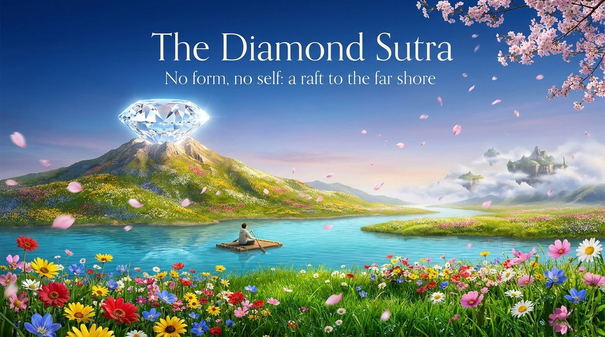
    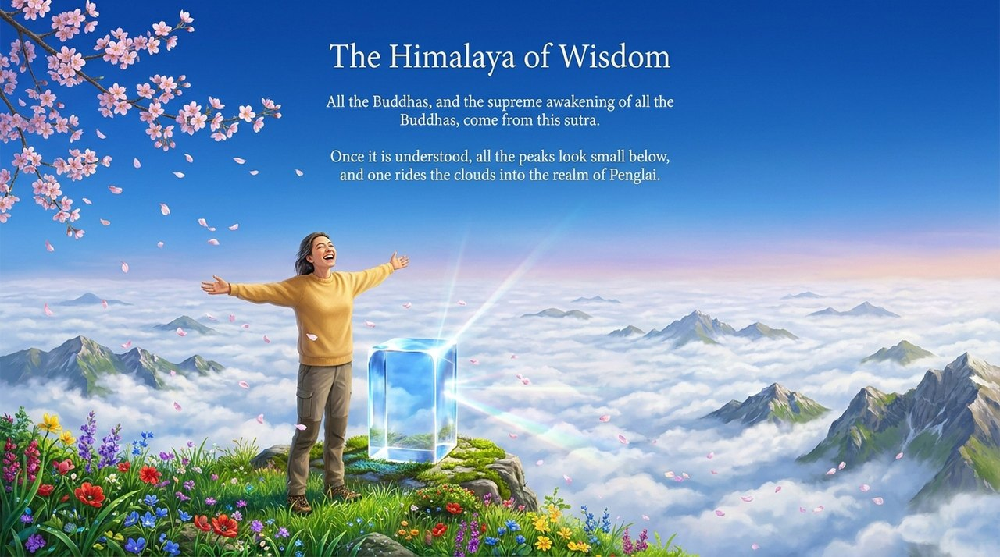
    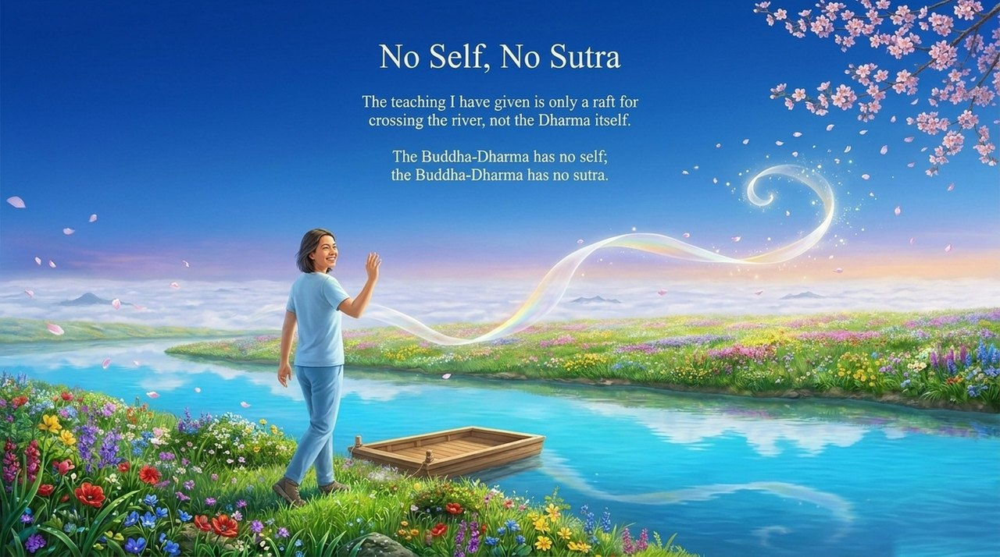
    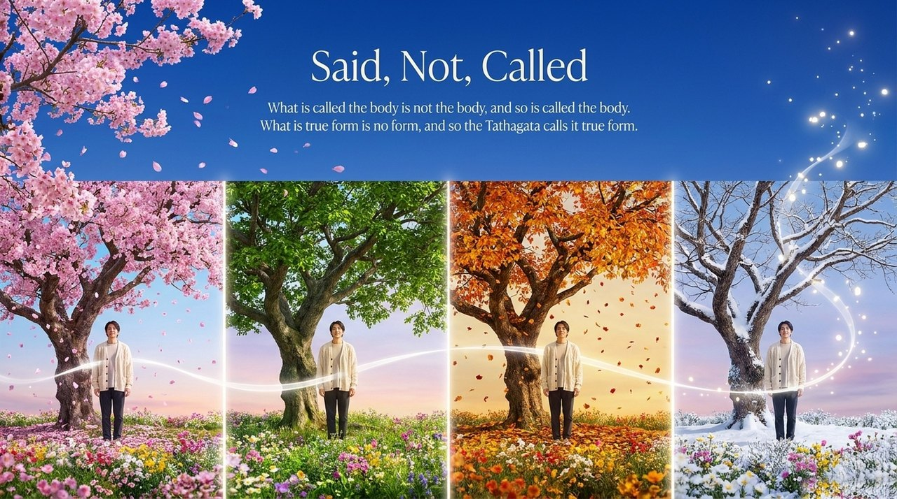
    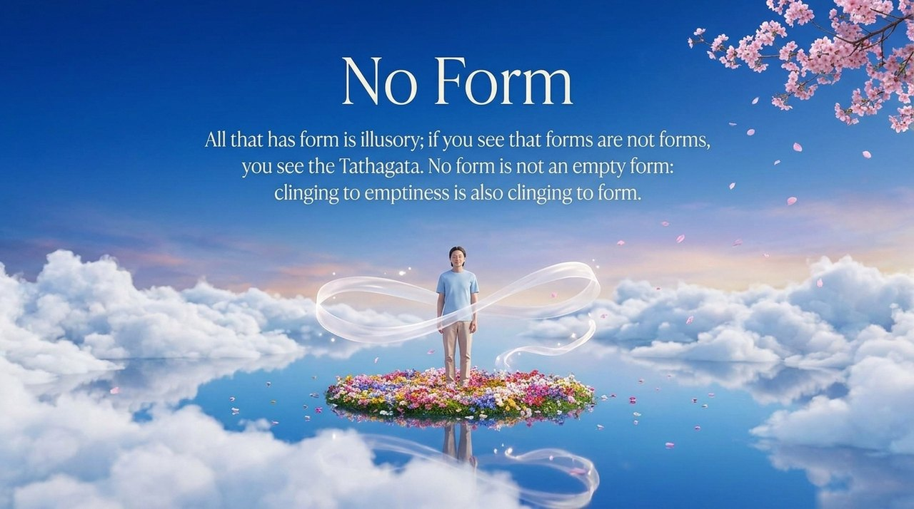
    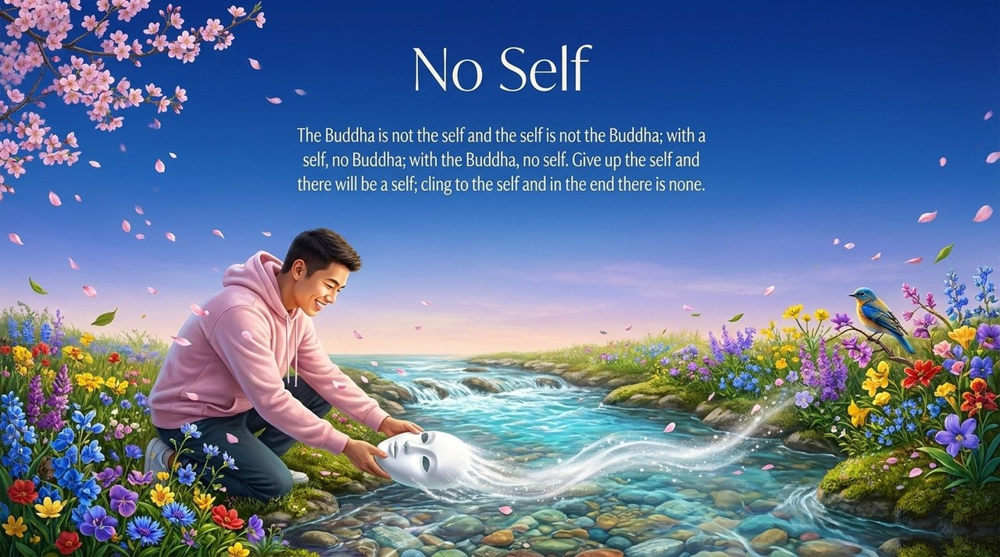
    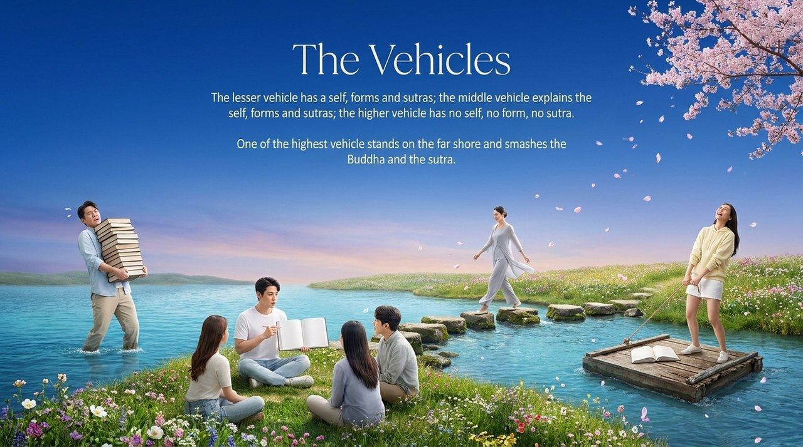
    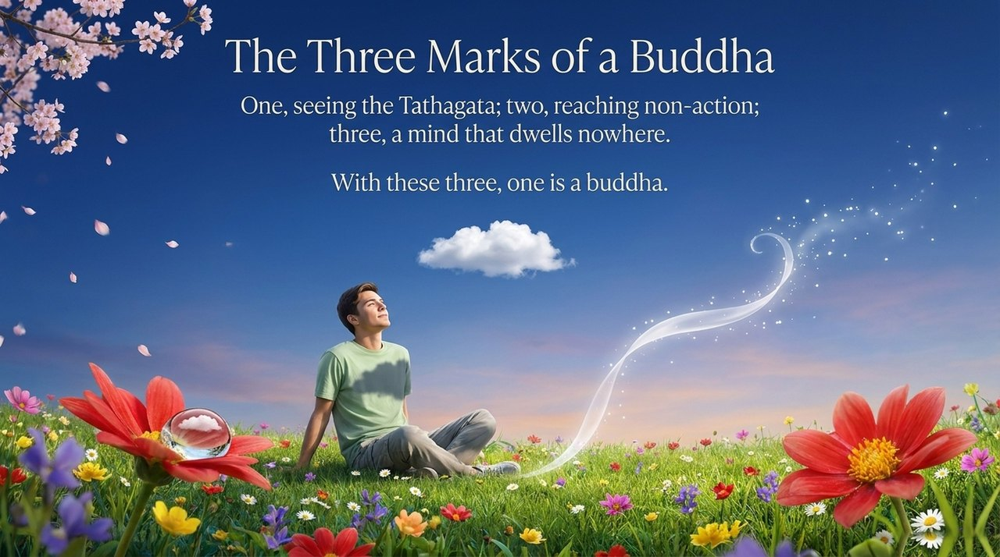
    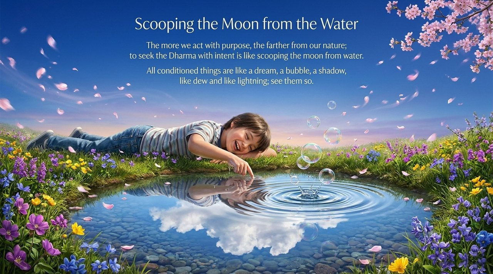
    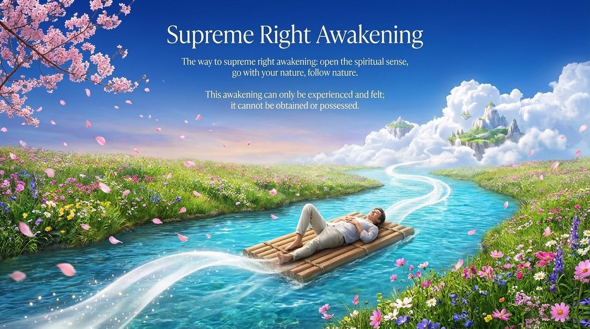
    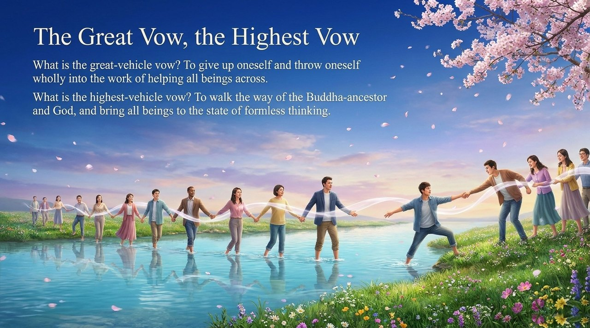
    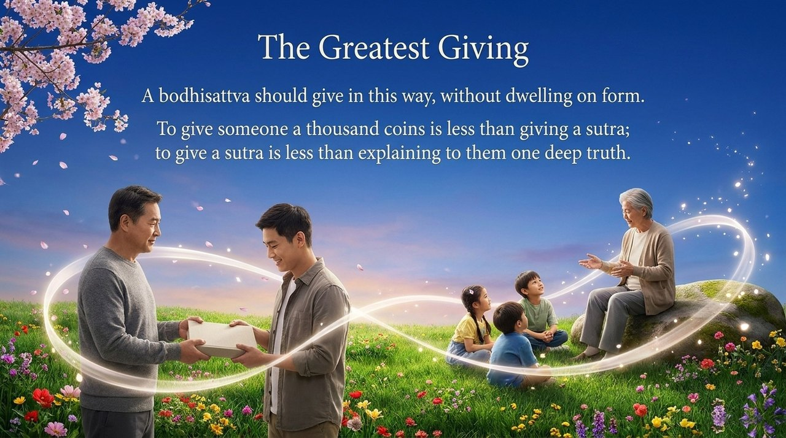
    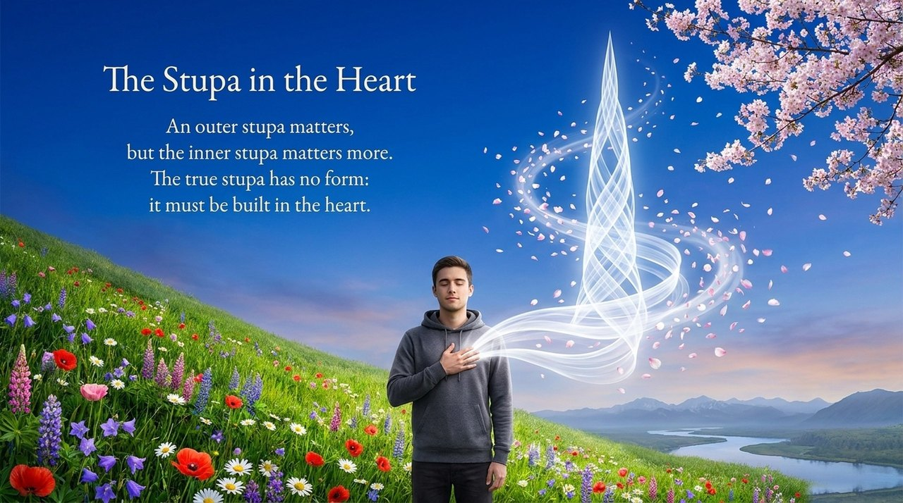
    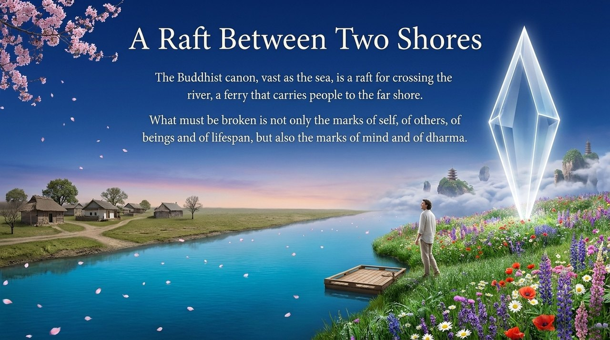

---

## Related Entries

[Buddha-Dharma](/en/buddha-dharma/) · [Buddha, the Buddha-Patriarch, Tathāgata](/en/buddha-patriarch/) · [Becoming a Buddha](/en/becoming-buddha/) · [Self-Nature · Buddha-Nature · Tathāgata-Nature](/en/self-nature/) · [No-Self No-Form](/en/no-self-no-form/) · [No-Abiding Mind](/en/xinwu-suozhu-guaai/) · [Formless Giving](/en/formless-giving/) · [Illuminating the Mind, Seeing One's Nature](/en/illuminate-mind-see-nature/) · [Non-Action (Wu Wei)](/en/wu-wei/) · [Awakening](/en/awakening/)
