<!-- id: LC-DH-0001-EN theme: Life Mysteries type: index direction: Life Mysteries lang: en -->

# Disease and Health

In the Lifechanyuan system, disease is not merely a malfunction of the physical body — it is the manifestation of inner imbalance in the nonmaterial structure of LIFE. Health, in turn, is not simply the absence of symptoms, but the natural state of a LIFE whose spirit body is pure, whose heart is free of resentment, and whose being is aligned with the Dao.

Guide Xuefeng stated it plainly: **"A heart full of resentment will inevitably bring illness."** Negative emotions — resentment, anger, fear — are the root causes of disease. Conversely, when the spirit body achieves perfection, the physical body enters its optimal state: damaged limbs can recover, terminal illness can be healed, and the dying can return to life.

True wellness does not lie in medicines or surgery, but in cultivating the mind, purifying the spirit body, and resonating with the Dao — when one's spirit body approaches perfection, the physical body naturally follows.

---

## Version Navigation

| Version | For | Core Angle |
|---------|-----|-----------|
| [Friendly Version](friendly.md) | Newcomers | The mind-body connection in plain language — finding the true path to health |
| [Academic Version](academic.md) | Researchers | Systematic analysis of disease etiology, health standards, and cultivation paths |
| [Internal Version](internal.md) | Deep study | Complete original source texts with full annotations |

---

## Video

<iframe style="width:100%;aspect-ratio:4/3;border:0" src="https://www.youtube-nocookie.com/embed/ERsrtQQ2y9E" title="Disease and Health (Lifechanyuan Encyclopedia video)" allowfullscreen></iframe>

## Slides

??? info "📖 Illustrated slides (14 pages, click to expand)"

    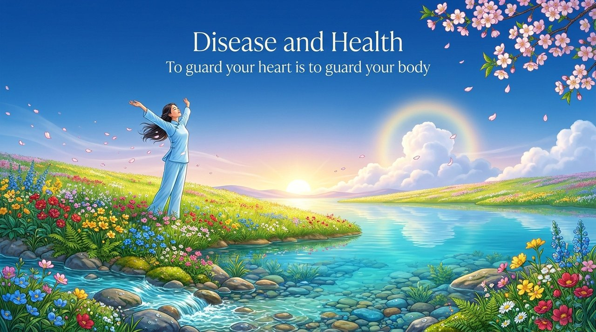
    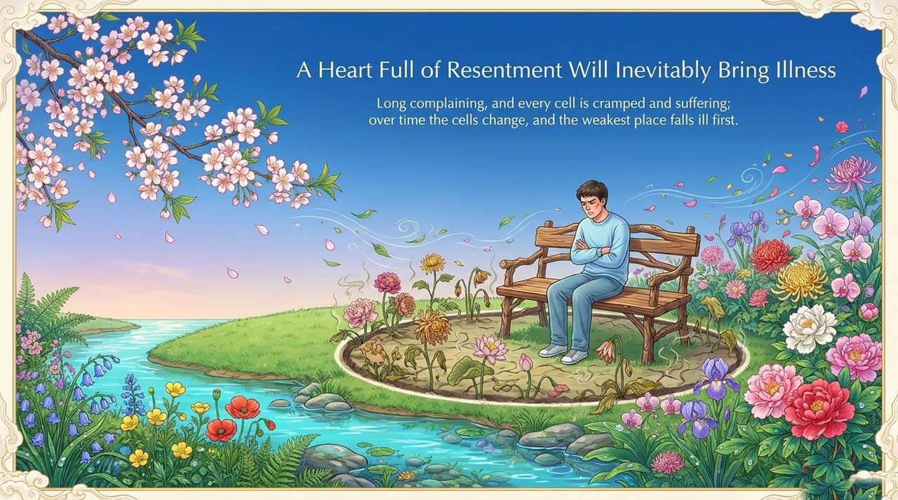
    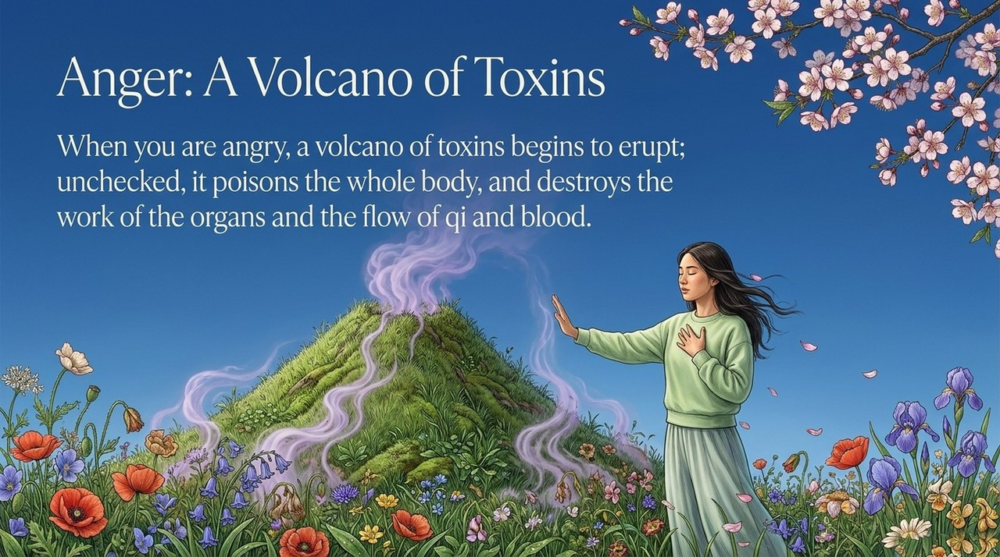
    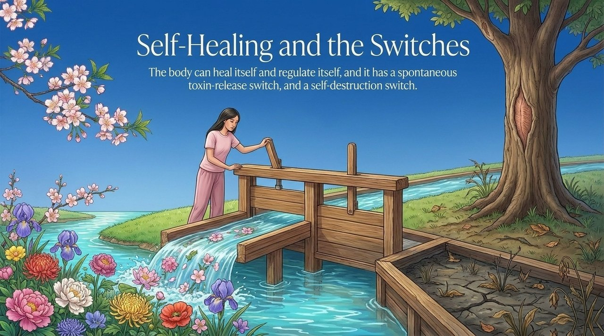
    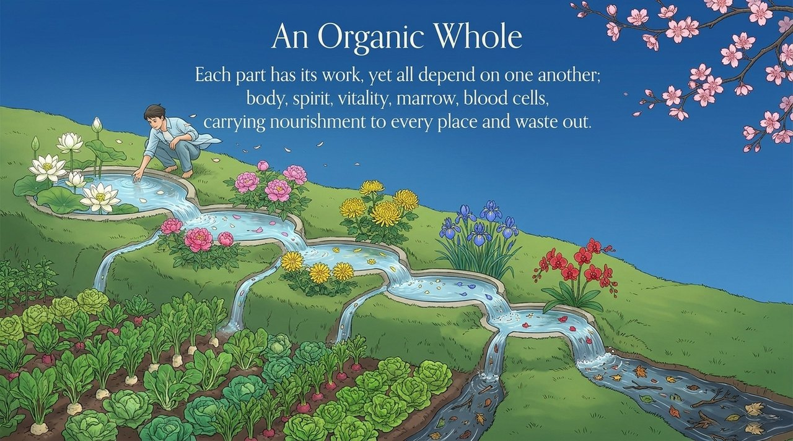
    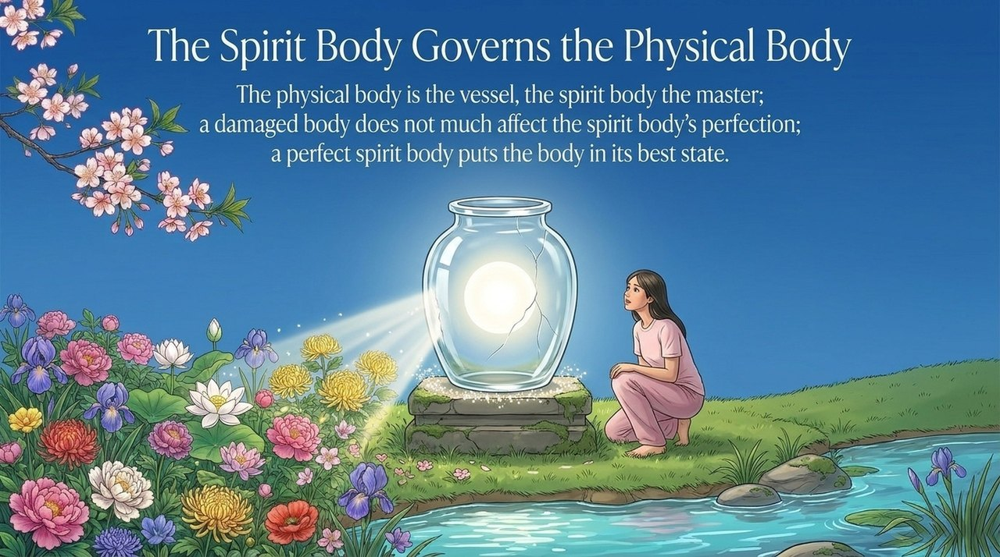
    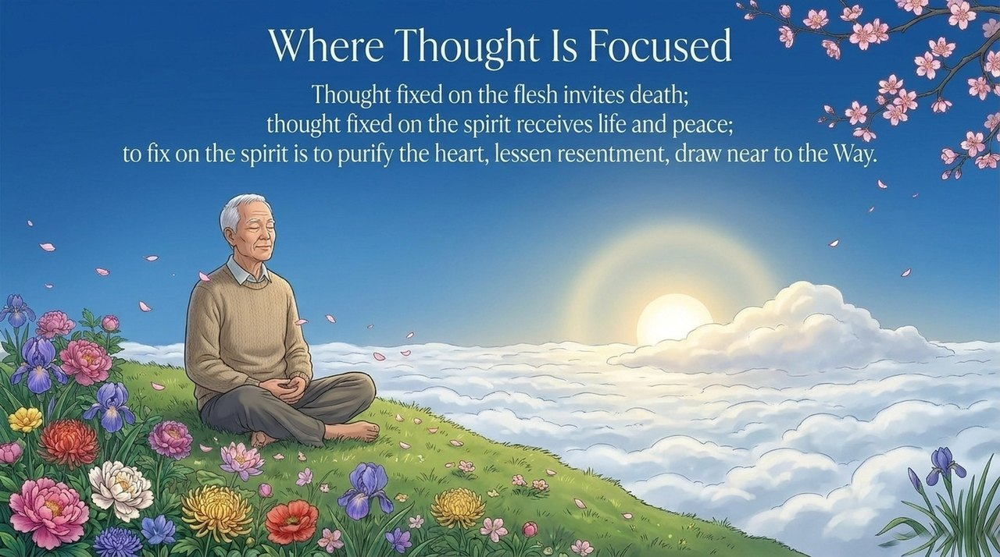
    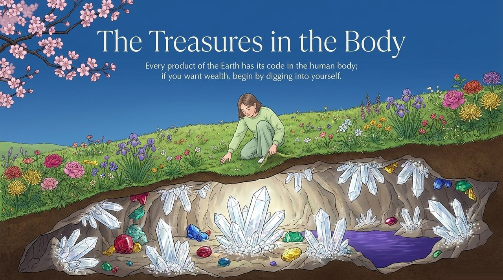
    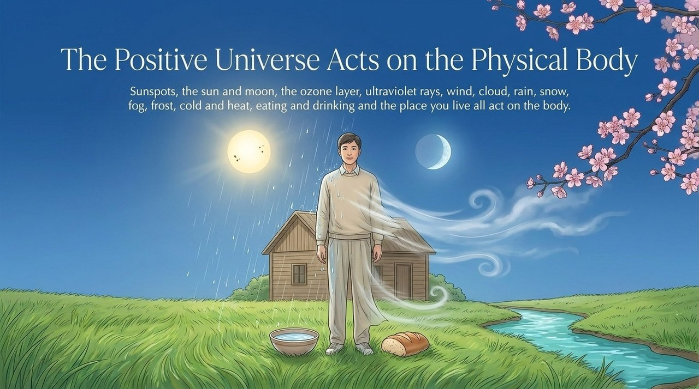
    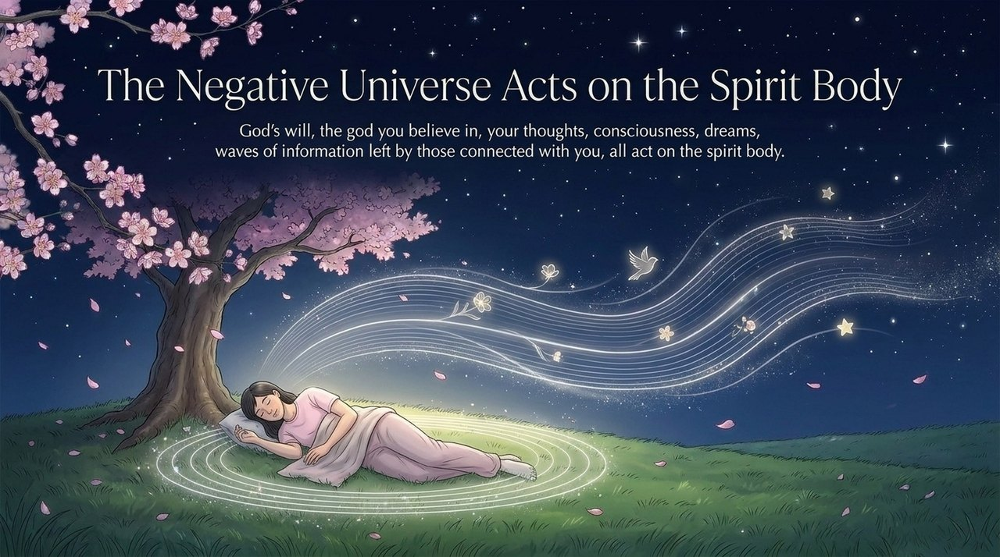
    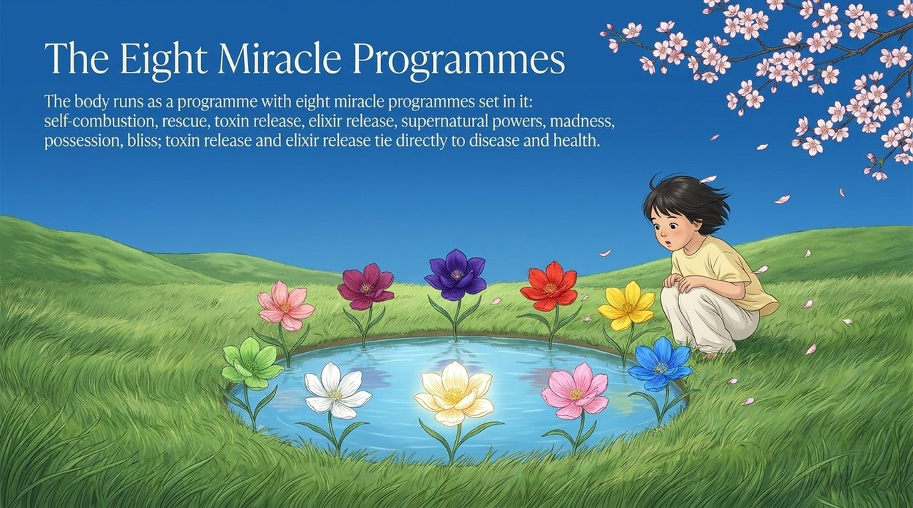
    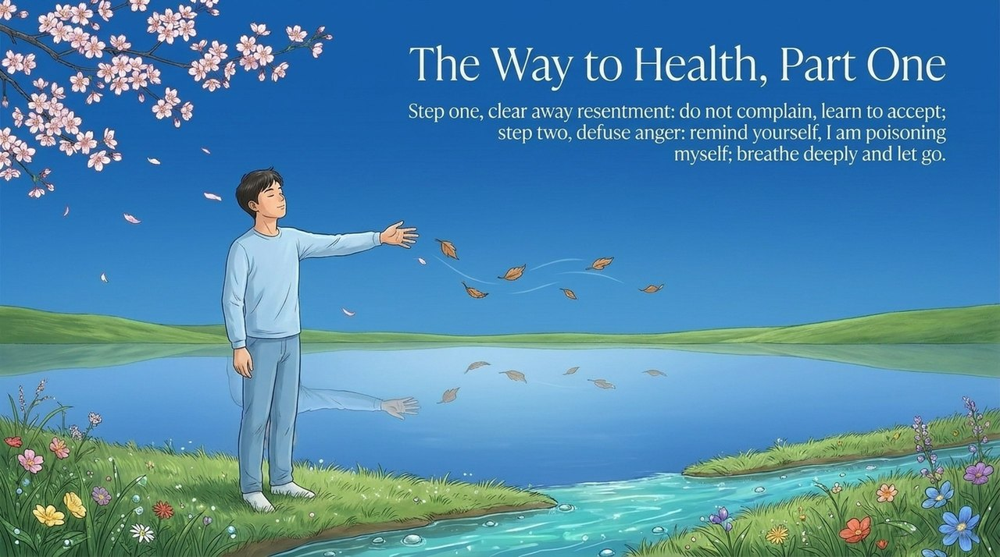
    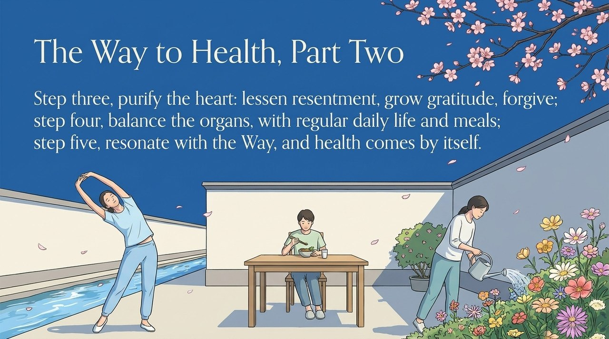
    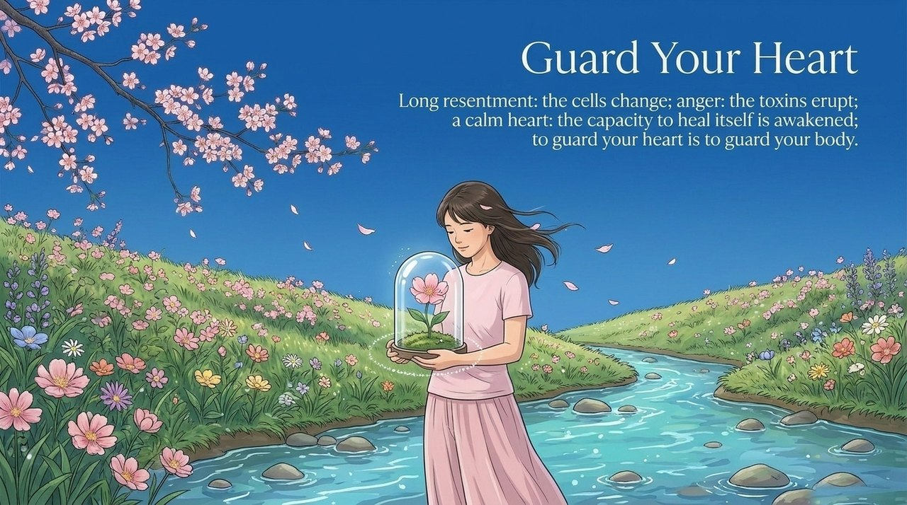

---

## Related Entries

[Human Body — Miracle Program and Mystery](/en/human-body-miracle/) · [The Nonmaterial Structure of LIFE](/en/antimatter-structure/) · [Ling-Spirit](/en/ling-spirit/) · [Subconscious](/en/subconscious/) · [Purifying the Mind](/en/jinghuaxinling/) · [Correcting Body and Mind](/en/neigong/) · [Happiness](/en/happiness/) · [Romantic Love and Sexuality](/en/romantic-love-and-sexuality/) · [Resonance](/en/resonance/) · [LIFE](/en/life/) · [Letting Go](/en/letting-go/) · [Forgiveness](/en/forgiveness/) · [Gratitude](/en/gratitude/)
