# Eight Cosmic Dialectical Laws

> One yin, one yang — this is the Tao. Balanced yin and yang — this is principle. Understanding dialectics — this is wisdom. Flowing with nature — this is virtue.  
> — Xuefeng, *Eight Cosmic Dialectical Laws*

The Eight Cosmic Dialectical Laws (*Yuzhou Bada Bianzhenfa*) is a framework proposed by Lifecosmos guide Xuefeng, drawn from Taiji thinking and ancient Taoist philosophy. The eight pairs of cosmic laws are: **emptiness and form, exhaustion and return, the minute and the vast, life and death as mutual roots, nothingness and existence, the mind and the nature, movement and stillness, symmetry and proportion**. These laws describe how the cosmos operates and serve as practical guides for cultivation and spiritual ascent.

## Video

<iframe style="width:100%;aspect-ratio:4/3;border:0" src="https://www.youtube-nocookie.com/embed/RYqKOT7BhcU" title="Eight Cosmic Dialectical Laws (Lifechanyuan Encyclopedia video)" allowfullscreen></iframe>

## Slides

??? info "📖 Illustrated slides (14 pages, click to expand)"

    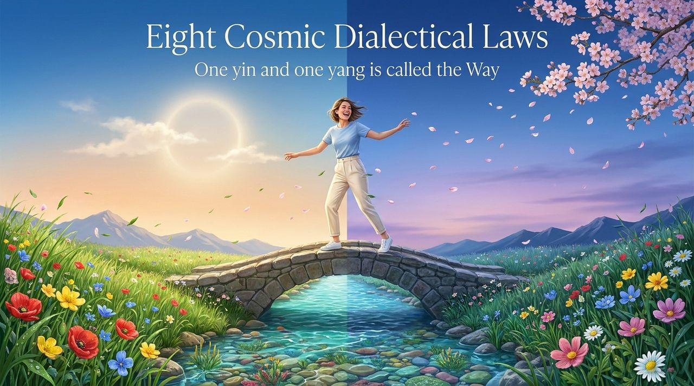
    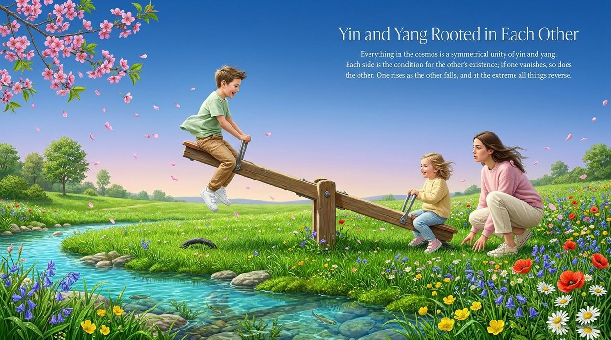
    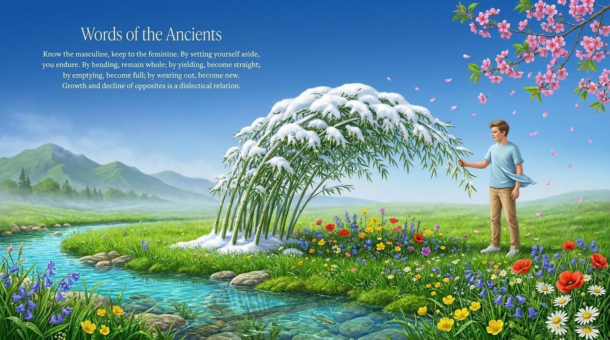
    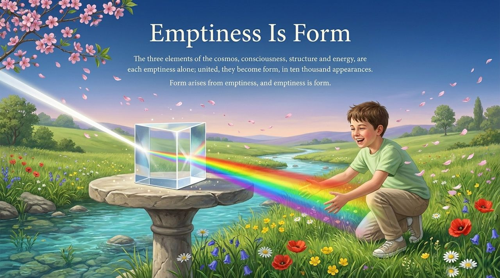
    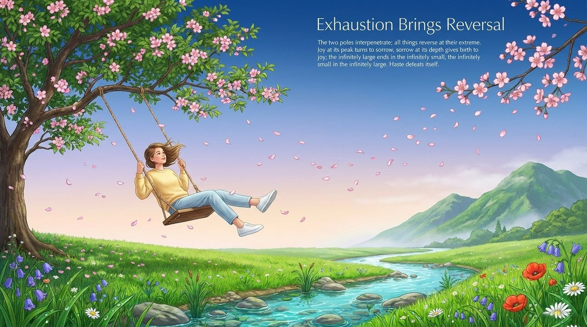
    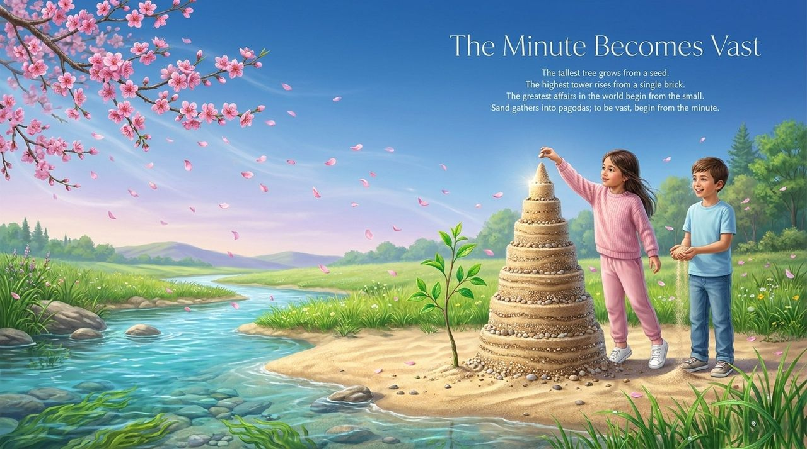
    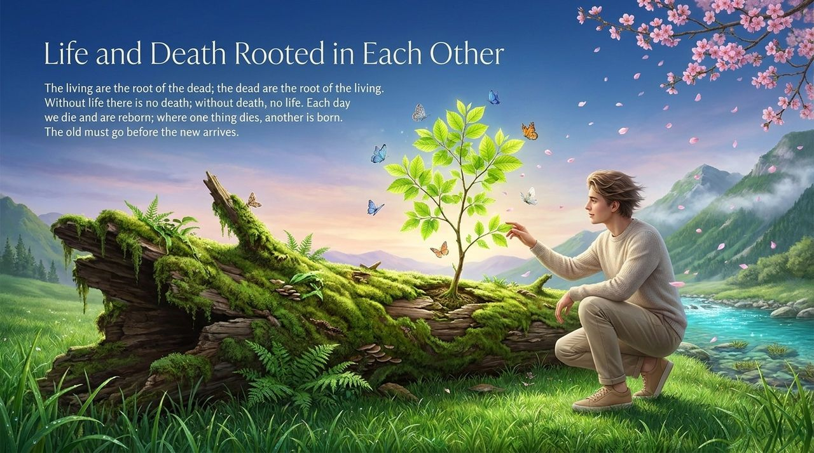
    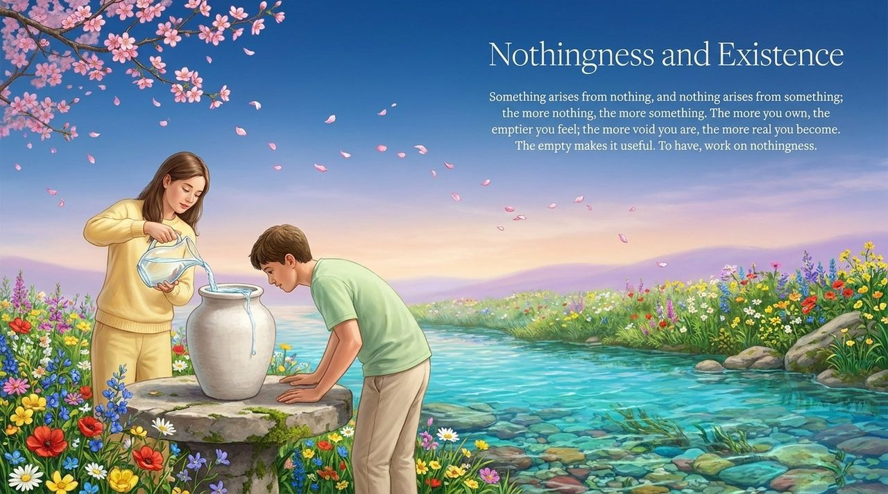
    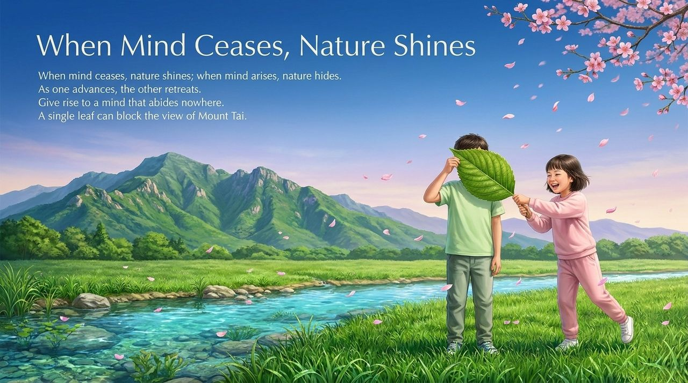
    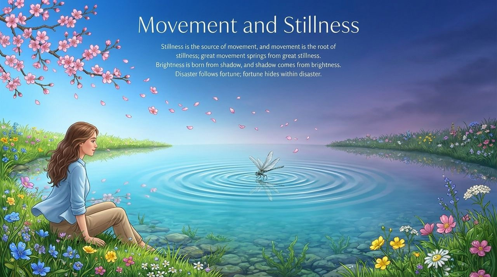
    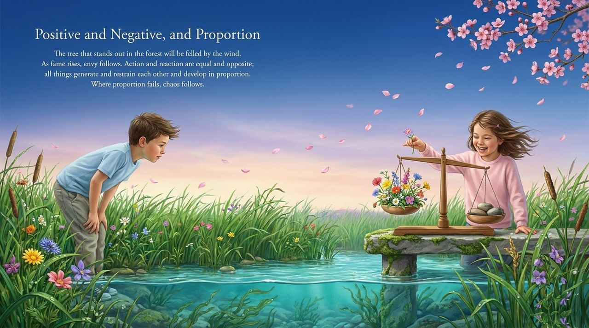
    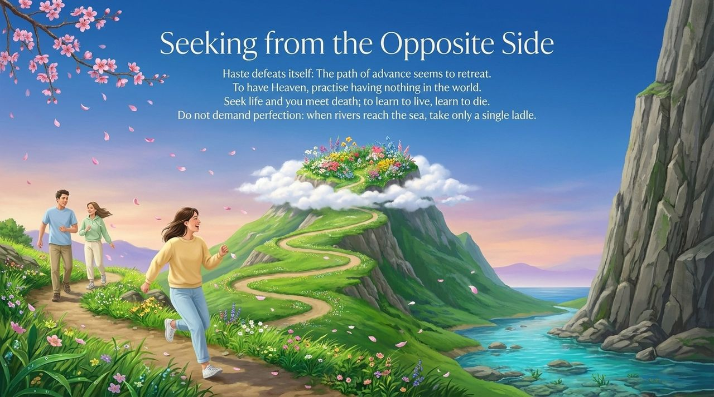
    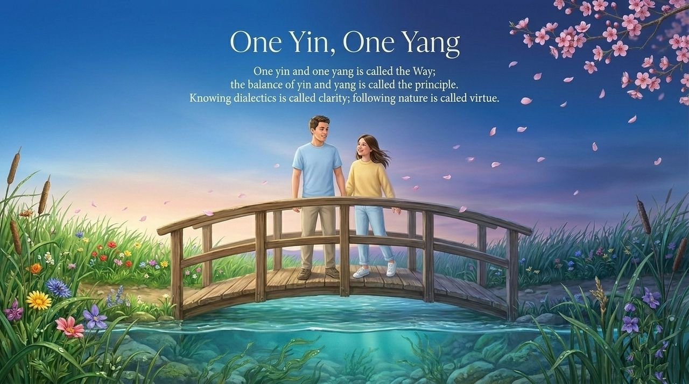
    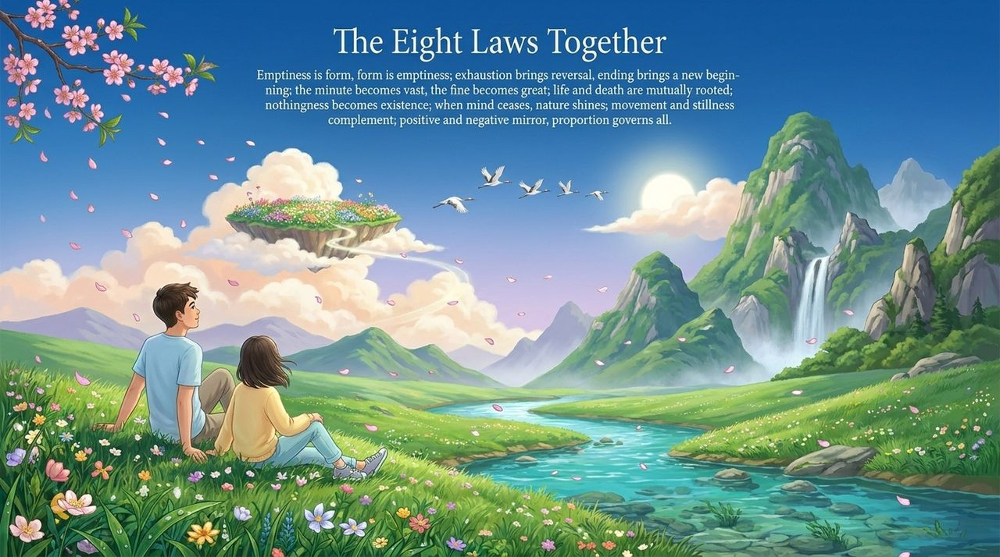

---

| Version | Best for | Focus |
|---------|----------|-------|
| [Friendly version](friendly.md) | First-time readers | Life wisdom from the eight laws |
| [Academic version](academic.md) | Researchers | Systematic analysis and comparison |
| [Internal reference](internal.md) | Deep study | Complete source texts and practice |

---

## Related Entries

[Dialectics](/en/dialectics/) · [Hundun (Ontology)](/en/hundun/) · [Taiji Thinking](/en/taiji-thinking/) · [Wuji and Taiji](/en/wuji-taiji/) · [Illuminate Mind, See Nature](/en/illuminate-mind-see-nature/) · [Mind Without Attachment](/en/xinwu-suozhu-guaai/) · [Self-Nature / Buddha-Nature](/en/self-nature/) · [No-Self, No-Form](/en/no-self-no-form/)
