<!-- id: LC-ELP-0001-EN theme: Cultivation Practice type: Index lang: en -->

# The Eight Guidelines, Eight Mysteries, Eight Heavenly Secrets, and Eight Bewilderments of Life

**Four complementary "eights" — Xuefeng's most systematic distillation of how life actually works.** The Eight Guidelines (2007) are the eight principles every life journey must follow; the Eight Mysteries are eight hidden operational secrets one can actively use; the Eight Heavenly Secrets are eight counter-intuitive laws of cosmic operation reflected in human life; the Eight Bewilderments are the eight states of confusion most people fall helplessly into. Together, they form a complete map for waking up and finding the right direction.

---

## Video

<iframe style="width:100%;aspect-ratio:4/3;border:0" src="https://www.youtube-nocookie.com/embed/wtVE_lY8fbs" title="Eight Life Principles (Lifechanyuan Encyclopedia video)" allowfullscreen></iframe>

## Slides

??? info "📖 Illustrated slides (14 pages, click to expand)"

    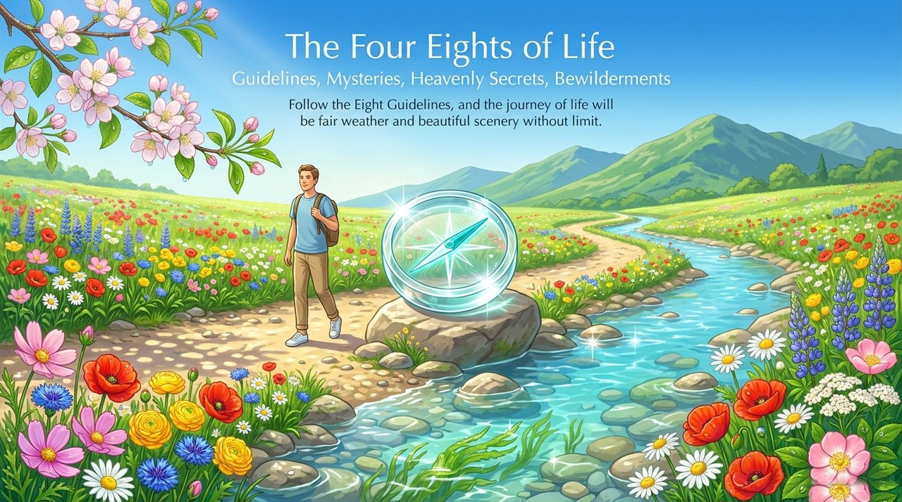
    
    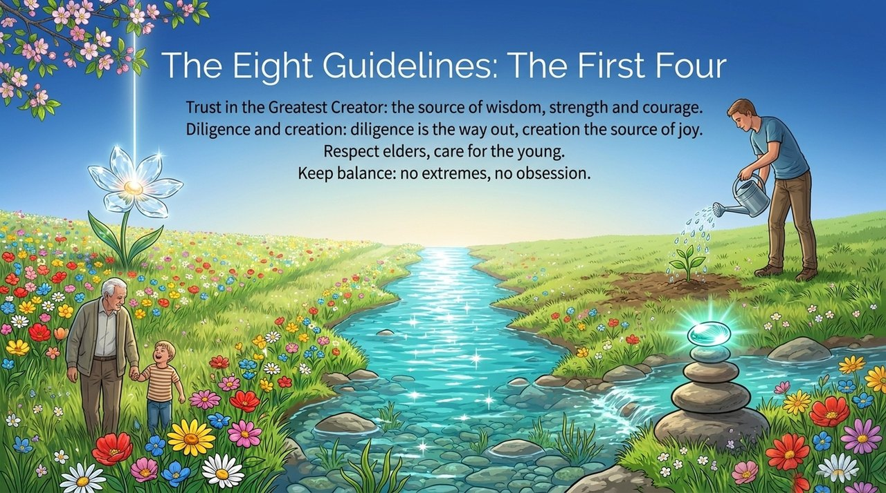
    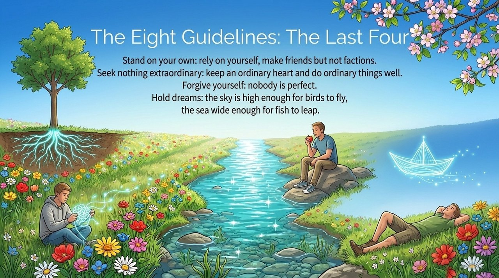
    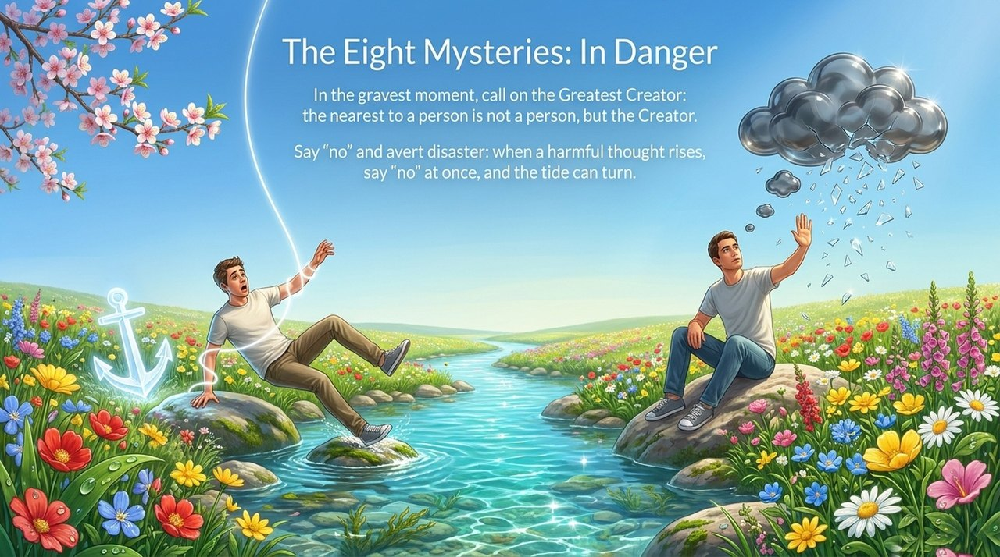
    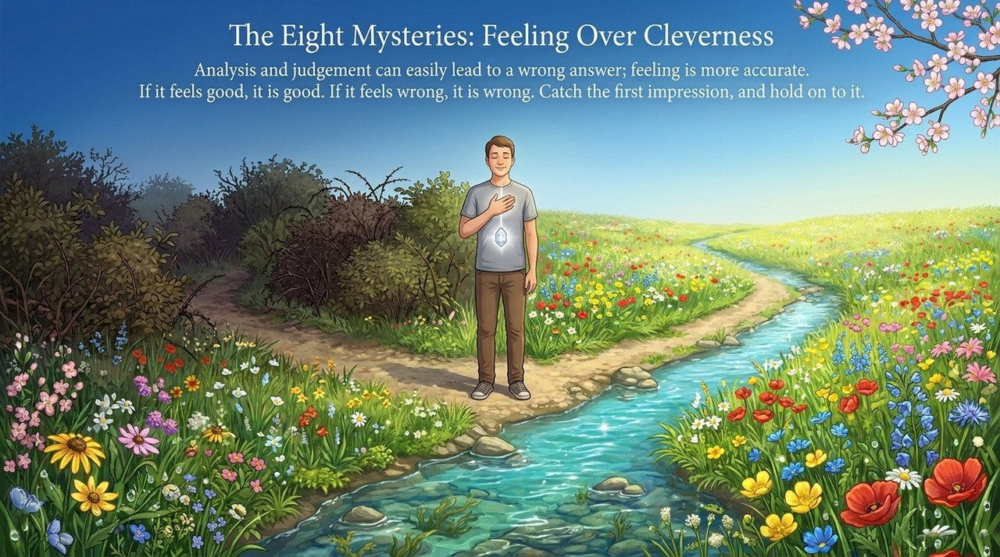
    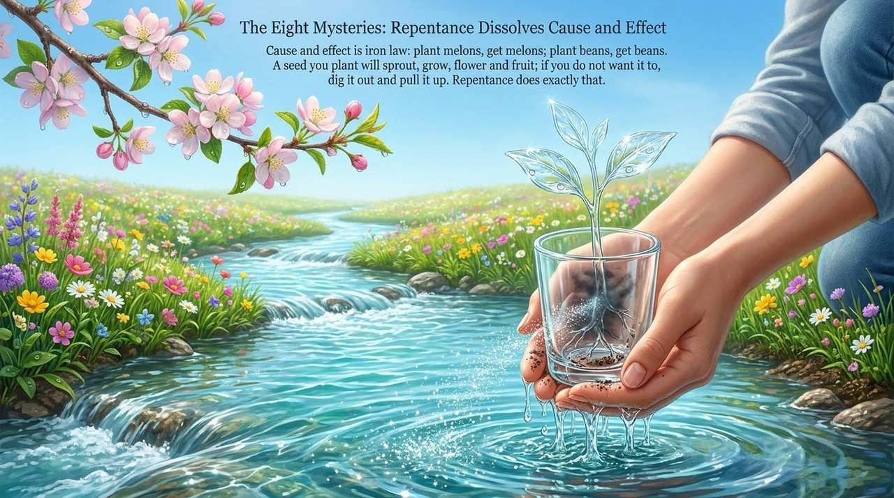
    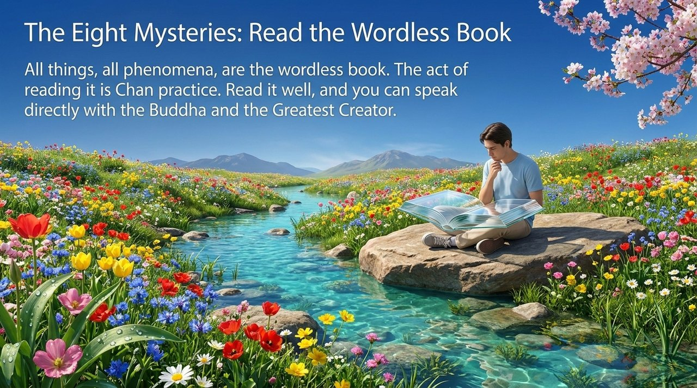
    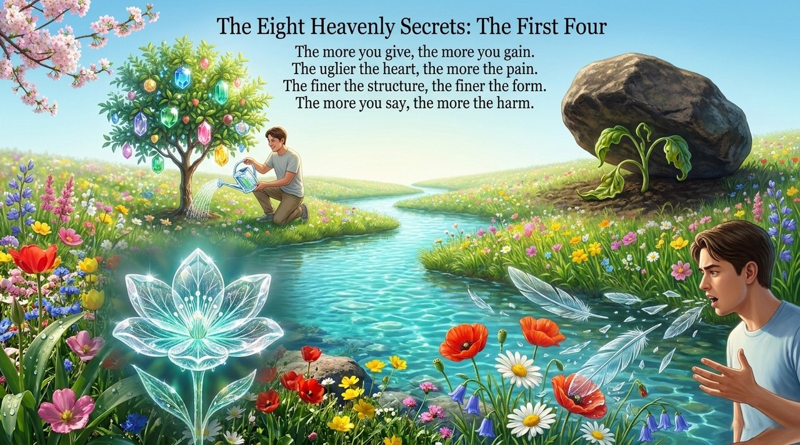
    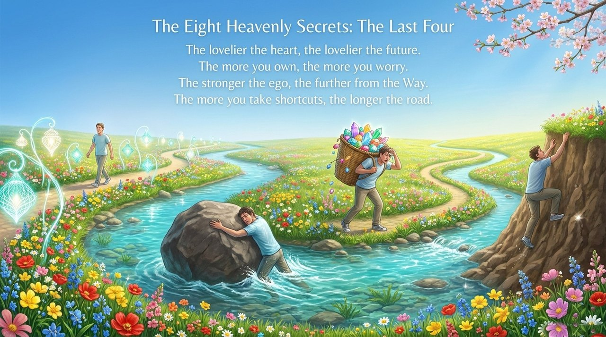
    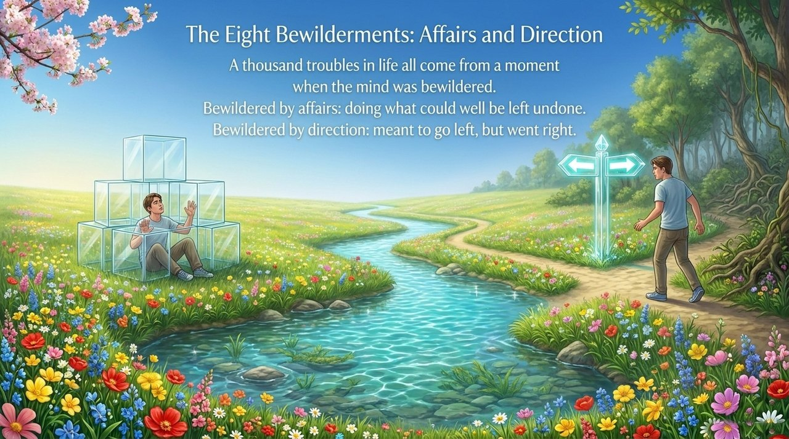
    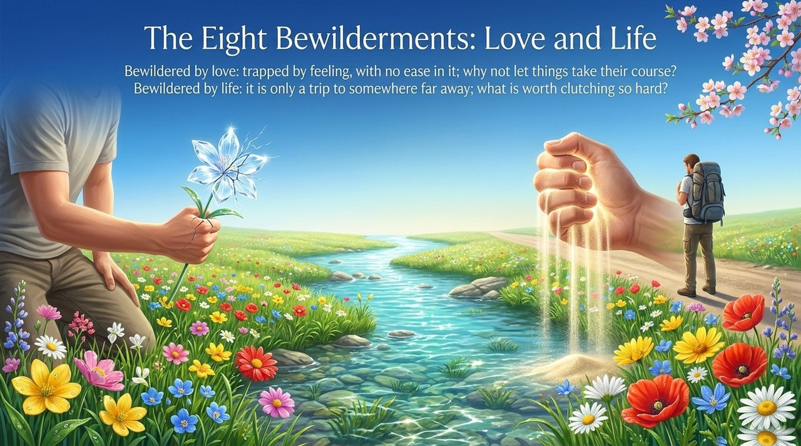
    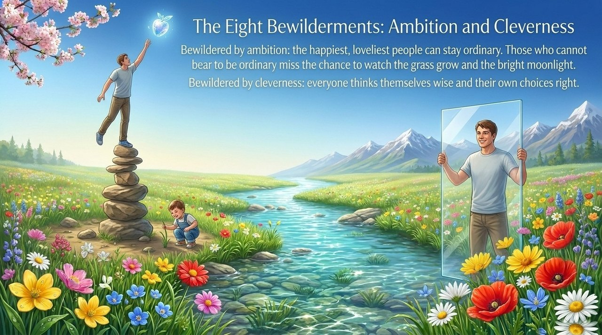
    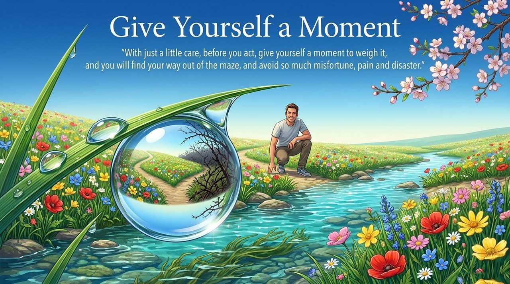

---

## Versions

| Version | Best for | Focus |
|---------|----------|-------|
| [Friendly version](friendly.md) | First-time readers | Plain summaries of all four sets; practical takeaways |
| [Academic version](academic.md) | Researchers | Structural analysis; logic of each set; comparison with Western concepts |
| [Internal reference](internal.md) | Deep study | Complete original quotations, four texts in full, all citations |

---

## Related Entries

[Outlook on Life and Values](/en/outlook-on-life-and-values/) · [Value, Meaning and Purpose of Life](/en/value-meaning-purpose-of-life/) · [Repentance](/en/repentance/) · [Ego-Clinging](/en/wo-zhi/) · [Self-Coherence](/en/self-coherence/) · [Letting Go](/en/letting-go/) · [Karma, Retribution & Reincarnation](/en/karma-retribution-reincarnation/)
