<!-- id: LC-EPH-0001-EN theme: Cultivation Practice type: index direction: Cultivation Practice lang: en -->

# The Eight Prisons of Human Existence

**The Eight Prisons of Human Existence** (人道八狱) is Xuefeng's systematic diagnosis of the eight confining structures every person is born into: the Prison of the Mind, the Prison of the Physical Body, the Prison of Emotion, the Prison of Blood Ties, the Prison of Clan and Ethnicity, the Prison of the Family, the Prison of the Nation, and the conventional Prison. The Prison of the Mind is the largest and most powerful — it enslaves LIFE's freedom even when the body enjoys wealth and comfort. The tangible prison restricts only physical freedom; the invisible Prison of the Mind restricts LIFE's freedom itself. Once one awakens, all eight prisons dissolve — even a person's body may be in a prison cell while the heart is already in paradise.

---

## Video

<iframe style="width:100%;aspect-ratio:4/3;border:0" src="https://www.youtube-nocookie.com/embed/m1dccN4ri1k" title="The Eight Prisons of Human Existence (Lifechanyuan Encyclopedia video)" allowfullscreen></iframe>

## Slides

??? info "📖 Illustrated slides (14 pages, click to expand)"

    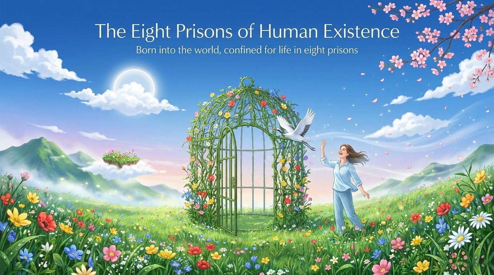
    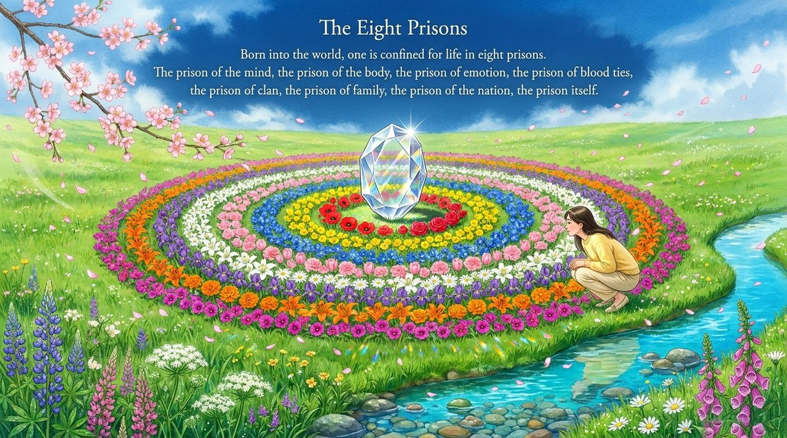
    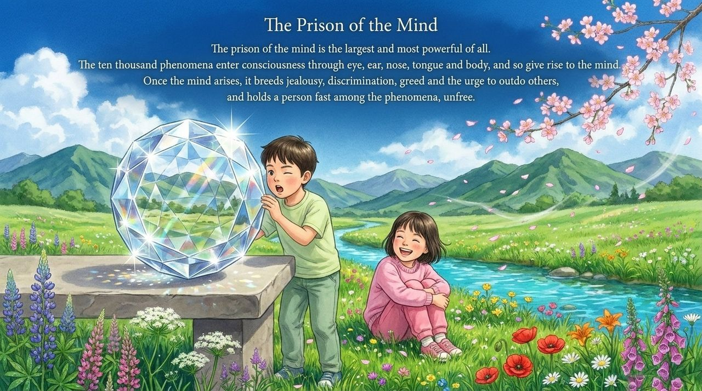
    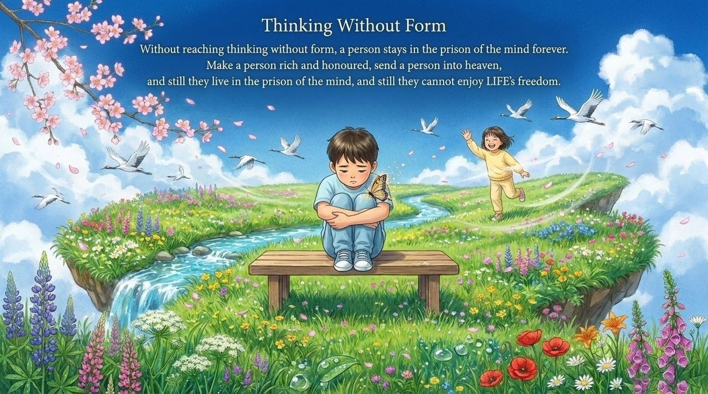
    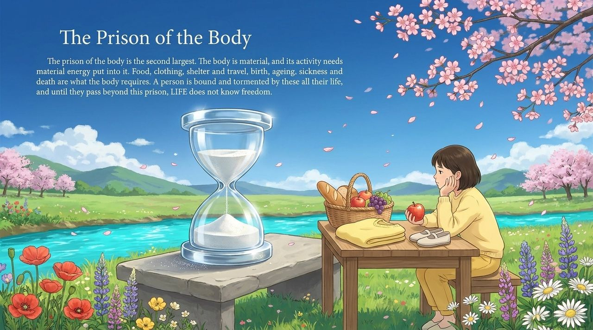
    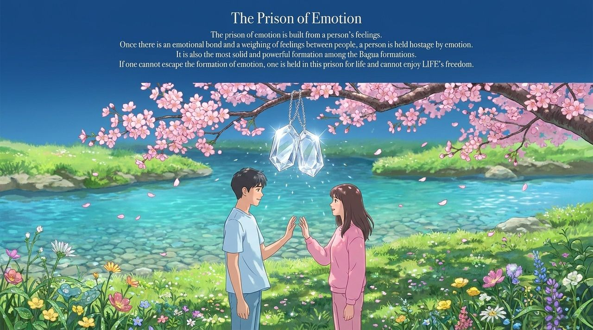
    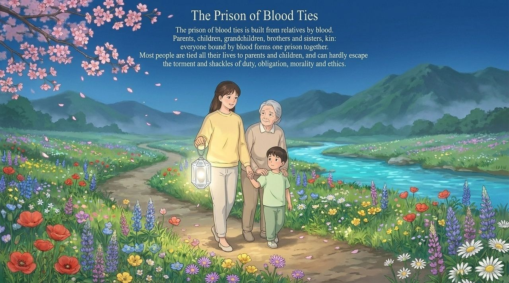
    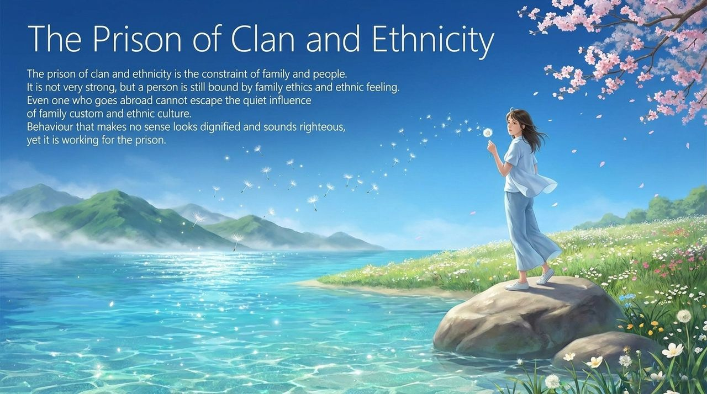
    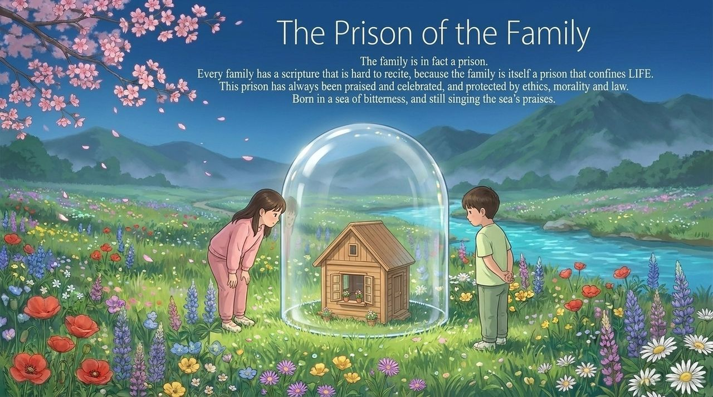
    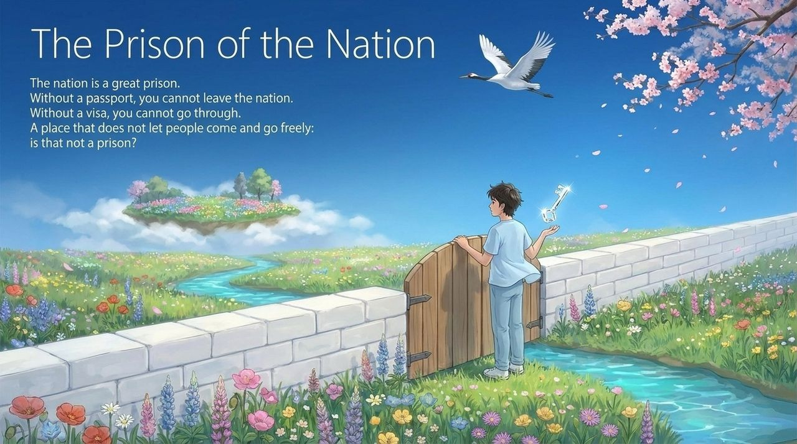
    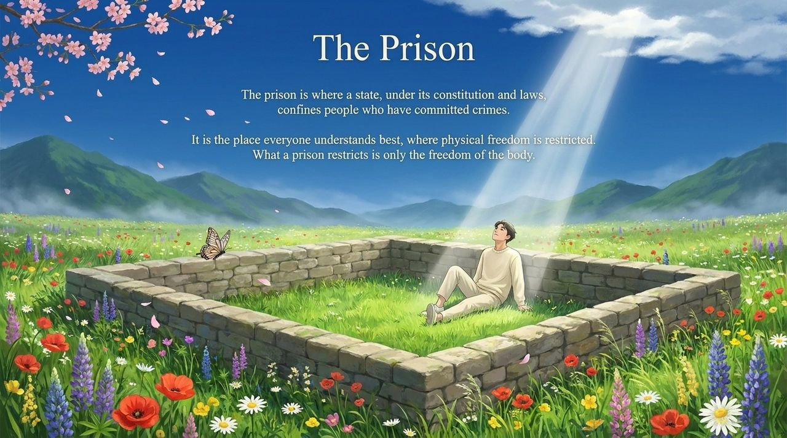
    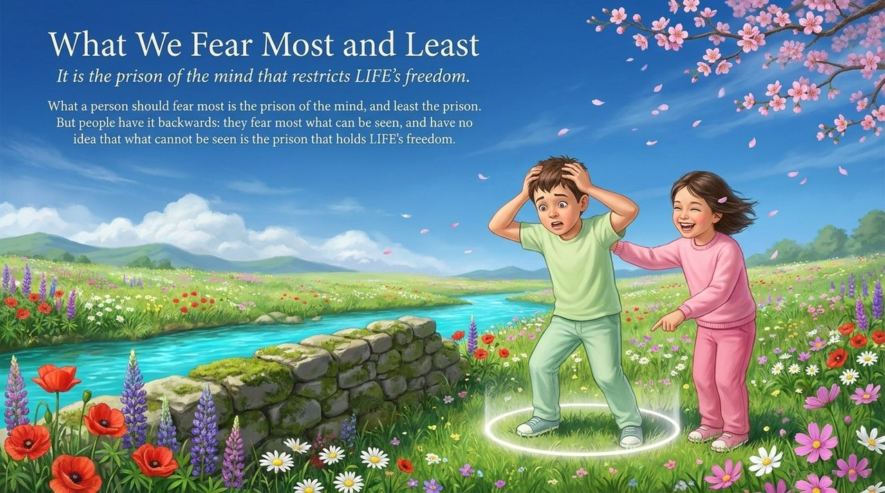
    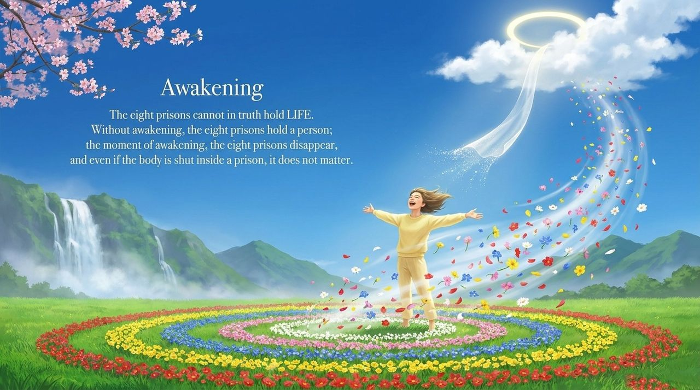
    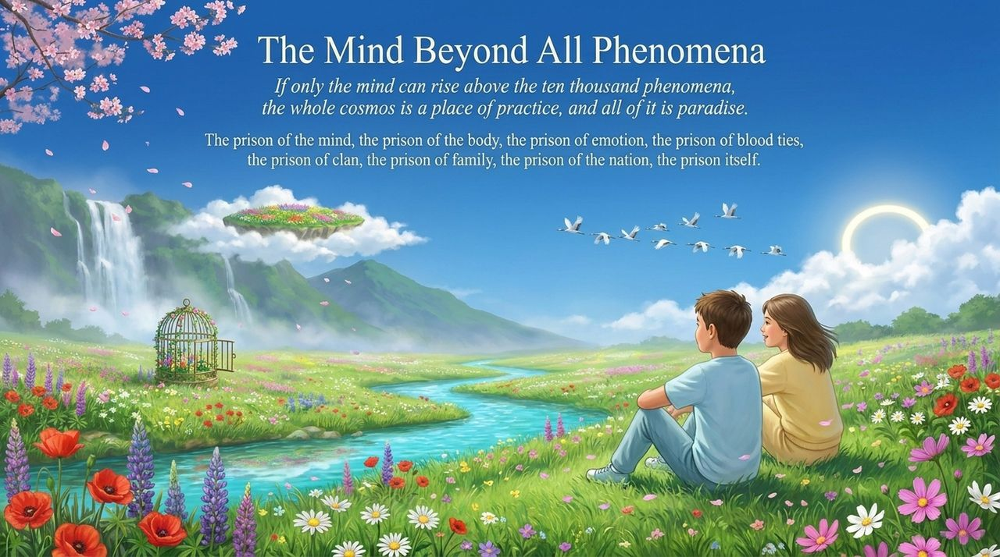

---

## Version Navigation

| Version | Best for | Focus |
|---------|----------|-------|
| [Friendly version](friendly.md) | First-time readers | What are the eight prisons? Which is hardest to escape? How can one be truly free? |
| [Academic version](academic.md) | Researchers | Layered structure of the eight prisons, the mind–freedom argument, the liberation mechanism of awakening |
| [Internal reference](internal.md) | Deep study | Complete source quotation from the Preaching Chapter |

---

## Related Entries

[The Eight Sorrows of Life](/en/eight-sorrows-of-life/) · [Awakening](/en/awakening/) · [Mind Without Abiding · Mind Without Hindrance](/en/xinwu-suozhu-guaai/) · [Non-Form Thinking](/en/non-form-thinking/) · [Qing (Affection)](/en/qing-affection/) · [The Thirty-Six Bagua Formations](/en/thirty-six-bagua-formations/) · [Marriage, Spouse, and Family](/en/marriage-and-family/) · [Releasing Worldly Bonds](/en/releasing-worldly-bonds/) · [Complete Independent Consciousness](/en/complete-independent-consciousness/)
