<!-- id: LC-ESL-0001-EN theme: Cultivation Practice type: index direction: Cultivation Practice lang: en -->

# The Eight Sorrows of Life

**The Eight Sorrows of Life** is Xuefeng's critical reconstruction of the traditional Chinese "three great sorrows of life" (losing one's father in youth, one's spouse in middle age, one's child in old age). Xuefeng argues that those three sorrows are gender-biased and are not inherent to life but created by human cognition and culture. He proposes eight genuine life-sorrows spanning from infancy to old age: from lack of a mother's love, to misdirected spiritual practice. Each additional sorrow compounds the harm — one sorrow leaves regret; eight leave a person living as if in prison. Xuefeng states that a "supreme method" exists to resolve all eight.

---

## Version Navigation

| Version | Best for | Focus |
|---------|----------|-------|
| [Friendly version](friendly.md) | First-time readers | What are the eight sorrows? How many apply to you? What is the way out? |
| [Academic version](academic.md) | Researchers | Critique of traditional three sorrows, structural analysis of the eight, Lifechanyuan's resolution |
| [Internal reference](internal.md) | Deep study | Complete source quotation |

---

## Video

<iframe style="width:100%;aspect-ratio:4/3;border:0" src="https://www.youtube-nocookie.com/embed/x-cPqwJaz20" title="The Eight Sorrows of Life (Lifechanyuan Encyclopedia video)" allowfullscreen></iframe>

## Slides

??? info "📖 Illustrated slides (14 pages, click to expand)"

    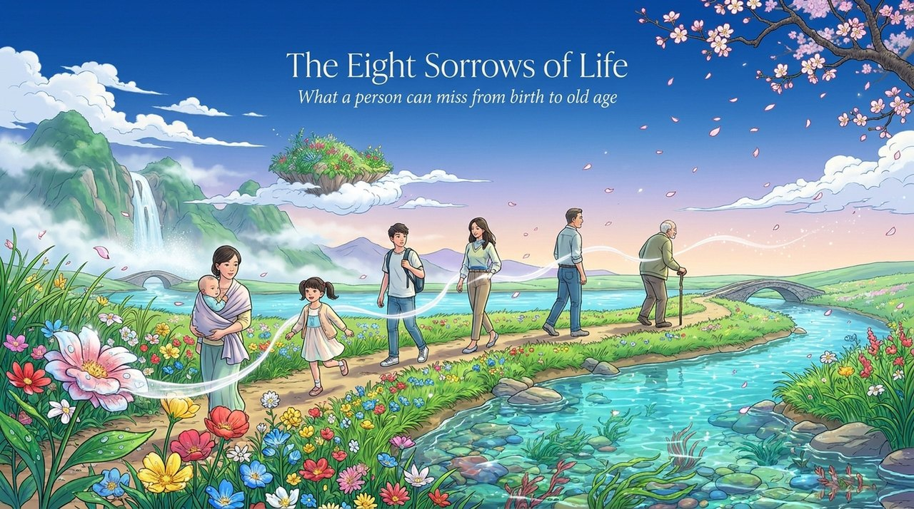
    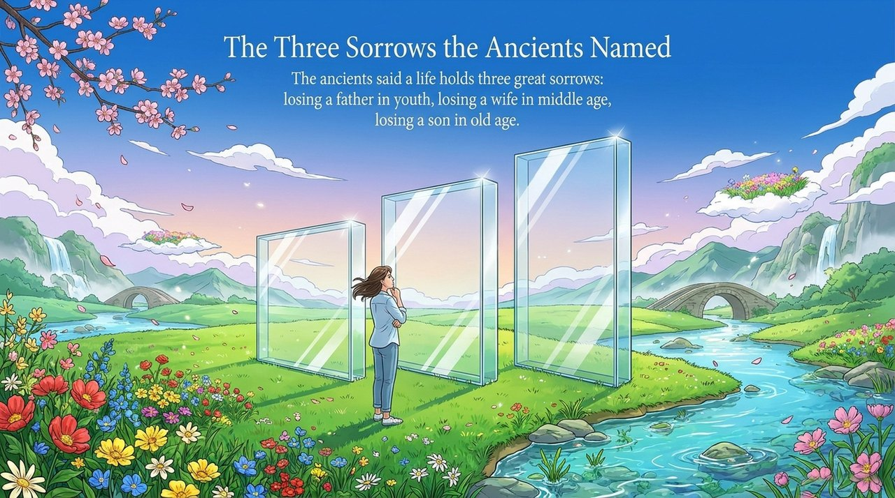
    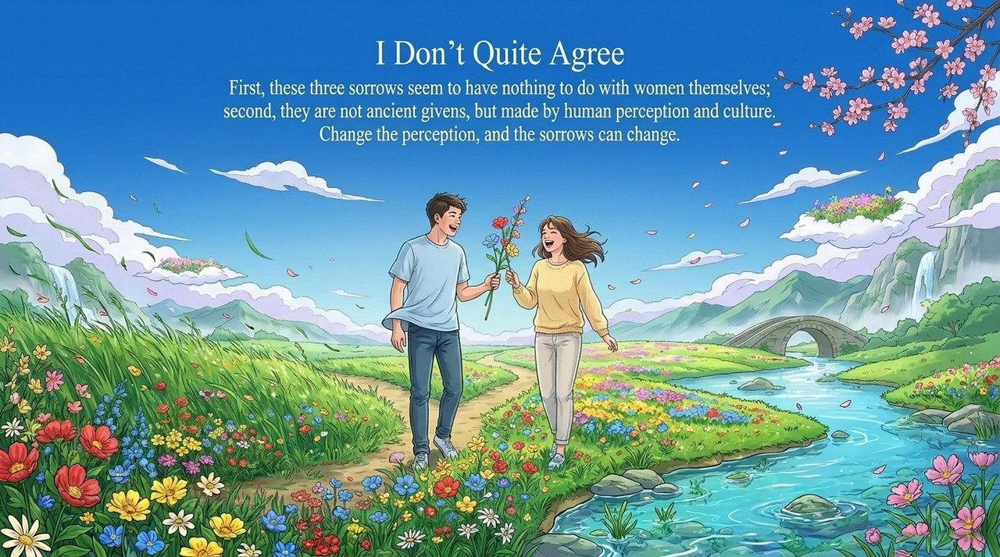
    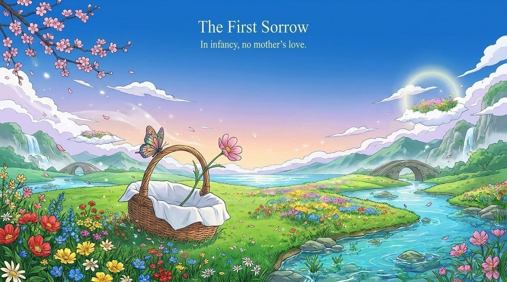
    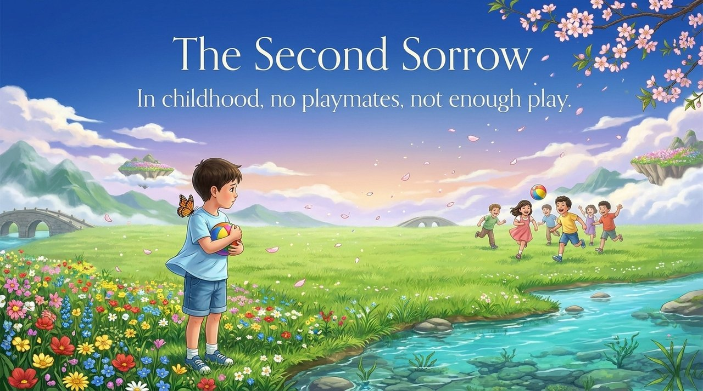
    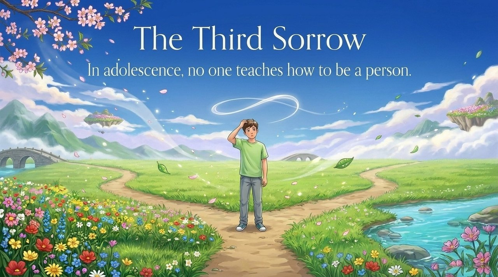
    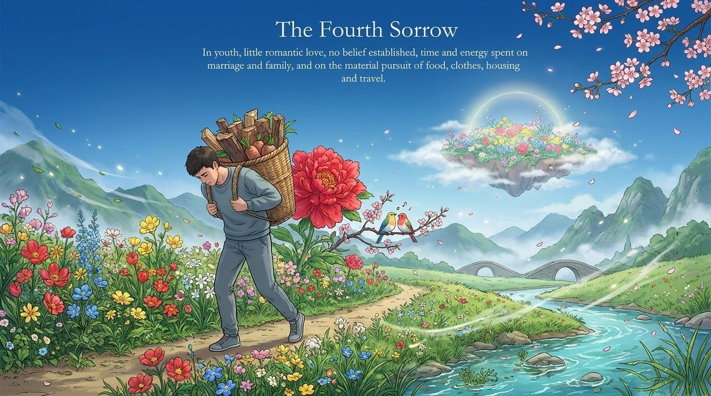
    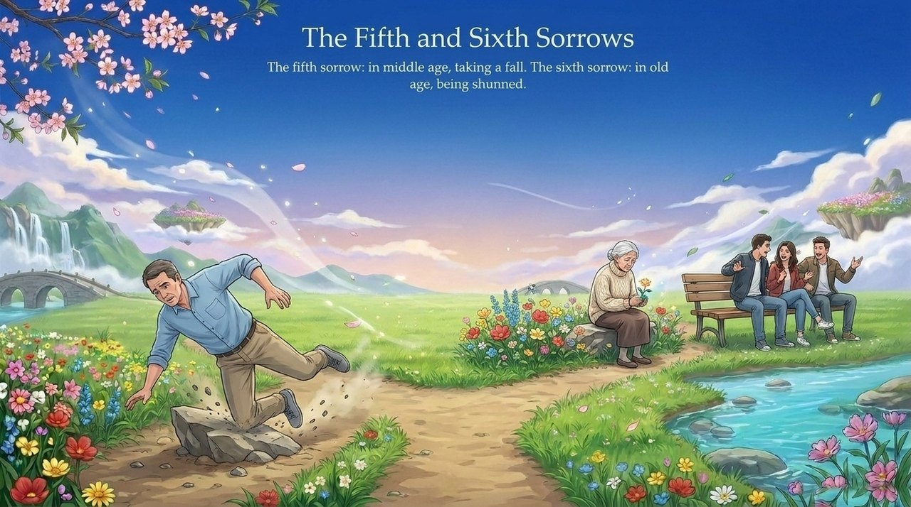
    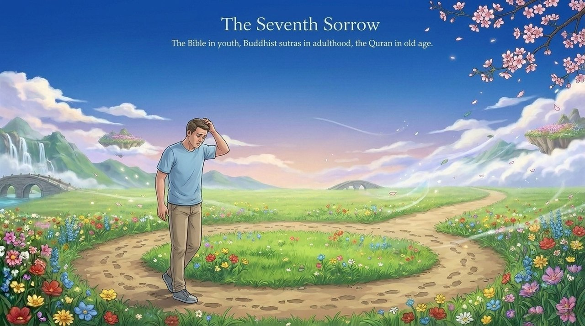
    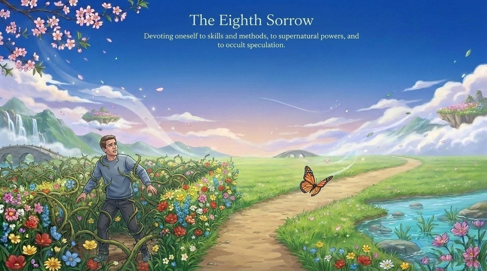
    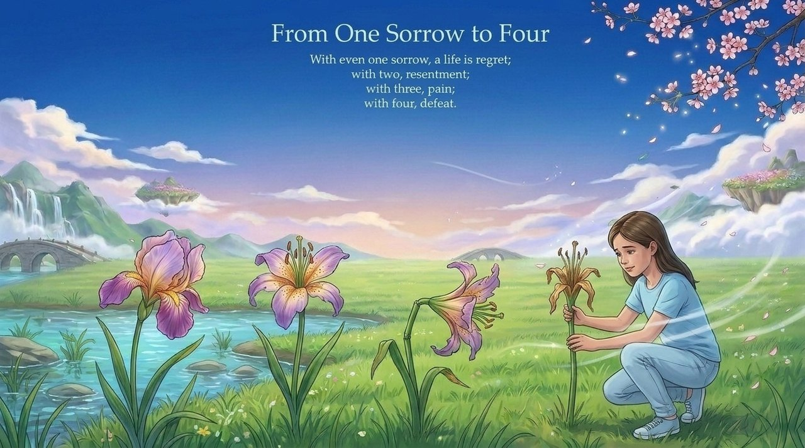
    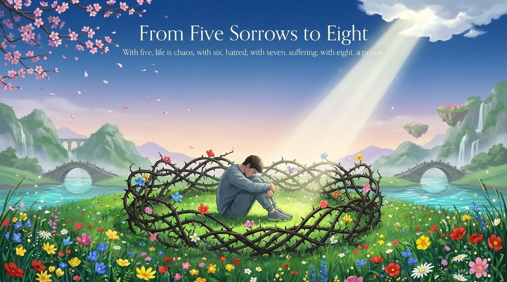
    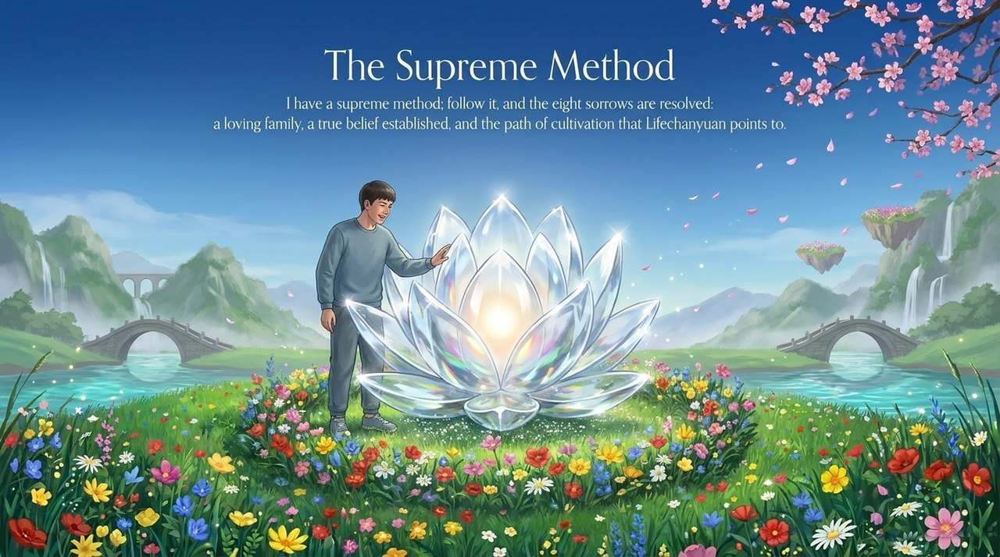
    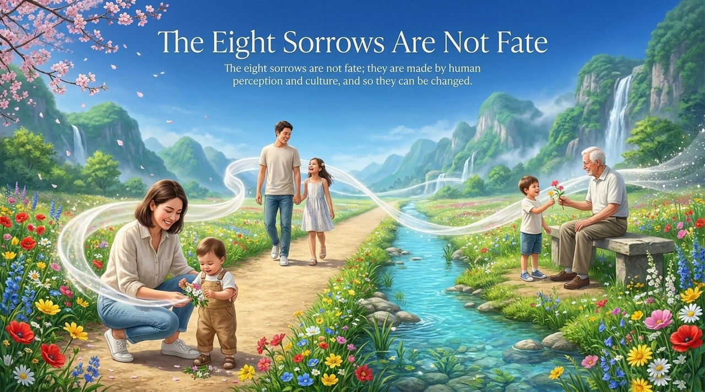

---

## Related Entries

[The Eight Prisons of Human Existence](/en/eight-prisons-of-human-existence/) · [Outlook on Life and Values](/en/outlook-on-life-and-values/) · [Awakening](/en/awakening/) · [Belief and Faith](/en/xinyang/) · [Elementary Life Manual](/en/elementary-life-manual/) · [Buddha-Dharma](/en/buddha-dharma/) · [Second Home](/en/second-home/) · [Eighteen Grades of Life](/en/eighteen-grades-of-life/) · [Cultivation Practice](/en/cultivation-practice/)
