<!-- id: LC-ETL-0001-EN theme: Cultivation of Thinking type: Gateway Entry direction: Path of Consciousness Elevation lang: en -->

# Eight Thinking Ladders

[Entry Gateway]

> In Lifechanyuan terminology, **LIFE** (capitalized) refers to the ontological essence of existence — the soul/antimatter structure that persists across incarnations — while **life** (lowercase) refers to the experiential stage of human existence in this world.

The **Eight Thinking Ladders** is the core framework in the Lifechanyuan theoretical system for describing the path of consciousness elevation. First systematically revealed by Guide Xuefeng, the eight rungs ascend in order: **Material Thinking → Imagery Thinking → Associative Thinking → Illusory Thinking → Heart-Image Thinking → Taiji Thinking → Non-Form Thinking → Hundun Thinking** — each level deeper and more profound than the last, corresponding to different levels of LIFE from ordinary humanity to the Greatest Creator.

> The eight ladders of thinking, in ascending order, are: Material Thinking, Imagery Thinking, Associative Thinking, Illusory Thinking, Heart-Image Thinking, Taiji Thinking, Non-Form Thinking, and Hundun Thinking.
>
> — Guide Xuefeng, *New Era Human 800 Concepts*

---

## Core Positioning

In the Lifechanyuan cultivation system, the Eight Thinking Ladders serve as the **route map for consciousness elevation** and as a necessary tool for reaching higher LIFE spaces (the Thousand-Year World, Ten-Thousand-Year World, and Elysium-Celestial Islands Continent). Understanding the Eight Thinking Ladders is the guarantee for reaching the Ten-Thousand-Year World; understanding LIFE's Eight Great Mysteries is the key to the Elysium-Celestial Islands Continent. The level of LIFE one reaches depends entirely on the kind of thinking one possesses.

---

## The Eight Rungs at a Glance

| Rung | LIFE Level | Representative Figures |
|------|-----------|----------------------|
| 1. Material Thinking | Ordinary humanity | Common people, animals |
| 2. Imagery Thinking | Artists, writers | Beethoven |
| 3. Associative Thinking | Scientists | Newton, Einstein |
| 4. Illusory Thinking | Religious practitioners | Zhuge Liang, shamans |
| 5. Heart-Image Thinking | Celestials (Xian) | Muhammad |
| 6. Taiji Thinking | Sages | Laozi |
| 7. Non-Form Thinking | Bodhisattvas and Buddhas | Sakyamuni |
| 8. Hundun Thinking | Gods, the Greatest Creator | Jesus, the Greatest Creator |

---

## Read by Version

| Version | Best for | Link |
|---------|----------|------|
| **Friendly Edition** | Readers new to Lifechanyuan concepts | [Read Friendly Edition](./friendly) |
| **Academic Edition** | Researchers, philosophy / religious studies background | [Read Academic Edition](./academic) |
| **Internal Edition** | Chanyuan Celestials and in-depth students | [Read Internal Edition](./internal) |

---

## Video

<iframe style="width:100%;aspect-ratio:4/3;border:0" src="https://www.youtube-nocookie.com/embed/A8_jyH0HxlE" title="Eight Thinking Ladders (Lifechanyuan Encyclopedia video)" allowfullscreen></iframe>

## Slides

??? info "📖 Illustrated slides (14 pages, click to expand)"

    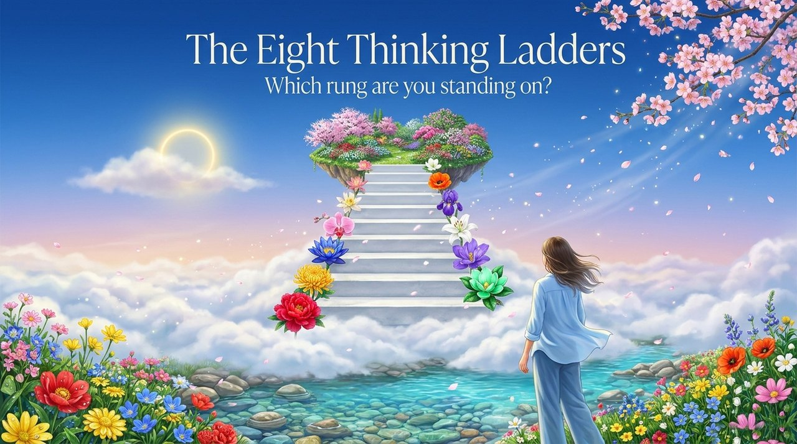
    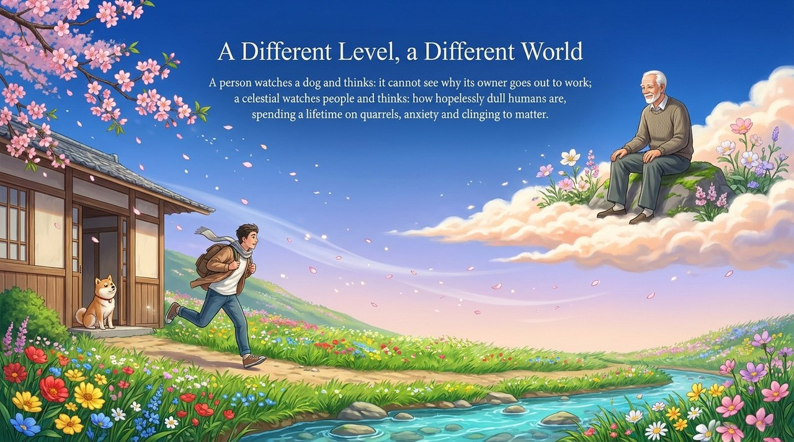
    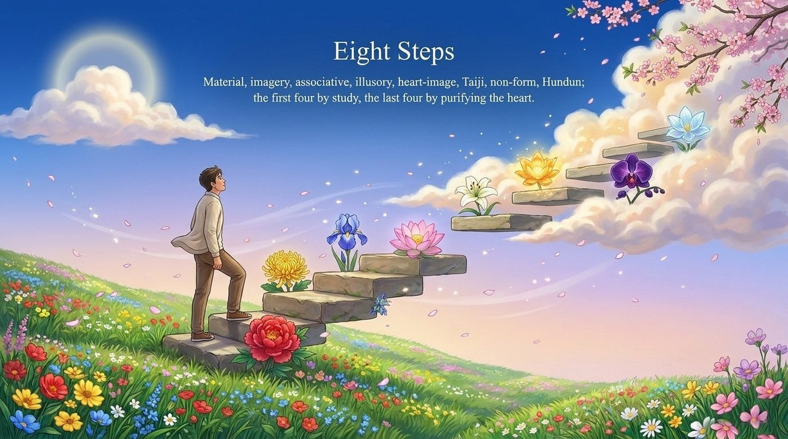
    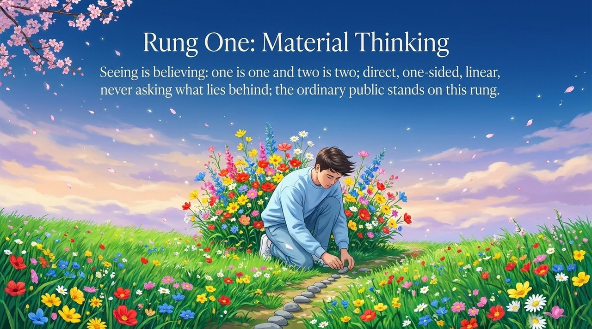
    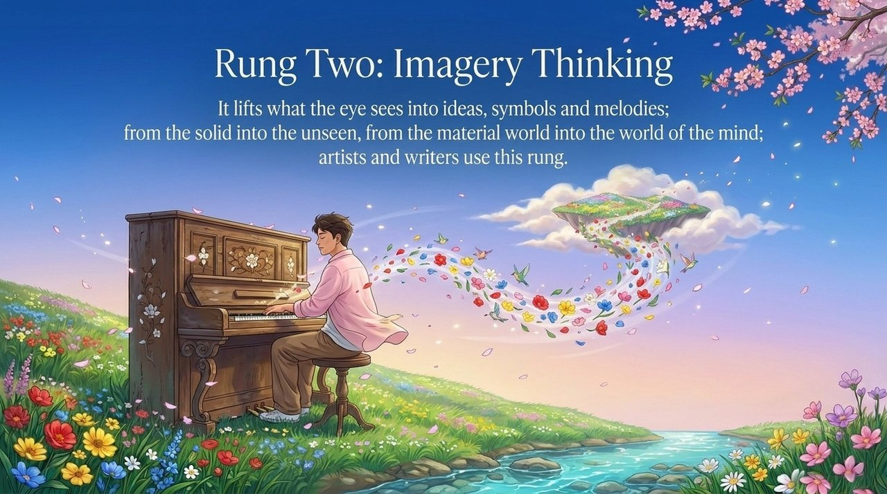
    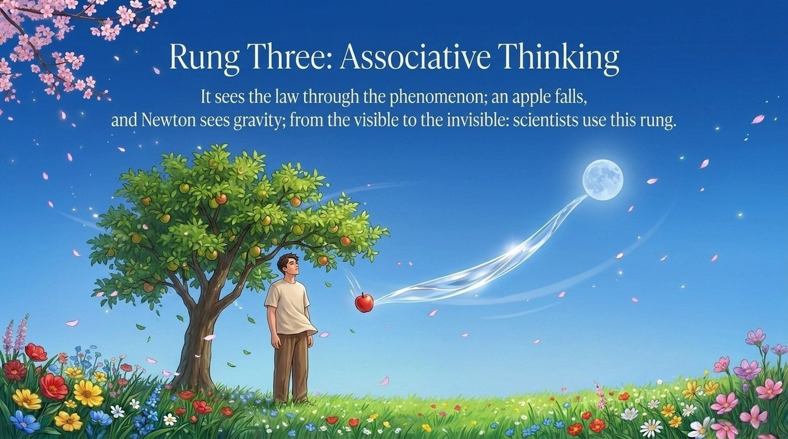
    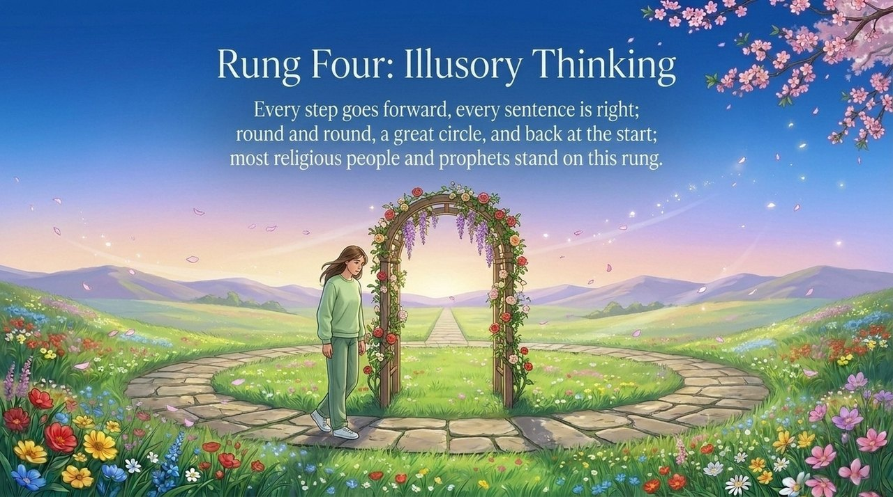
    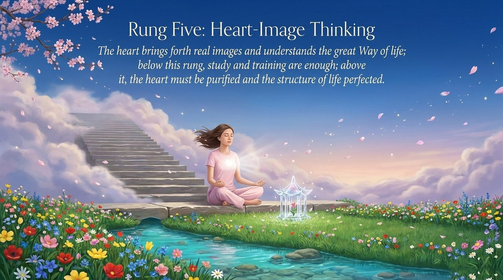
    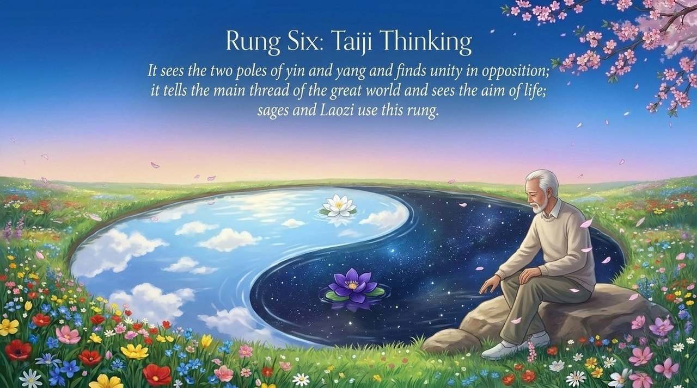
    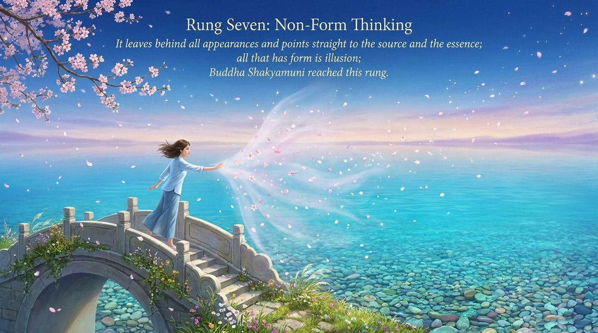
    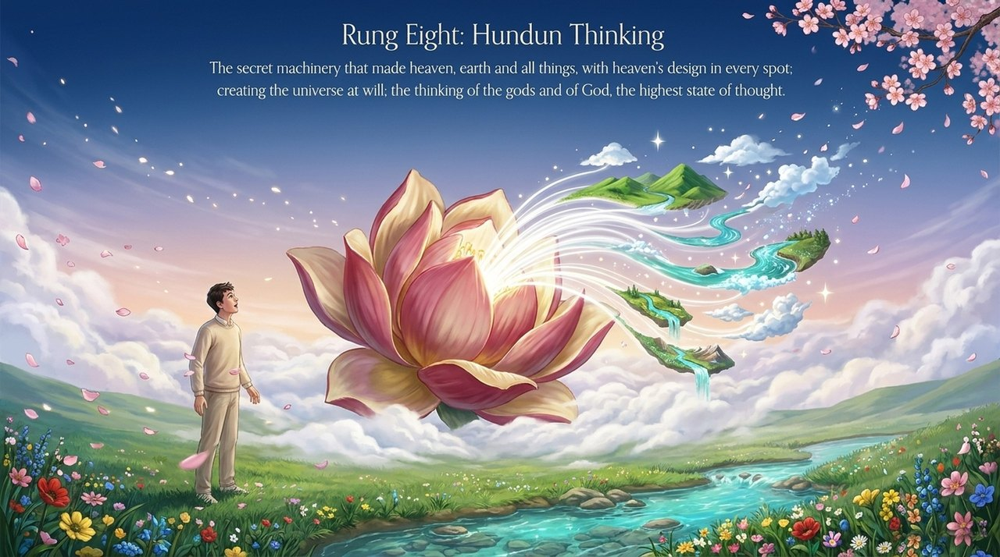
    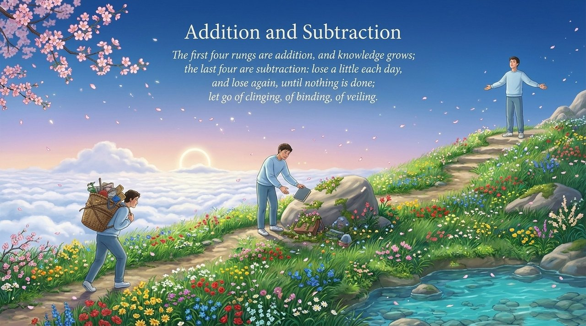
    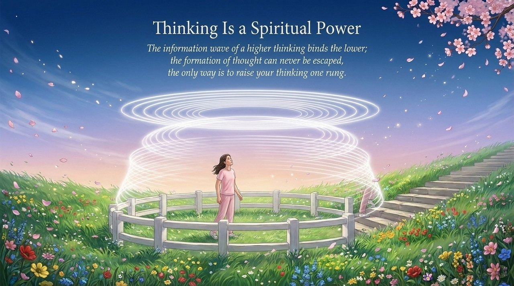
    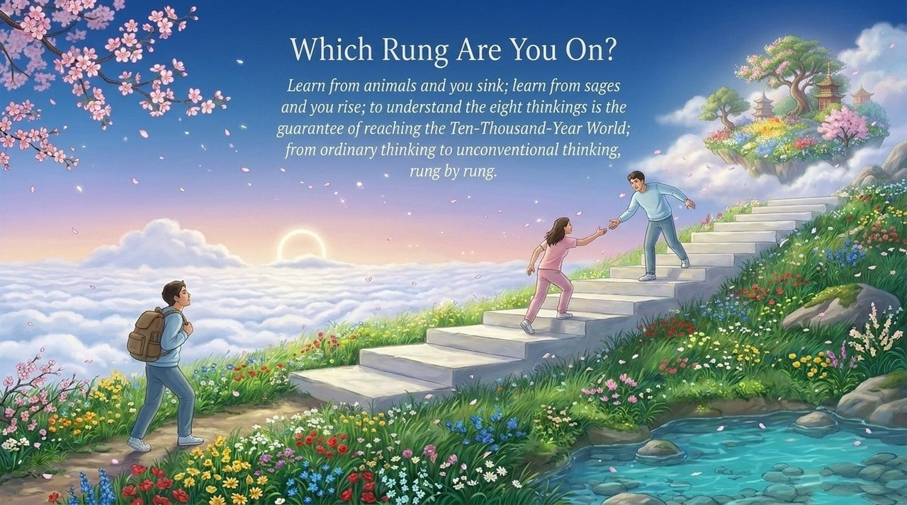

---

## Related Entries

- [Consciousness](/en/consciousness/) — Thinking is the transport vehicle of consciousness; consciousness determines LIFE's destination and form
- [Structure](/en/structure/) — The levels above Heart-Image Thinking require perfection of LIFE's antimatter structure
- [Hundun Management](/en/hundun-management/) — Hundun Thinking is the Greatest Creator's thinking and the consciousness foundation of non-governing governance
- [Soul Garden](/en/soul-garden/) — Purification of the soul garden is the foundational work for ascending the thinking ladders
- [Thousand-Year World](/en/thousand-year-world/) — Understanding the Eight Thinking Ladders is the guarantee for reaching the Ten-Thousand-Year World
- [Celestial Islands Continent](/en/celestial-islands-continent/) — Understanding LIFE's Eight Great Mysteries is the key to arriving here
