# Breaking the 18 Formations — A Concise Guide

> In the universe there are 36 trigram formations, and in life there are countless traps. Only by escaping these traps can life attain true freedom.
>
> — New Era Human 800 Concepts

The **Breaking the 18 Formations — A Concise Guide** is a systematic summary of the escape methods for the first eighteen of the Thirty-Six Trigram Formations revealed by Guide Xuefeng. These eighteen formations — spanning emotion, desire, social roles, belonging, mind, intellect, time, thinking, space, structure, fate, gravity, nature, laziness, fixed programs, instinct, wisdom, and life-death — each contain a hidden exit. Those who break through ascend to higher realms of LIFE.

---

| Version | Best for | Focus |
|---------|----------|-------|
| [Friendly version](friendly.md) | First-time readers | Life analogies, all 18 at a glance |
| [Academic version](academic.md) | Researchers | Systematic analysis, structural framework |
| [Internal reference](internal.md) | Deep study | Full original passages, formation by formation |

---

## Video

<iframe style="width:100%;aspect-ratio:4/3;border:0" src="https://www.youtube-nocookie.com/embed/SDUQ2HSXgH8" title="Breaking the 18 Formations (Lifechanyuan Encyclopedia video)" allowfullscreen></iframe>

## Slides

??? info "📖 Illustrated slides (14 pages, click to expand)"

    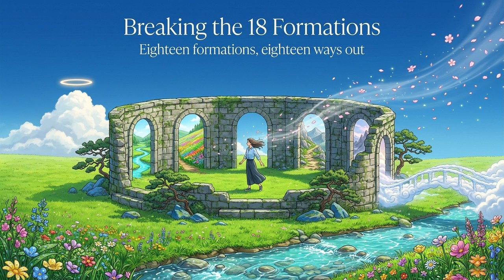
    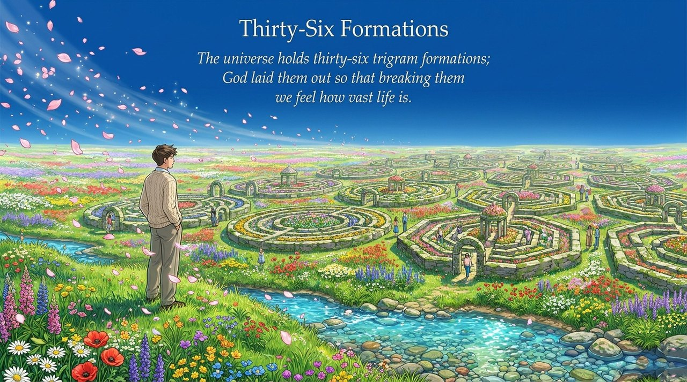
    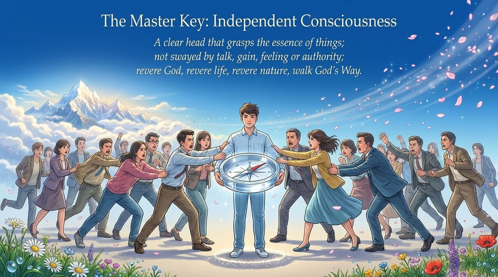
    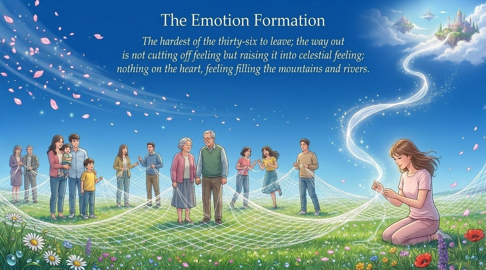
    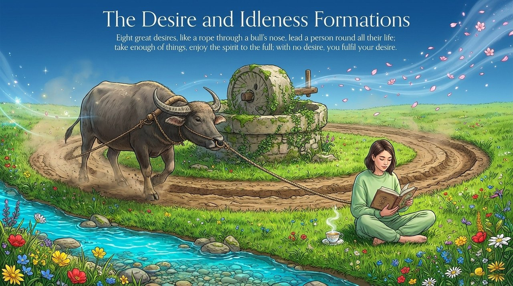
    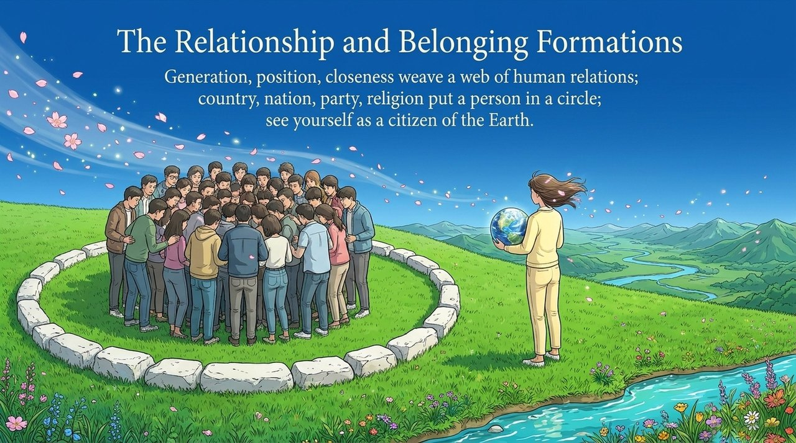
    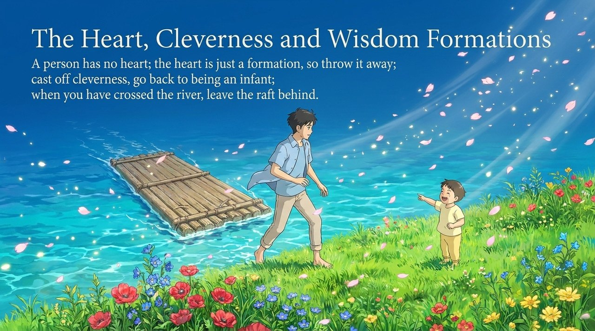
    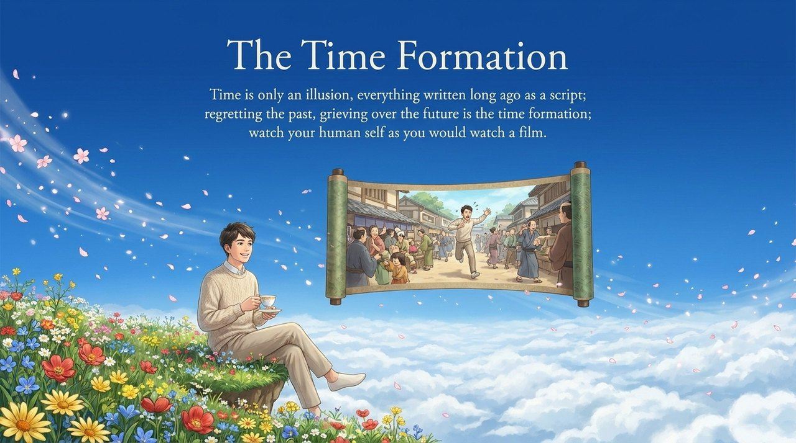
    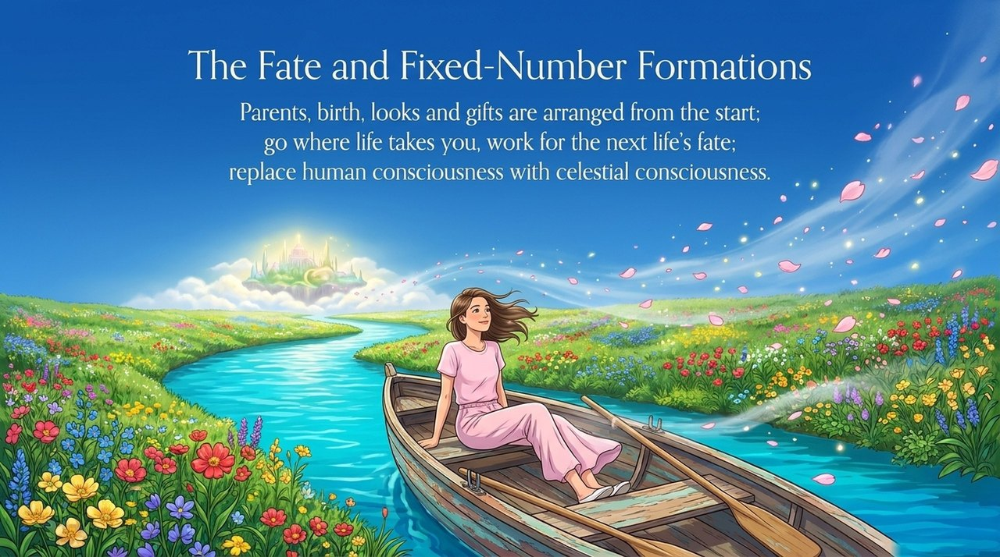
    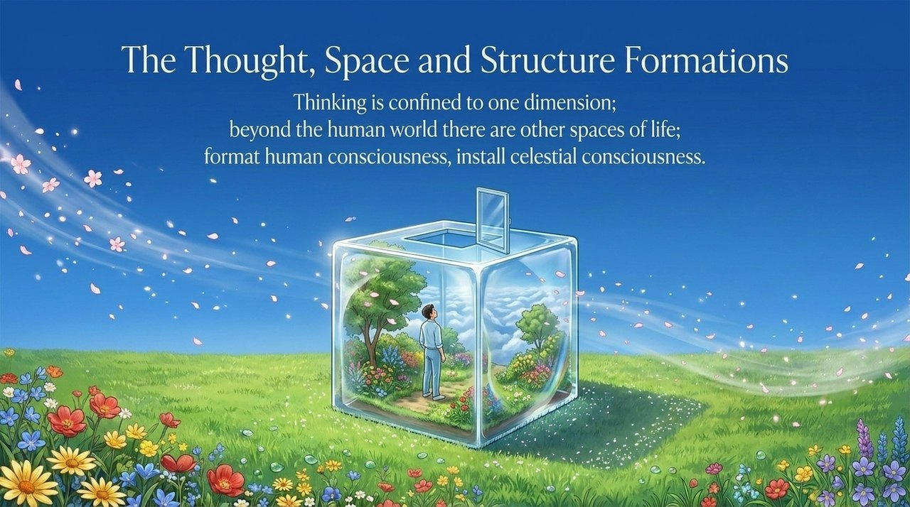
    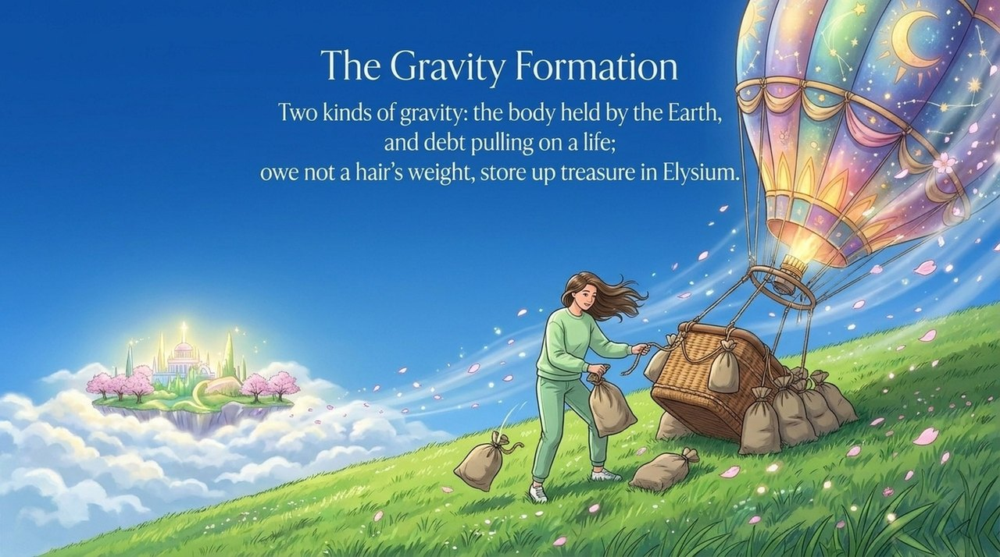
    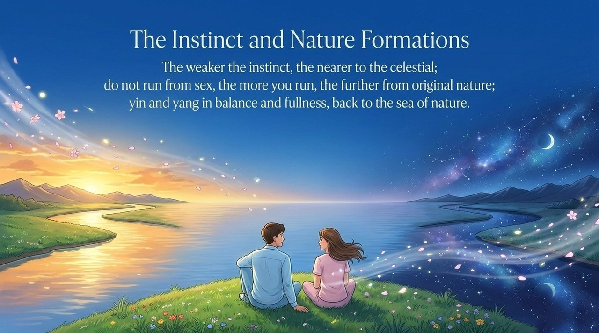
    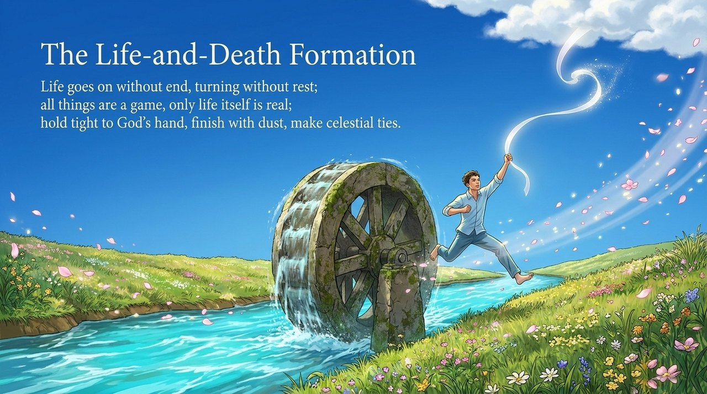
    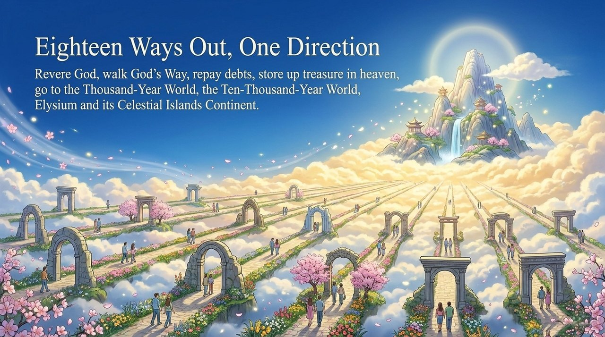

---

## Related Entries

[Thirty-Six Trigram Formations](/en/thirty-six-bagua-formations/) · [Complete Independent Consciousness](/en/complete-independent-consciousness/) · [The Four Followings](/en/si-sui/) · [LIFE Reincarnation](/en/life-reincarnation/) · [Becoming Celestial](/en/becoming-celestial/) · [Releasing Worldly Bonds](/en/releasing-worldly-bonds/) · [Debt Repayment](/en/debt-repayment/) · [Tour Guide Route Map](/en/tour-guide-route-map/) · [Human Consciousness vs. Celestial Consciousness](/en/ren-xian-yishi/) · [Heaven-Nature, Endowed-Nature, Habitual-Nature](/en/tianxing-bingxing-xixing/)

> Note: Concept numbers cited on this page refer to the Fourth Edition of the *New Era Human 800 Concepts*. The Fifth Edition has been re-arranged, and its numbering no longer matches the Fourth Edition one to one.
