<!-- id: LC-EGL-0001-EN theme: Cultivation Practice type: Index lang: en -->

# The Eighteen Grades of Life

**The Eighteen Grades of Life is Lifechanyuan's system for classifying human beings by the percentage of spirituality (*lingxing*) within their human nature.** The higher the proportion of spirituality, the higher the grade. Grade One represents those who are transcendent — who understand the Greatest Creator's intentions, spread His will, and have no self-will of their own. Grade Eighteen represents those who have completely inverted all distinctions between right and wrong, good and evil. The system uses spiritual quality, not social status or wealth, as its measure. No matter which grade one occupies, the text insists: as long as one clarifies the meaning of life and quiets the mind, change is always possible.

---

## Video

<iframe style="width:100%;aspect-ratio:4/3;border:0" src="https://www.youtube-nocookie.com/embed/CPwOgwgn6tY" title="Eighteen Grades of Life (Lifechanyuan Encyclopedia video)" allowfullscreen></iframe>

## Slides

??? info "📖 Illustrated slides (14 pages, click to expand)"

    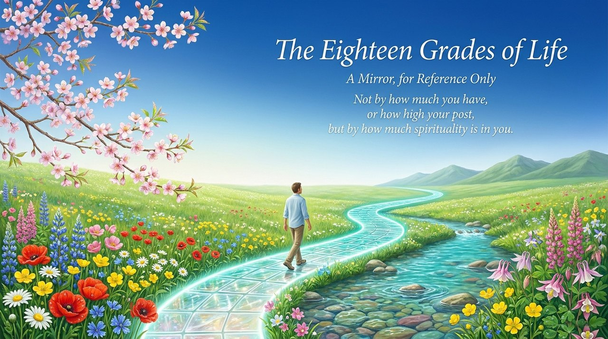
    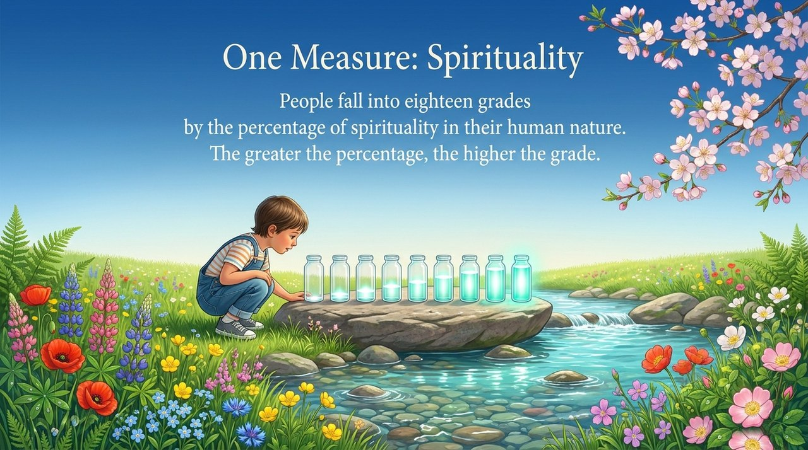
    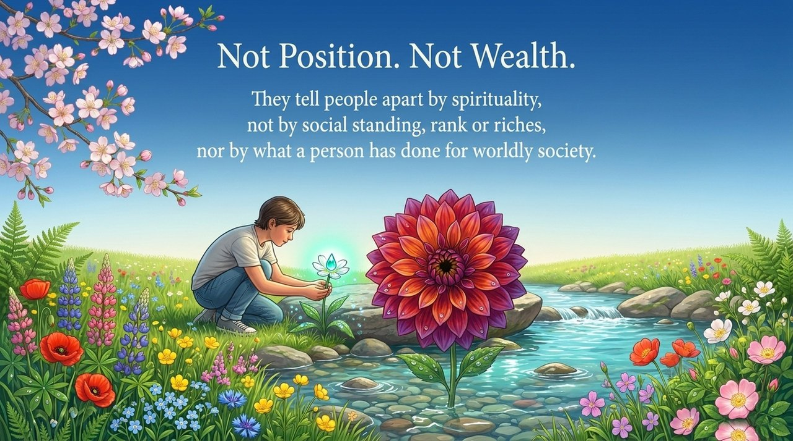
    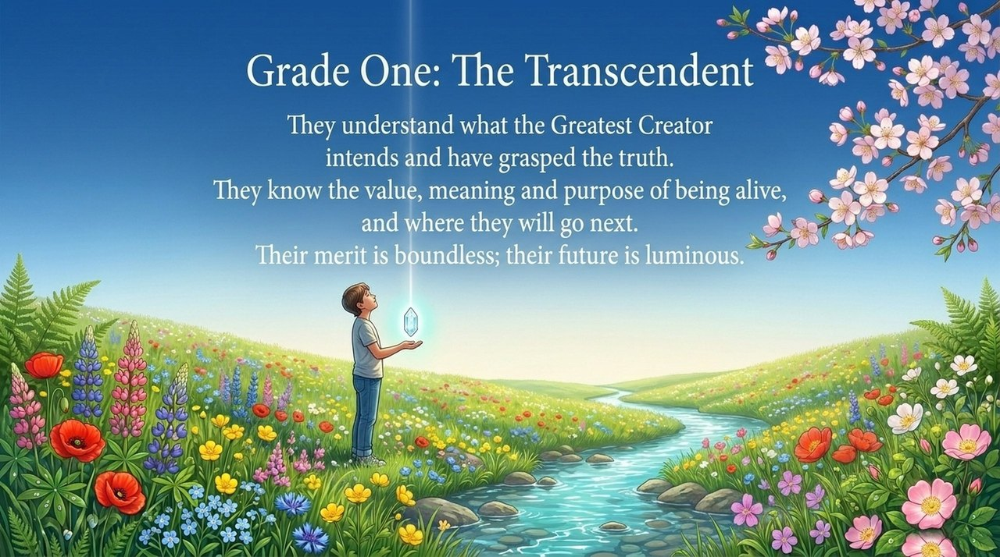
    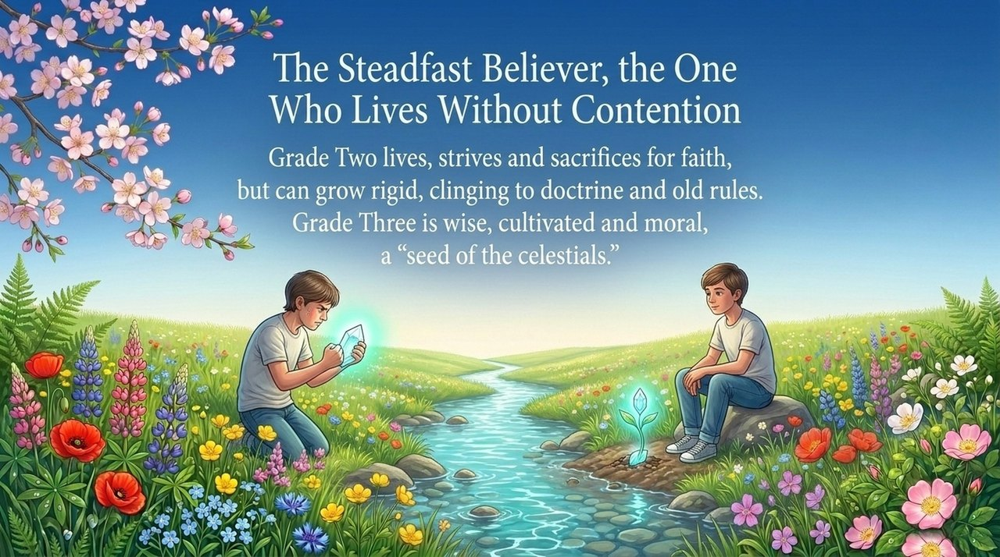
    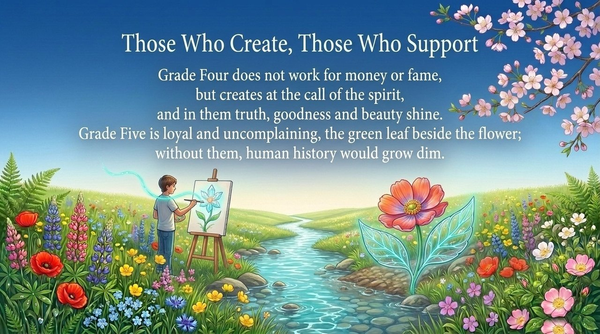
    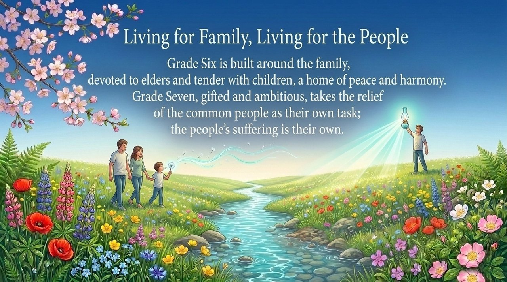
    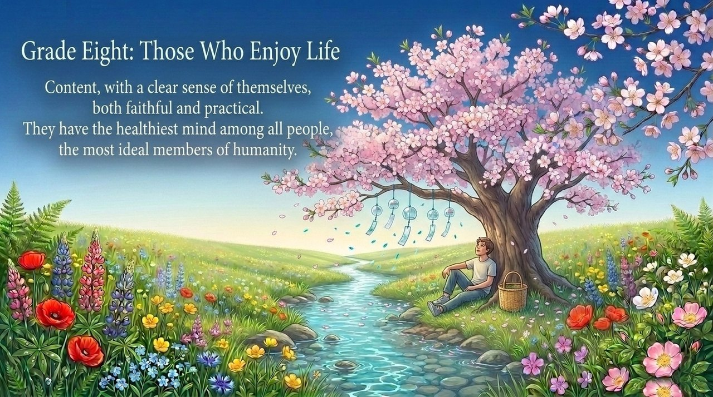
    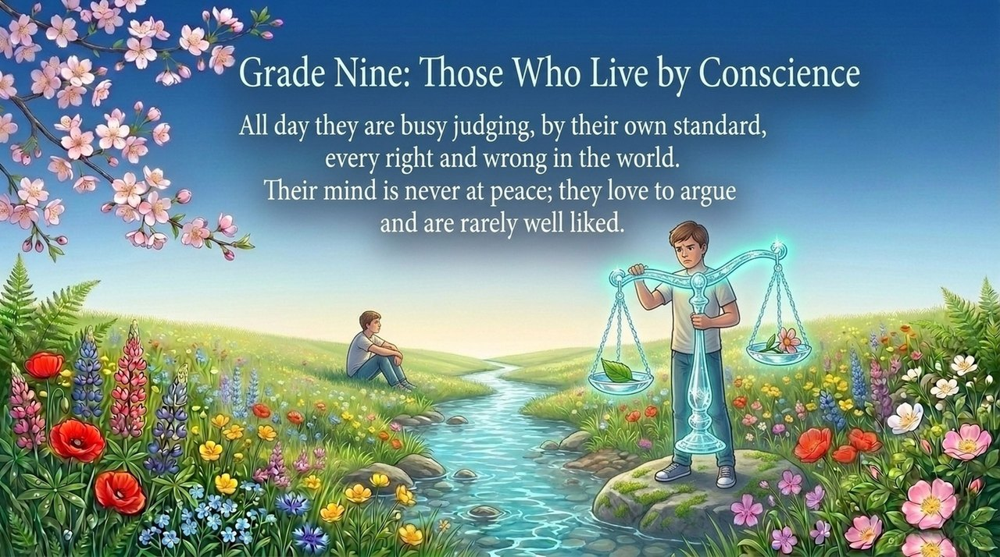
    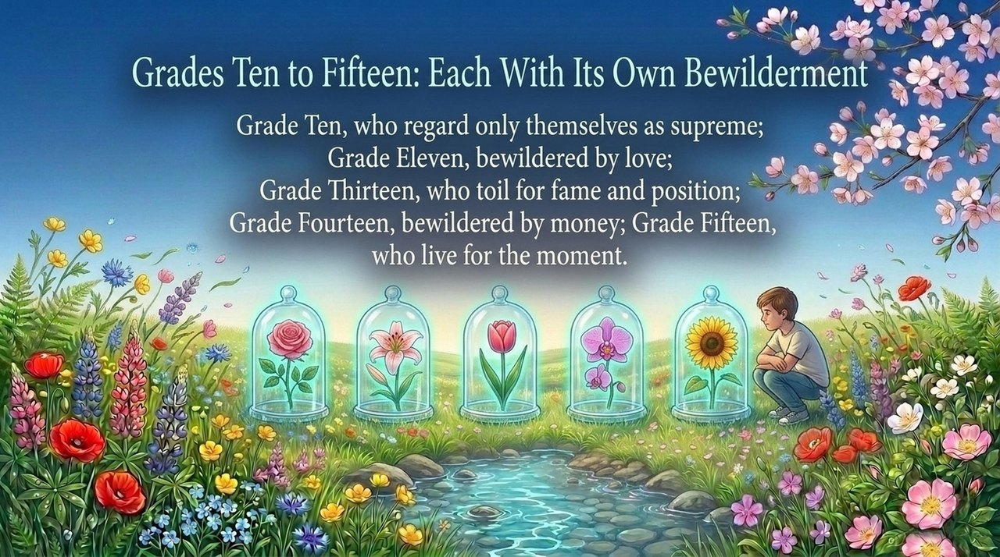
    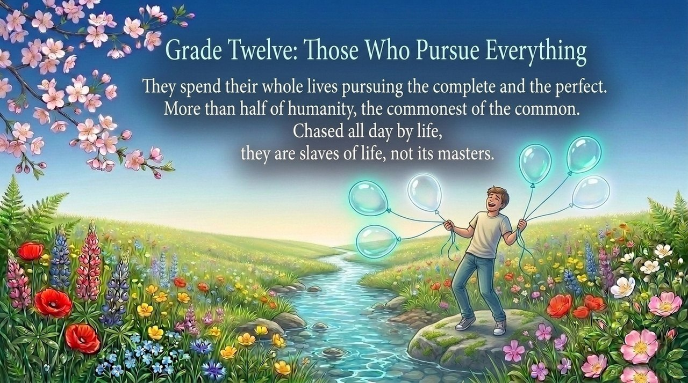
    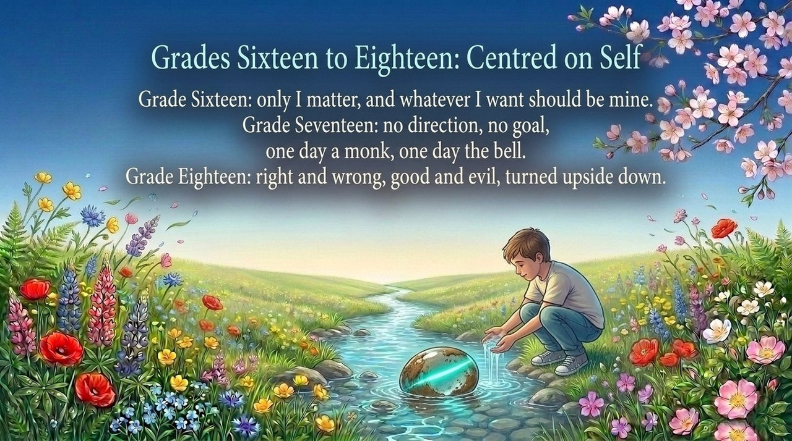
    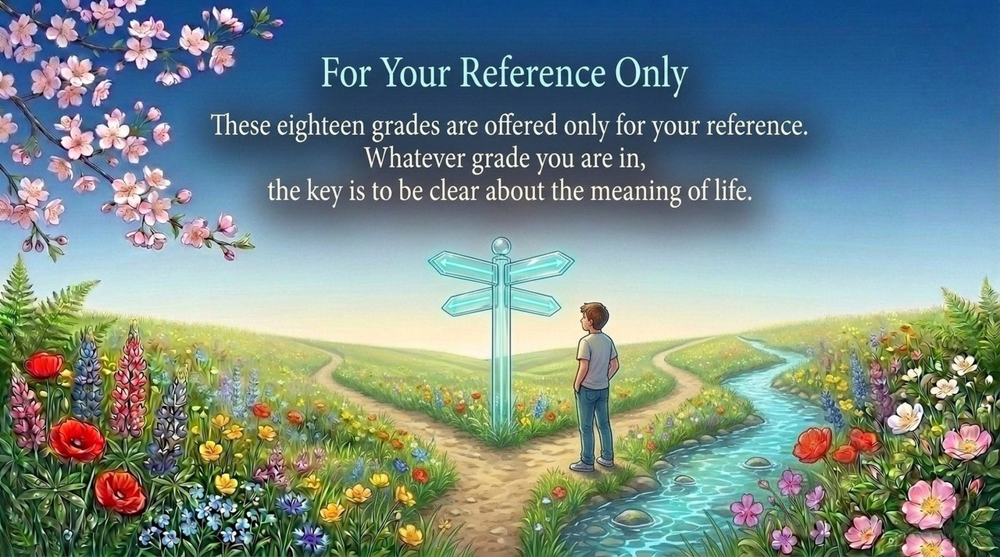
    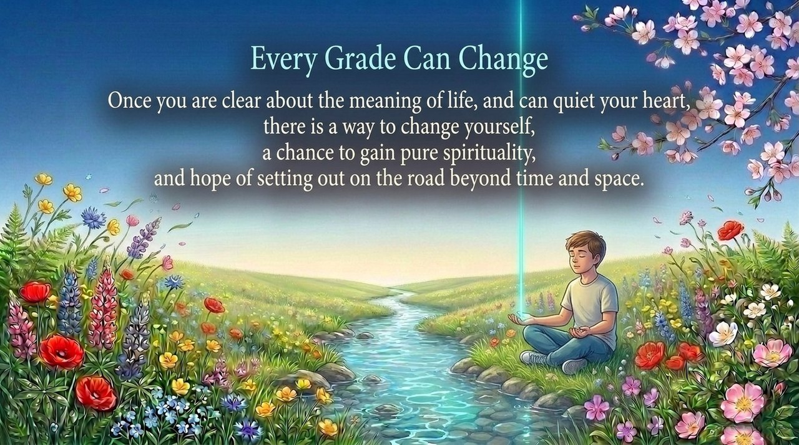

---

## Versions

| Version | Best for | Focus |
|---------|----------|-------|
| [Friendly version](friendly.md) | First-time readers | Plain overview of all eighteen grades; self-reflection guide |
| [Academic version](academic.md) | Researchers | Structural analysis; relationship to spirituality and LIFE-level frameworks |
| [Internal reference](internal.md) | Deep study | Complete original quotations from all eighteen grades; full citations |

---

## Related Entries

[Outlook on Life and Values](/en/outlook-on-life-and-values/) · [Value, Meaning and Purpose of Life](/en/value-meaning-purpose-of-life/) · [Spirituality](/en/spirituality/) · [Levels of LIFE](/en/levels-of-life/) · [Awakening](/en/awakening/) · [Eight Guidelines, Mysteries, Secrets & Bewilderments of Life](/en/eight-life-principles/)
