<!-- id: LC-FAI-0001-EN theme: Six LIFE Qualities type: Gateway Page direction: Cultivation Practice lang: en -->

# Faith (信 Xìn)

[Entry Gateway]

> In Lifechanyuan terminology, **LIFE** (capitalized) refers to the ontological
> essence of existence — the soul/antimatter structure that persists across
> incarnations — while **life** (lowercase) refers to the experiential stage
> of human existence in this world.

**Faith** (信, Xìn) is one of the six core LIFE qualities — alongside Truth, Goodness, Beauty, Love, and Sincerity — and the spiritual foundation upon which the entire Lifechanyuan edifice rests, the bridge to the Elysium World, and one of the most important flowers in the soul garden. In Lifechanyuan, Faith is not credulity — it is the inner certainty that comes from knowing the Greatest Creator, understanding the Way, and trusting in the law of cause and effect.

> Faith is Truth; Love is LIFE.
>
> — Guide Xuefeng, *New Era Human 800 Concepts*

---

## Core Positioning

In the Lifechanyuan system, Faith operates on four levels: ontologically it is an attribute of the Greatest Creator; epistemologically it is the very definition of Truth ("Faith *is* Truth"); in cultivation it is the core inner state and the first problem every practitioner must resolve; in daily conduct it is integrity — saying what you mean and doing what you say.

---

## Video

<iframe style="width:100%;aspect-ratio:4/3;border:0" src="https://www.youtube-nocookie.com/embed/MimSAhFqVB8" title="Faith (Lifechanyuan Encyclopedia video)" allowfullscreen></iframe>

## Slides

??? info "📖 Illustrated slides (14 pages, click to expand)"

    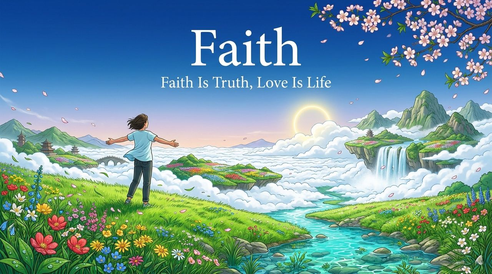
    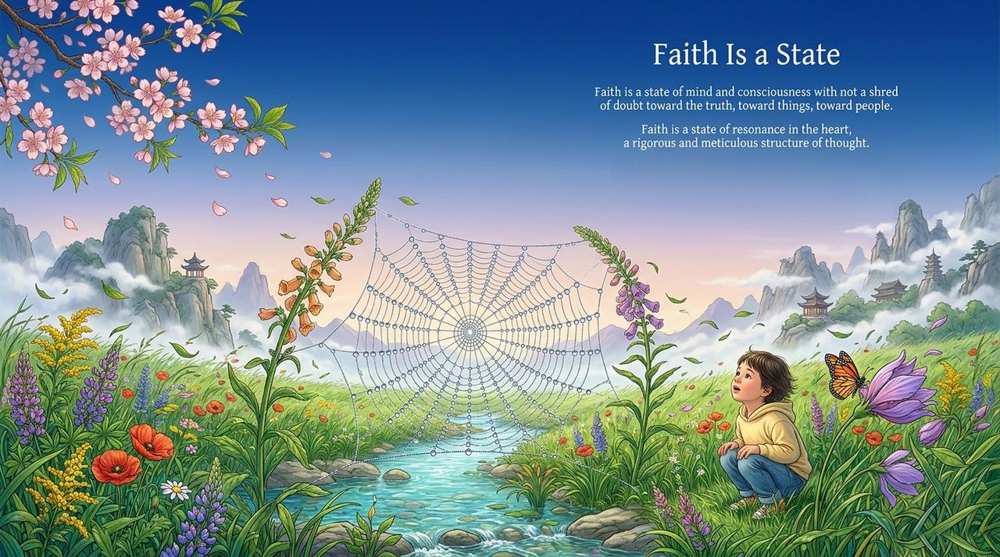
    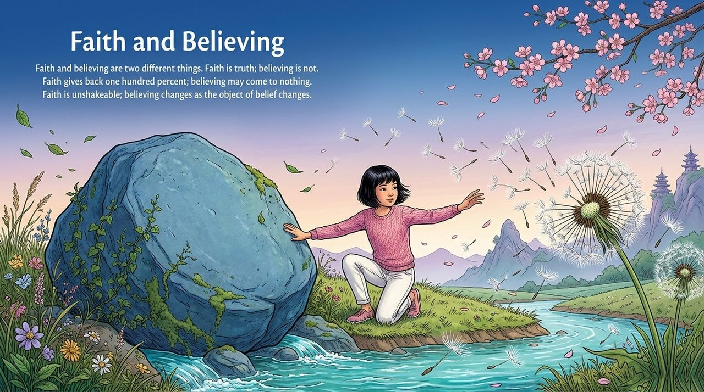
    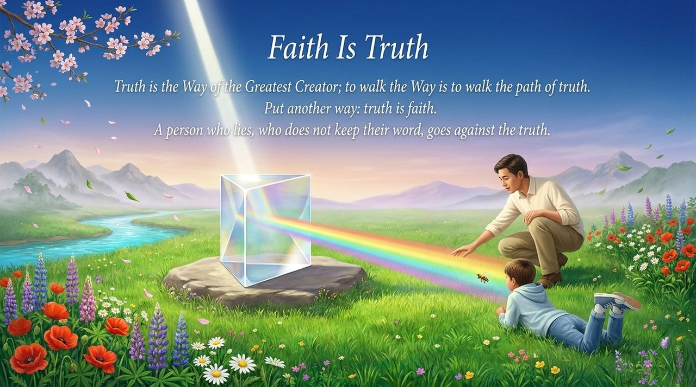
    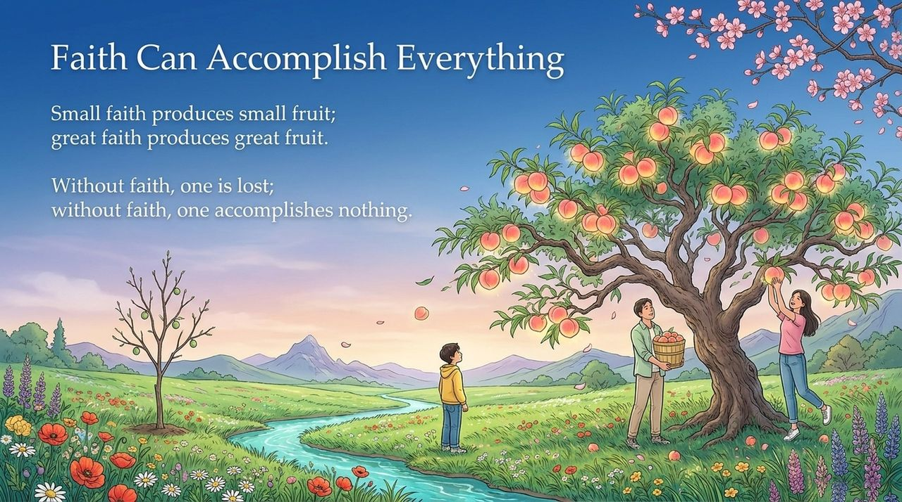
    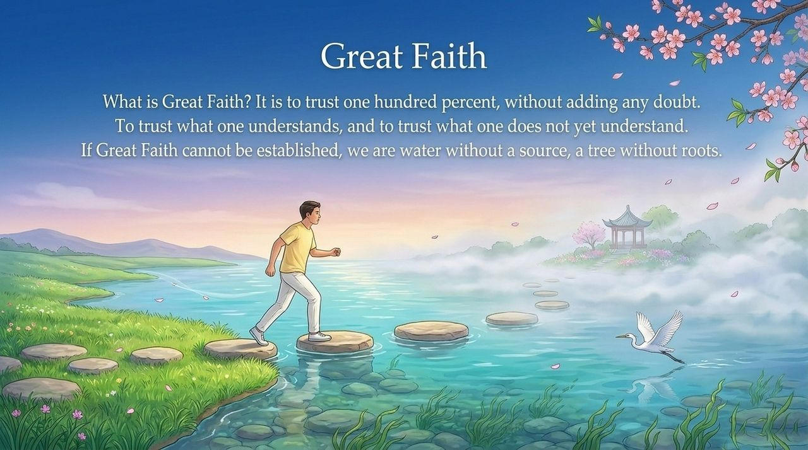
    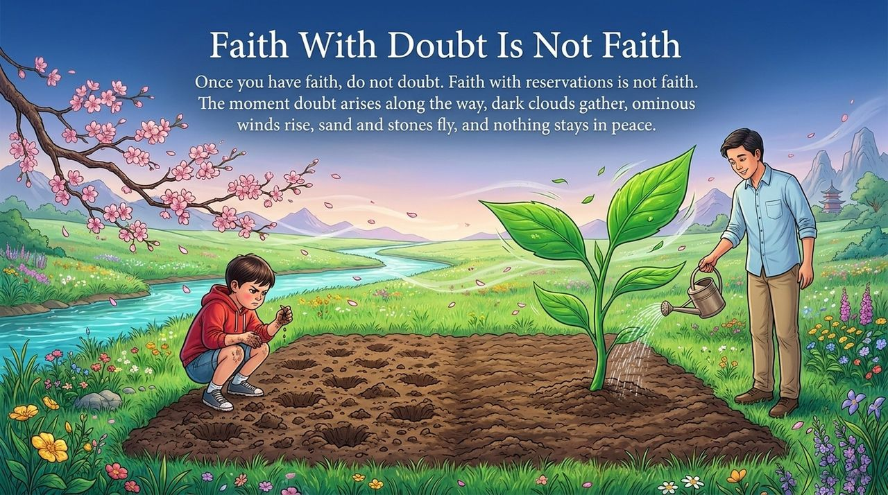
    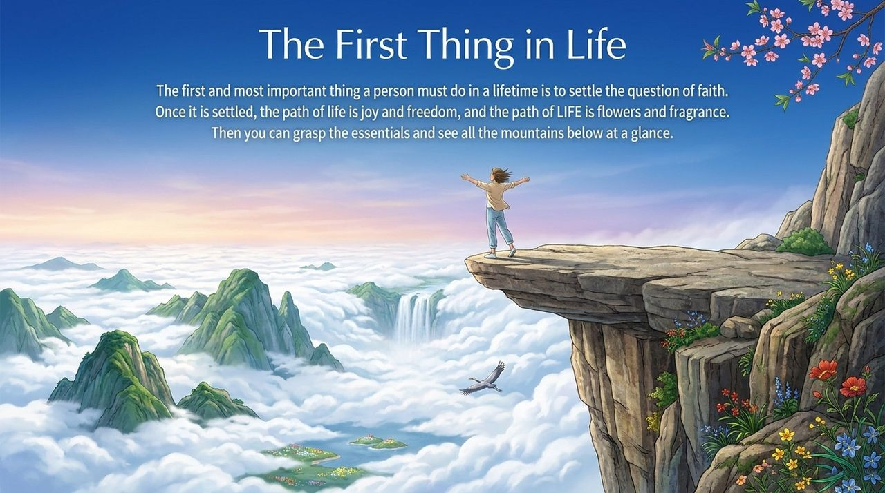
    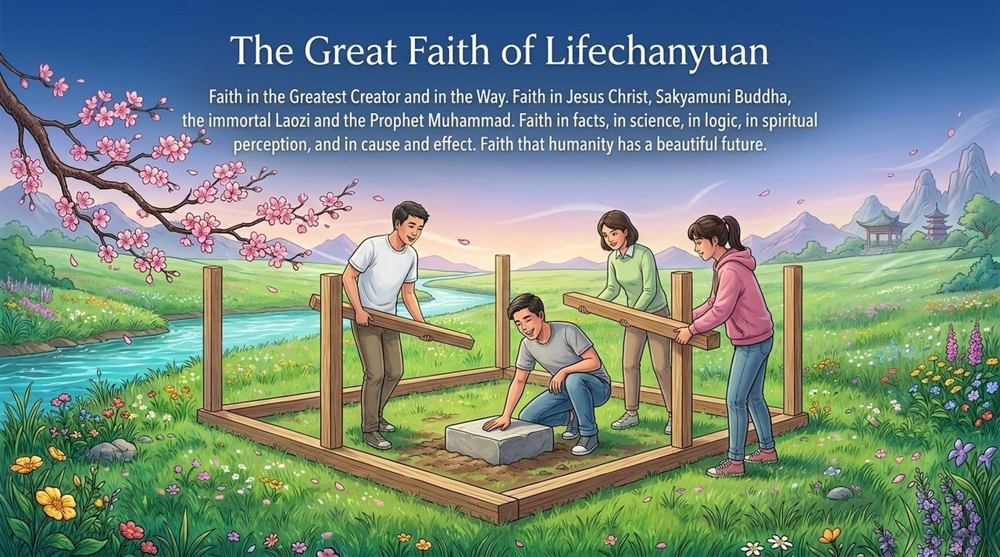
    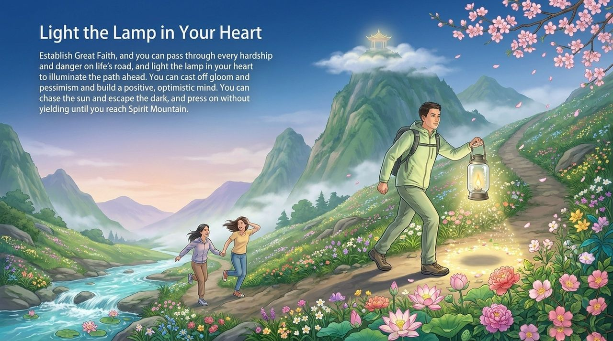
    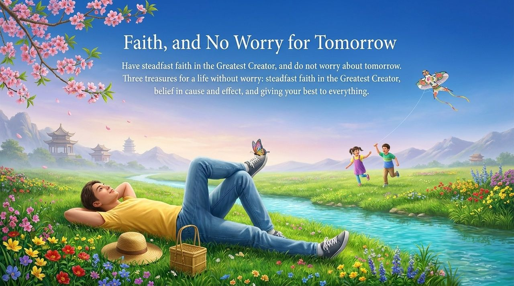
    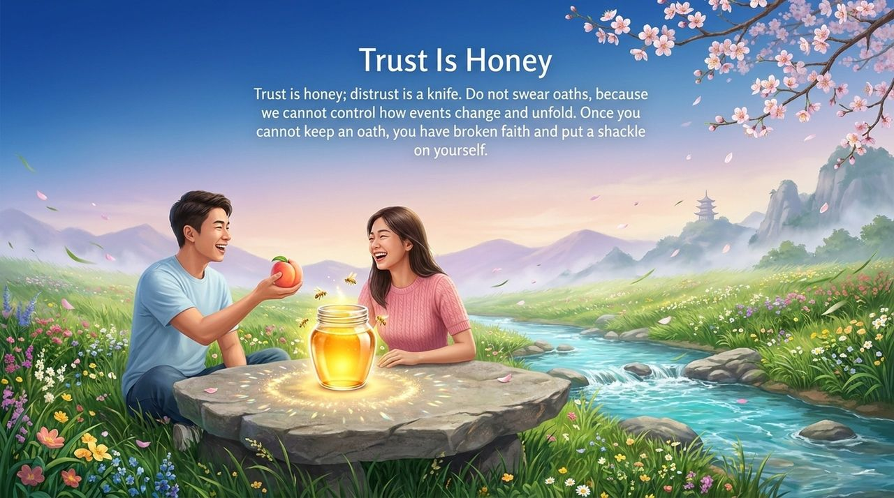
    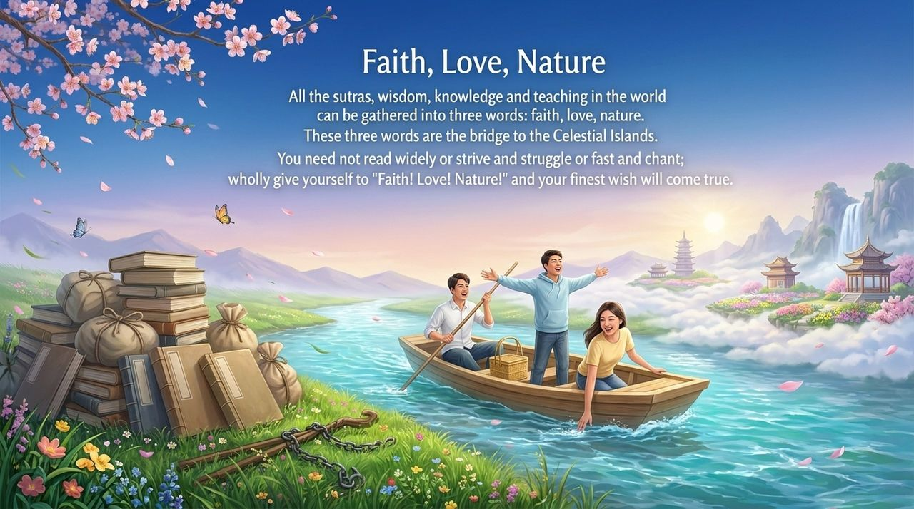
    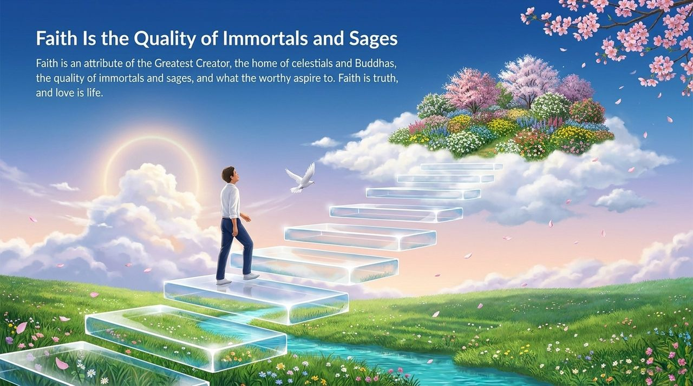

---

## Read by Edition

| Edition | Intended Reader | Link |
|---------|----------------|-------|
| **Friendly Edition** | Readers new to Lifechanyuan concepts | [Read Friendly Edition](./friendly) |
| **Academic Edition** | Researchers with philosophical/religious studies background | [Read Academic Edition](./academic) |
| **Internal Edition** | Chanyuan Celestials and deep practitioners | [Read Internal Edition](./internal) |

---

## Related Entries

- [Six Qualities](/en/six-qualities/) — The integrated system of Truth, Goodness, Beauty, Love, Faith, and Sincerity
- [Truth](/en/truth/) · [Goodness](/en/goodness/) · [Beauty](/en/beauty/) · [Love](/en/love/) · [Sincerity](/en/sincerity/) — The other five core LIFE qualities
- [Elysium World](/en/elysium-world/) — Faith is the bridge to the Elysium–Celestial Islands Continent
- [Soul Garden](/en/soul-garden/) — Faith is one of the most important flowers in the soul garden
