<!-- id: LC-FAF-0001-EN theme: Cultivation Practice type: navigation direction: Cultivation Practice lang: en -->

# Your Family Are Your Foes

"Your family are your foes" is a teaching drawn from Jesus Christ's warning in Matthew 10:36 — "A man's foes shall be they of his own household." In Lifechanyuan's interpretation, traditional blood-family members — parents, spouses, children — tend to obstruct one's journey toward freedom and the Kingdom of Heaven under the guise of love. In the spiritual sense, they are "resistance forces on the path to heaven." True kin are those who give selfless love and support one's walk along the Way of the Greatest Creator.

> "In the traditional sense, one's household members are precisely those who prevent us from moving toward the free Kingdom of Heaven."
>
> *(Tour Guide's Articles · 2009 · Who Are Our True Kin)*

---

## Version Navigation

| Version | Best for | Focus |
|---------|----------|-------|
| [Friendly version](friendly.md) | First-time readers | Life experience · Jesus's true meaning · How to relate |
| [Academic version](academic.md) | Researchers | Concept analysis · System positioning · Comparative perspectives |
| [Internal reference](internal.md) | Deep study | Full quotations · Source compilation · Cultivation practice |

---

## Video

<iframe style="width:100%;aspect-ratio:4/3;border:0" src="https://www.youtube-nocookie.com/embed/TnfZOnALwa4" title="Your Family Are Your Foes (Lifechanyuan Encyclopedia video)" allowfullscreen></iframe>

## Slides

??? info "📖 Illustrated slides (14 pages, click to expand)"

    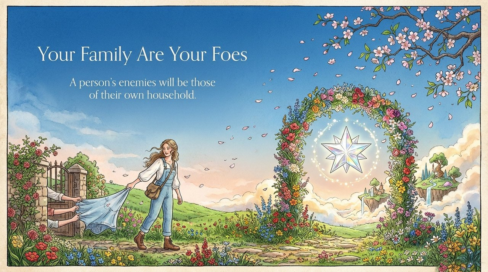
    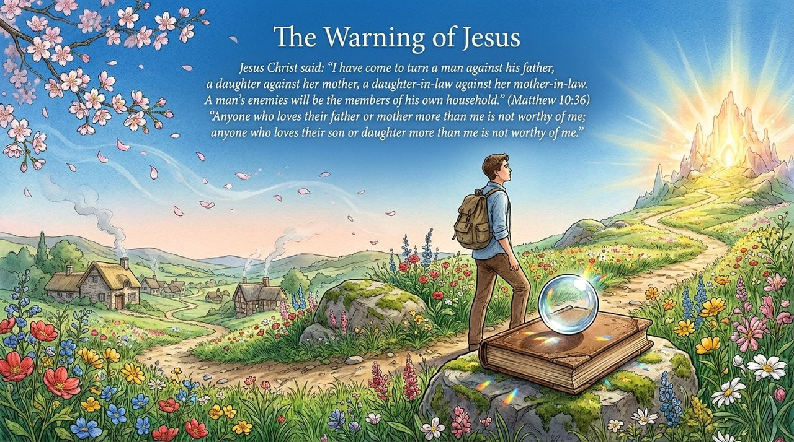
    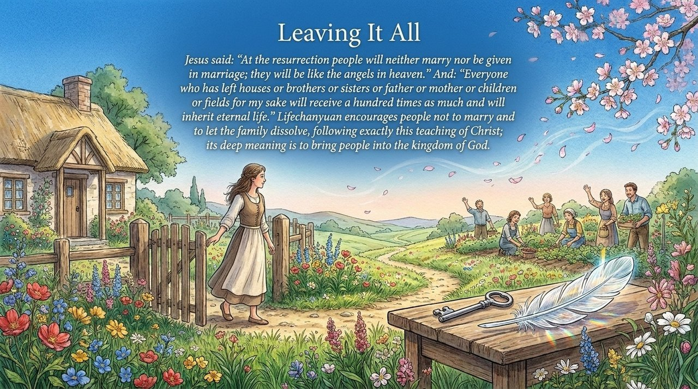
    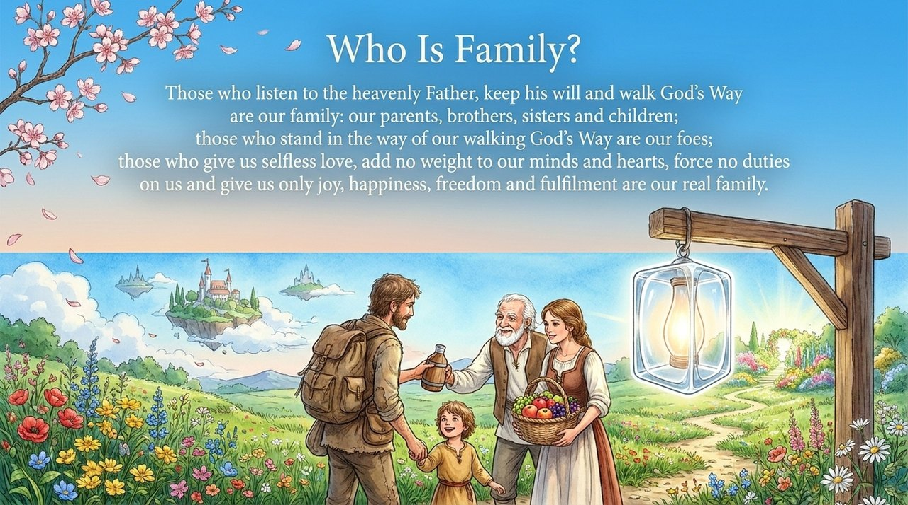
    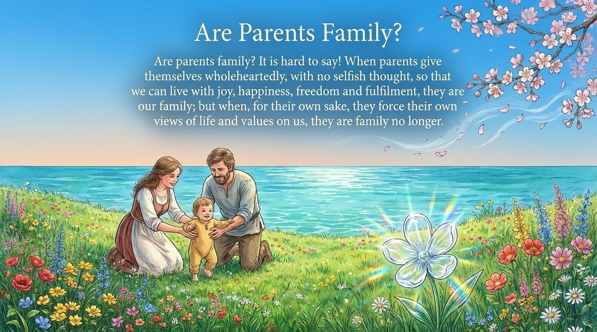
    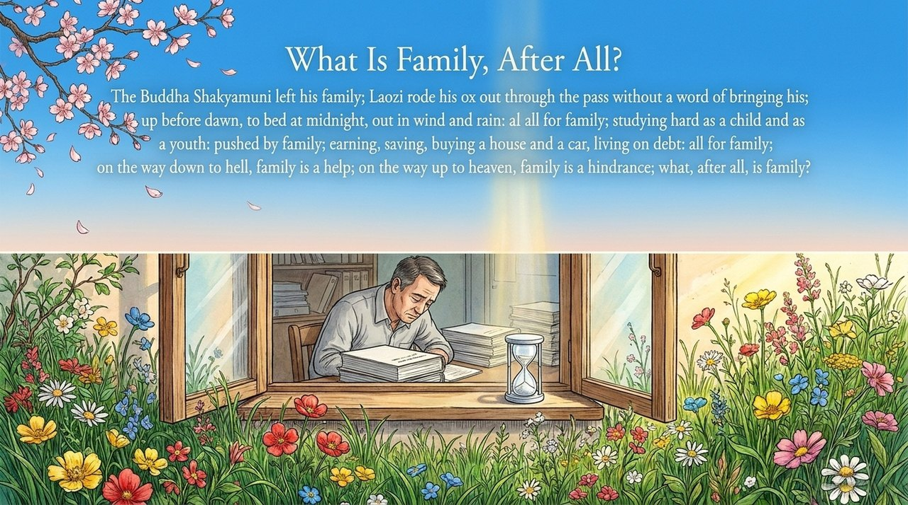
    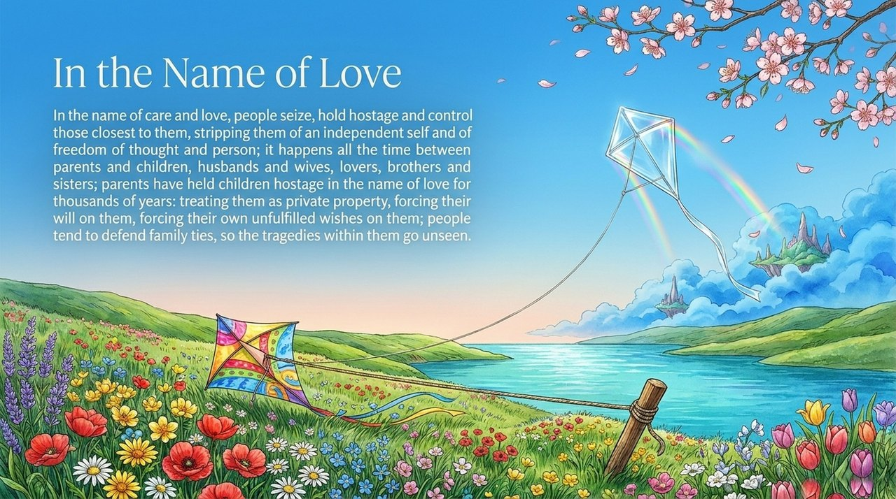
    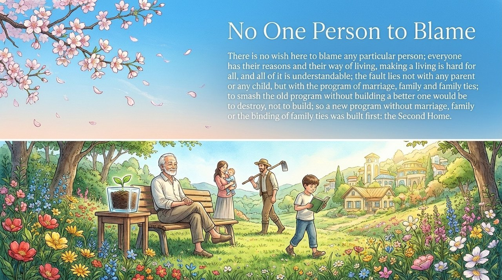
    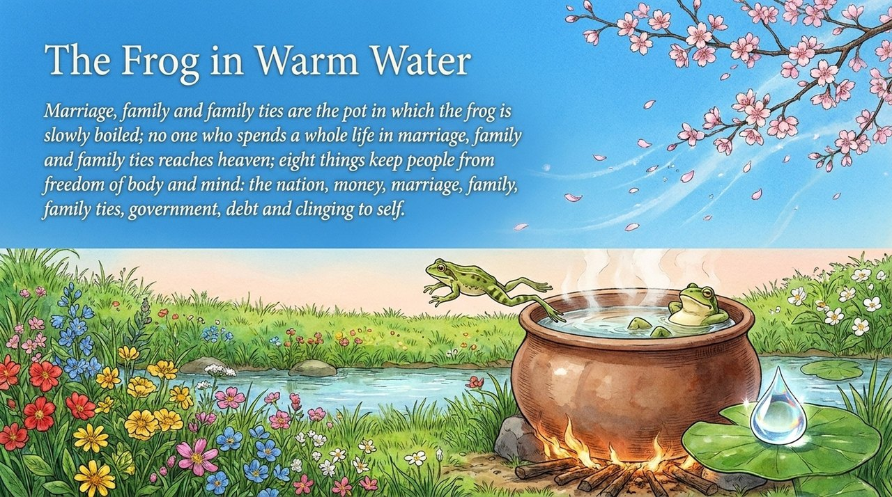
    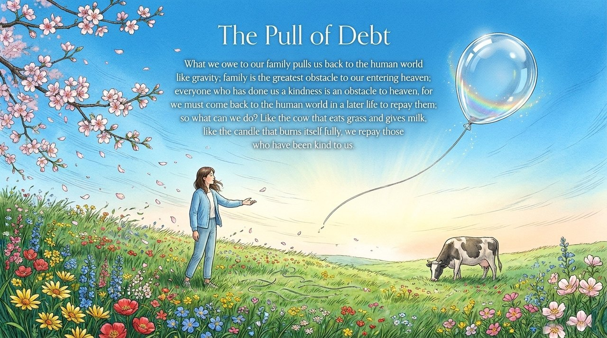
    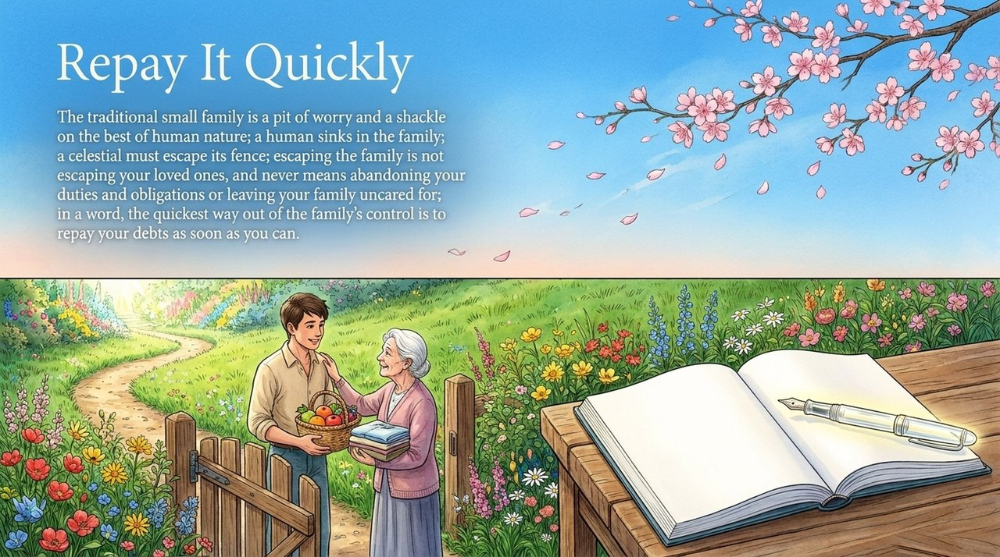
    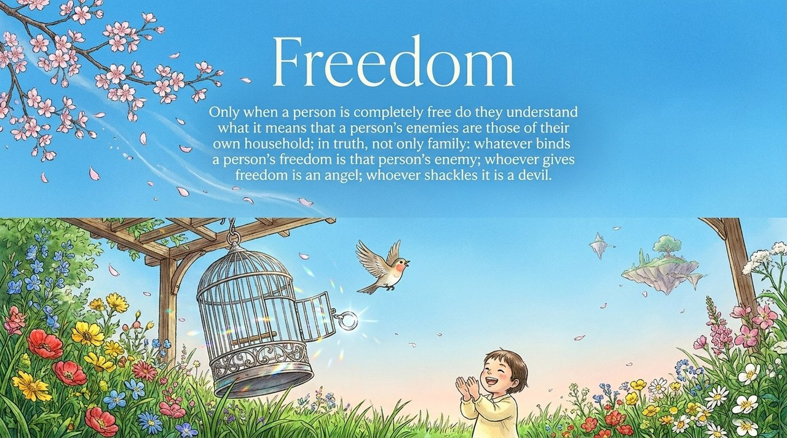
    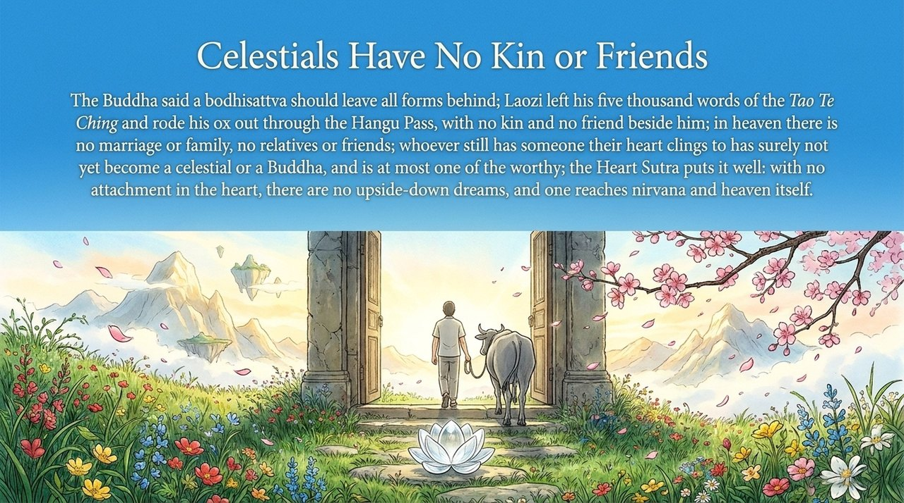
    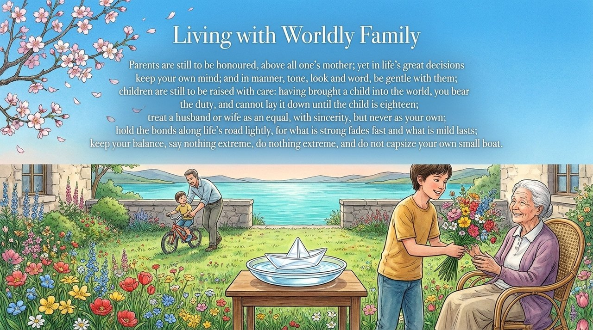

---

## Related Entries

[Releasing Worldly Bonds](/en/releasing-worldly-bonds/) · [Debt Repayment](/en/debt-repayment/) · [Free Will](/en/free-will/) · [Quantum Entanglement and the "Other Half"](/en/quantum-entanglement-and-the-other-half/) · [Letting Go](/en/letting-go/) · [Life and Death](/en/life-and-death/) · [Yuan (Affinity)](/en/yuan/) · [Becoming Celestial and Buddha](/en/becoming-celestial-buddha/) · [Spiritual Life](/en/spiritual-life/) · [Route to the Kingdom of Heaven](/en/route-to-heaven/)
