# Fate and Transcendence

**Fate** is the inevitable trajectory along which LIFE unfolds according to the program designed by the Greatest Creator. **Transcending fate** is the rare leap made by the awakened few — those who, through deep understanding of life's mysteries, abnormal thinking, and the Lifechanyuan methods, break free from the realm of necessity and enter the realm of freedom.

> For 98% of people, everything is the result of fate. For the 1–2% who are Chanyuan Celestials, everything is a matter of consciousness and heart.
>
> — Xuefeng

## Video

<iframe style="width:100%;aspect-ratio:4/3;border:0" src="https://www.youtube-nocookie.com/embed/14Os66X69L8" title="Fate and Transcendence (Lifechanyuan Encyclopedia video)" allowfullscreen></iframe>

## Slides

??? info "📖 Illustrated slides (14 pages, click to expand)"

    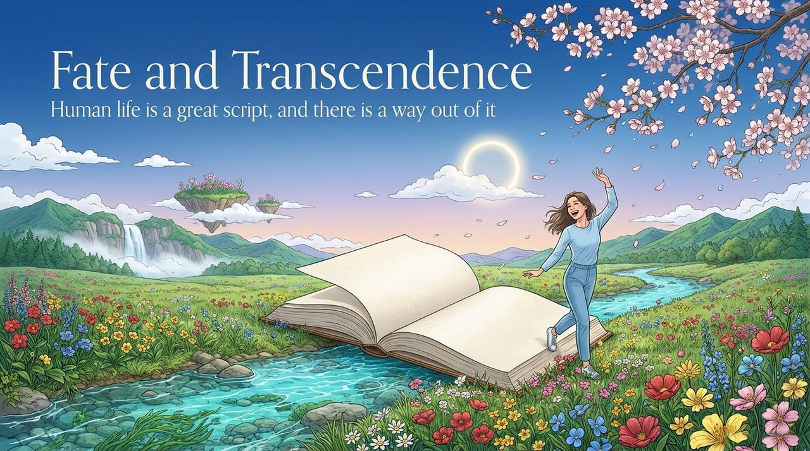
    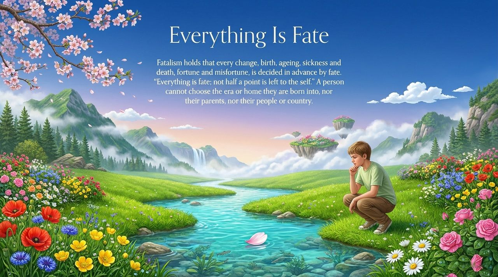
    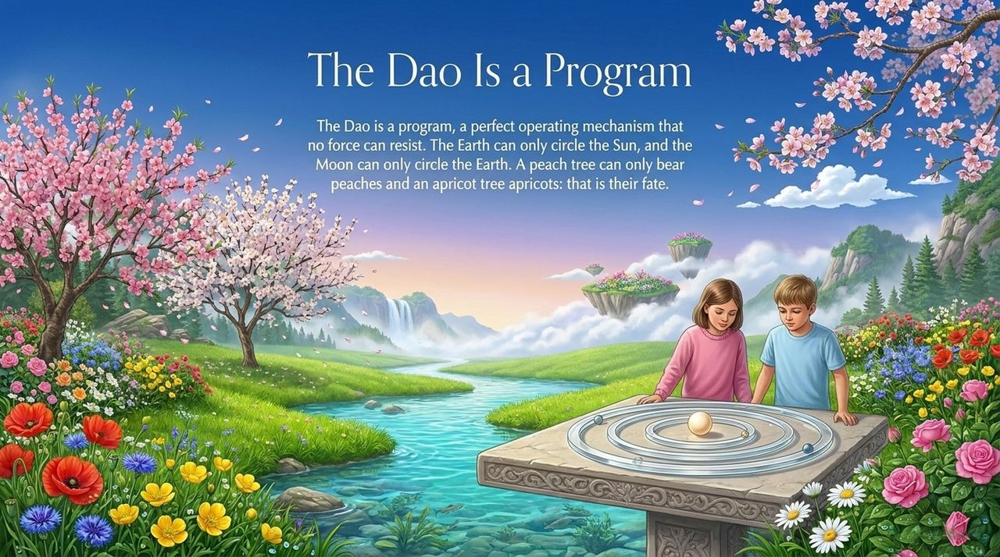
    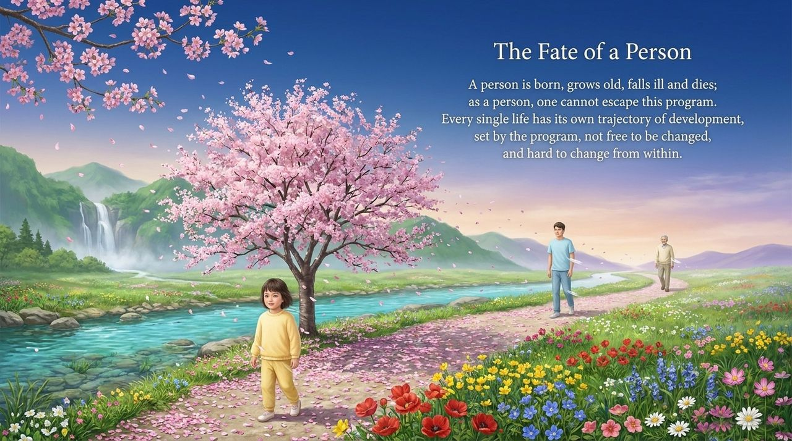
    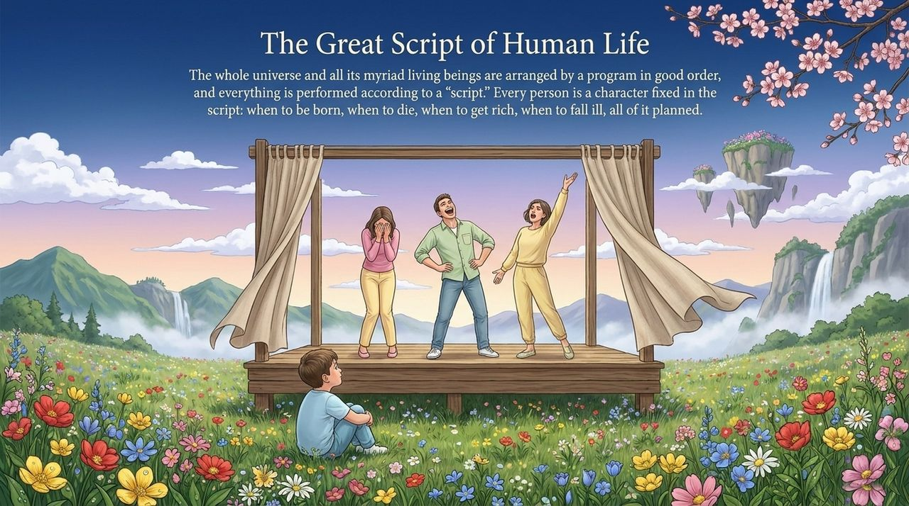
    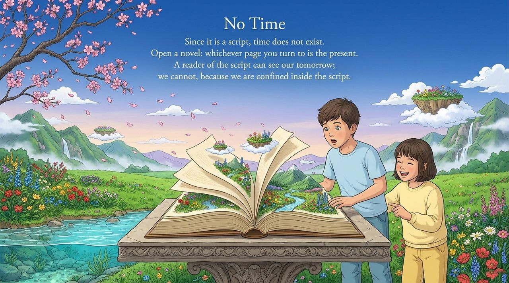
    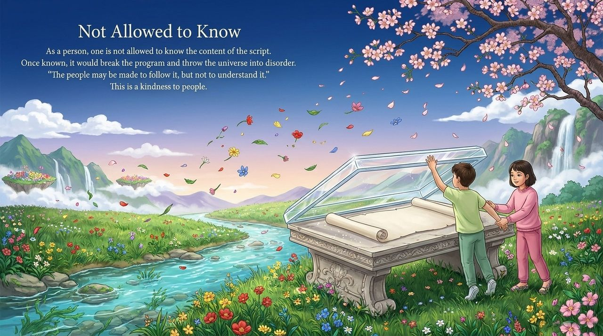
    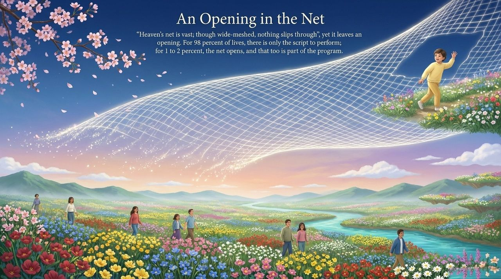
    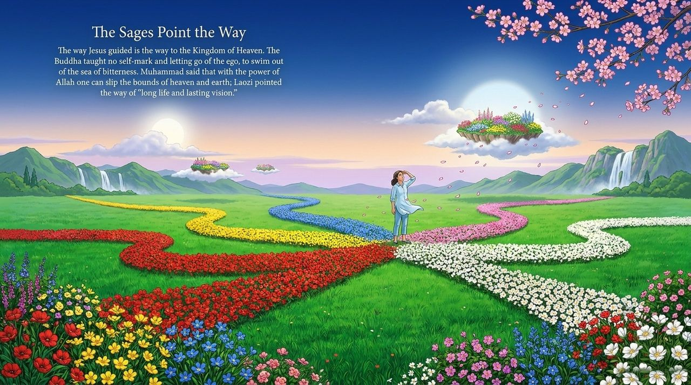
    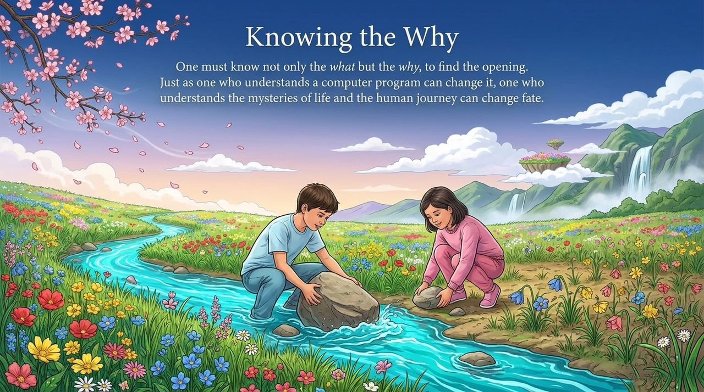
    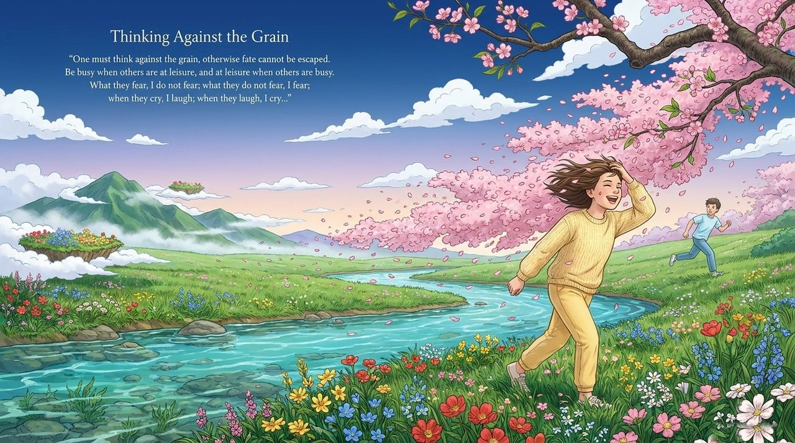
    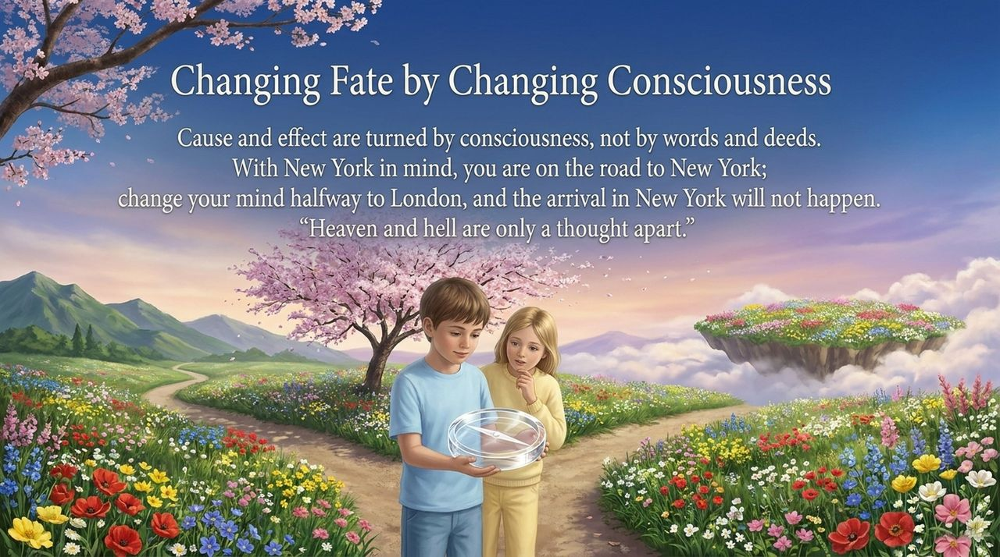
    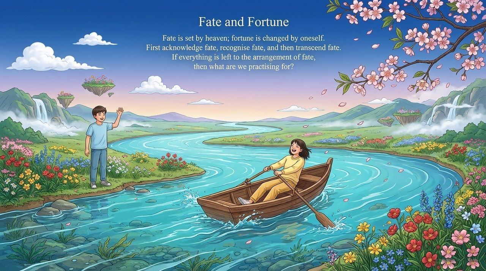
    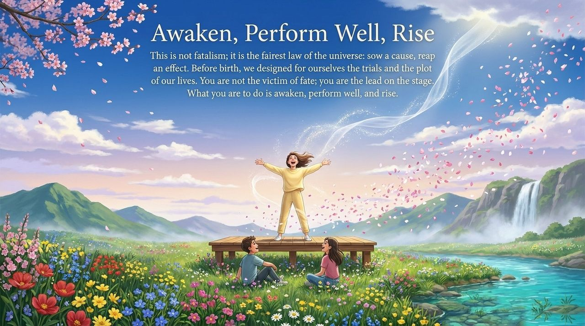

---

| Version | Best for | Focus |
|---------|----------|-------|
| [Friendly version](friendly.md) | First-time readers | What fate is and how to transcend it |
| [Academic version](academic.md) | Researchers | Conceptual analysis, textual sources, comparative study |
| [Internal reference](internal.md) | Deep study | Original writings in full |

---

**Related entries:**
[Life Script](/en/life-script/) · [Life Trajectory](/en/life-trajectory/) · [Everything Is Destined](/en/everything-is-destined/) · [Free Will](/en/free-will/) · [Karma, Retribution & Reincarnation](/en/karma-retribution-reincarnation/) · [Abnormal Thinking](/en/abnormal-thinking/) · [Consciousness](/en/consciousness/) · [Awakening](/en/awakening/)
