<!-- id: LC-FBS-0001-EN theme: Cultivation Practice type: 导航 direction: Cultivation Practice lang: en -->

# Feminine Beauty in Softness

In Lifechanyuan's philosophy, feminine beauty lies in softness — not in weakness, but in a profound inner strength. Softness is not submission or lack of conviction; rather, it is the ultimate form of strength, one that, like water, can wear away stone and conquer all things.

> "Women find beauty in softness. Softness overcomes hardness. Feminine softness is not weakness, not lack of conviction, not indiscriminate acceptance, not willingness to be bullied — on the contrary, feminine softness is the ultimate strength, strength contained within softness, like the gentle flow of water that can cleanse all impurity, pierce stone, and conquer everything."
>
> *(800 New Era Concepts)*

---

## Version Guide

| Version | Best for | Focus |
|---------|----------|-------|
| [Friendly version](friendly.md) | First-time readers | Daily life · The power of softness · Cultivation perspective |
| [Academic version](academic.md) | Researchers | Concept analysis · Comparative philosophy · System context |
| [Internal reference](internal.md) | Deep study | Complete original texts · Seven-section framework |

---

## Video

<iframe style="width:100%;aspect-ratio:4/3;border:0" src="https://www.youtube-nocookie.com/embed/0r6tO99Vrxk" title="Feminine Beauty in Softness (Lifechanyuan Encyclopedia video)" allowfullscreen></iframe>

## Slides

??? info "📖 Illustrated slides (14 pages, click to expand)"

    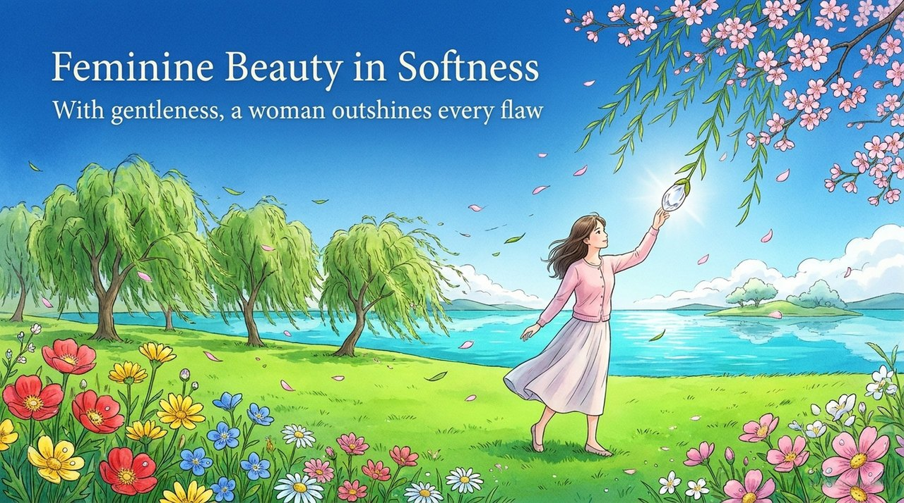
    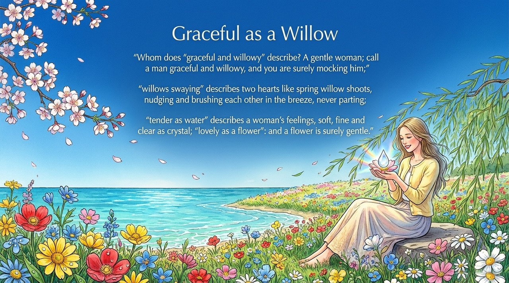
    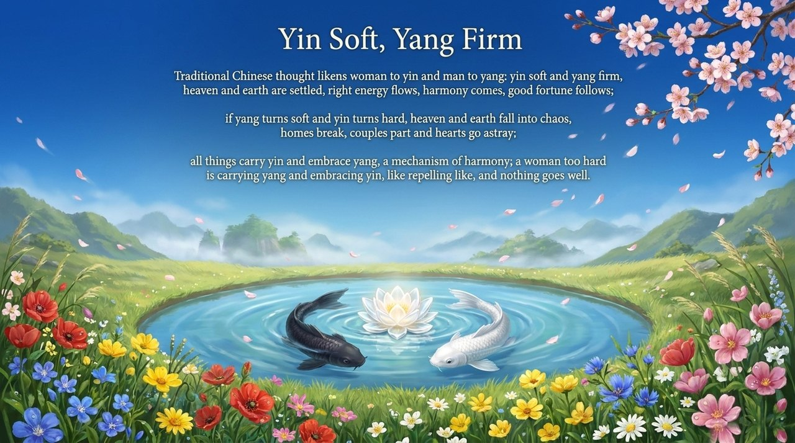
    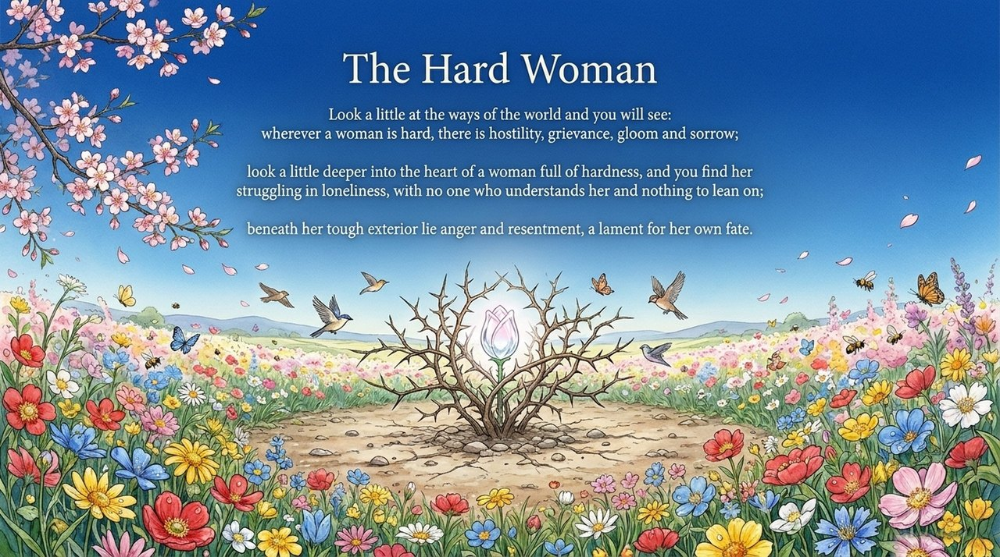
    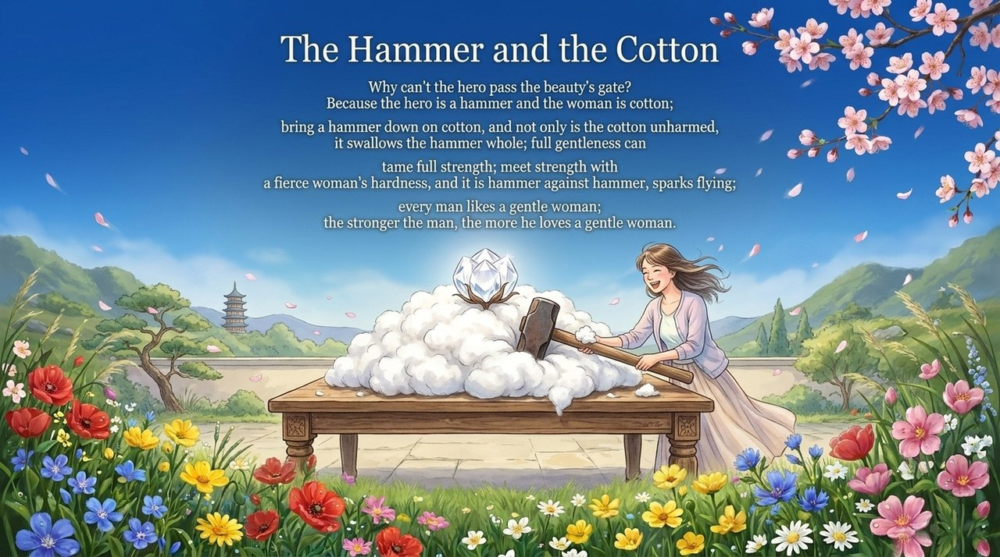
    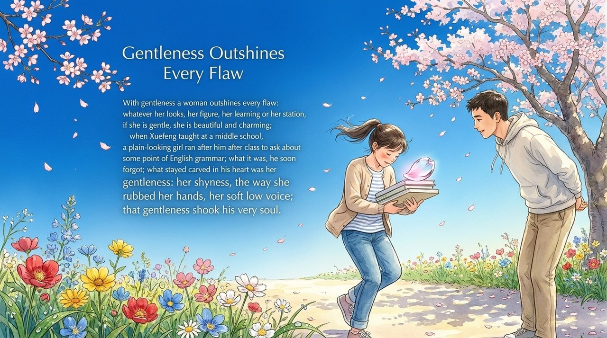
    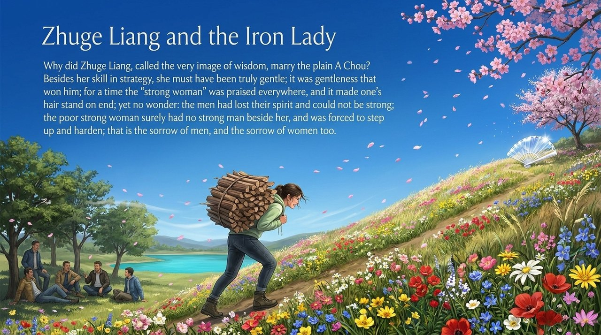
    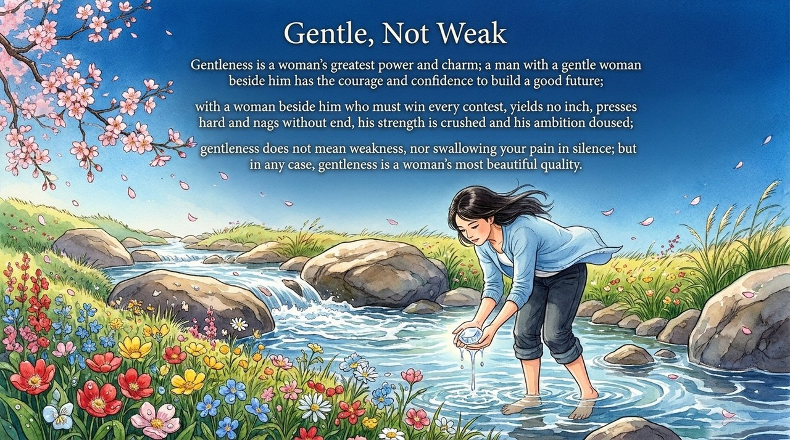
    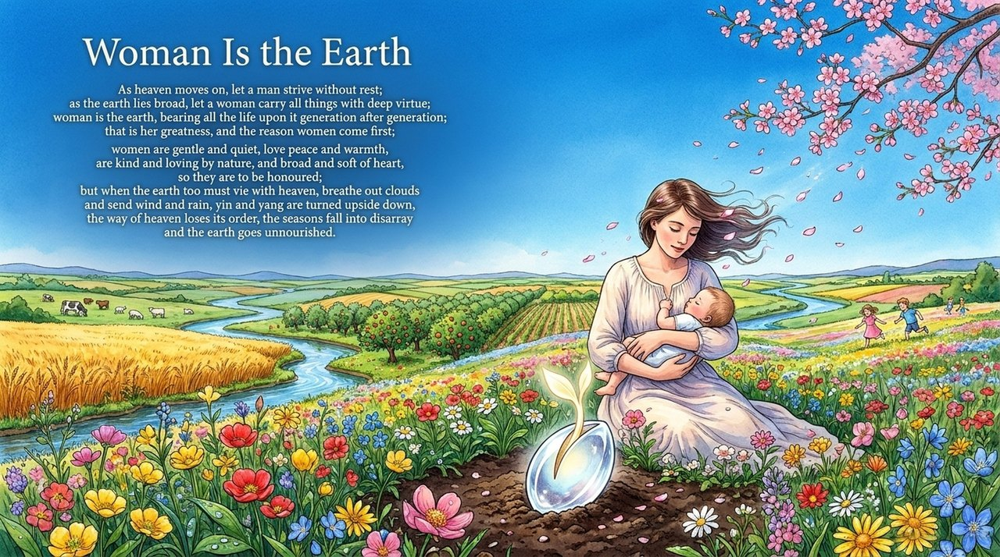
    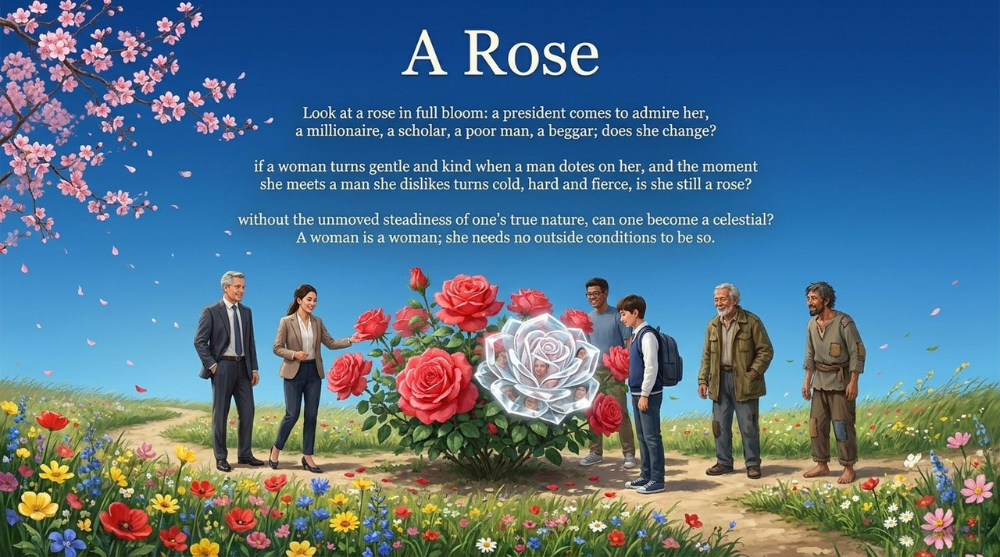
    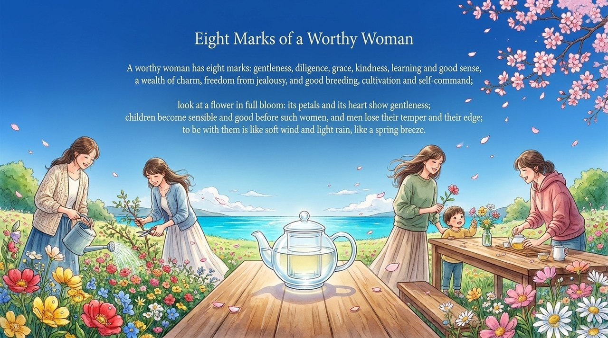
    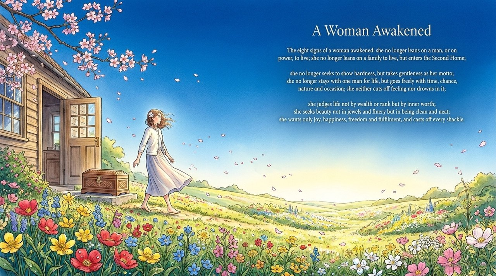
    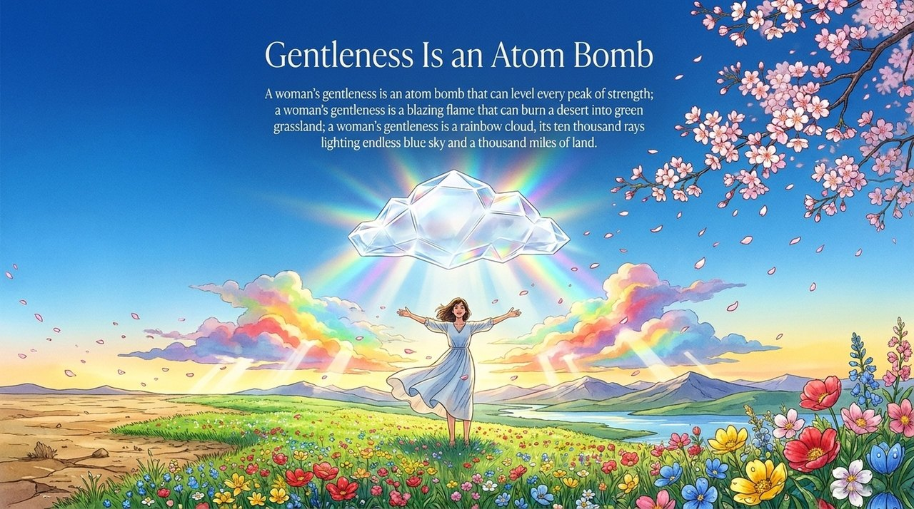
    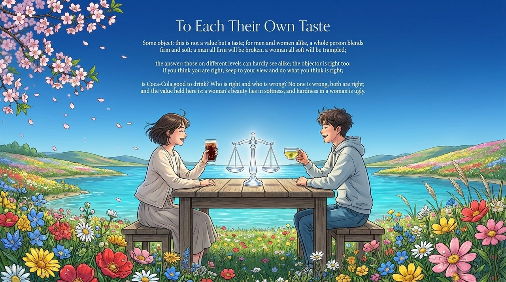

---

## Related Entries

[Celestial Nature](/en/tianxing/) · [Celestial Bearing](/en/xianfengdaogu/) · [Standard of Perfect Human Nature](/en/perfect-human-nature/) · [Refinement of Character](/en/jiaoyang-xiuyang-hanyang/) · [Heaven-Nature, Innate-Nature, Habitual-Nature](/en/tianxing-bingxing-xixing/) · [Transcending the Mundane](/en/chaofantuosu/) · [Spiritual Life](/en/spiritual-life/) · [Truth, Goodness, Beauty, Love, Faith, Sincerity](/en/six-qualities/)

> Note: Concept numbers cited on this page refer to the Fourth Edition of the *New Era Human 800 Concepts*. The Fifth Edition has been re-arranged, and its numbering no longer matches the Fourth Edition one to one.
