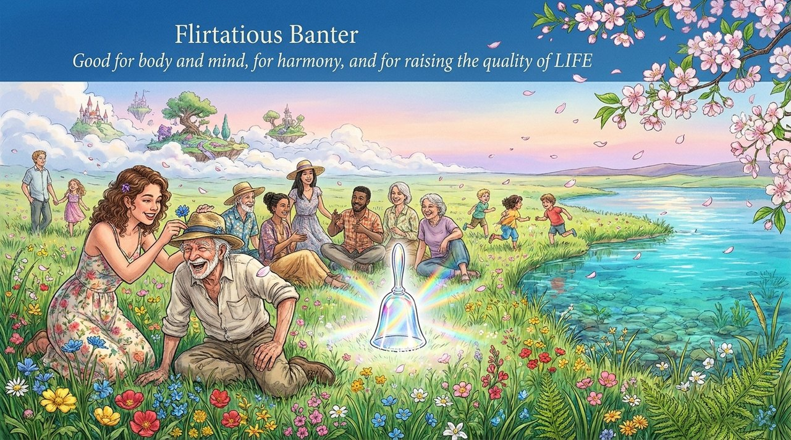
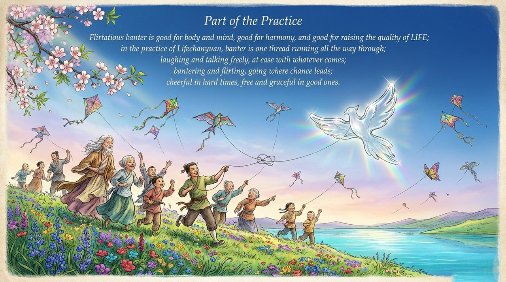
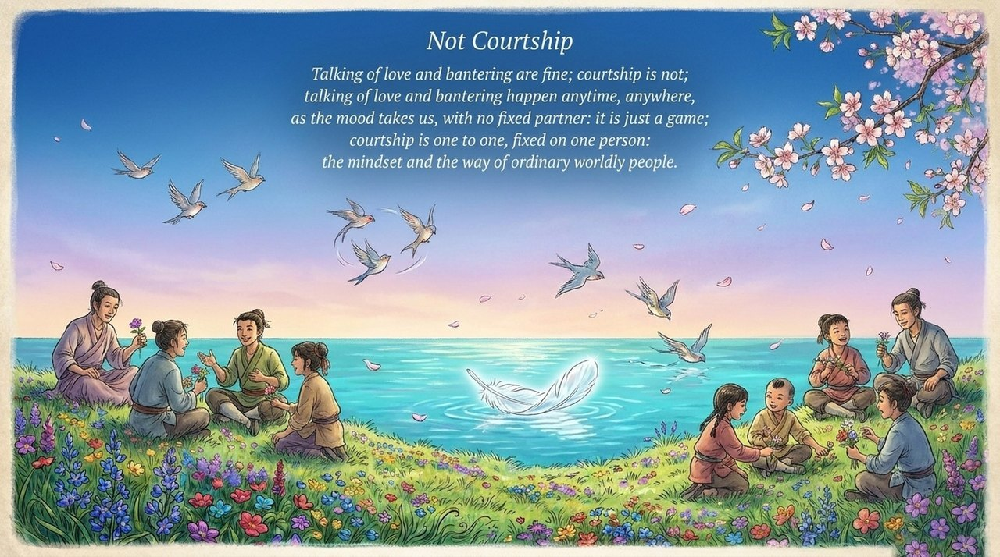
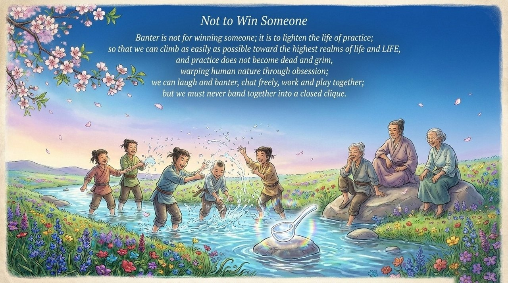
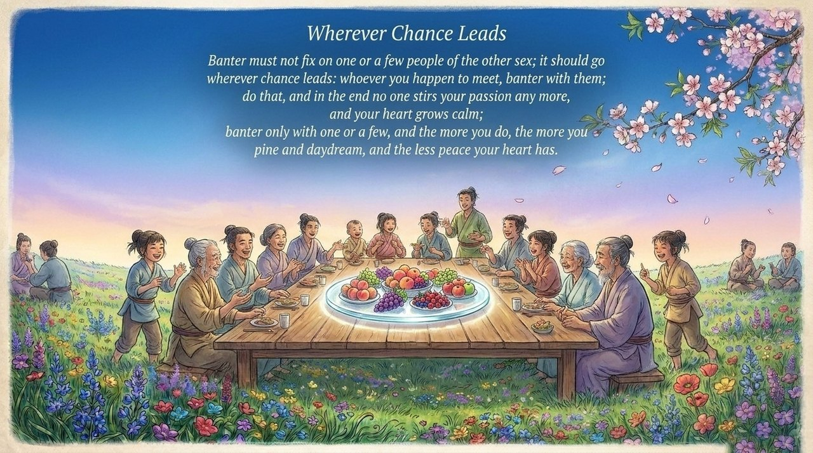
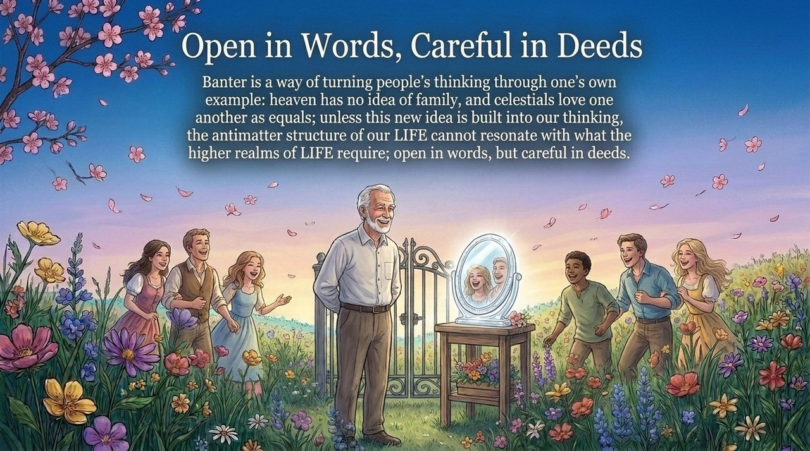

<!-- id: LC-FB-0001-EN theme: cultivation type: navigation direction: daily-practice lang: en -->

# Flirtatious Banter

*Flirtatious banter* (打情骂俏, *dǎ qíng mà qiào*) is a designated cultivation practice within Lifechanyuan's "Chaotic Cultivation Method" — a form of spontaneous, playful, non-exclusive teasing and affectionate exchange among community members. Its purpose is not to pursue or possess anyone, but to dissolve jealousy and possessiveness, expand one's inner capacity for love, and shift consciousness from ordinary human attachment toward a freer, more celestial state.

---

## Version Navigation

| Version | Best for | Focus |
|---------|----------|-------|
| [Friendly version](friendly.md) | First-time readers | Everyday context · game spirit · what it's for |
| [Academic version](academic.md) | Researchers | Concept analysis · comparison with other traditions · systemic positioning |
| [Internal reference](internal.md) | Deep study | Full source quotations · six-section framework · practical guidance |

---

## Video

<iframe style="width:100%;aspect-ratio:4/3;border:0" src="https://www.youtube-nocookie.com/embed/icZct5olF9g" title="Flirtatious Banter (Lifechanyuan Encyclopedia video)" allowfullscreen></iframe>

## Slides

??? info "📖 Illustrated slides (14 pages, click to expand)"

    
    
    
    
    
    
    
    
    
    
    
    
    
    

---

## Related Entries

[Acting Spontaneously](/en/suixing-er-dong/) · [Jealousy and Envy](/en/jealousy-envy/) · [Romantic Love and Sexuality](/en/romantic-love-and-sexuality/) · [Letting Go](/en/letting-go/) · [Exclusive Relationships](/en/exclusive-relationship/) · [Elementary Cultivation](/en/elementary-cultivation/) · [Advanced Practice](/en/advanced-refinement/) · [Soul Garden](/en/soul-garden/) · [Elysian Realm](/en/jilemiaojing/)
