# The Garden of Eden

> The old Garden of Eden has been lost, but a new one has long been completed, and its gates stand open to everyone.  
> The blind cannot see the sky, so they say there is no sky. The deaf cannot hear the river, so they say there are no waves. Those without spiritual perception cannot see the Greatest Creator, so they say there is no Garden of Eden.  
> — Guide Xuefeng, *Chanyuan Corpus · Celestial Revelation · This Is How the Garden of Eden Was Lost*

**The Garden of Eden** in Lifechanyuan carries three interlocking meanings: first, the biblical paradise where Adam and Eve once lived — its loss a consequence of humanity's own unworthiness; second, the environment most suited to each person's unique nature — "the environment most fitting for your survival is your Garden of Eden" (*New Era Human 800 Concepts*, No. 340); third, a name for the higher LIFE spaces — the Thousand-Year World, the Ten-Thousand-Year World, and the Elysium World. The Garden of Eden never vanished; it retreated to a higher dimension, awaiting those worthy of return.

| Version | Best for | Focus |
|---------|----------|-------|
| [Friendly version](friendly.md) | First-time readers | What the Garden of Eden is and how to find yours |
| [Academic version](academic.md) | Researchers | Three-level analysis and comparative study |
| [Internal reference](internal.md) | Deep study | Complete original texts: loss, individual Eden, and higher realms |

---

## Video

<iframe style="width:100%;aspect-ratio:4/3;border:0" src="https://www.youtube-nocookie.com/embed/l4IQj-VPBDg" title="The Garden of Eden (Lifechanyuan Encyclopedia video)" allowfullscreen></iframe>

## Slides

??? info "📖 Illustrated slides (14 pages, click to expand)"

    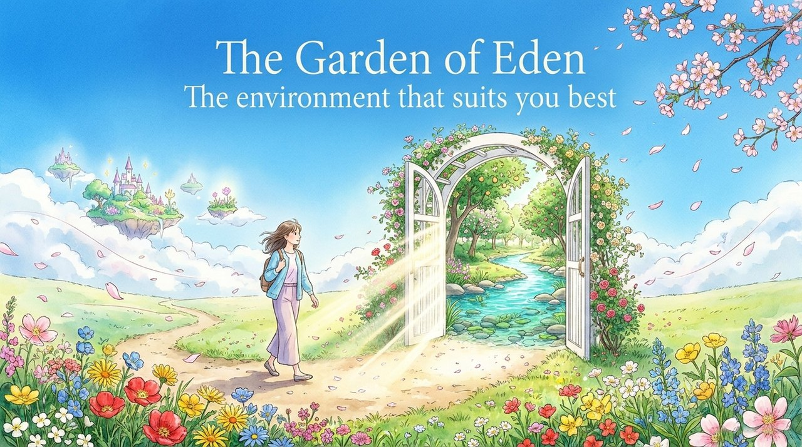
    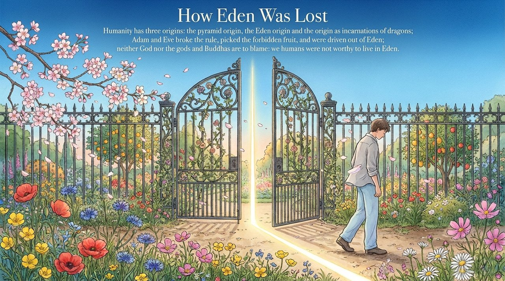
    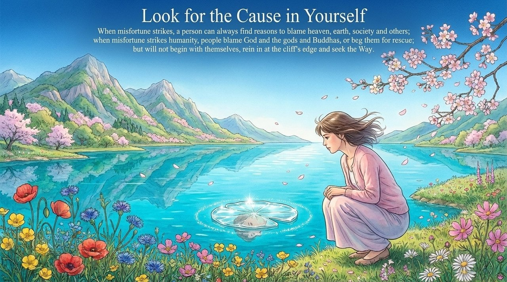
    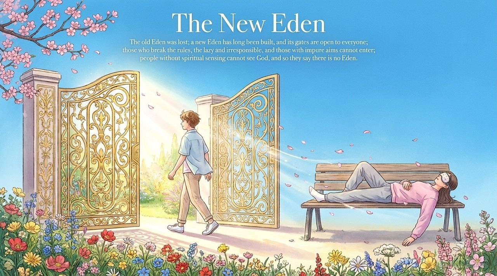
    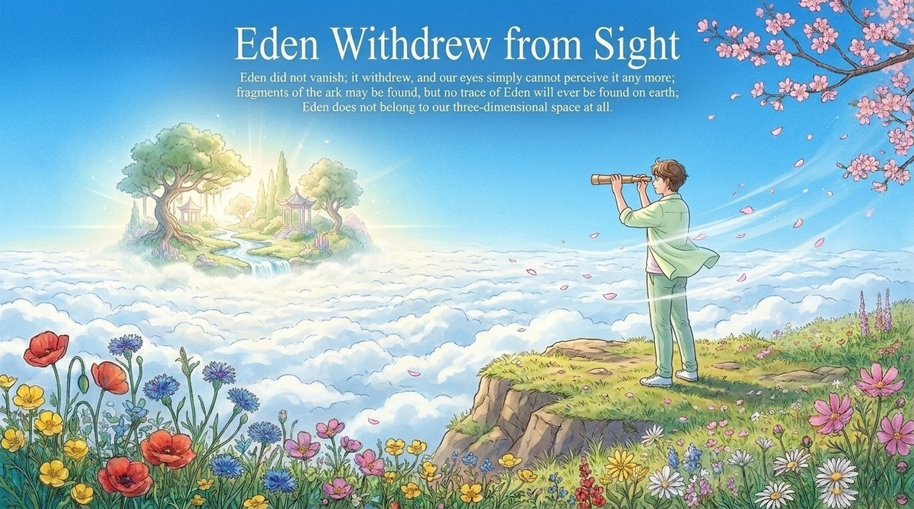
    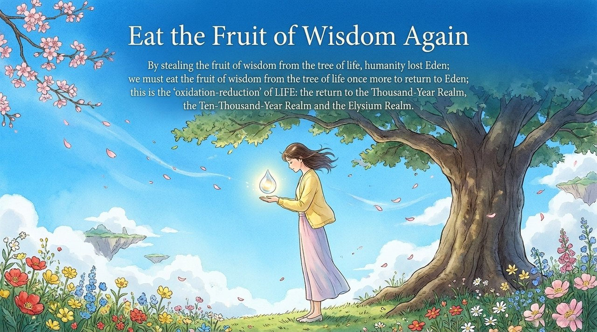
    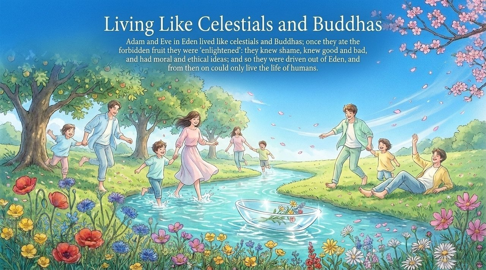
    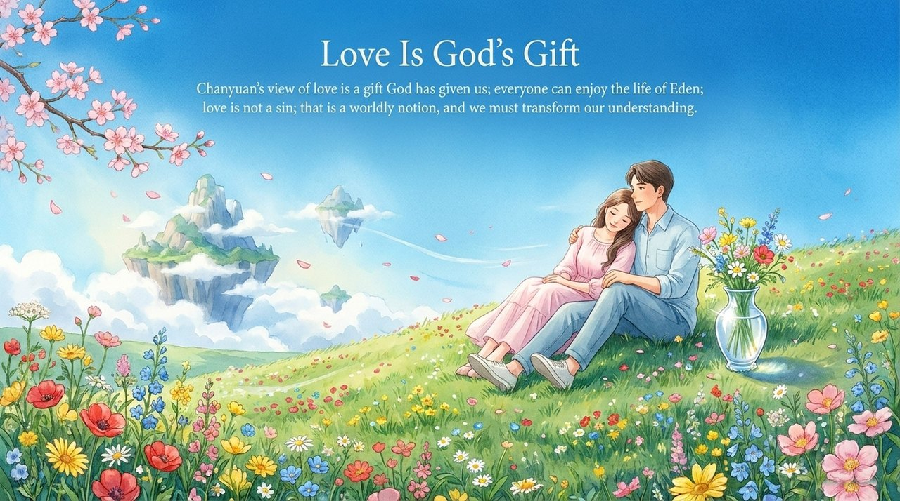
    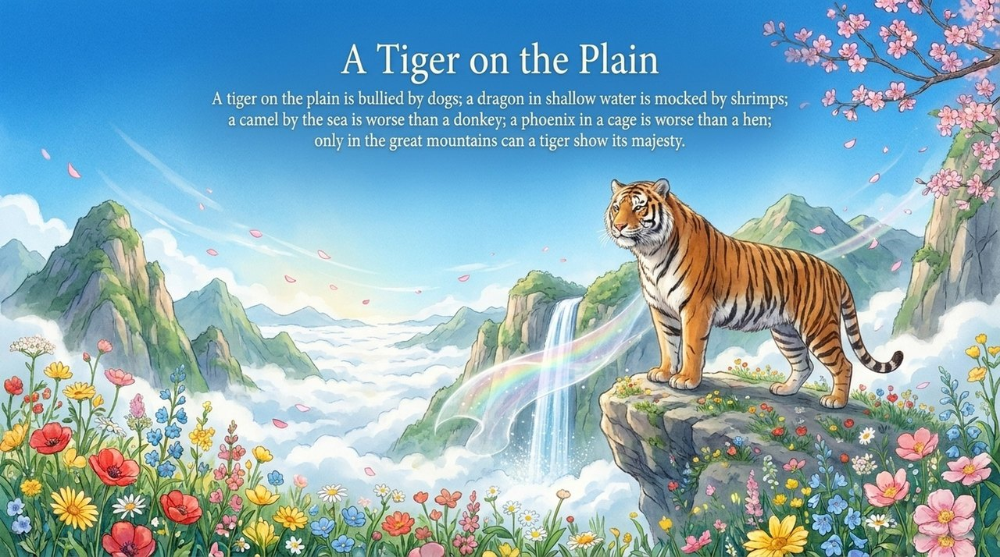
    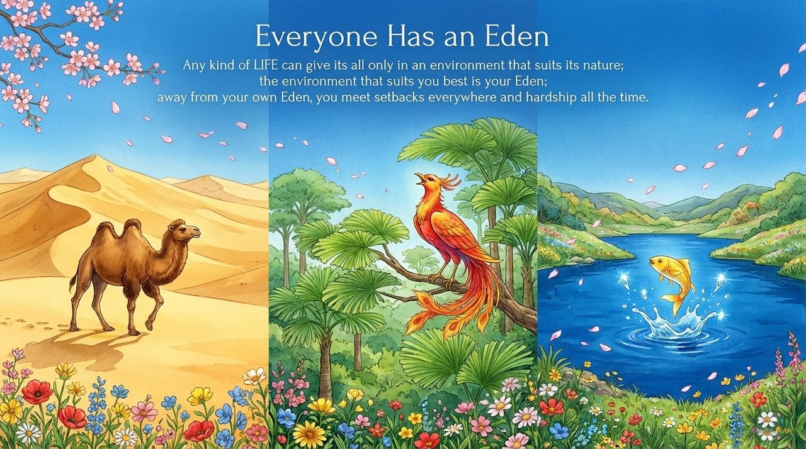
    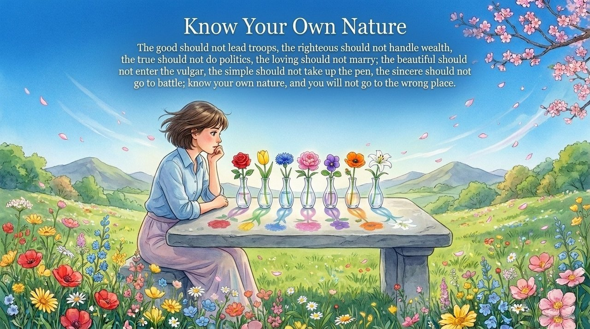
    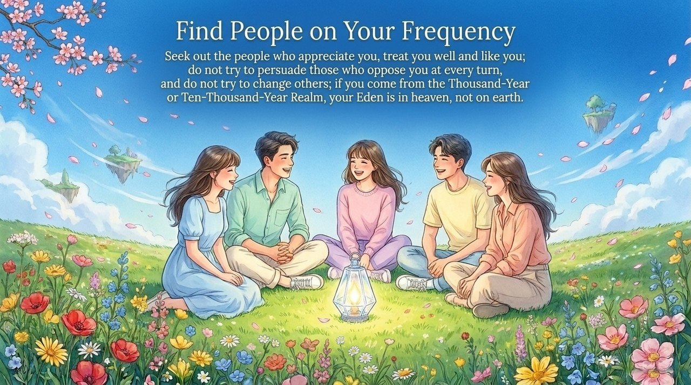
    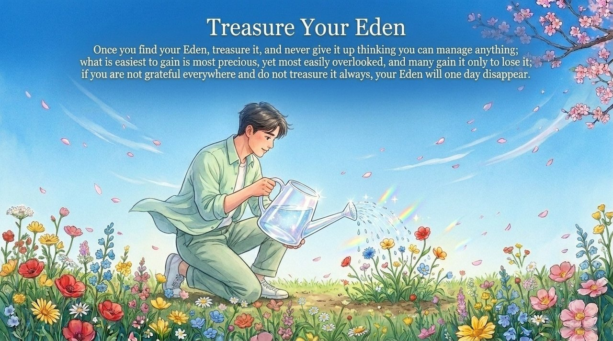
    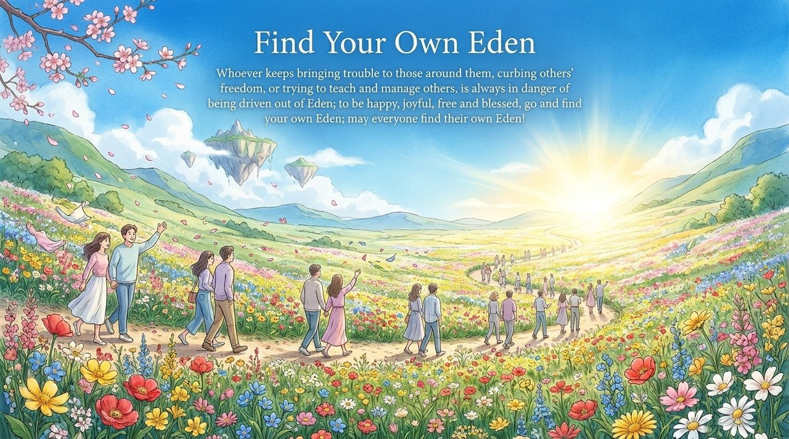

---

## Related Entries

[Kingdom of Heaven](/en/kingdom-of-heaven/) · [Thousand-Year World](/en/thousand-year-world/) · [Ten-Thousand-Year World](/en/ten-thousand-year-world/) · [Elysium World](/en/elysium-world/) · [Becoming a Celestial Being and a Buddha](/en/becoming-celestial-buddha/) · [Free Will](/en/free-will/) · [Gratitude](/en/gratitude/) · [Guide Xuefeng](/en/guide-xuefeng/)
