<!-- id: LC-GENE-0005 theme: Mystery of LIFE type: entry-page direction: exploring-life-essence lang: en -->

# Gene

> The brain is a microcosm of the universe; the gene is the scripture of LIFE.
>
> — *New Era Human 800 Concepts*

In the Lifechanyuan system, the **gene** is described as "the scripture of LIFE" — the most precise physical expression of the blueprint God has inscribed into all living things. Genes determine an organism's form, traits, and the trajectory of its existence. Yet genes are only the surface manifestation of this "scripture of LIFE," not its ultimate essence. The true essence of LIFE is the antimatter structure endowed with Ling (spirit). Genetic engineering, meanwhile, is explicitly warned to be an extraordinarily dangerous undertaking.

---

## Video

<iframe style="width:100%;aspect-ratio:4/3;border:0" src="https://www.youtube-nocookie.com/embed/6G5v2u79lOo" title="Gene (Lifechanyuan Encyclopedia video)" allowfullscreen></iframe>

## Slides

??? info "📖 Illustrated slides (14 pages, click to expand)"

    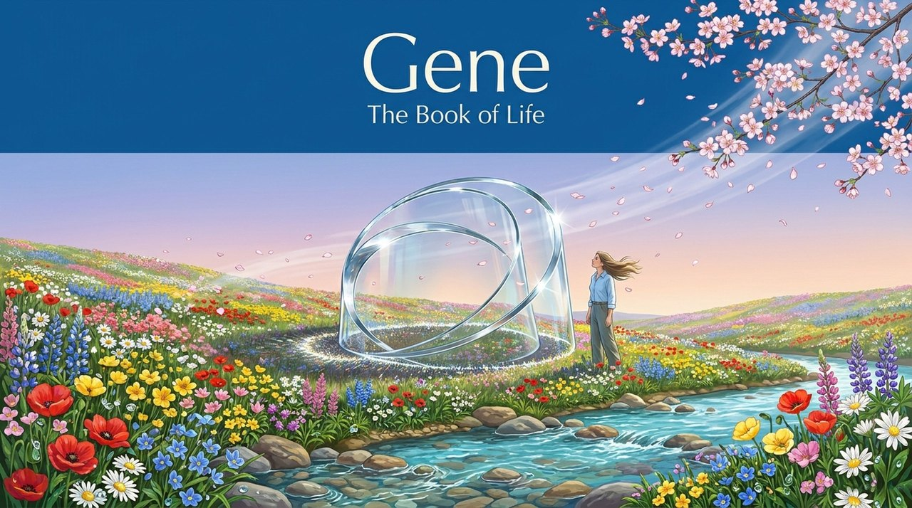
    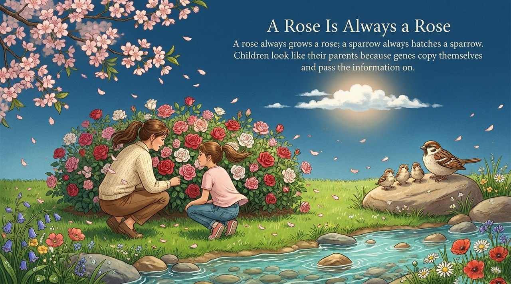
    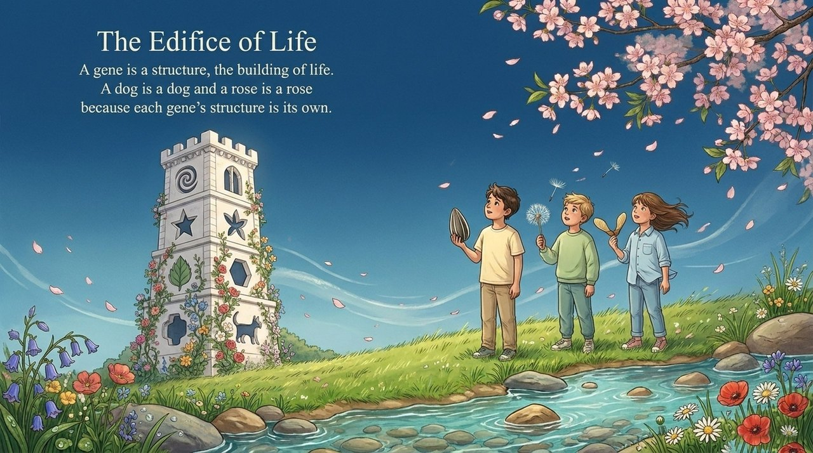
    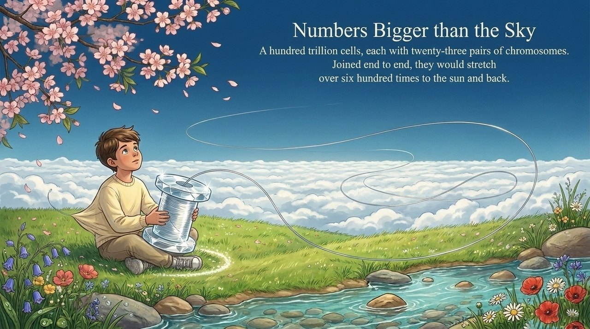
    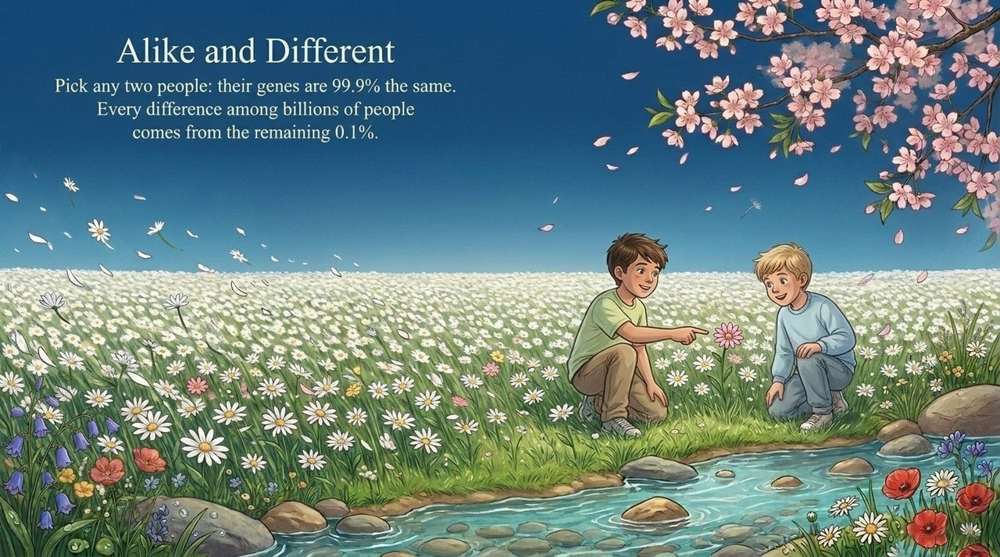
    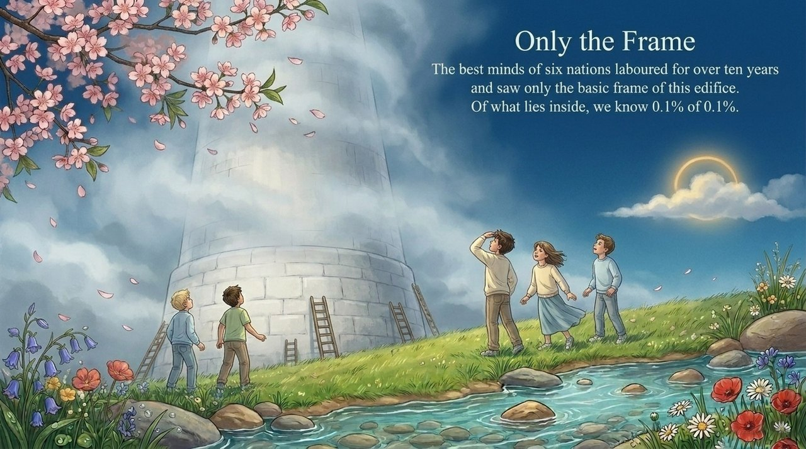
    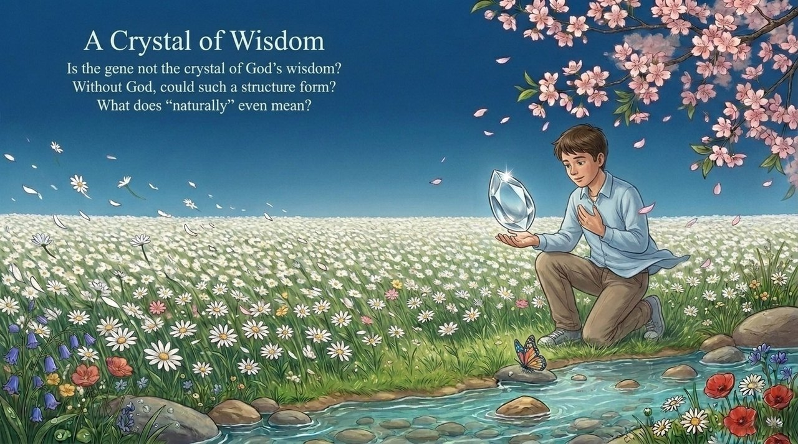
    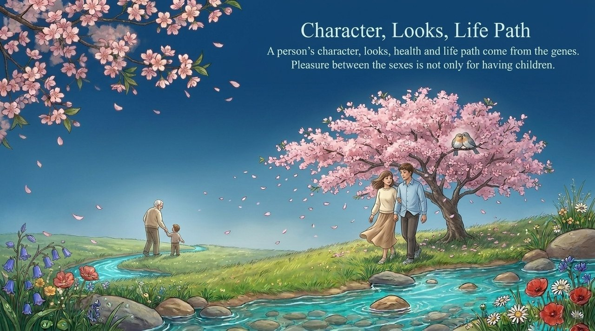
    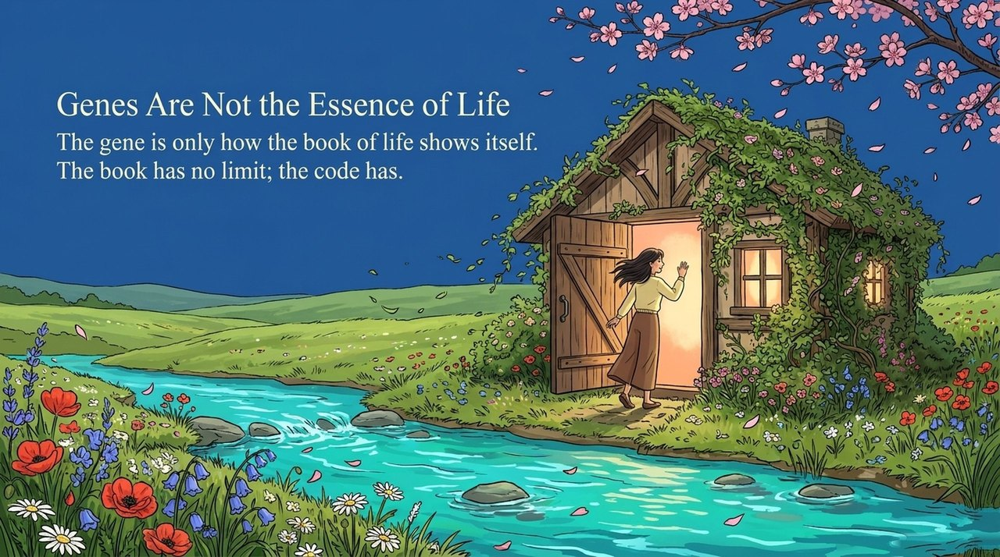
    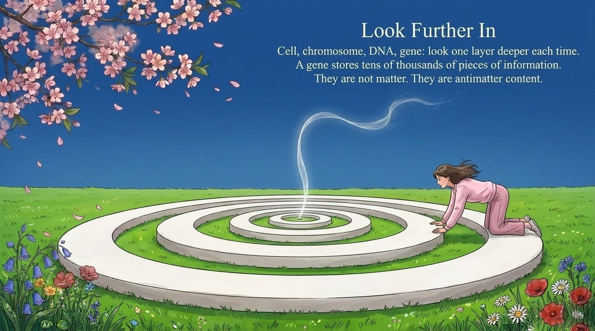
    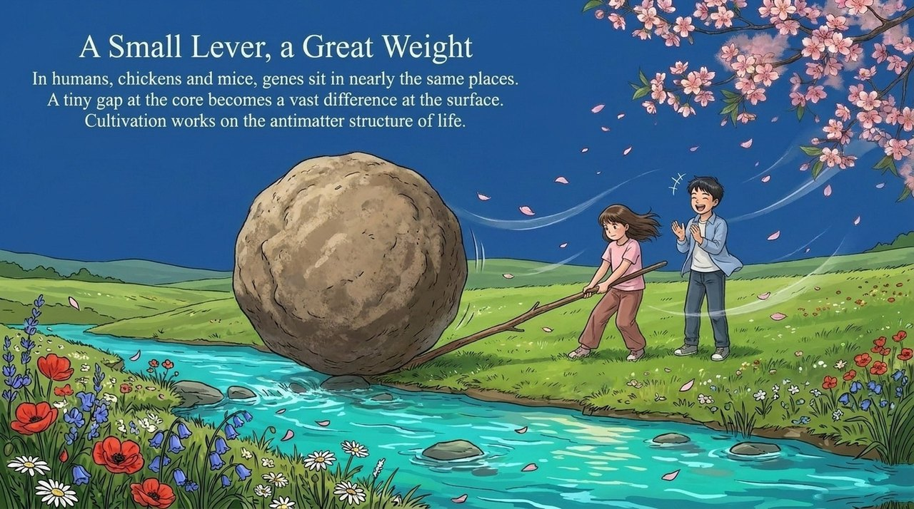
    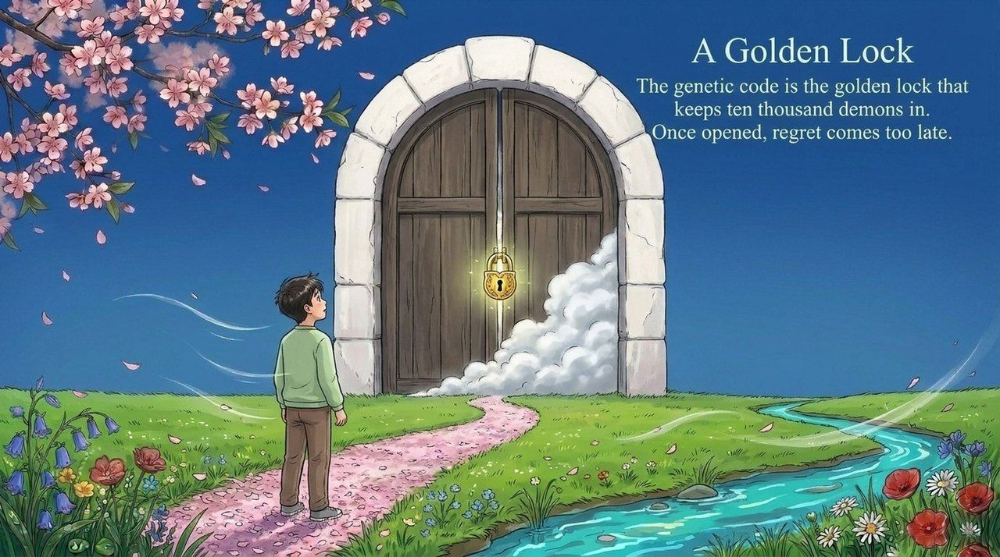
    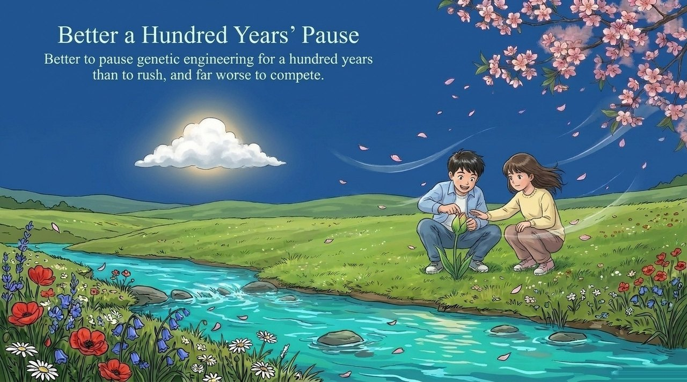
    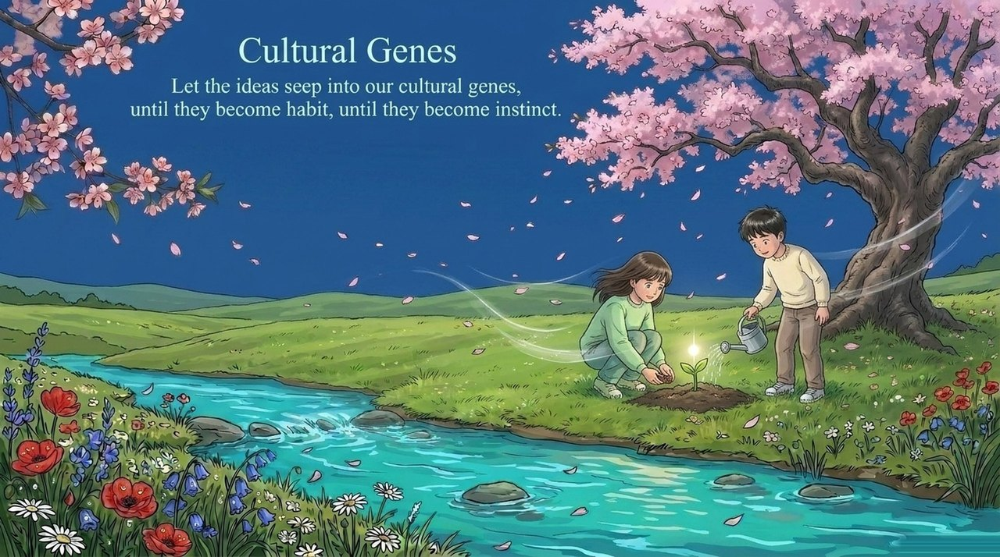

---

## Versions

| Version | Best for | Focus |
|---------|----------|-------|
| [Friendly version](friendly.md) | First-time readers | What is a gene? Why is it called a scripture? Everyday analogies |
| [Academic version](academic.md) | Researchers | Gene's cosmic status, its relationship to antimatter structure, dangers of genetic engineering |
| [Internal reference](internal.md) | Deep study | Complete source texts, 12 independent passages |

---

## Related Entries

- [LIFE](/en/life/)
- [Antimatter Structure](/en/antimatter-structure/)
- [Characteristics of LIFE](/en/life-characteristics/)
- [The Human Body — Miracle Program and Mystery](/en/human-body-miracle/)
- [The Greatest Creator](/en/greatest-creator/)
- [Tao](/en/dao/)
- [Origin of LIFE](/en/life-origin/)

> Note: Concept numbers cited on this page refer to the Fourth Edition of the *New Era Human 800 Concepts*. The Fifth Edition has been re-arranged, and its numbering no longer matches the Fourth Edition one to one.
