# Good, Evil, and the 108 Evils & 108 Virtues

**Good and evil**, in the Lifechanyuan system, operate on two distinct levels: at the cosmic level of Hundun and the Tao, there is no good or evil — only symmetric balance; but for every living being, the distinction between good and evil absolutely exists and is the fundamental basis for whether LIFE can elevate and reach Heaven. One of the *New Era Human 800 Concepts* presents the most complete and specific inventory of good and evil conduct in the Lifechanyuan system: **108 Evils** and **108 Virtues** — the practical reference standard for daily cultivation.

> Heaven belongs to the good; hell belongs to the evil; the human world belongs to those who are a mixture of both.

---

## Version Navigation

| Version | Best For | Link |
|---------|----------|------|
| Friendly | New readers, accessible introduction | [Read Friendly Version](/en/good-evil-108/friendly/) |
| Academic | In-depth study, systematic analysis | [Read Academic Version](/en/good-evil-108/academic/) |
| Internal | Chanyuan Celestials, original texts | [Read Internal Version](/en/good-evil-108/internal/) |

---

## Video

<iframe style="width:100%;aspect-ratio:4/3;border:0" src="https://www.youtube-nocookie.com/embed/FnKRDafc8IY" title="Good, Evil, and the 108 Evils & 108 Virtues (Lifechanyuan Encyclopedia video)" allowfullscreen></iframe>

## Slides

??? info "📖 Illustrated slides (14 pages, click to expand)"

    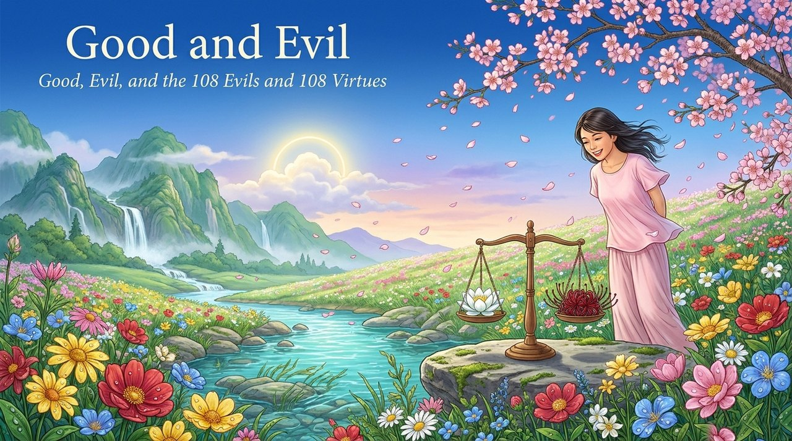
    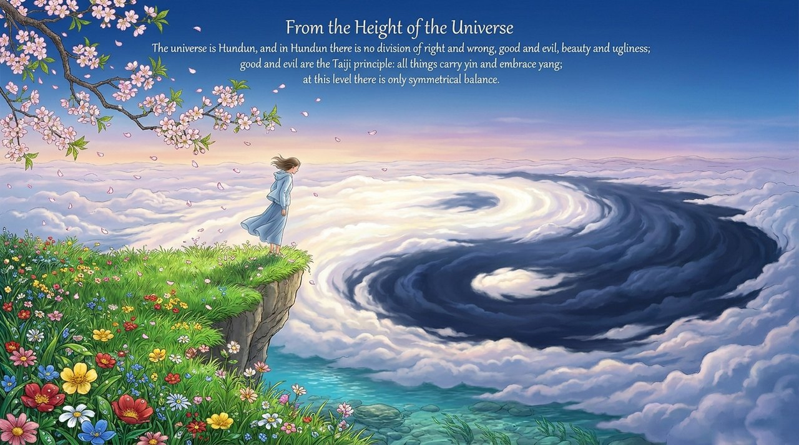
    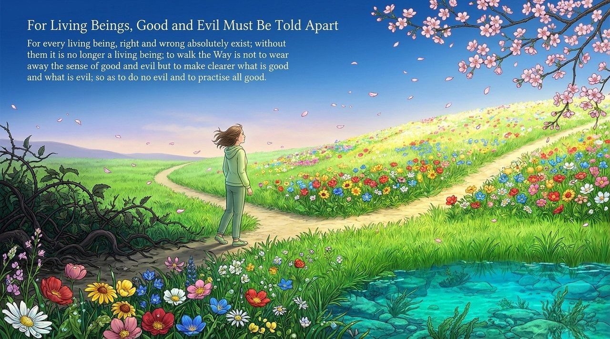
    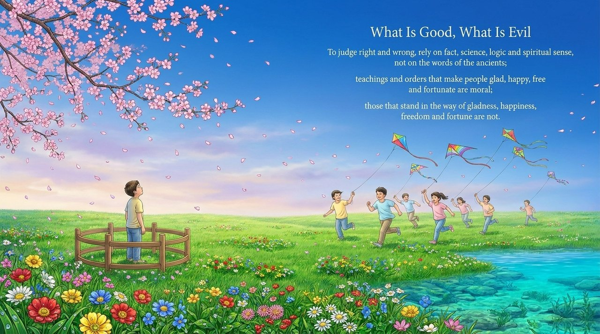
    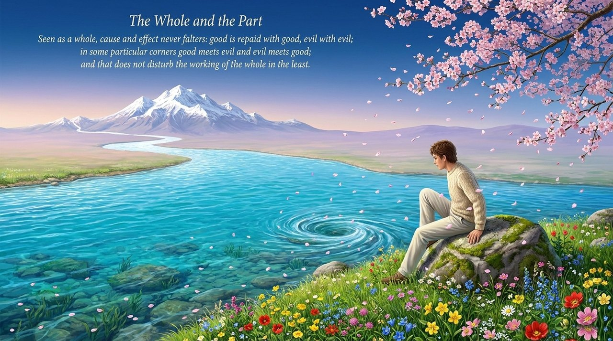
    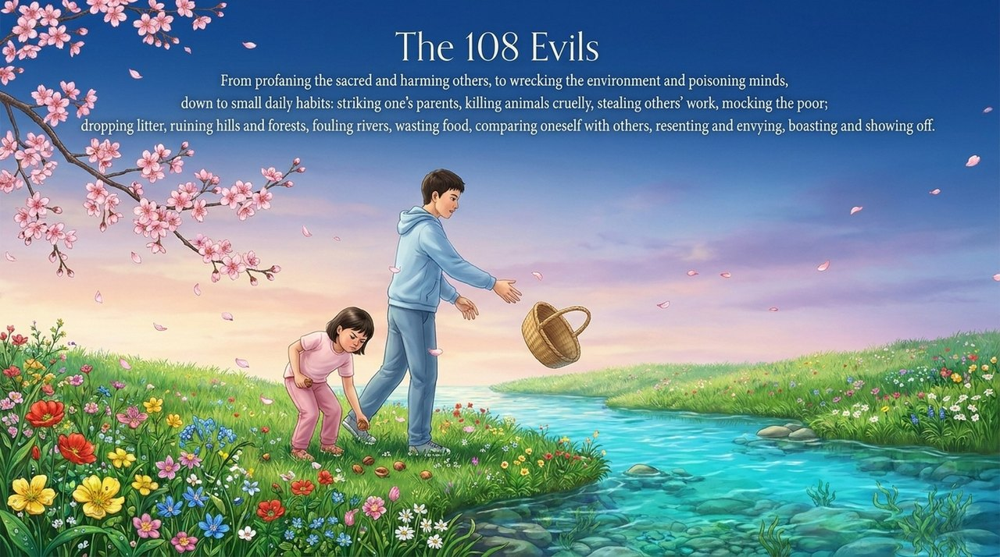
    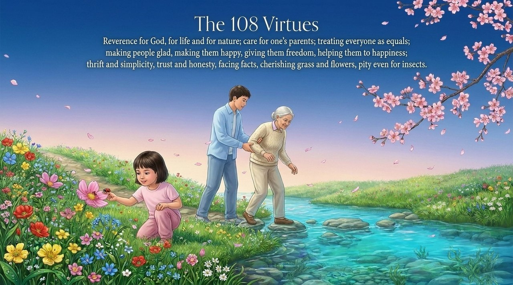
    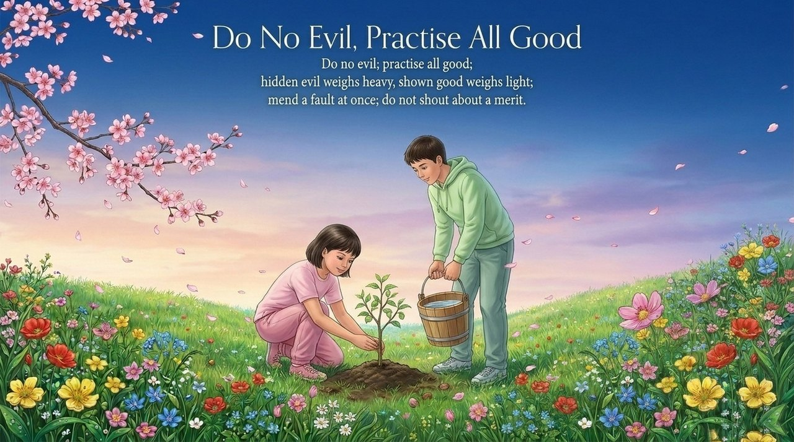
    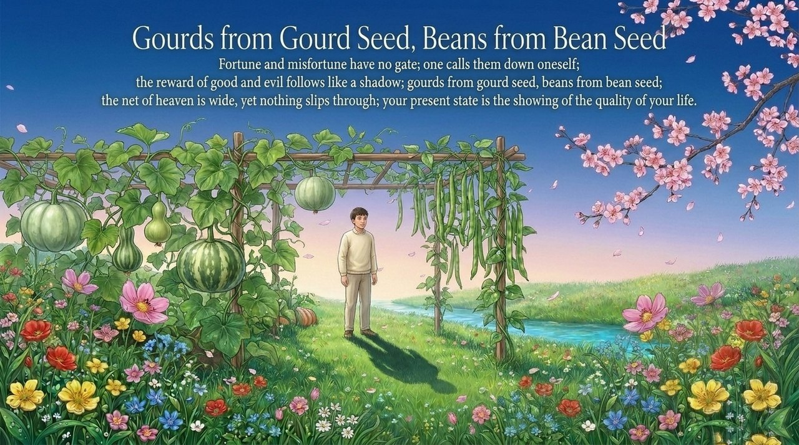
    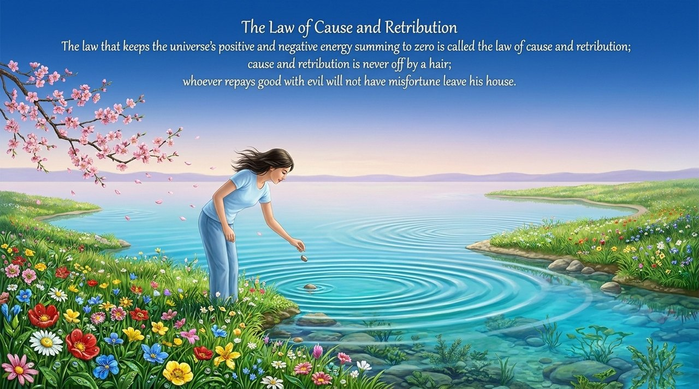
    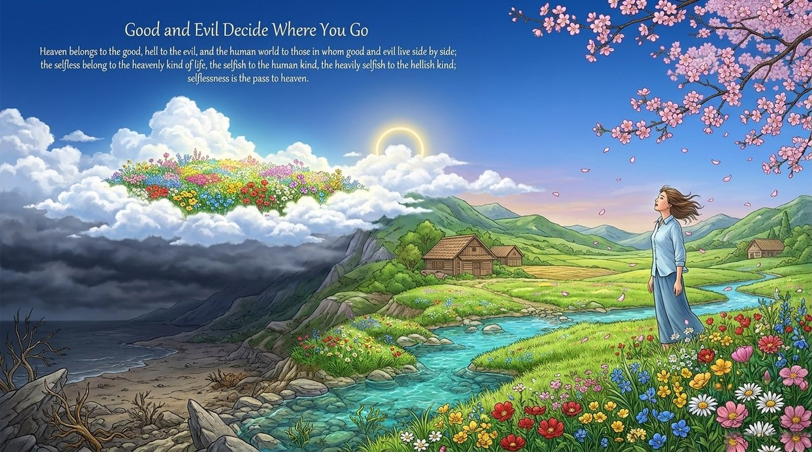
    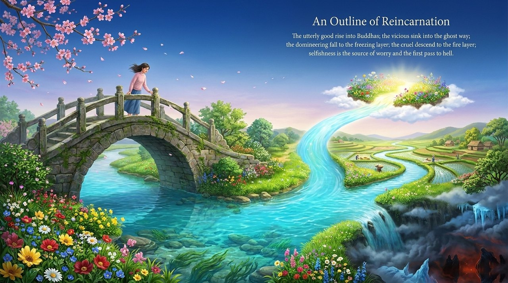
    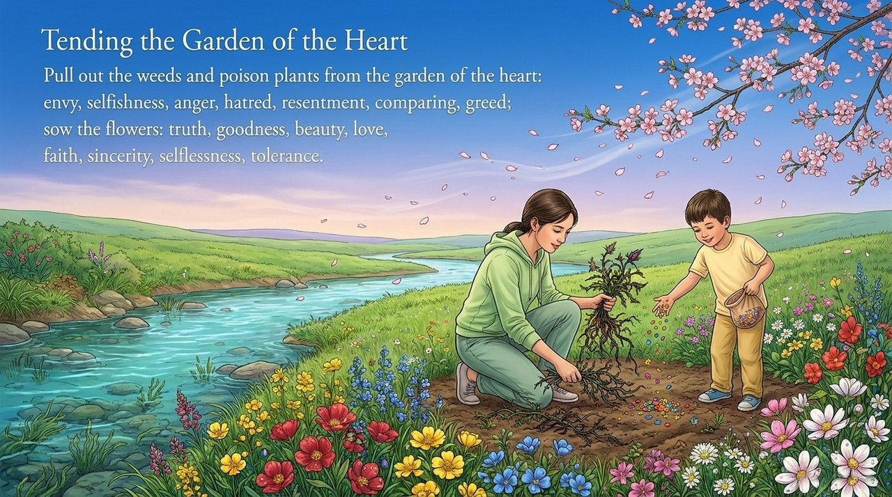
    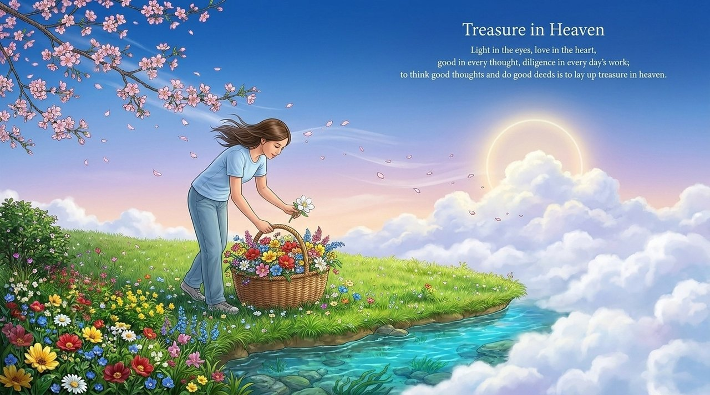

---

## Related Entries

[Morality](/en/morality/) · [Karma, Retribution & Reincarnation](/en/karma-retribution-reincarnation/) · [Soul Garden](/en/soul-garden/) · [Kingdom of Heaven](/en/kingdom-of-heaven/) · [Hundun (Ontology)](/en/hundun/) · [Awakening](/en/awakening/) · [Repentance](/en/repentance/) · [Way of the Greatest Creator](/en/way-of-the-greatest-creator/)

> Note: Concept numbers cited on this page refer to the Fourth Edition of the *New Era Human 800 Concepts*. The Fifth Edition has been re-arranged, and its numbering no longer matches the Fourth Edition one to one.
