---
title: Good People (Virtuous) · Bad People (Wicked)
slug: good-person-bad-person-en
---

# Good People (Virtuous) · Bad People (Wicked)

A **good person (善人, virtuous)** is one who brings joy, happiness, freedom, and wellbeing to others, and who guides people toward the Way of the Greatest Creator. A **bad person (恶人, wicked)** is one who brings distress, suffering, anxiety, and fear, and who leads others toward the path of darkness.

Chanyuan Celestials does not judge people by social reputation, religious piety, or self-assessment, but by the actual impact of one's existence on others and on life itself. At the same time, the system recognizes that human nature is fluid — shaped by environment — and that the highest cultivation goal is to transcend the good/bad framework altogether, living from one's true nature according to the will of the Greatest Creator.

> *Whoever brings joy, happiness, freedom, and wellbeing to others is a good person.*

---

## Version Guide

## Video

<iframe style="width:100%;aspect-ratio:4/3;border:0" src="https://www.youtube-nocookie.com/embed/5TctocGW98k" title="Good People (Virtuous) · Bad People (Wicked) (Lifechanyuan Encyclopedia video)" allowfullscreen></iframe>

## Slides

??? info "📖 Illustrated slides (14 pages, click to expand)"

    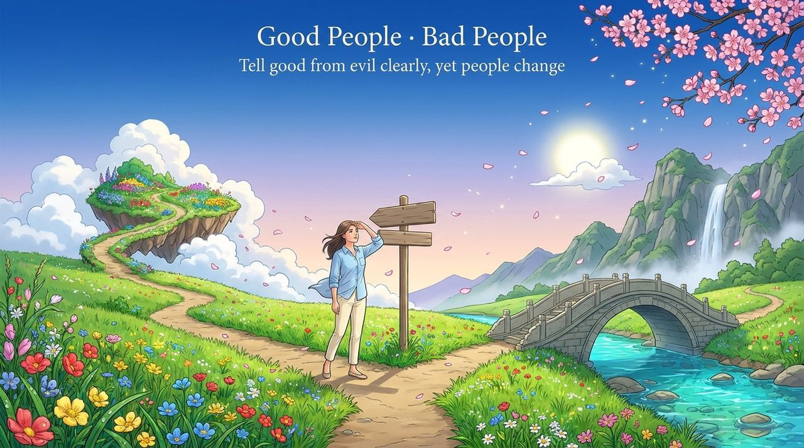
    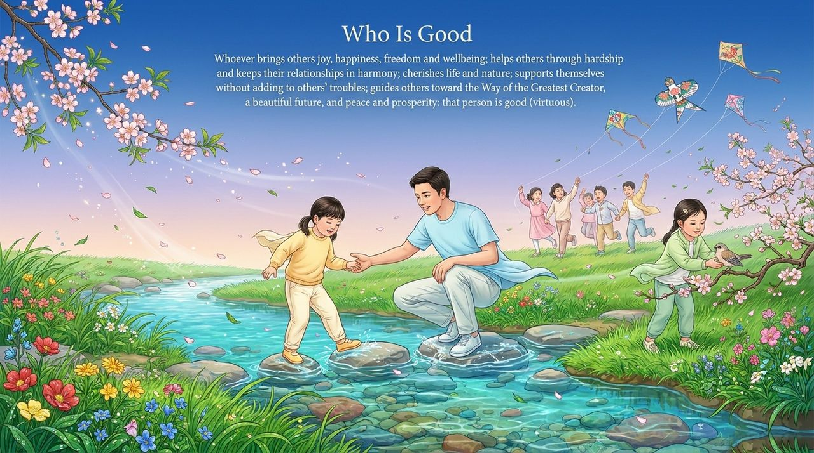
    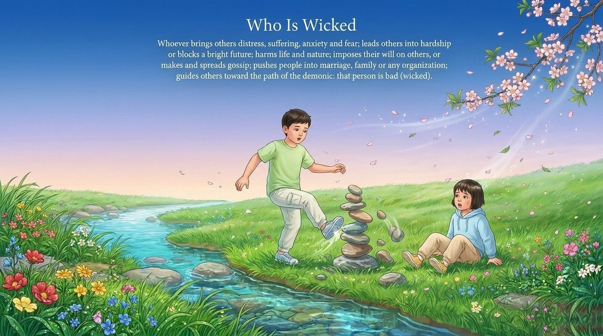
    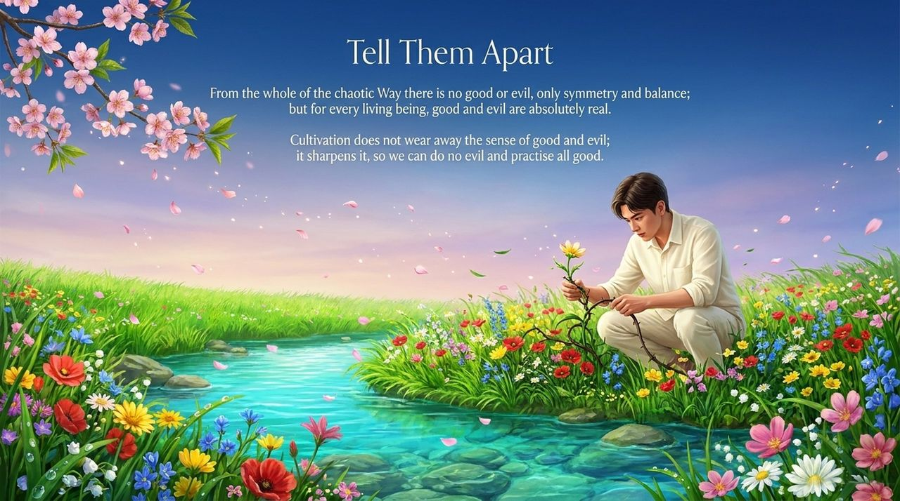
    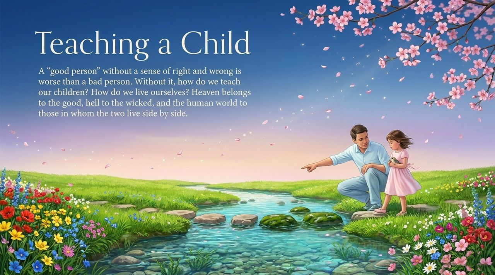
    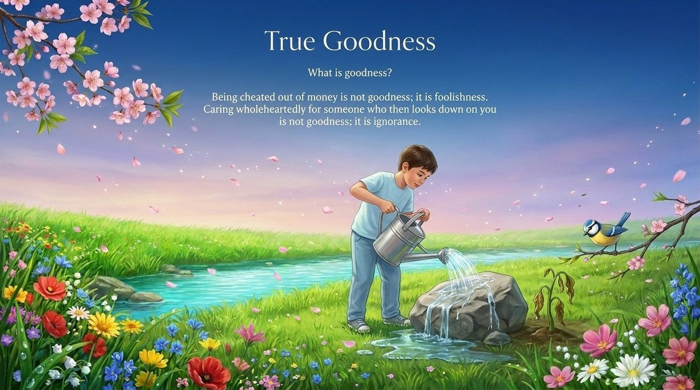
    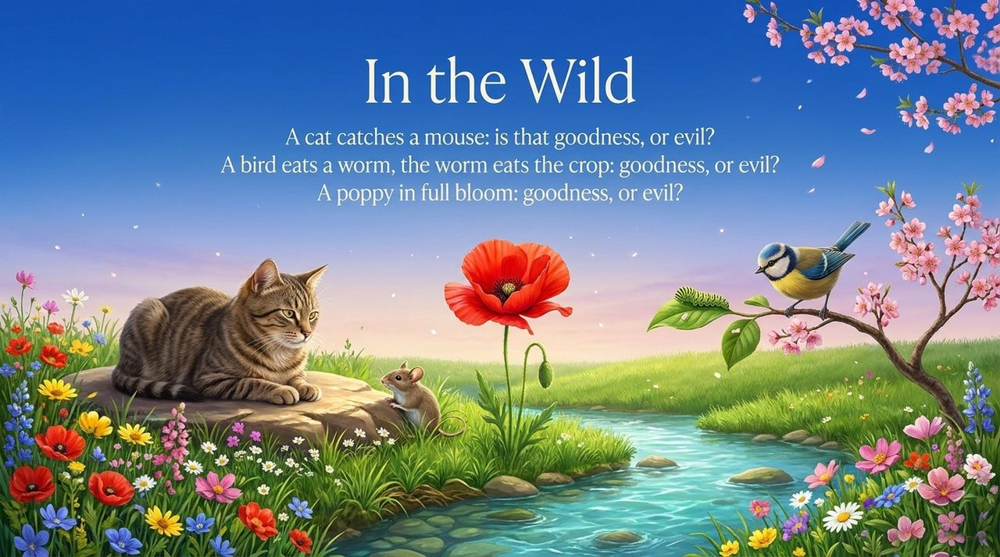
    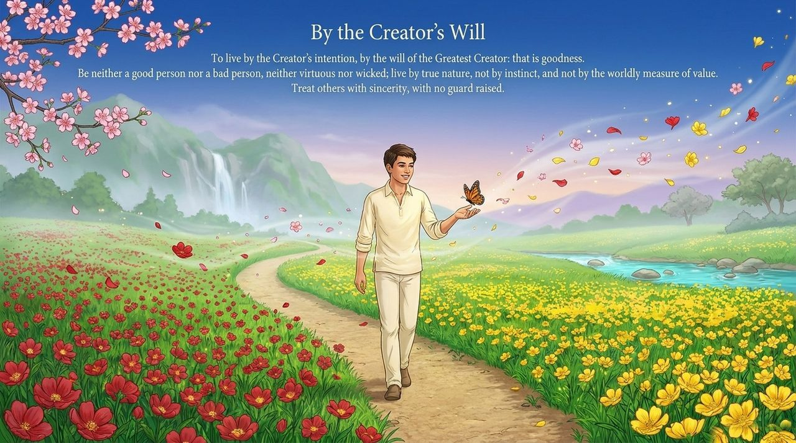
    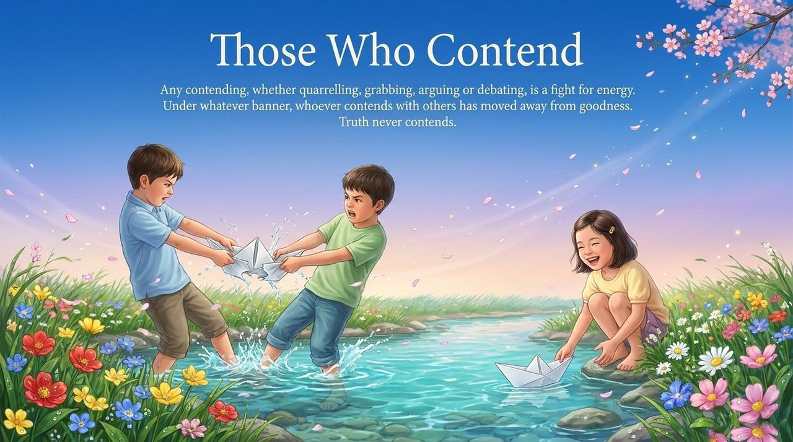
    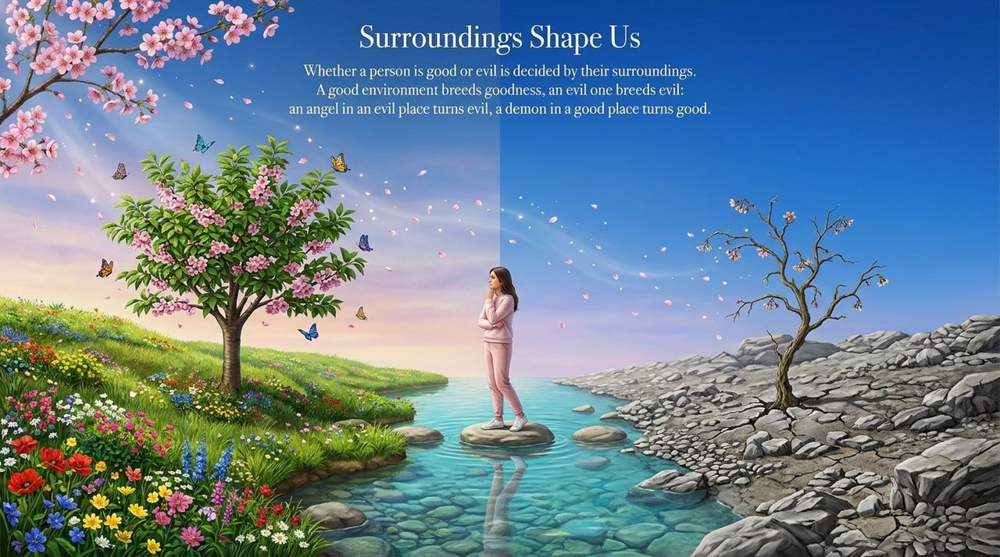
    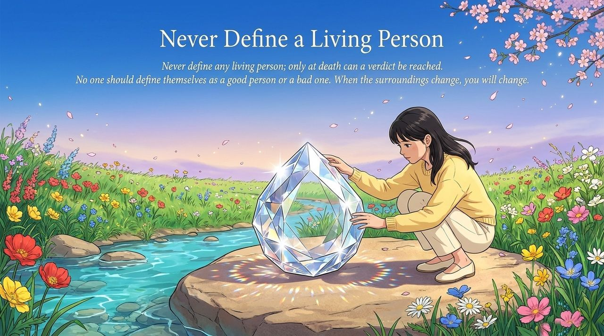
    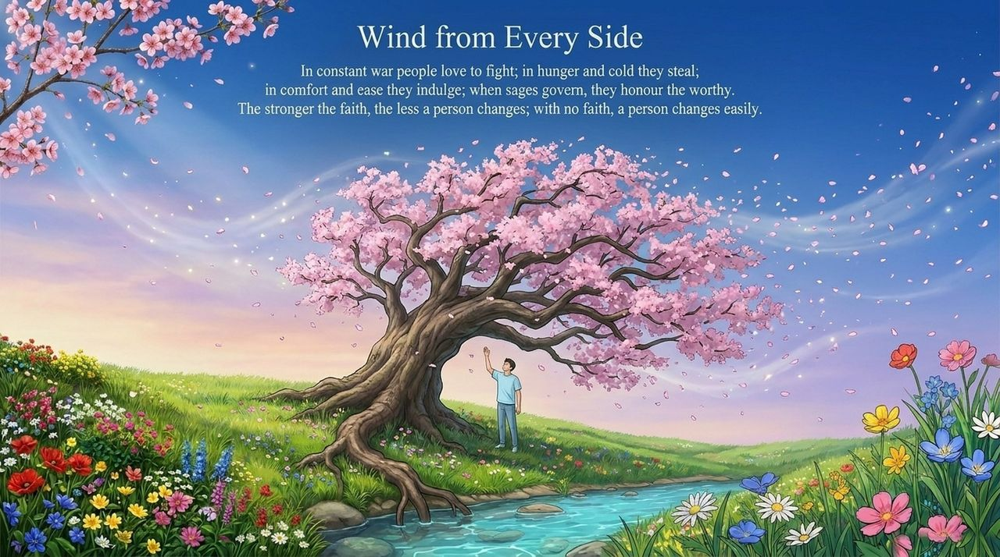
    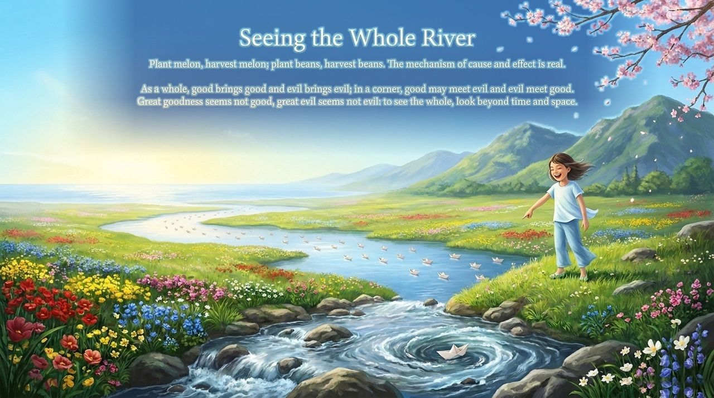
    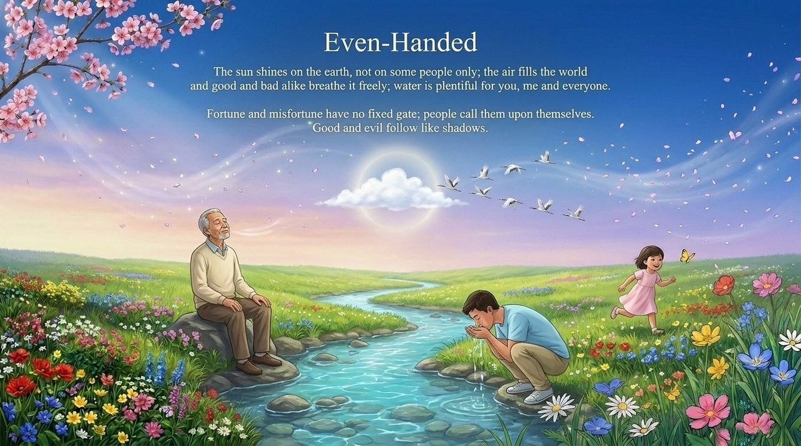

---

| Version | Best for | Focus |
|---------|----------|-------|
| [Friendly version](friendly.md) | First-time readers | Accessible exploration, self-reflection |
| [Academic version](academic.md) | Researchers | Systematic analysis, comparative study |
| [Internal reference](internal.md) | Deep study | Original texts, cultivation guidance |

---

## Related Entries

[Good, Evil & 108 Virtues / 108 Vices](/en/good-evil-108/) · [Morality](/en/morality/) · [Human Nature](/en/human-nature/) · [Perfect Human Nature](/en/perfect-human-nature/) · [Demonic Nature](/en/moxing/) · [Awakening](/en/awakening/) · [Karma, Retribution & Reincarnation](/en/karma-retribution-reincarnation/) · [Soul Garden](/en/soul-garden/)
