<!-- id: LC-GOO-0001-EN theme: Six LIFE Qualities type: Gateway Page direction: Cultivation Practice lang: en -->

# Goodness (善 Shàn)

[Entry Gateway]

> In Lifechanyuan terminology, **LIFE** (capitalized) refers to the ontological
> essence of existence — the soul/antimatter structure that persists across
> incarnations — while **life** (lowercase) refers to the experiential stage
> of human existence in this world.

**Goodness** (善, Shàn) is one of the six core LIFE qualities — alongside Truth, Beauty, Love, Faith, and Sincerity — and is the most beautiful flower in the soul garden, a fundamental attribute of the Greatest Creator, and an essential measure of a LIFE's level. Goodness is not weakness, not foolishness, not unprincipled accommodation — it is living according to the will of the Greatest Creator.

> Living according to the Creator's intention, according to the will of the Greatest Creator — this, I believe, is Goodness.
>
> — Guide Xuefeng, *Chanyuan Corpus · Wisdom Section · "Should We Remain Good?"*

---

## Core Positioning

In the Lifechanyuan system, Goodness operates on three levels: cosmologically, it is an attribute of the Greatest Creator and the law maintaining the ordered harmony of all things; in cultivation, it is the core direction of soul-garden tending; in daily conduct, it means refraining from all evil and practicing all good — in accordance with the natural Way, not according to human conventions.

---

## Video

<iframe style="width:100%;aspect-ratio:4/3;border:0" src="https://www.youtube-nocookie.com/embed/UnRXBK5Y3H0" title="Goodness (Lifechanyuan Encyclopedia video)" allowfullscreen></iframe>

## Slides

??? info "📖 Illustrated slides (14 pages, click to expand)"

    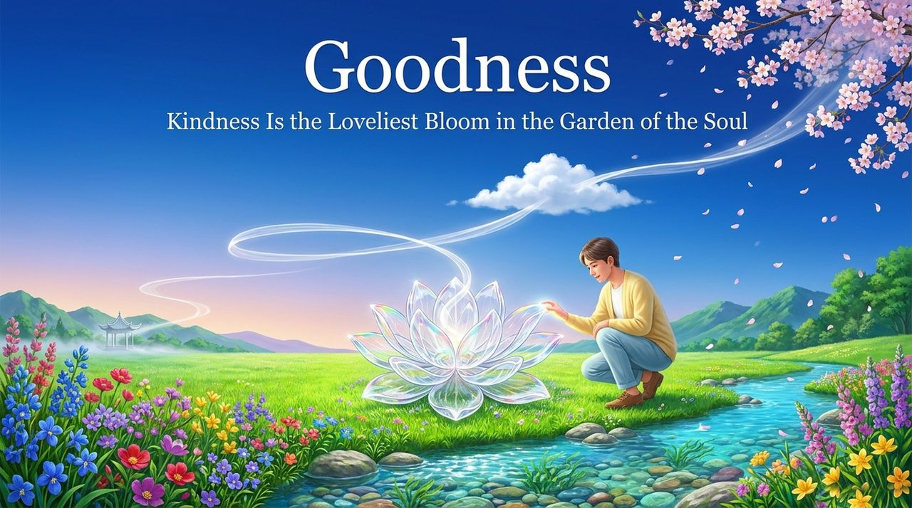
    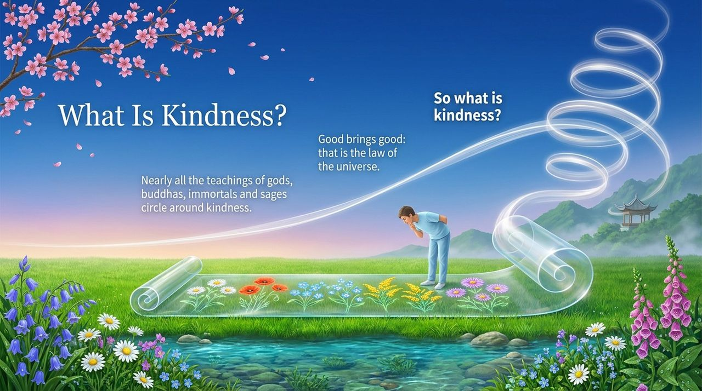
    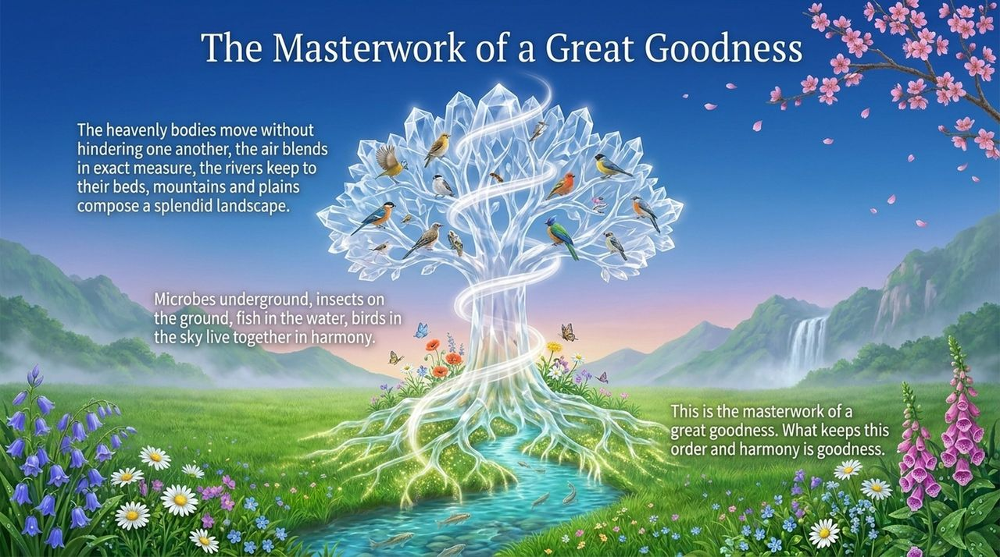
    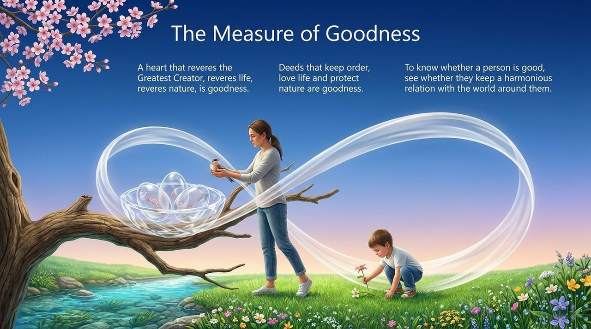
    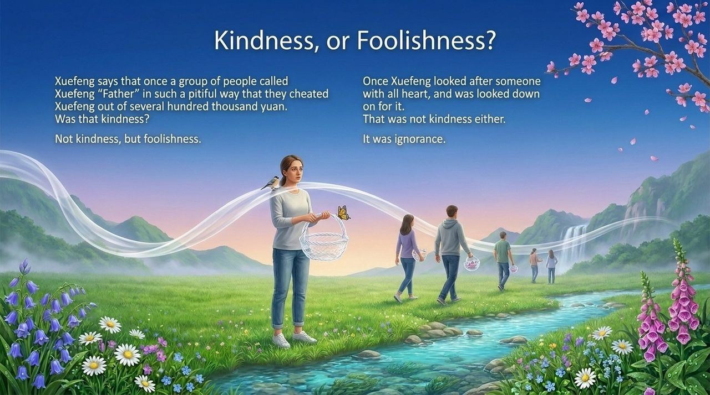
    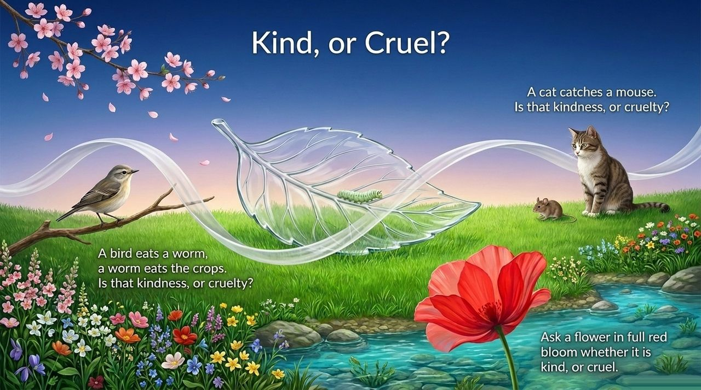
    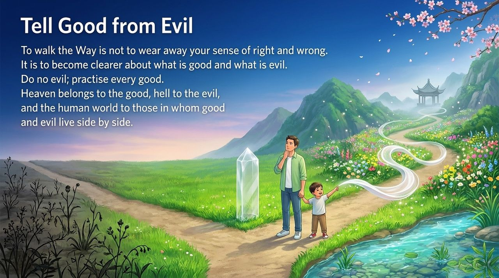
    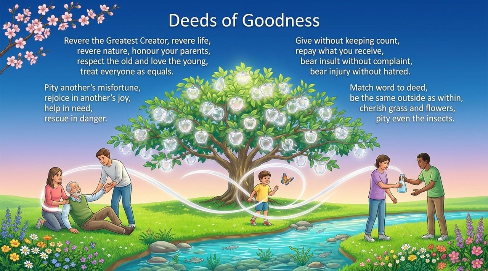
    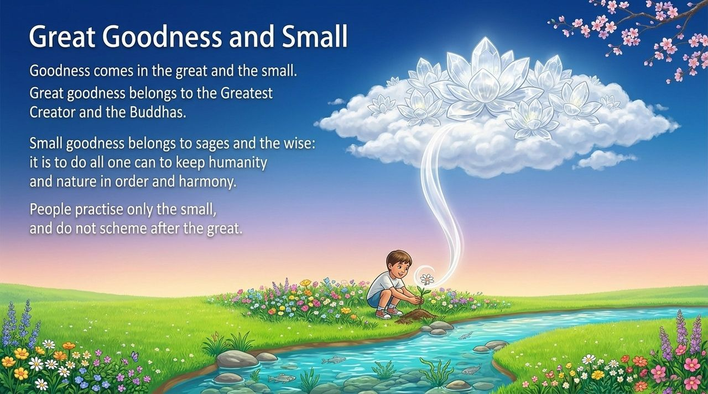
    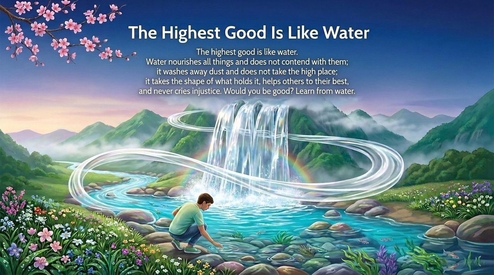
    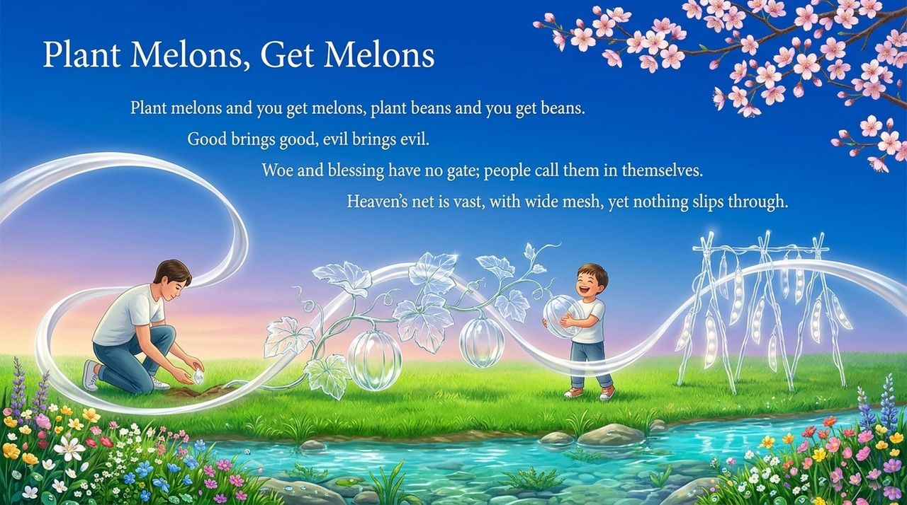
    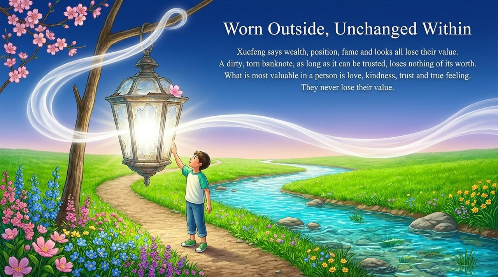
    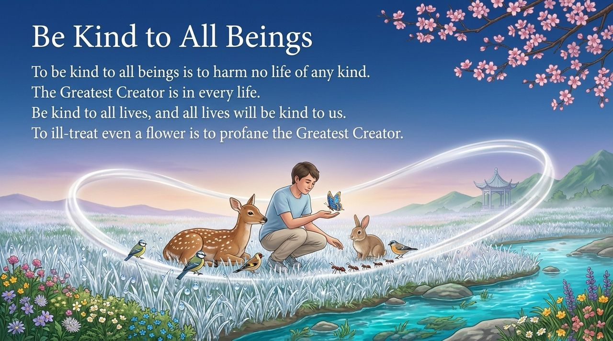
    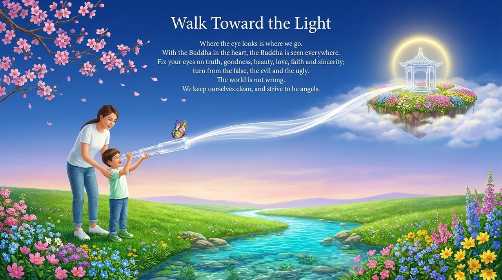

---

## Read by Edition

| Edition | Intended Reader | Link |
|---------|----------------|-------|
| **Friendly Edition** | Readers new to Lifechanyuan concepts | [Read Friendly Edition](./friendly) |
| **Academic Edition** | Researchers with philosophical/religious studies background | [Read Academic Edition](./academic) |
| **Internal Edition** | Chanyuan Celestials and deep practitioners | [Read Internal Edition](./internal) |

---

## Related Entries

- [Six Qualities](/en/six-qualities/) — The integrated system of Truth, Goodness, Beauty, Love, Faith, and Sincerity
- [Truth](/en/truth/) · [Beauty](/en/beauty/) · [Love](/en/love/) · [Faith](/en/faith/) · [Sincerity](/en/sincerity/) — The other five core LIFE qualities
- [Soul Garden](/en/soul-garden/) — The practical vessel for cultivating Goodness
- [The Greatest Creator](/en/greatest-creator/) — The source of the universe's Goodness
