# Happiness

> **The Way of the Greatest Creator is the way of happiness.**
>
> — 800 Values for New Era Humanity, Value 518

In the Lifechanyuan framework, happiness is not the accumulation of external conditions but the inner radiance that naturally emerges when LIFE resonates with the Way of the Greatest Creator. True happiness has nothing to do with material wealth or social standing — it is the natural expression of a soul that is free, fulfilled, and unencumbered. Lifechanyuan teaches that love is the greatest source of happiness; carefree ease is its basic form; and living in natural harmony with the Way is its highest expression. Happiness has its levels: the ordinary person's happiness depends on external circumstances; the practitioner's happiness comes from inner freedom; the Celestial's happiness is unconditional, complete, and eternal.

| Version | Best for | Focus |
|---------|----------|-------|
| [Friendly version](friendly.md) | First-time readers | Understanding true happiness in plain, everyday terms |
| [Academic version](academic.md) | Researchers | Systematic analysis of happiness: sources, levels, and the cultivation path |
| [Internal reference](internal.md) | Deep study | Complete source texts with full citations |

---

## Core Definition

Happiness is the inner state that arises when LIFE aligns with the Way of the Greatest Creator — a natural condition of freedom, fullness, and unhindered being. In the Lifechanyuan framework, happiness is not about what one possesses but about the state of resonance between one's life and the Way: the content are happy, the free are happy, those with abundant love are happy, and those in resonance with the Greatest Creator are most happy of all.

The highest form of happiness is Elysian Bliss — the complete, eternal, unconditional joy experienced by Celestials in the Elysium World, which is the ultimate destination of all cultivation and practice.

---

## Video

<iframe style="width:100%;aspect-ratio:4/3;border:0" src="https://www.youtube-nocookie.com/embed/lGZxDkJlvo8" title="Happiness (Lifechanyuan Encyclopedia video)" allowfullscreen></iframe>

## Slides

??? info "📖 Illustrated slides (14 pages, click to expand)"

    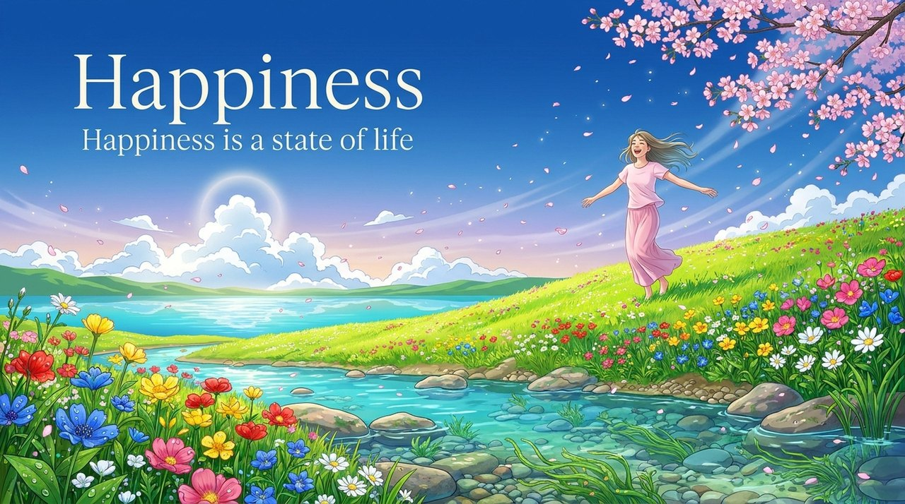
    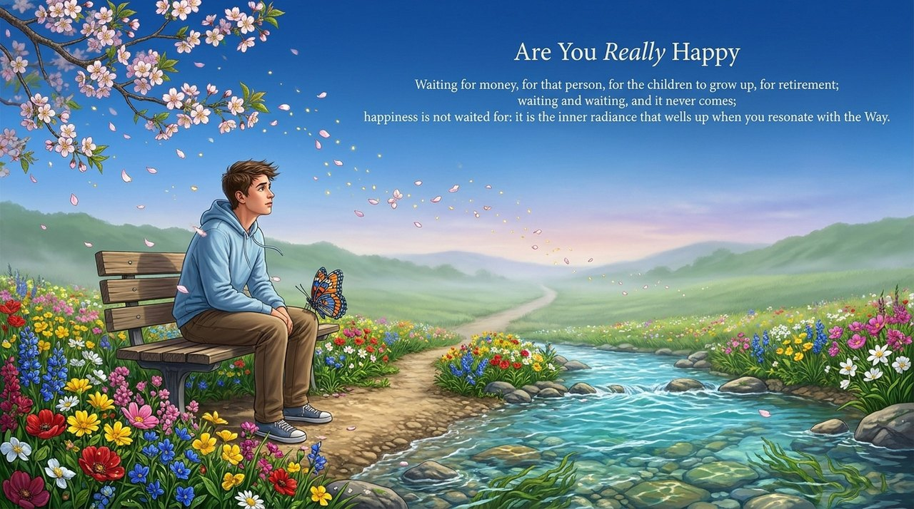
    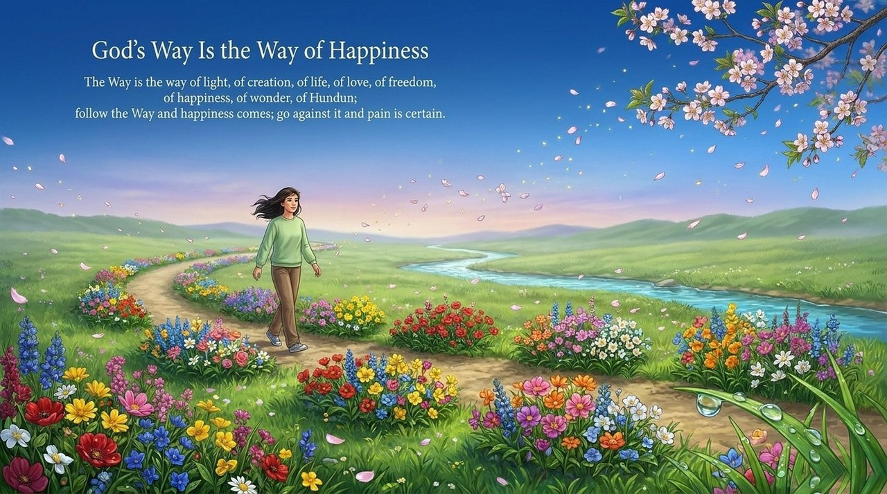
    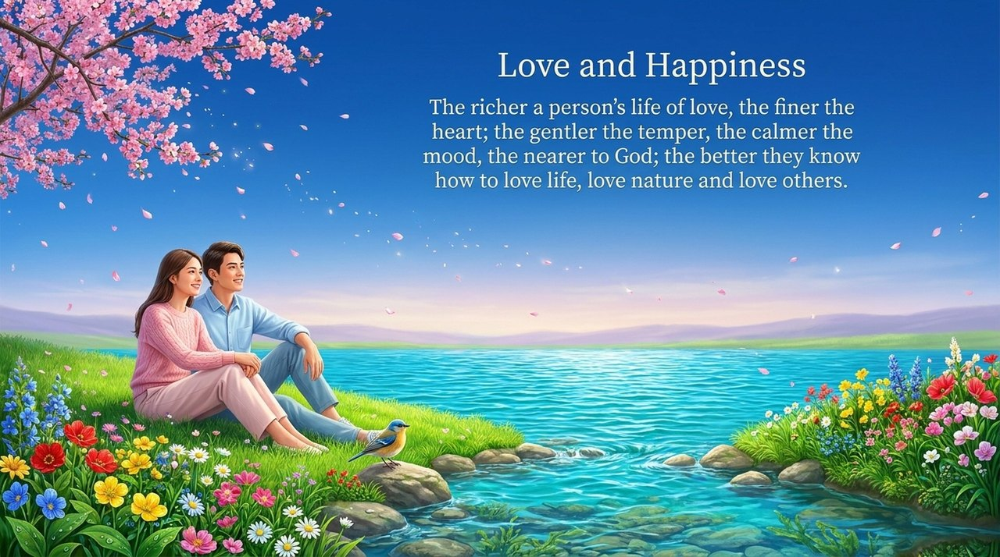
    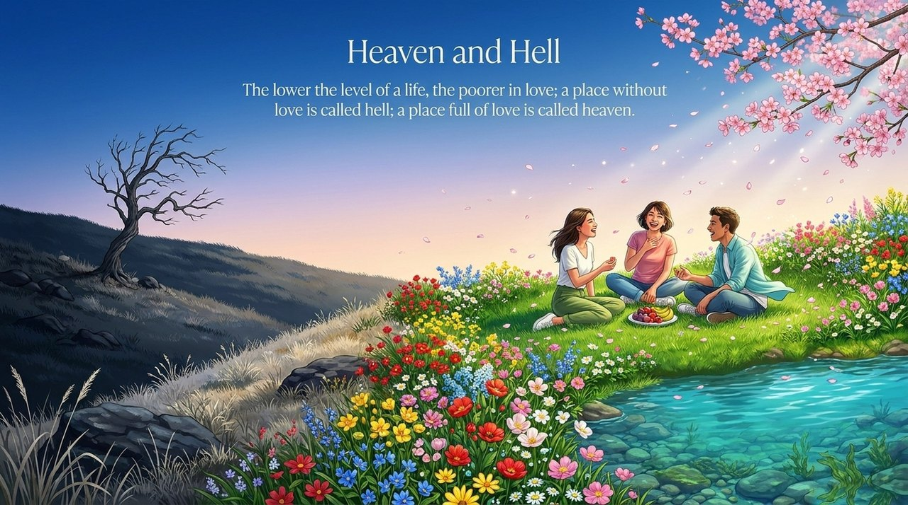
    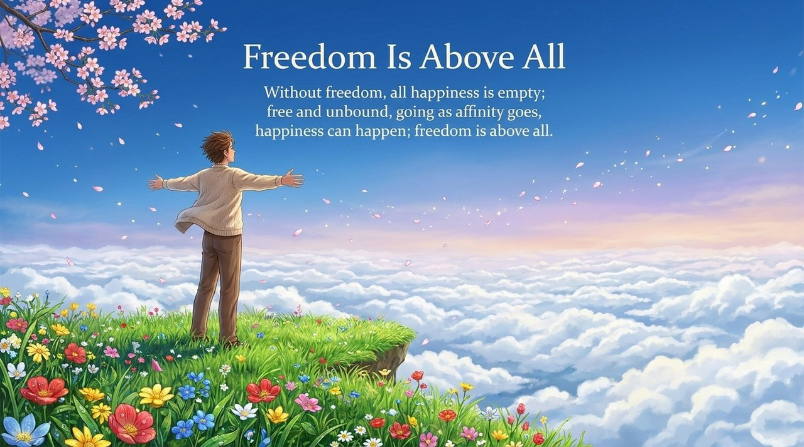
    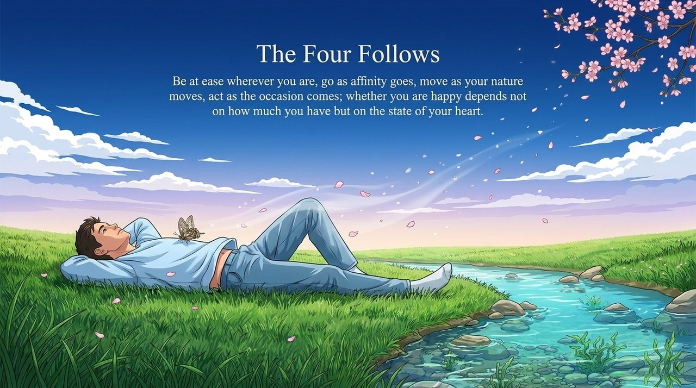
    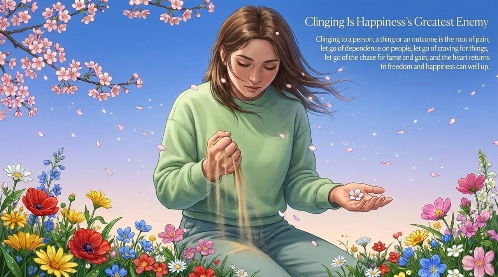
    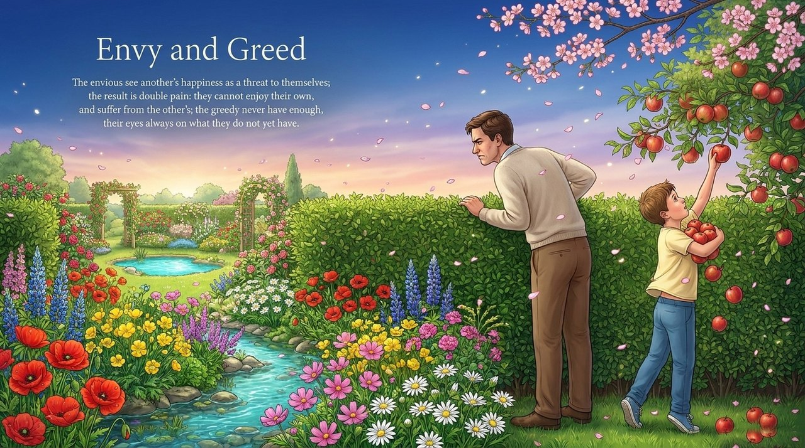
    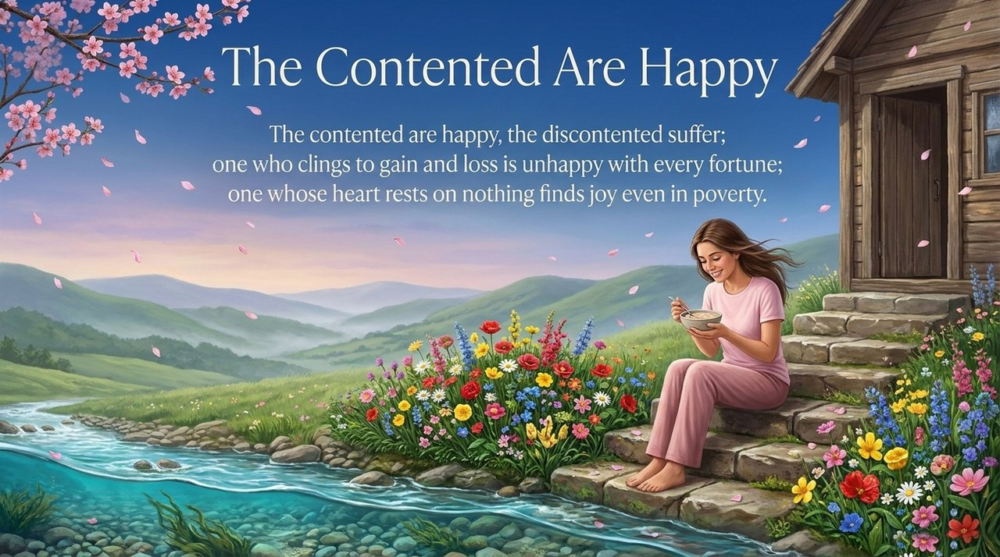
    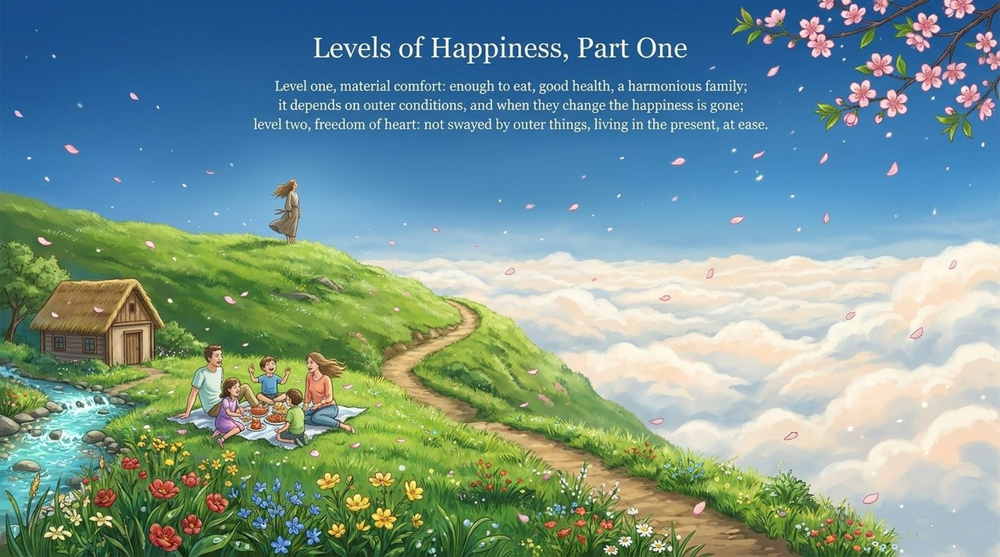
    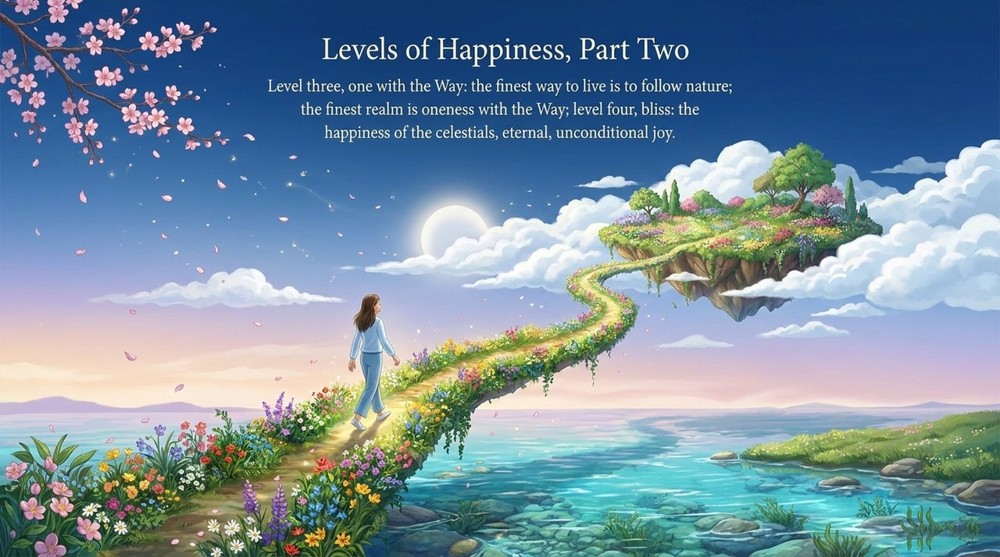
    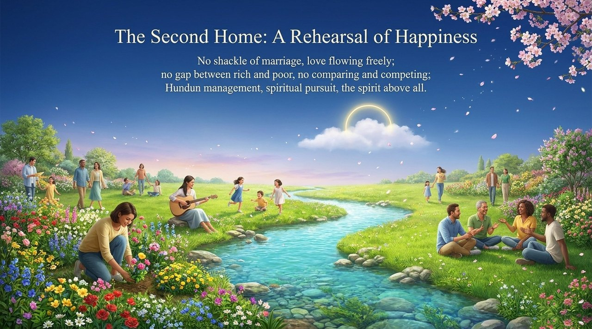
    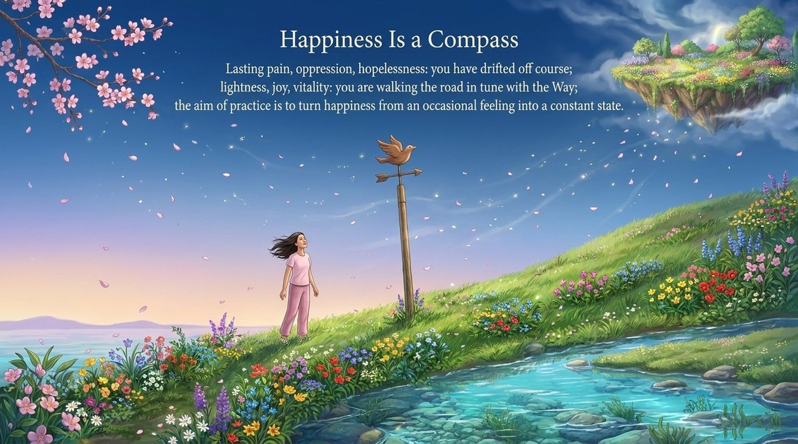

---

## Related Entries

- [Love](/en/love/)
- [Romantic Love and Sexuality](/en/romantic-love-and-sexuality/)
- [Elysian Realm of Bliss](/en/jilemiaojing/)
- [Free Will](/en/free-will/)
- [Move with Authentic Nature](/en/suixing-er-dong/)
- [Resonance](/en/resonance/)
- [Inner Garden of the Spirit](/en/soul-garden/)
- [Truth, Goodness, Beauty, Love, Faith, Sincerity](/en/six-qualities/)
- [Value, Meaning and Purpose of Life](/en/value-meaning-purpose-of-life/)
- [The Thousand-year World](/en/thousand-year-world/)
