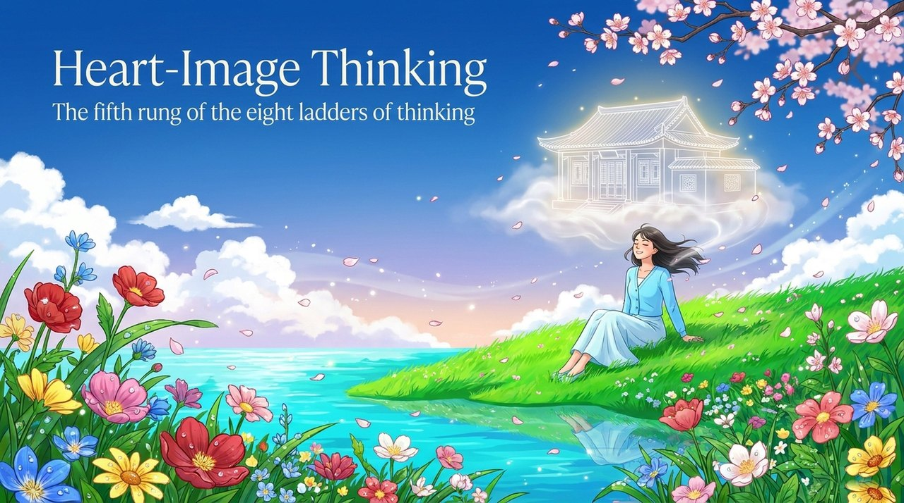
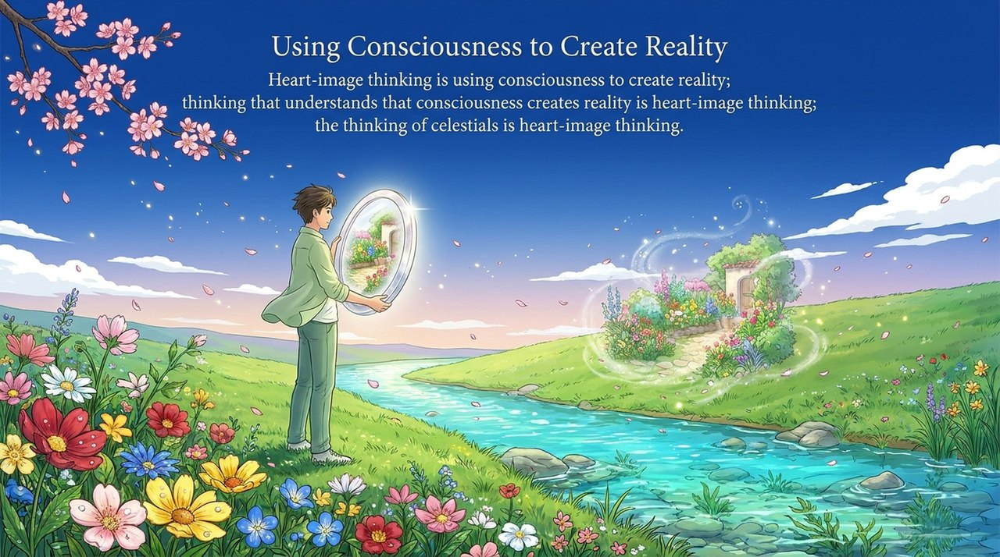
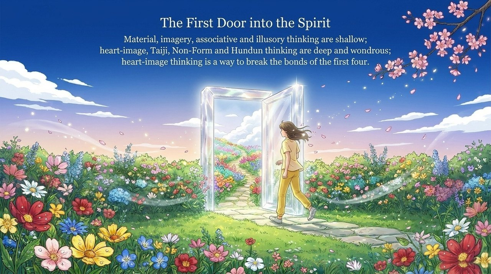
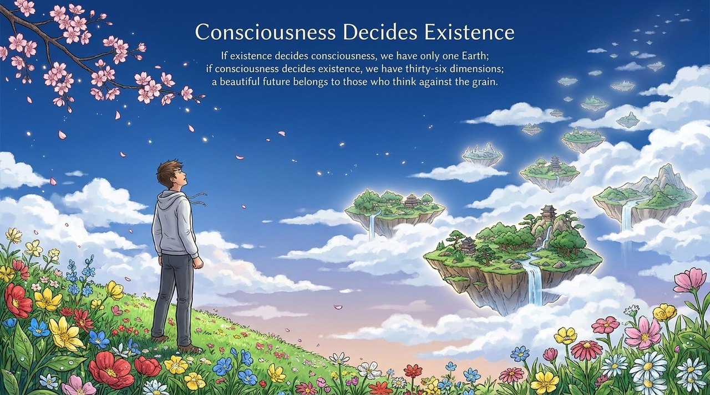

<!-- id: LC-HIT-0001 theme: Thinking Cultivation type: Entry Gateway direction: Consciousness Ascension Path lang: en -->

> In Lifechanyuan terminology, **LIFE** (capitalized) refers to the ontological
> essence of existence — the soul/antimatter structure that persists across
> incarnations — while **life** (lowercase) refers to the experiential stage
> of human existence in this world.

# Heart-Image Thinking

[Entry Gateway]

**Heart-Image Thinking** is the **fifth rung** of the Eight Thinking Ladders — the most critical threshold between the first four rungs ("addition phase") and the final three rungs ("subtraction phase"), the first gateway into the spiritual level. Its essence in one sentence: **use consciousness to create reality**. The thinking of celestial immortals is Heart-Image Thinking; the thinking of Muhammad is Heart-Image Thinking. Heart-Image Thinking is the core secret of becoming an immortal — the first genuine key to escaping the maze of LIFE and reaching the higher realms of existence.

> Heart-Image Thinking is using consciousness to create reality.
>
> — Guide Xuefeng, *Chanyuan Corpus · Revelation Chapter · Heart-Image Thinking*

---

## Core Position

In Lifechanyuan's cultivation route map, Heart-Image Thinking is the endpoint of the addition phase and the starting point of the subtraction phase. The first four rungs (Material / Imagery / Associative / Illusory Thinking) rely on brain training achievable through learning and accumulation; Heart-Image Thinking and above require heart purification and the perfection of LIFE's antimatter structure — a qualitative leap. Once Heart-Image Thinking is attained, one can understand the great Way of LIFE, know the path to higher LIFE realms, and escape the bondage of time and space. Guide Xuefeng's explicit requirement for Chanyuan Celestials: abandon the first four types of thinking and enter Heart-Image Thinking directly.

---

## Editions

| Edition | Intended Readers | Link |
|---------|-----------------|------|
| **Friendly Edition** | Readers new to Lifechanyuan concepts | [Read Friendly Edition](./friendly) |
| **Academic Edition** | Researchers, philosophy/religious studies backgrounds | [Read Academic Edition](./academic) |
| **Internal Edition** | Chanyuan Celestials and deep practitioners | [Read Internal Edition](./internal) |

---

## Video

<iframe style="width:100%;aspect-ratio:4/3;border:0" src="https://www.youtube-nocookie.com/embed/QiJApdDynUE" title="Heart-Image Thinking (Lifechanyuan Encyclopedia video)" allowfullscreen></iframe>

## Slides

??? info "📖 Illustrated slides (14 pages, click to expand)"

    
    
    
    
    
    
    
    
    
    
    
    
    
    

---

## Related Entries

- [Eight Thinking Ladders](/en/eight-thinking-ladders/) — Heart-Image Thinking's coordinates in the complete ladder system
- [Illusory Thinking](/en/illusory-thinking/) — Fourth rung, the step immediately before Heart-Image Thinking
- [Antimatter Structure](/en/antimatter-structure/) — Heart-Image Thinking acts directly upon LIFE's antimatter structure
- [Soul Garden](/en/soul-garden/) — Heart purification is the prerequisite soil for Heart-Image Thinking
