<!-- id: LC-HT-0001-EN theme: Cultivation Practice type: index direction: Cultivation Practice lang: en -->

# Heavenly Treasures

**Heavenly Treasures** in the Lifechanyuan system refers specifically to **soul energy** — one's faith in the Greatest Creator, divine beings, and the Kingdom of Heaven; one's conviction and longing for a beautiful future; and qualities such as love, goodness, truth-goodness-beauty-love, and artistic beauty. Heavenly Treasures is one of the four core tasks for Chanyuan Celestials and one of three indispensable conditions for entering the Kingdom of Heaven (the Thousand-year World, Ten-thousand-year World, and Elysium with its Celestial Islands Continent). Jesus Christ's teaching — *"Store up for yourselves treasures in heaven"* — is the foundational scriptural source of this concept.

> "Heavenly Treasures refer mainly to soul energy. Material energy and mental energy do not count as Heavenly Treasures."
> — Xuefeng, *Heavenly Treasures and How to Calculate Them*, 2009

---

## Version Guide

| Version | Best for | Focus |
|---------|----------|-------|
| [Friendly version](friendly.md) | First-time readers | What are Heavenly Treasures? How to accumulate and deplete them? |
| [Academic version](academic.md) | Researchers | Soul energy ontology, systematic analysis of accumulation methods, comparison with Buddhist/Christian/Taoist traditions |
| [Internal reference](internal.md) | Deep study | Complete source texts, calculation methods, F-coins and Heavenly Treasures |

---

## Video

<iframe style="width:100%;aspect-ratio:4/3;border:0" src="https://www.youtube-nocookie.com/embed/8b3Ntx0I6Bw" title="Heavenly Treasures (Lifechanyuan Encyclopedia video)" allowfullscreen></iframe>

## Slides

??? info "📖 Illustrated slides (14 pages, click to expand)"

    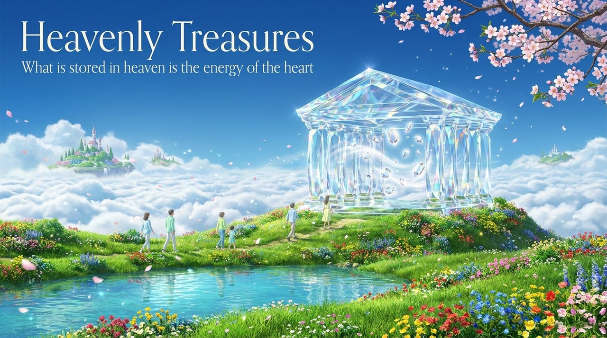
    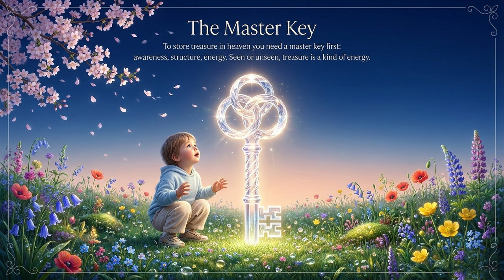
    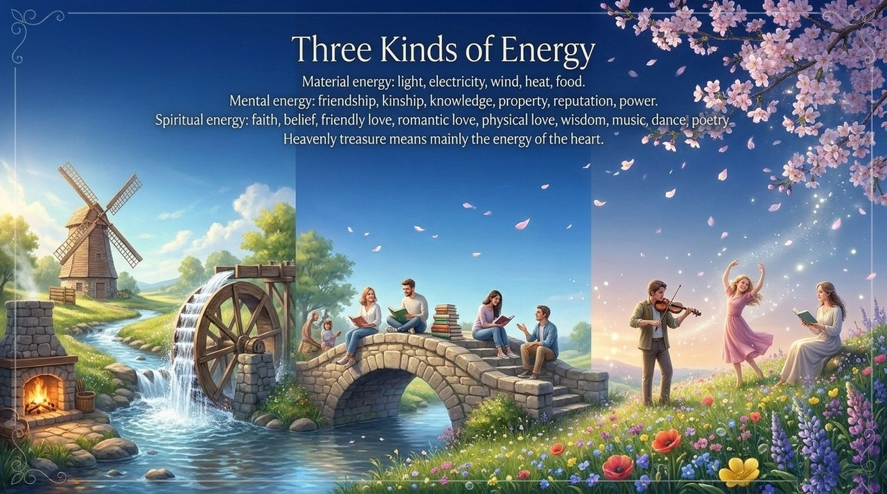
    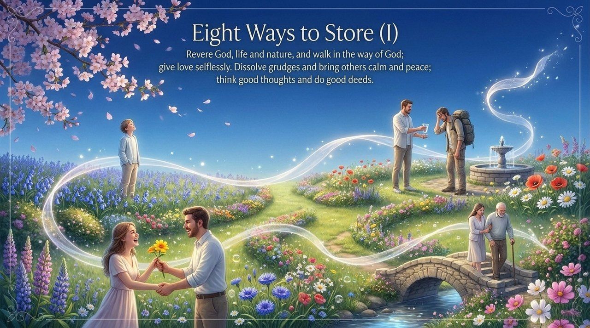
    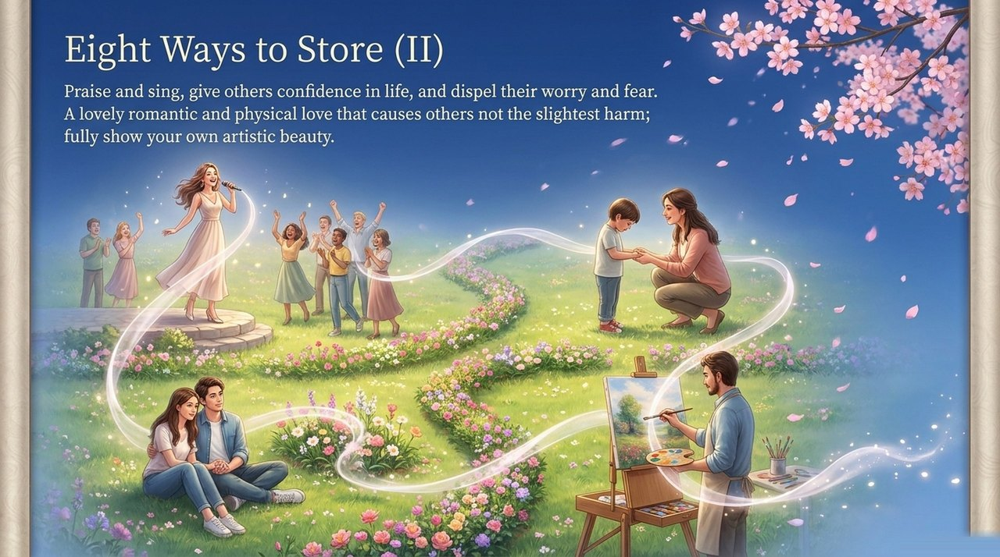
    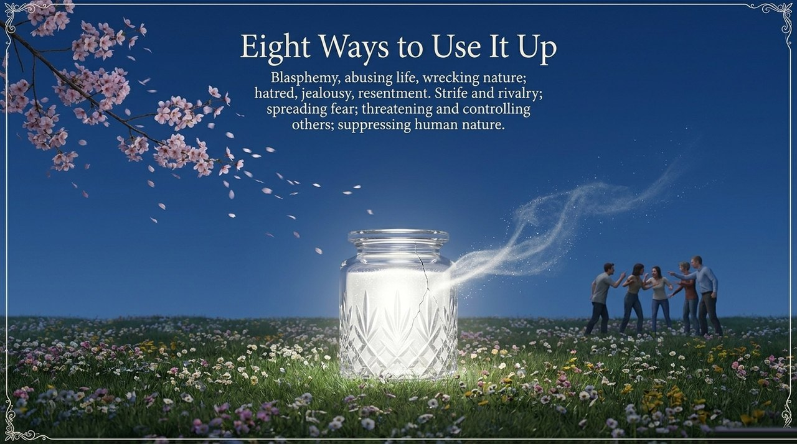
    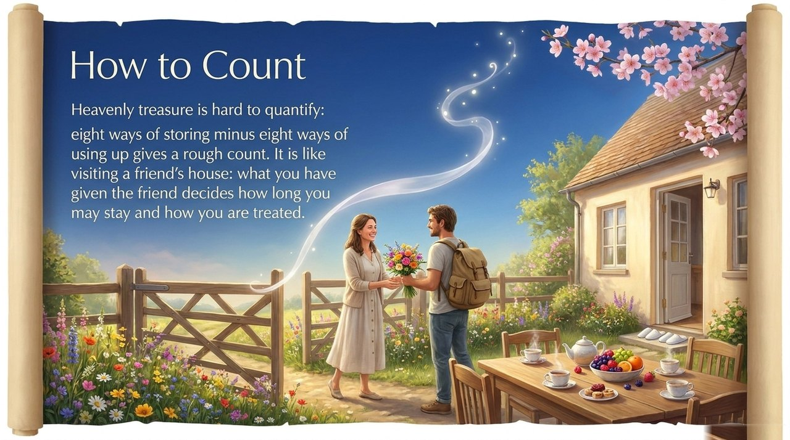
    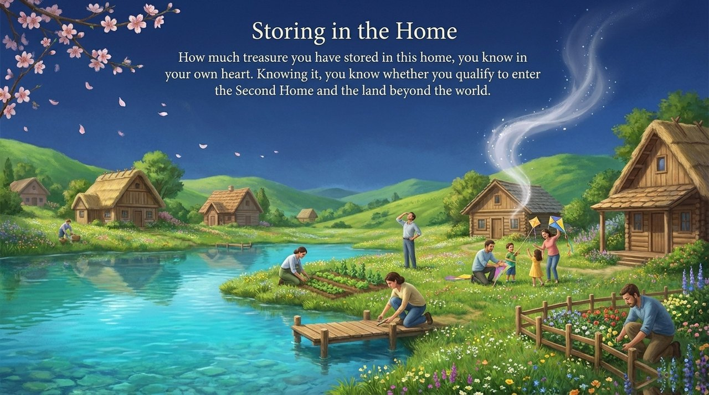
    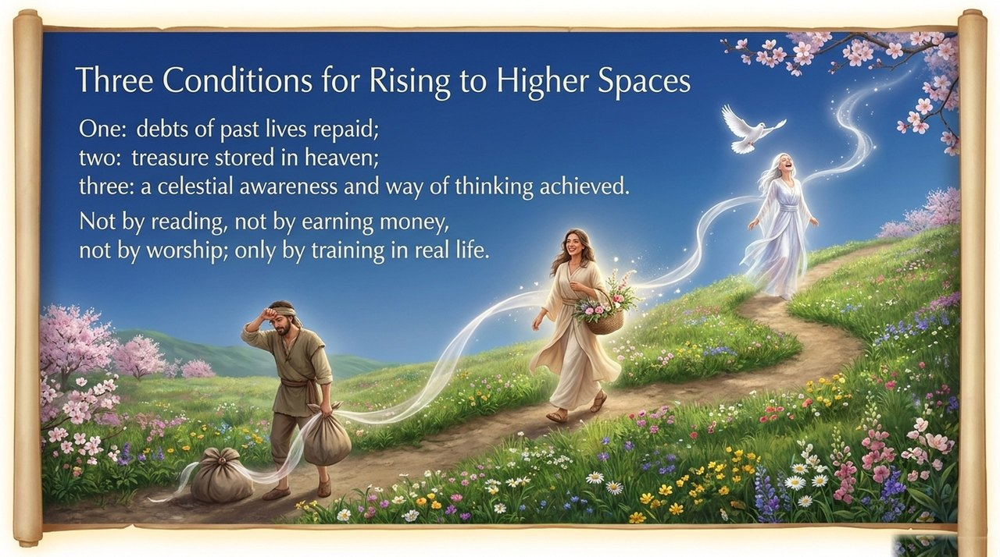
    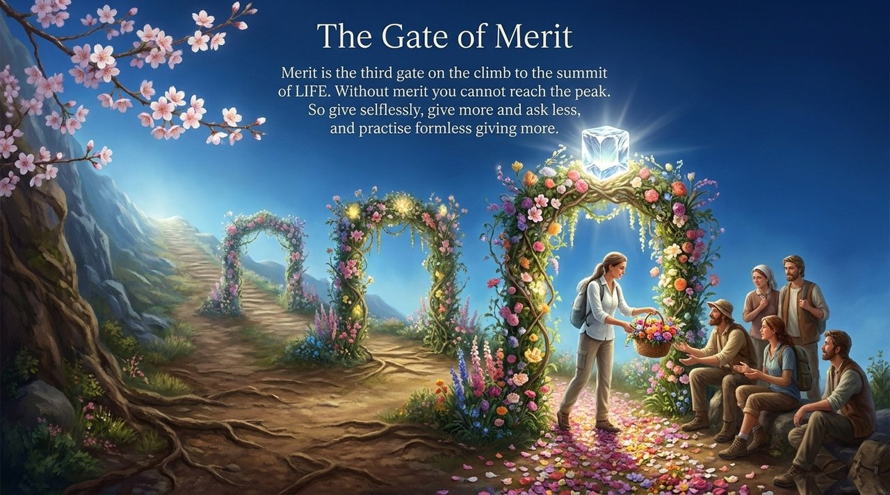
    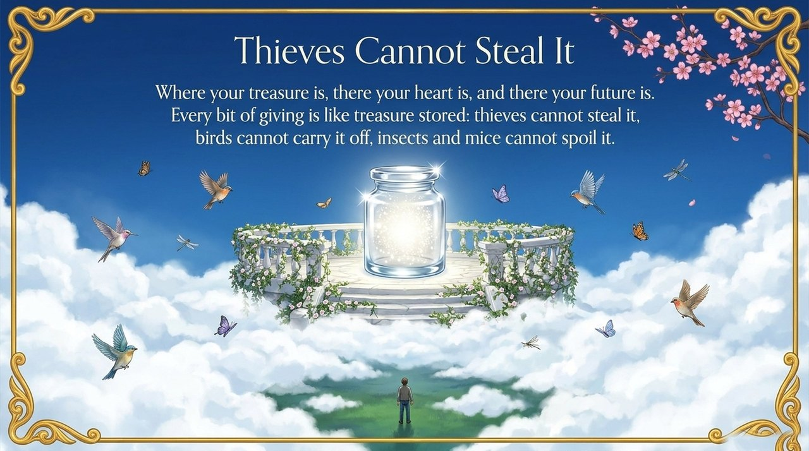
    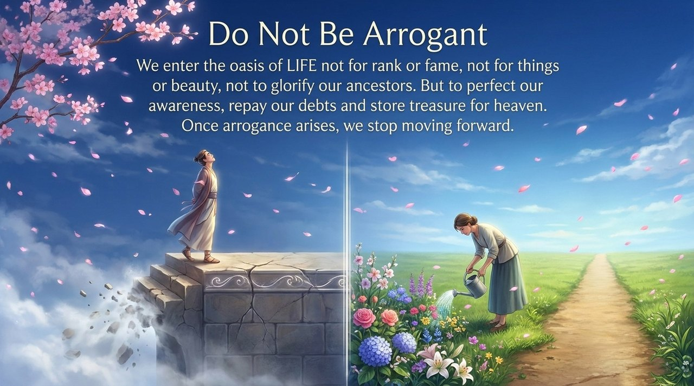
    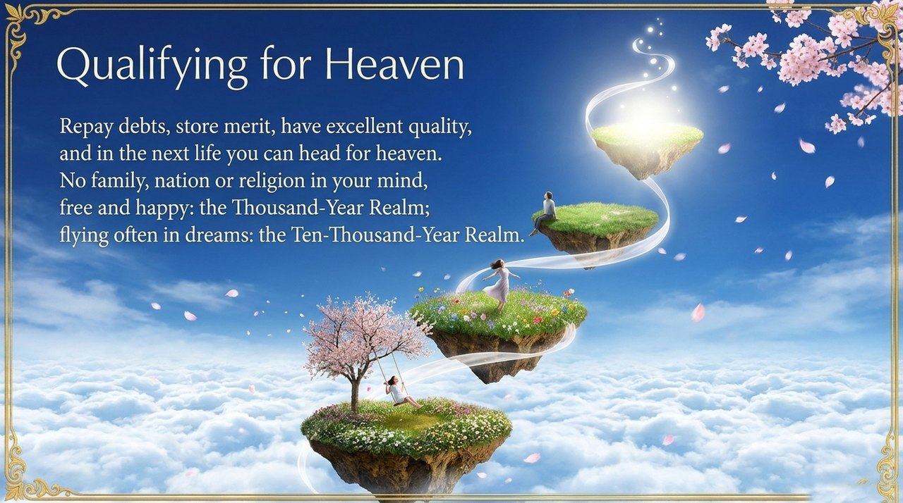
    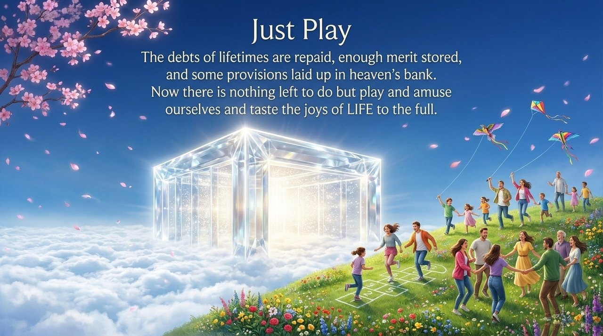

---

## Related Entries

- [Route Map to the Kingdom of Heaven](/en/route-to-heaven/)
- [Debt Repayment](/en/debt-repayment/)
- [Formless Giving](/en/formless-giving/)
- [Soul Garden](/en/soul-garden/)
- [F-coin](/en/f-coin/)
- [Releasing Worldly Bonds](/en/releasing-worldly-bonds/)
- [Elysium World](/en/elysium-world/)
- [Kingdom of Heaven](/en/kingdom-of-heaven/)
