# Hell

**Hell**, in the Lifechanyuan system, is not a religious myth or moral metaphor — it is a real spatial dimension within the universe's 36-dimensional structure. Specifically, it encompasses three distinct parallel worlds: **the Underworld (Yinjian)**, **the Frozen Layer (Bingdong Ceng)**, and **the Fire-Tempering Layer (Huolian Ceng)**. Hell is the natural karmic destination for souls whose spirituality has been corrupted by selfishness, cruelty, and violation of the Way of the Greatest Creator.

> The Fire-Tempering Layer, the Frozen Layer, and the Underworld are collectively what is commonly referred to as Hell. LIFE in Hell generally does not directly enter the human world.
>
> — *New Era Human 800 Concepts*

---

## Version Navigation

| Version | Best for | Focus |
|---------|----------|-------|
| [Friendly version](friendly.md) | First-time readers | What hell really is and why it matters |
| [Academic version](academic.md) | Researchers | Spatial coordinates, entry mechanisms, cosmic function |
| [Internal reference](internal.md) | Deep study | Original source texts with full citations |

---

## Video

<iframe style="width:100%;aspect-ratio:4/3;border:0" src="https://www.youtube-nocookie.com/embed/khuZbyLLB14" title="Hell (Lifechanyuan Encyclopedia video)" allowfullscreen></iframe>

## Slides

??? info "📖 Illustrated slides (14 pages, click to expand)"

    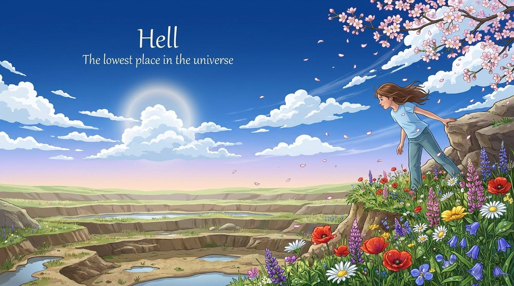
    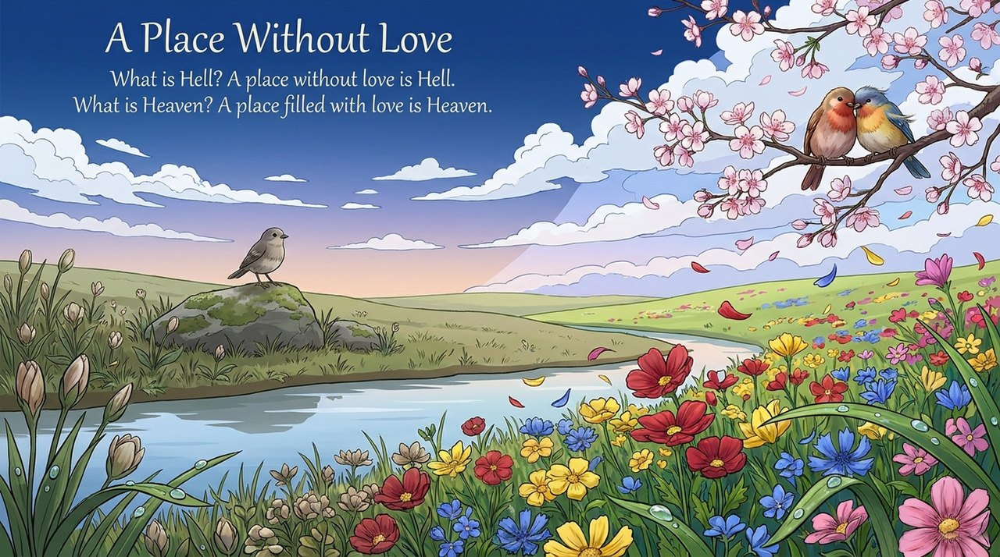
    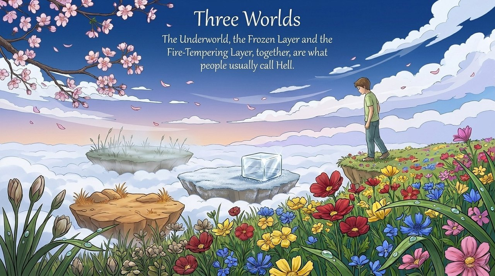
    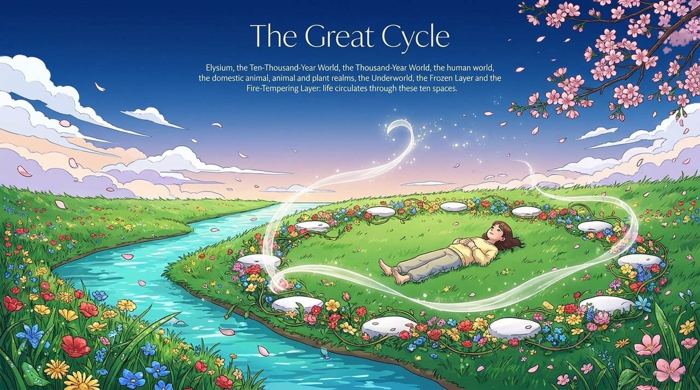
    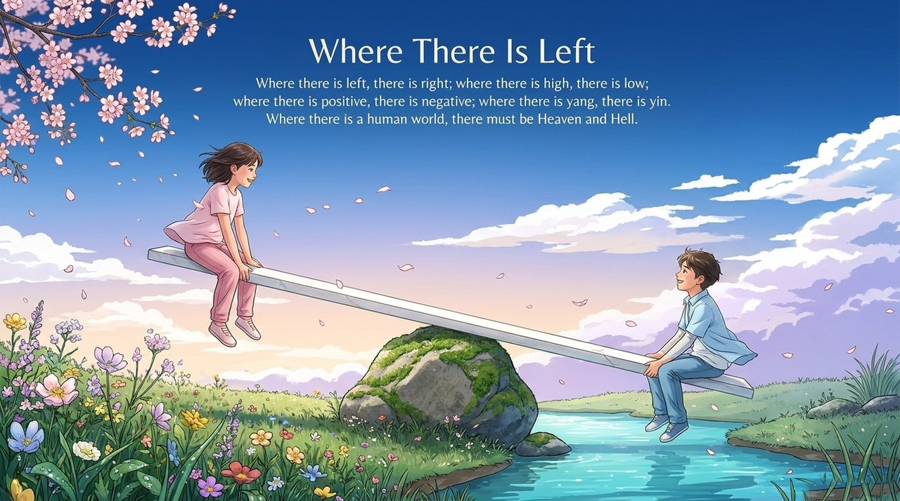
    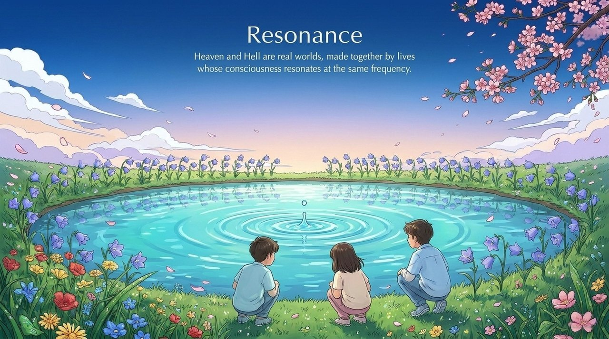
    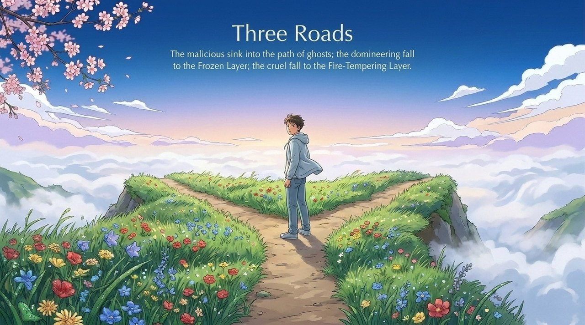
    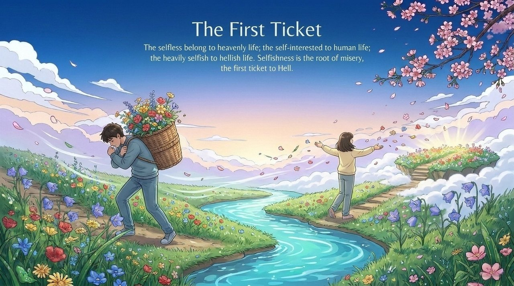
    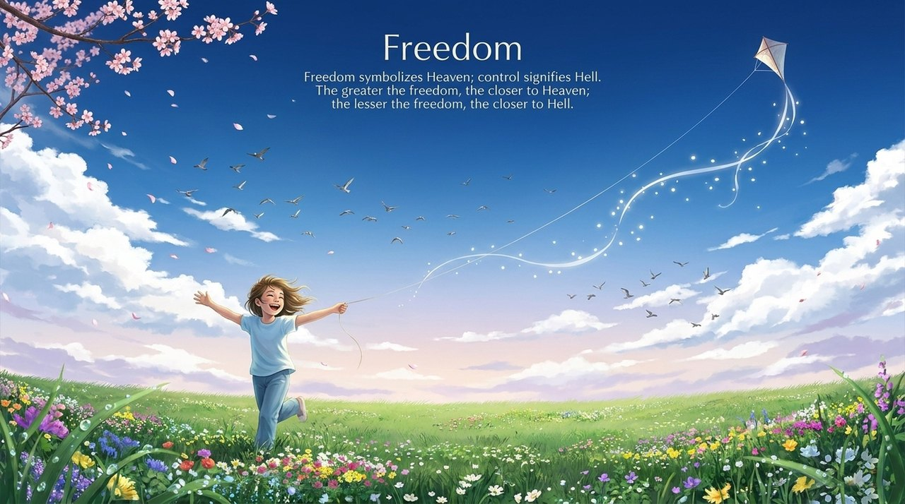
    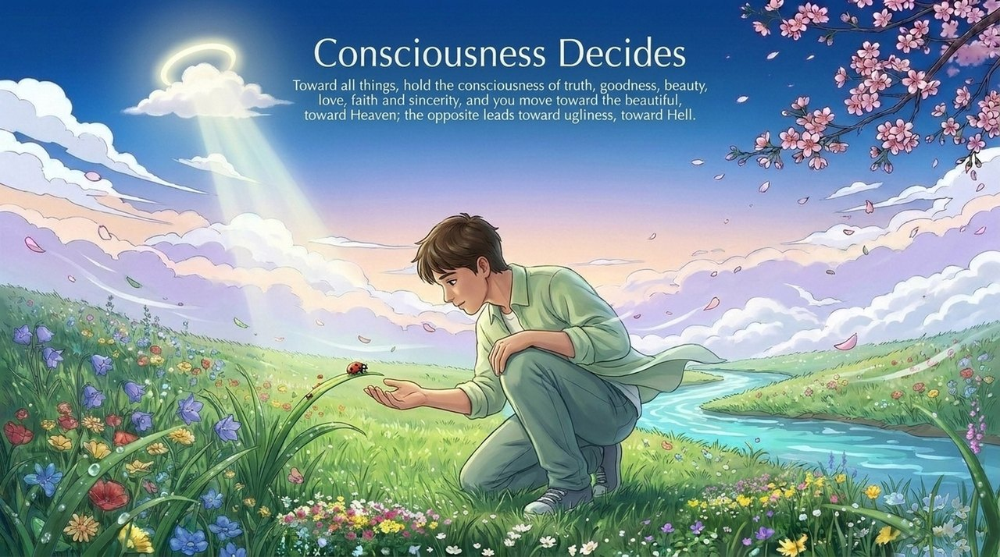
    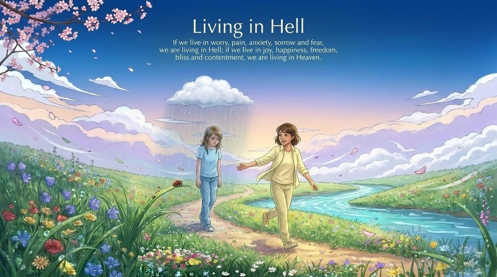
    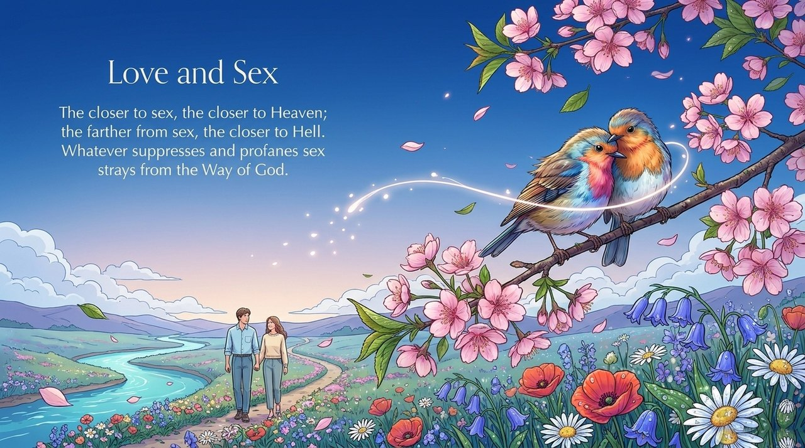
    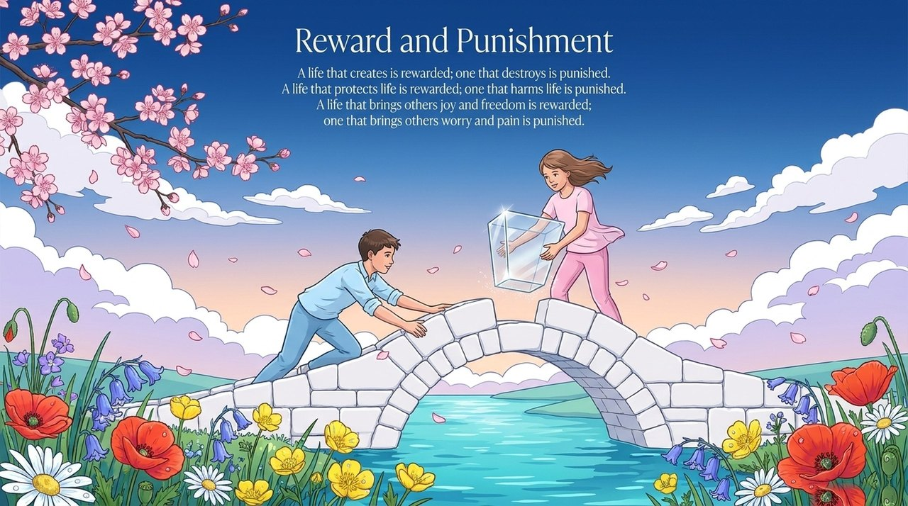
    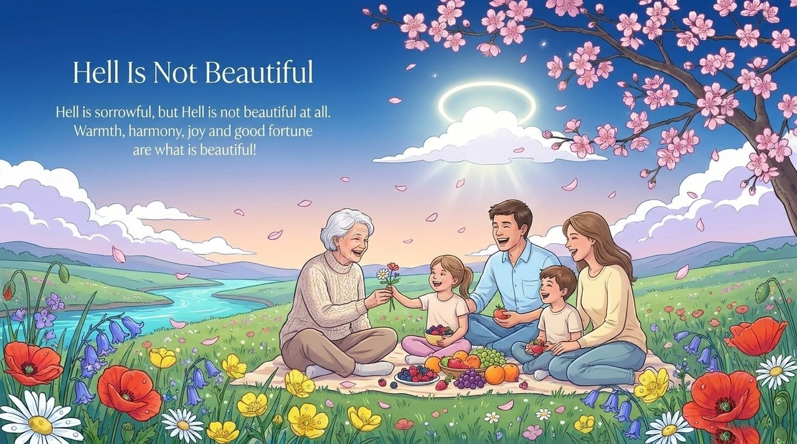

---

## Related Entries

[Kingdom of Heaven](/en/kingdom-of-heaven/) · [Karma, Retribution & Reincarnation](/en/karma-retribution-reincarnation/) · [Levels of LIFE](/en/levels-of-life/) · [The Twenty Parallel Worlds](/en/twenty-parallel-worlds/) · [Thirty-Six-Dimensional Space](/en/thirty-six-dimensional-space/) · [Selfishness and Selflessness](/en/zisi-wusi/) · [Reincarnation of LIFE](/en/life-reincarnation/) · [Awakening](/en/awakening/) · [Free Will](/en/free-will/)

> Note: Concept numbers cited on this page refer to the Fourth Edition of the *New Era Human 800 Concepts*. The Fifth Edition has been re-arranged, and its numbering no longer matches the Fourth Edition one to one.
