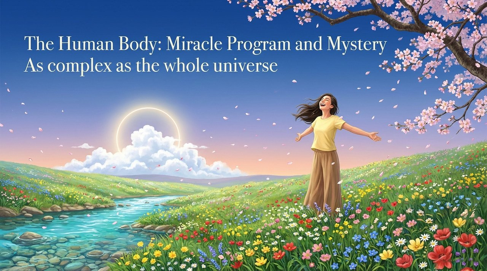
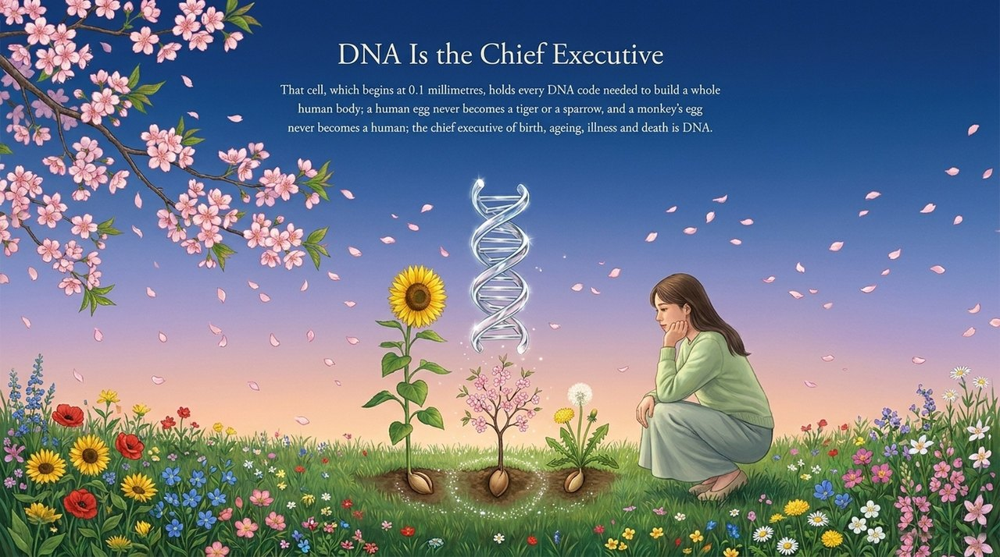
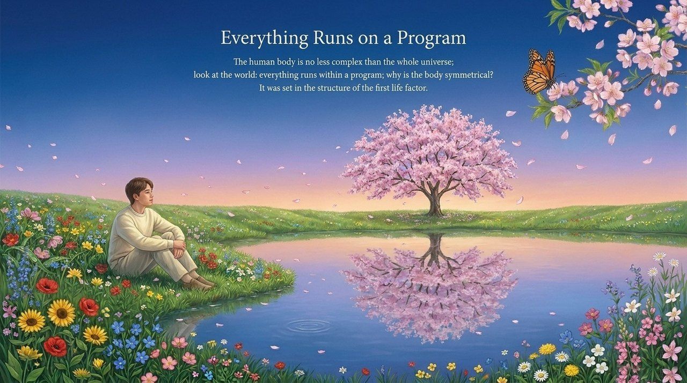
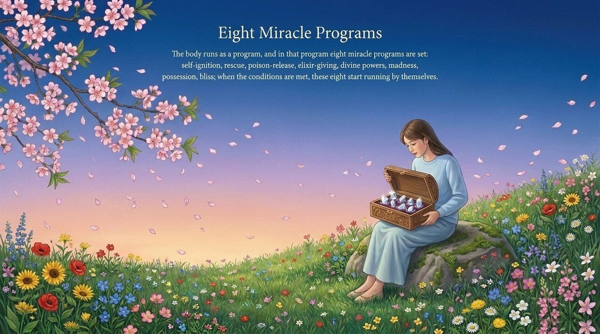
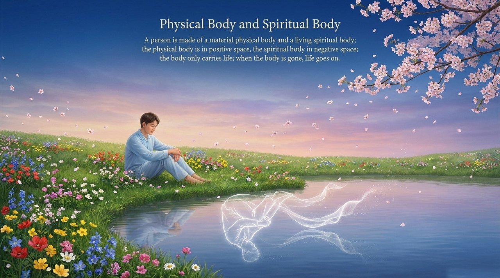
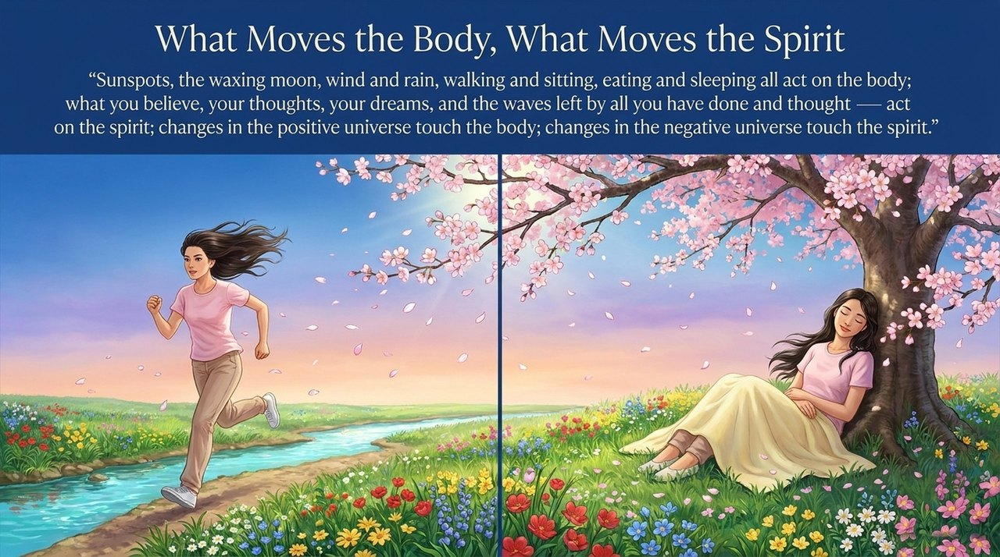
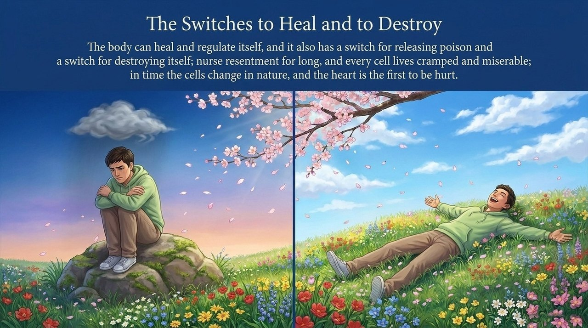
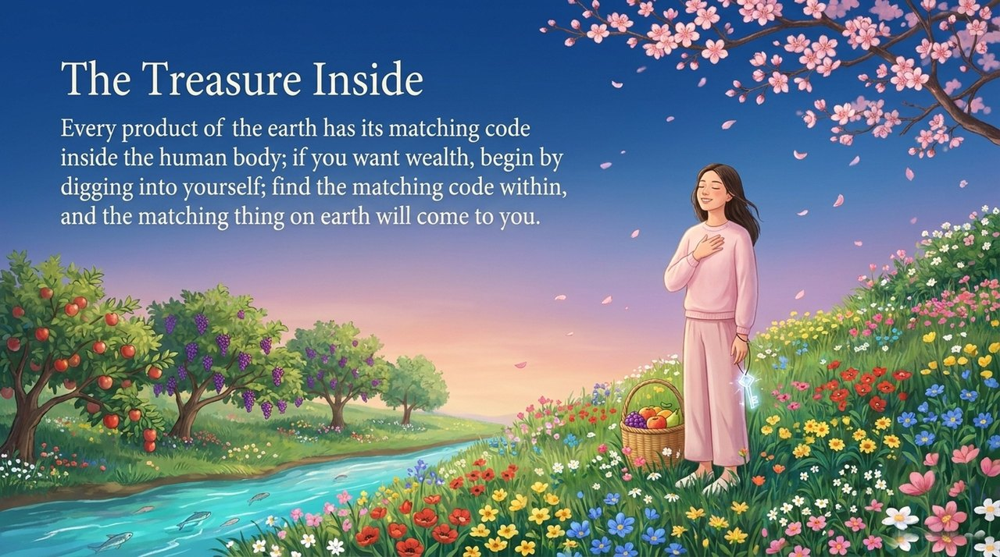
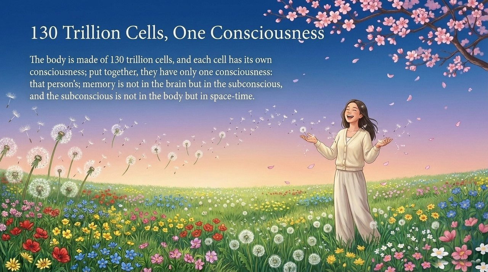

# The Human Body — Miracle Program and Mystery

> **The complexity of the human body is no less than that of the entire universe.**
>
> — Xuefeng (Chanyuan Corpus · Life · Life Program DNA)

Within the Lifechanyuan system, the human body is not merely a biological organism — it is a masterpiece of cosmic engineering, a program of divine precision written into the smallest possible seed and unfolding into staggering complexity. The body is composed of a visible physical form and an invisible spiritual body, carries eight built-in miracle programs, and holds hidden treasures that science has yet to fully explain.

| Version | Best for | Focus |
|---------|----------|-------|
| [Friendly version](friendly.md) | First-time readers | The wonder of your body in plain language |
| [Academic version](academic.md) | Researchers | Systematic analysis of body, program, and spirit |
| [Internal reference](internal.md) | Deep study | Complete original texts with source references |

---

## Core Definition

Life is a program, and the human body is its most intricate expression. From a fertilized egg no larger than a pinpoint, DNA orchestrates the precise formation of organs, nerve systems, emotions, and senses — with accuracy extending to hundreds of decimal places. Nothing is left to chance. Everything unfolds according to a pre-written code.

Within this program, **eight miracle subroutines** are built in: Self-ignition, Rescue, Poison-release, Elixir-transmission, Divine power, Madness, Possession, and Bliss — each activating automatically when the right conditions are met.

---

## Video

<iframe style="width:100%;aspect-ratio:4/3;border:0" src="https://www.youtube-nocookie.com/embed/dflhQfuFtrg" title="The Human Body: Miracle Program and Mystery (Lifechanyuan Encyclopedia video)" allowfullscreen></iframe>

## Slides

??? info "📖 Illustrated slides (14 pages, click to expand)"

    
    
    
    
    
    
    
    
    
    
    
    
    
    

---

## Related Entries

- [LIFE (Overview)](/en/life/)
- [Soul](/en/soul/)
- [Characteristics of LIFE](/en/life-characteristics/)
- [Antimatter Structure](/en/antimatter-structure/)
- [Disease and Health](/en/disease-health/)
- [Subconscious](/en/subconscious/)
- [Consciousness](/en/consciousness/)
- [Energy](/en/energy/)
