# The Meaning and Role of Humanity

> **Humanity exists with a purpose — to serve the Greatest Creator!**
>
> — Xuefeng (Chanyuan Corpus · The Greatest Creator Chapter · Eight Logical Inferences · All Things Exist for a Purpose, and the Ultimate Purpose is the Greatest Creator)

In the Lifechanyuan system, humanity is not an accidental inhabitant of the cosmos, but a purposefully positioned link in the sacred chain of LIFE. All things in the universe serve a function: microorganisms serve plants, plants serve animals, animals serve humans — and humans exist to serve the Greatest Creator, and indirectly the deities. Humanity has three specific roles: to bring joy to the Greatest Creator, to maintain the dynamic balance of opposing divine forces, and to beautify and steward the Earth. The human world is a transit hub between higher and lower LIFE spaces; the purpose of human life is to resolve karmic debts and transform one's LIFE structure, with the ultimate destination being elevation to the higher realms.

## Video

<iframe style="width:100%;aspect-ratio:4/3;border:0" src="https://www.youtube-nocookie.com/embed/k_Iuc092D-M" title="The Meaning and Role of Humanity (Lifechanyuan Encyclopedia video)" allowfullscreen></iframe>

## Slides

??? info "📖 Illustrated slides (14 pages, click to expand)"

    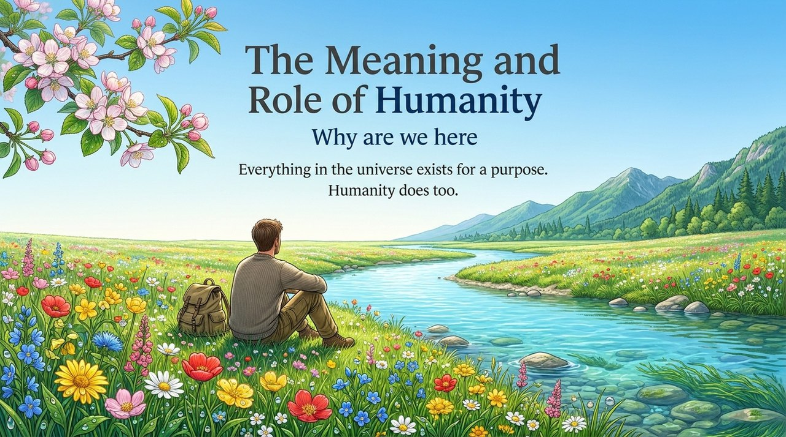
    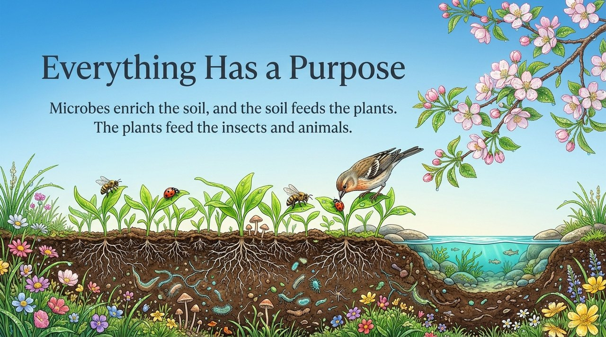
    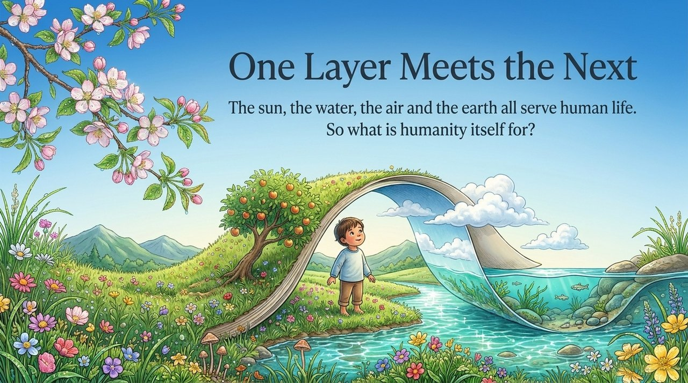
    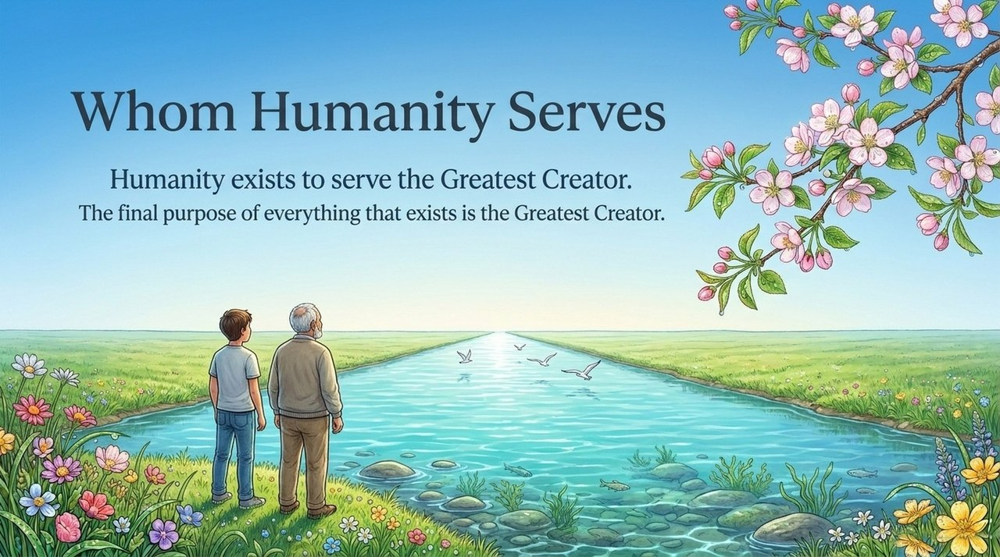
    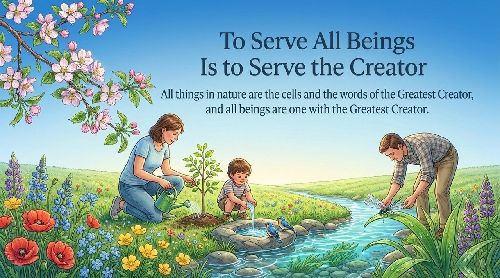
    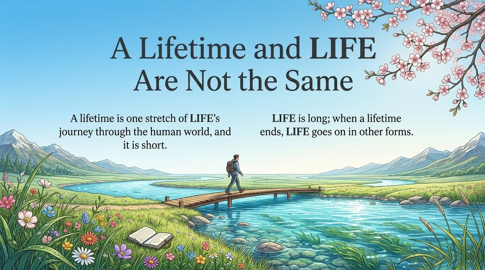
    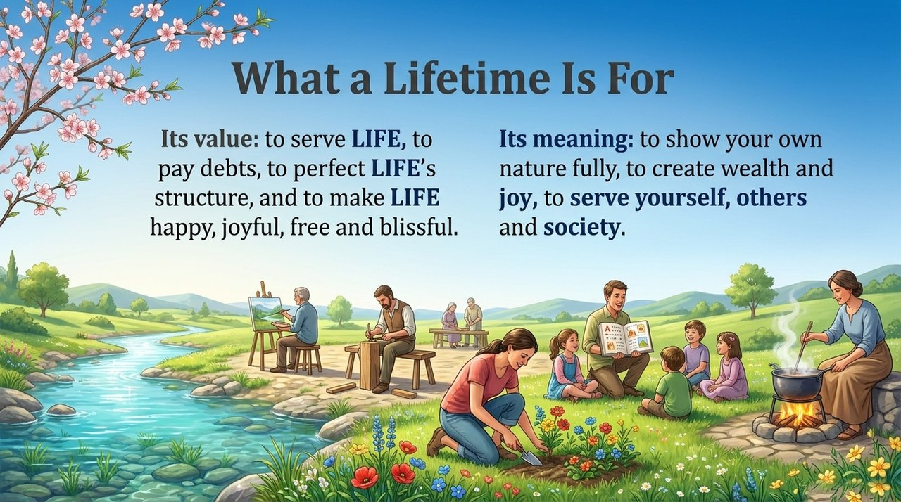
    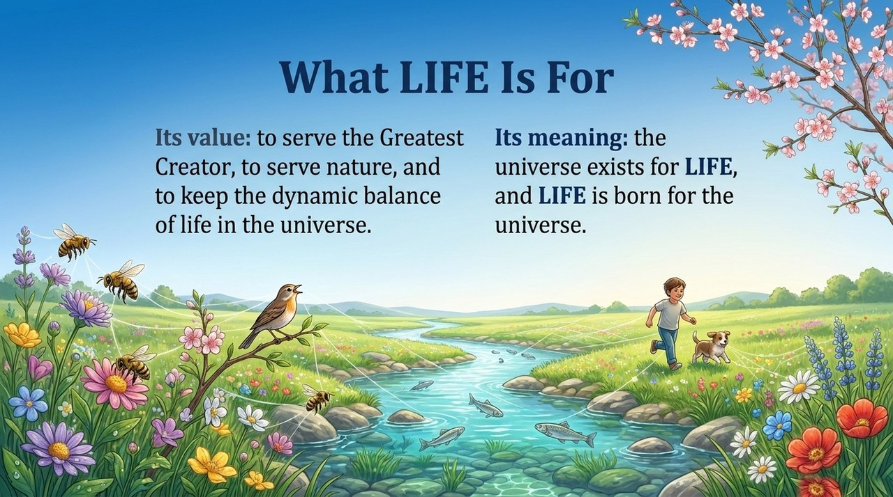
    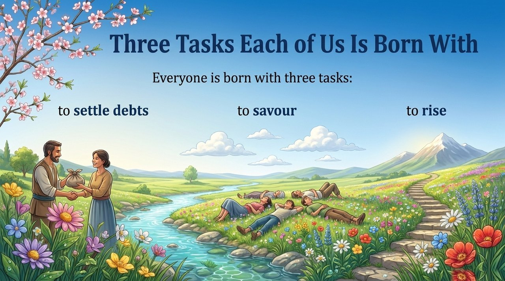
    
    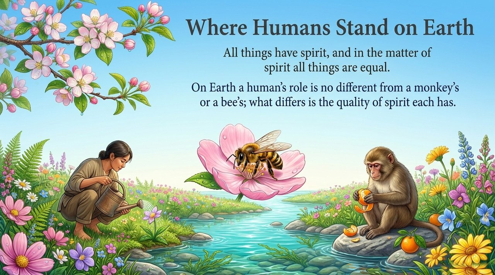
    
    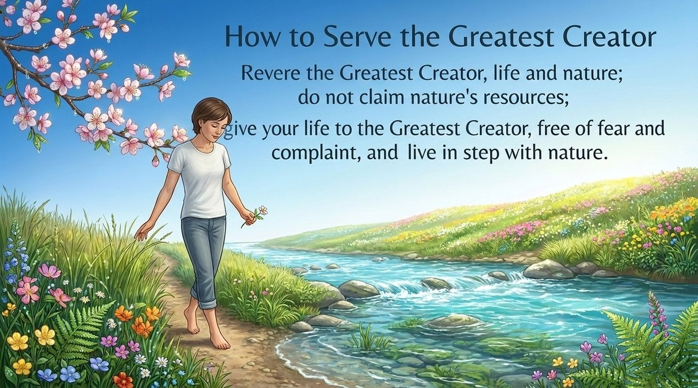
    

---

| Version | Best for | Focus |
|---------|----------|-------|
| [Friendly version](friendly.md) | First-time readers | Accessible language on humanity's cosmic role |
| [Academic version](academic.md) | Researchers | Systematic analysis of the LIFE chain and humanity's threefold function |
| [Internal reference](internal.md) | Deep study | Complete original quotes with source citations |

---

## Core Definition

Humanity's purpose is to serve the Greatest Creator, just as plants exist to serve humanity. The three roles of humanity: **bring joy to the Greatest Creator**, **maintain the harmonious balance of opposing divine forces**, **beautify and build the Earth**. Human life is a transit point between higher and lower LIFE spaces; its purpose is karmic resolution and transformation. The ultimate value of LIFE is to serve the Greatest Creator, nature, and the dynamic balance of cosmic LIFE.

## Related Entries

- [The Greatest Creator](/en/greatest-creator/)
- [Universe (Overview)](/en/universe-overview/)
- [The Value, Meaning and Purpose of Life](/en/value-meaning-purpose-of-life/)
- [The Law of LIFE's Indestructibility](/en/law-of-life-indestructibility/)
- [LIFE Reincarnation](/en/life-reincarnation/)
- [LIFE Visa](/en/life-visa/)
- [The Kingdom of Heaven](/en/kingdom-of-heaven/)
- [Becoming Celestial and Buddha](/en/becoming-celestial-buddha/)
- [Karma, Retribution and Reincarnation](/en/karma-retribution-reincarnation/)
