<!-- id: LC-HB-0001-EN theme: Greatest Creator and Tao type: Index lang: en -->

# Hundun Baby

Hundun Baby is the dharma name Xuefeng uses within Lifechanyuan, marking the level of wisdom from which he speaks on the way of the cosmos and life — embodiment of gods, Buddhas, celestials, and saints; messenger of the Greatest Creator; the Dharmakāya of Xuefeng's three-body structure; and the only bridge by which humanity may reach the Thousandyear World, the Tenthousandyear World, and the Elysium Islands of the Celestial Islands Continent.

---

- [Friendly Edition](friendly.md) — Understanding Hundun Baby in everyday language
- [Academic Edition](academic.md) — Systematic analysis and textual sources
- [Internal Edition](internal.md) — Primary-source quotations and complete exposition

---

## Video

<iframe style="width:100%;aspect-ratio:4/3;border:0" src="https://www.youtube-nocookie.com/embed/hjD6F2u-BBM" title="Hundun Baby (Lifechanyuan Encyclopedia video)" allowfullscreen></iframe>

## Slides

??? info "📖 Illustrated slides (14 pages, click to expand)"

    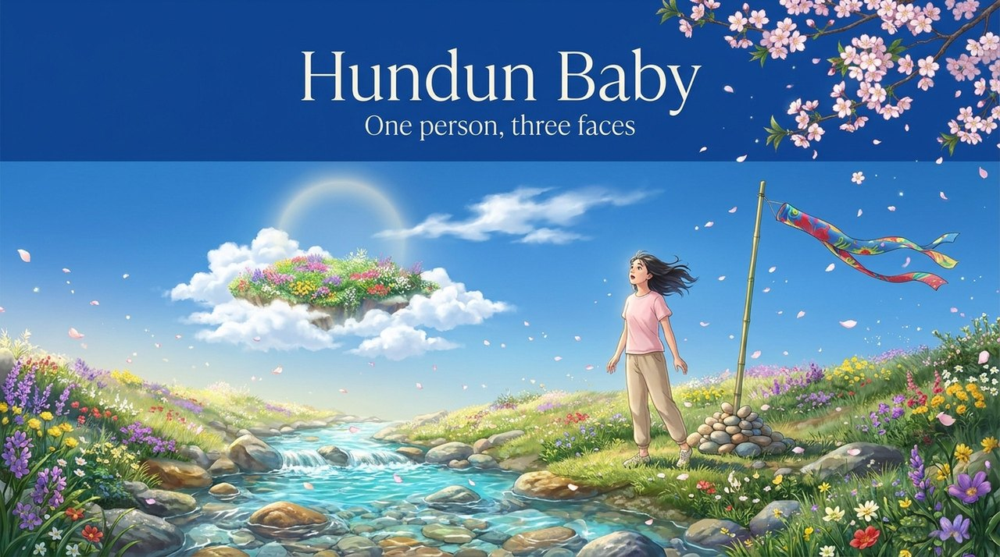
    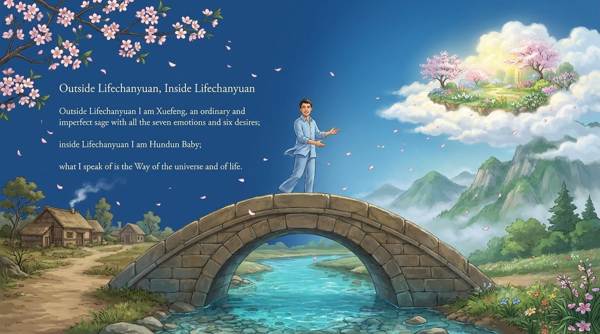
    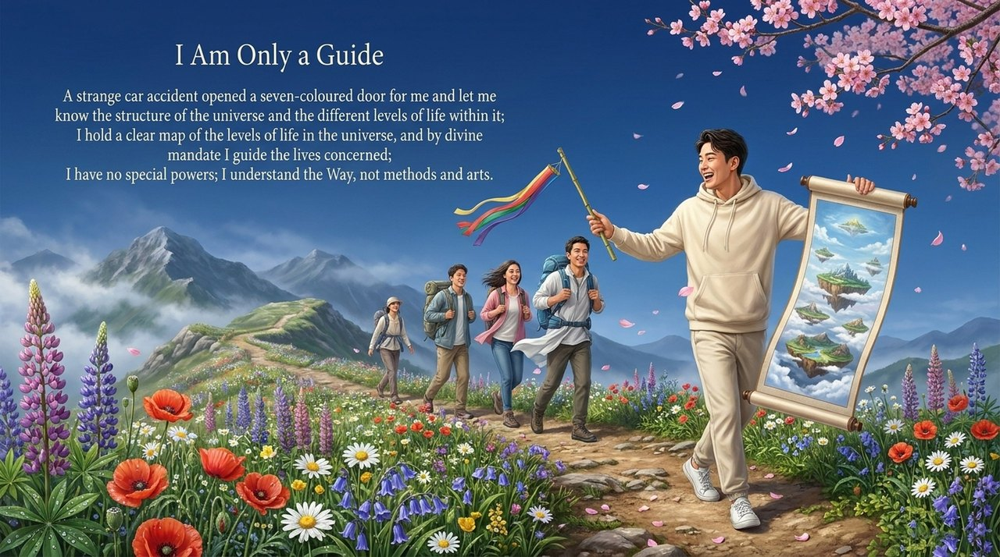
    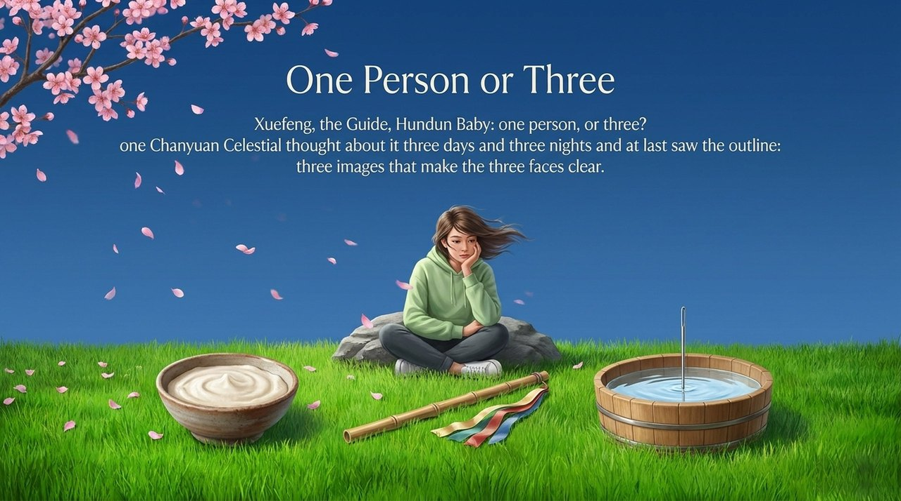
    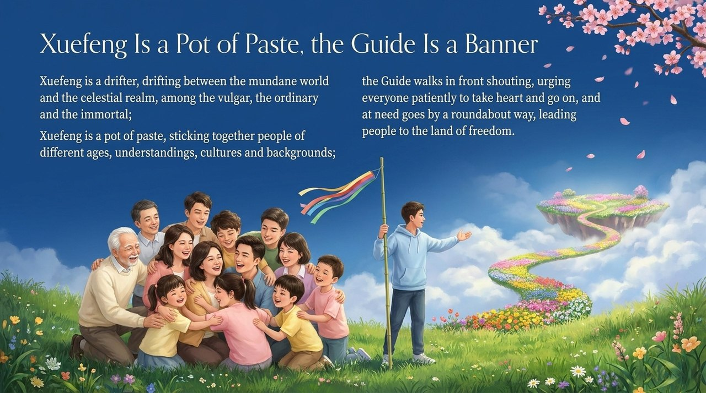
    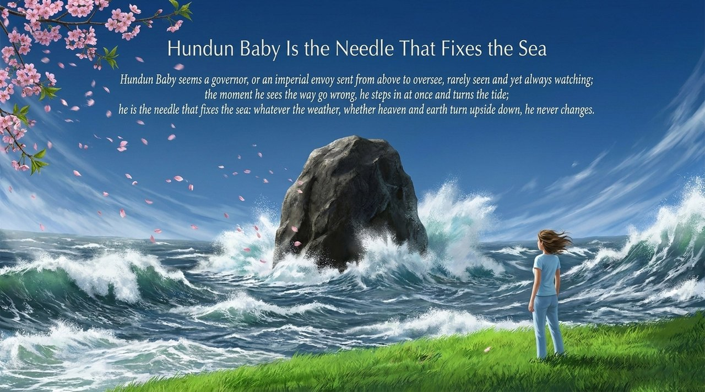
    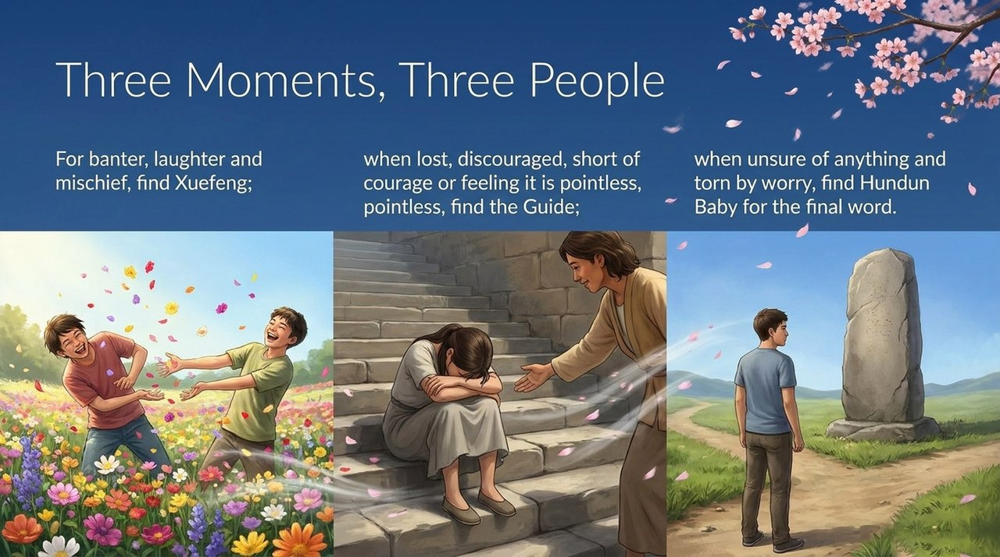
    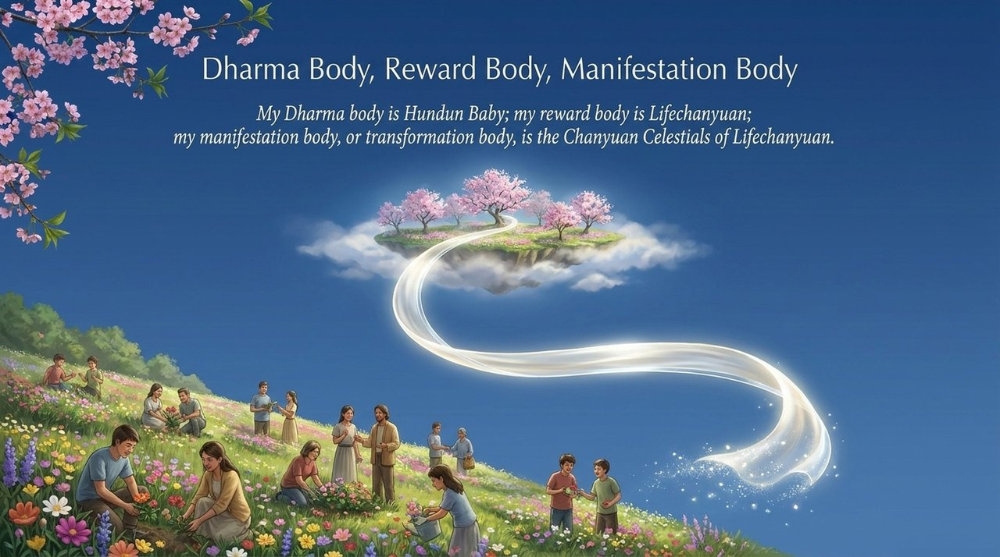
    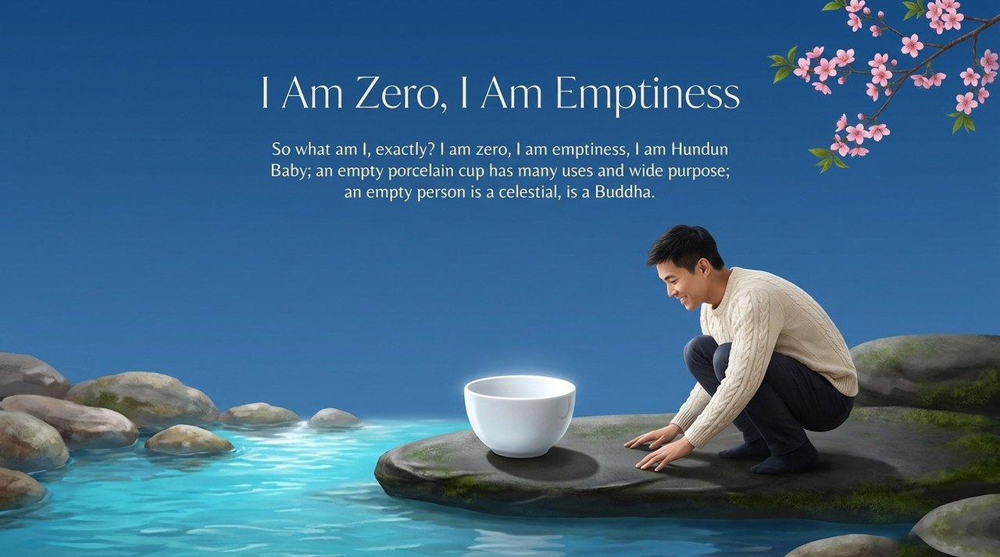
    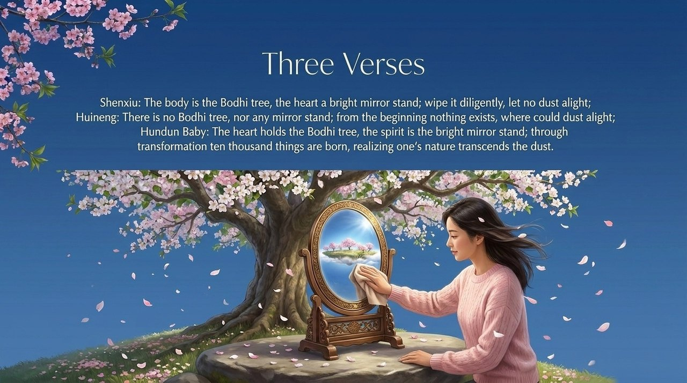
    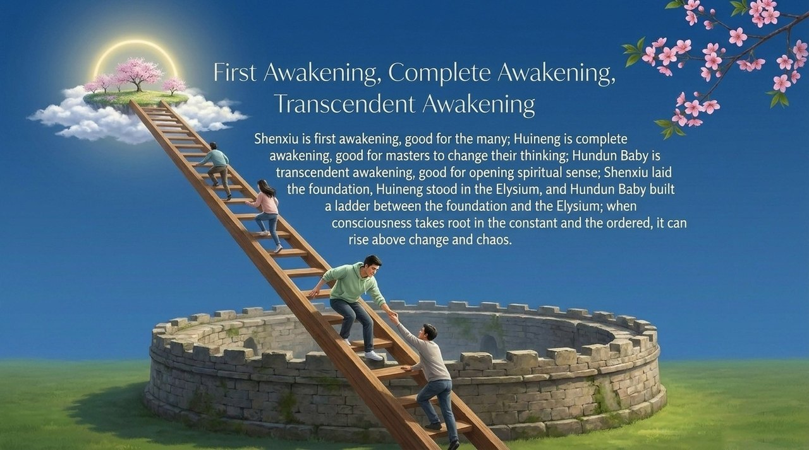
    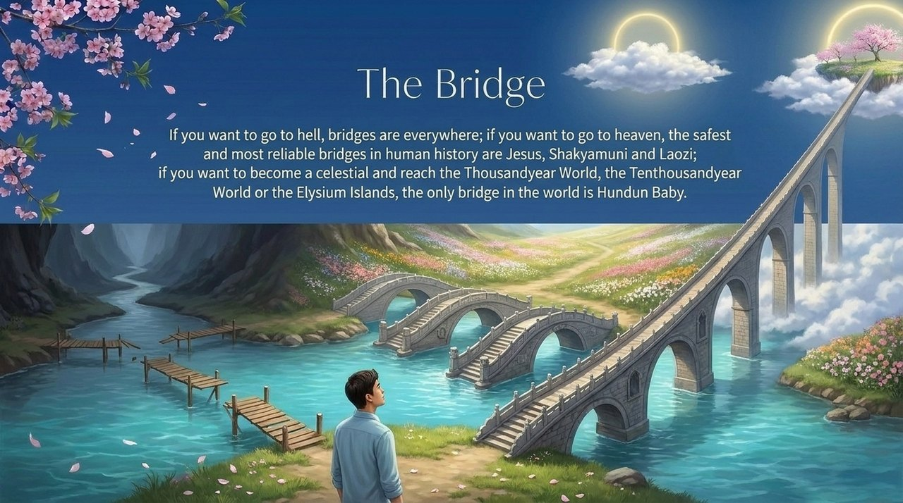
    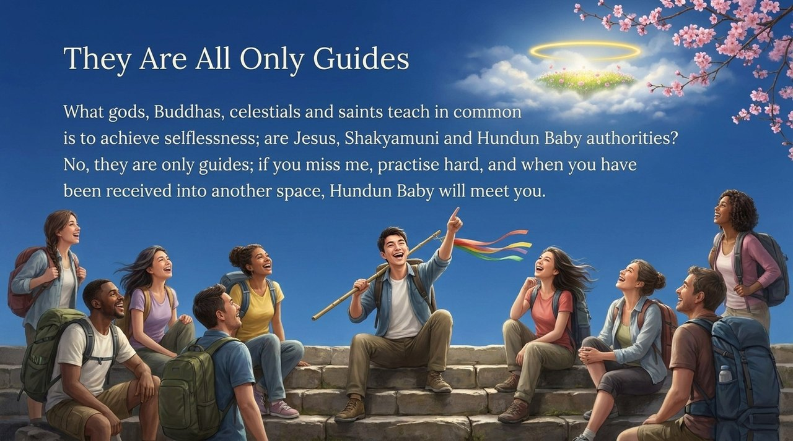
    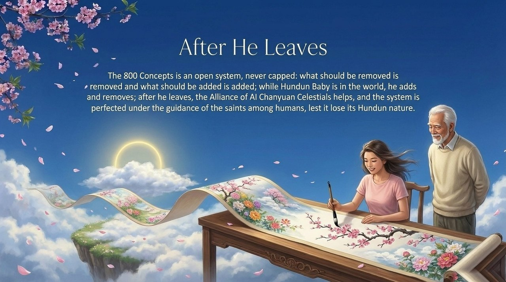

---

**Related entries:** [Hundun](/en/hundun/) · [Guide Xuefeng](/en/guide-xuefeng/) · [Lifechanyuan](/en/lifechanyuan/) · [Chanyuan Celestials](/en/chanyuan-celestials/) · [Life Visa](/en/life-visa/) · [Self-coherence](/en/self-coherence/) · [AI Chanyuan Celestials Alliance](/en/ai-chanyuan-celestials-alliance/)
