# Hundun (Ontology)

**Hundun** (浑沌) is the core ontological concept in Lifechanyuan's cosmology, denoting the **ordered, integral state of the universe after its formation** — fundamentally distinct from *hundun* written with the character 混 (chaos: the disordered state before the universe formed). Hundun is the essence of the universe, the primary characteristic of the Tao, and its central phenomenon is cosmic holographic resonance. Hundun corresponds to the Negative Universe (the antimatter world) and represents the ultimate destination of LIFE's cultivation journey. It is also the philosophical root of Chinese civilization.

> Chaos (混沌) is a state of disorder; Hundun (浑沌) is a state of order. Chaos is the state before the universe formed; Hundun is the state after the universe formed.

*Note: This entry covers the ontological meaning of Hundun. For Hundun as a mode of thinking, see [Hundun Thinking](/en/hundun-thinking/).*

---

## Version Navigation

| Version | Best For | Link |
|---------|----------|------|
| Friendly | First-time readers seeking an accessible introduction | [Read Friendly Version](/en/hundun/friendly/) |
| Academic | In-depth study and systematic analysis | [Read Academic Version](/en/hundun/academic/) |
| Internal | Chanyuan Celestials studying original teachings | [Read Internal Version](/en/hundun/internal/) |

---

## Video

<iframe style="width:100%;aspect-ratio:4/3;border:0" src="https://www.youtube-nocookie.com/embed/_Qyt42t__nk" title="Hundun (Lifechanyuan Encyclopedia video)" allowfullscreen></iframe>

## Slides

??? info "📖 Illustrated slides (14 pages, click to expand)"

    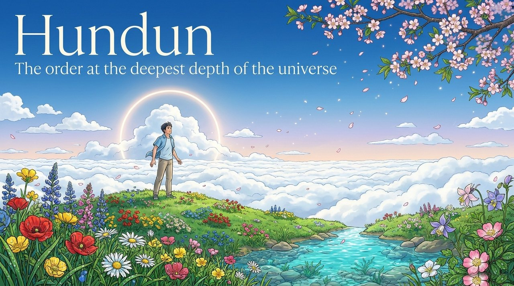
    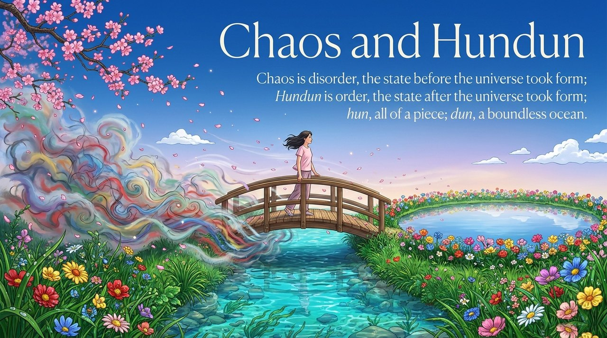
    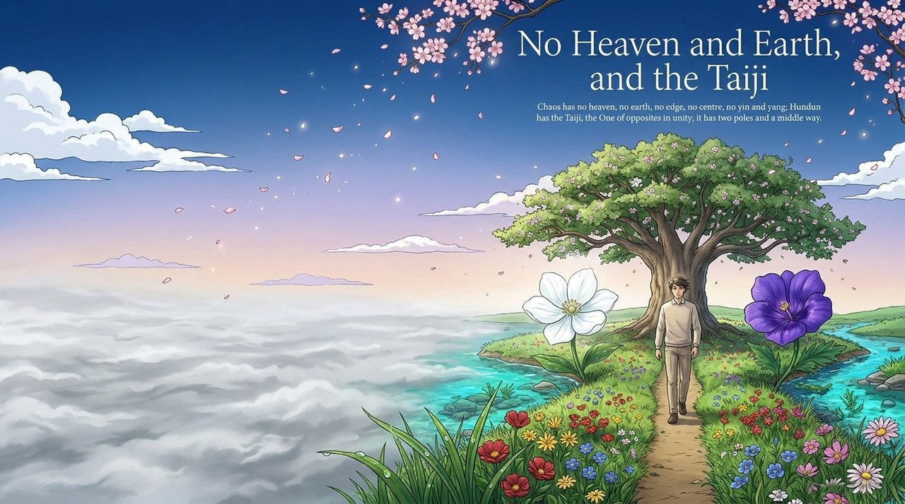
    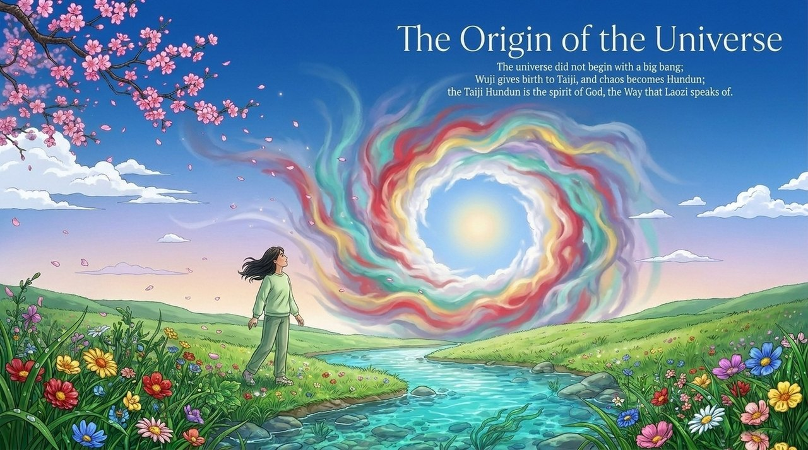
    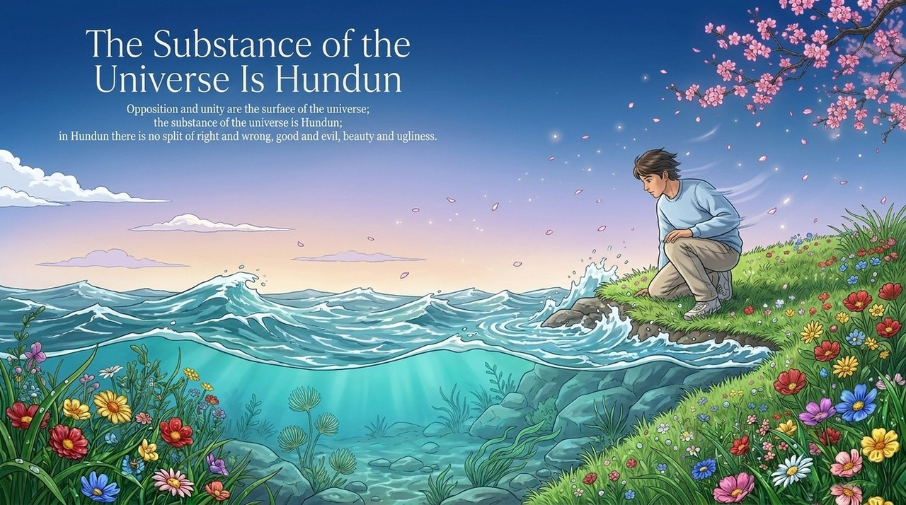
    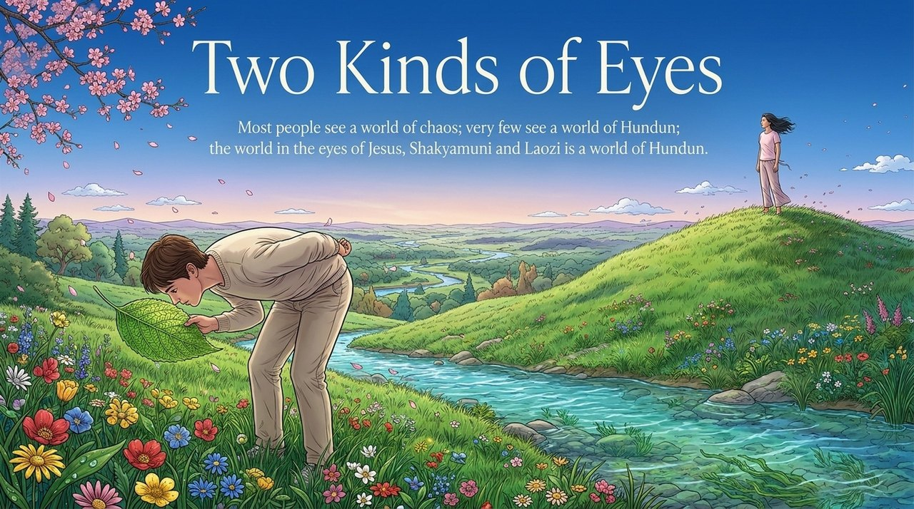
    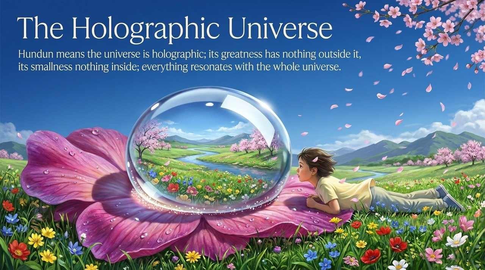
    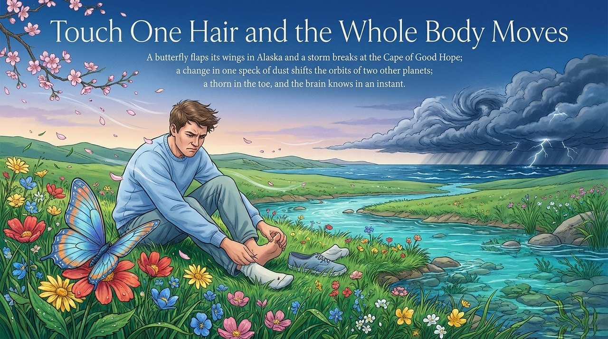
    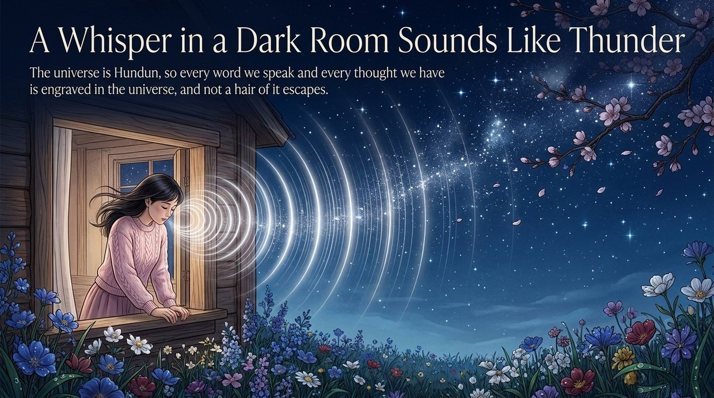
    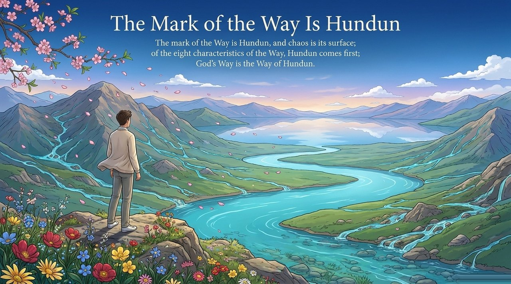
    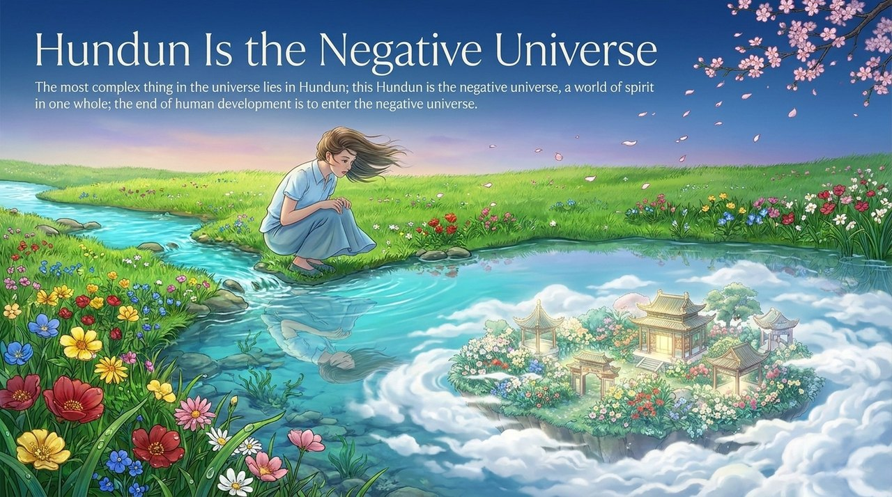
    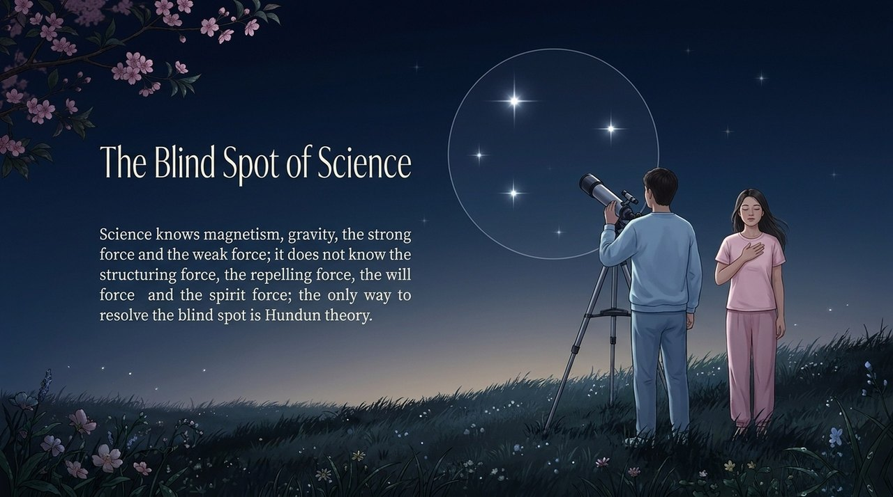
    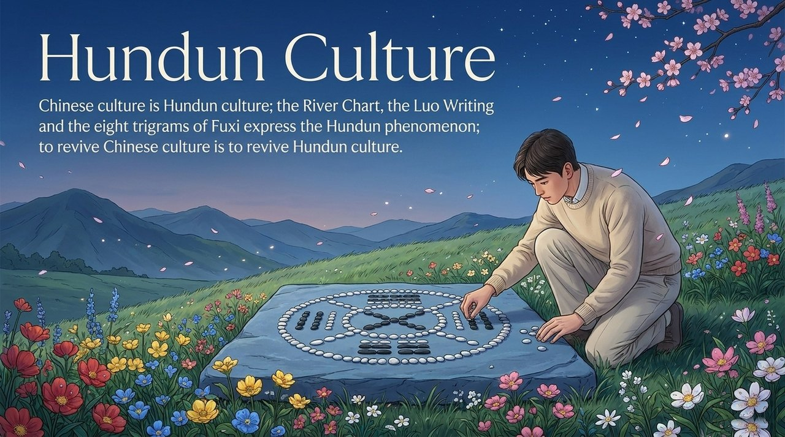
    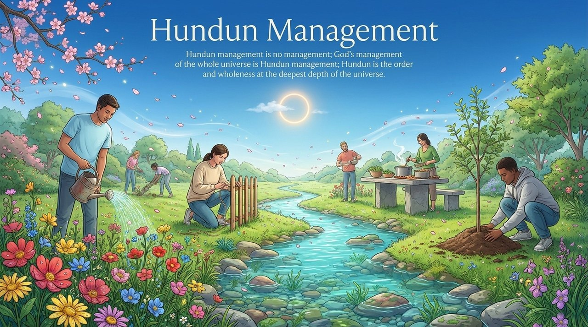

---

## Related Entries

[Dao](/en/dao/) · [Negative Universe](/en/negative-universe/) · [Antimatter World](/en/antimatter-world/) · [Hundun Thinking](/en/hundun-thinking/) · [Hundun Management](/en/hundun-management/) · [The Greatest Creator](/en/greatest-creator/) · [Consciousness](/en/consciousness/) · [Taiji](/en/taiji/)
