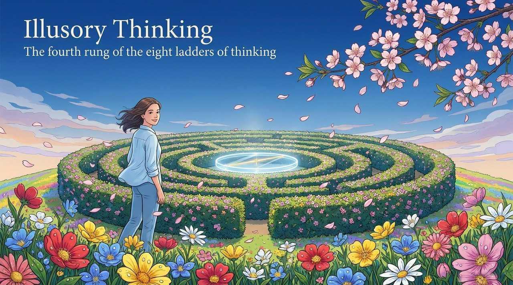
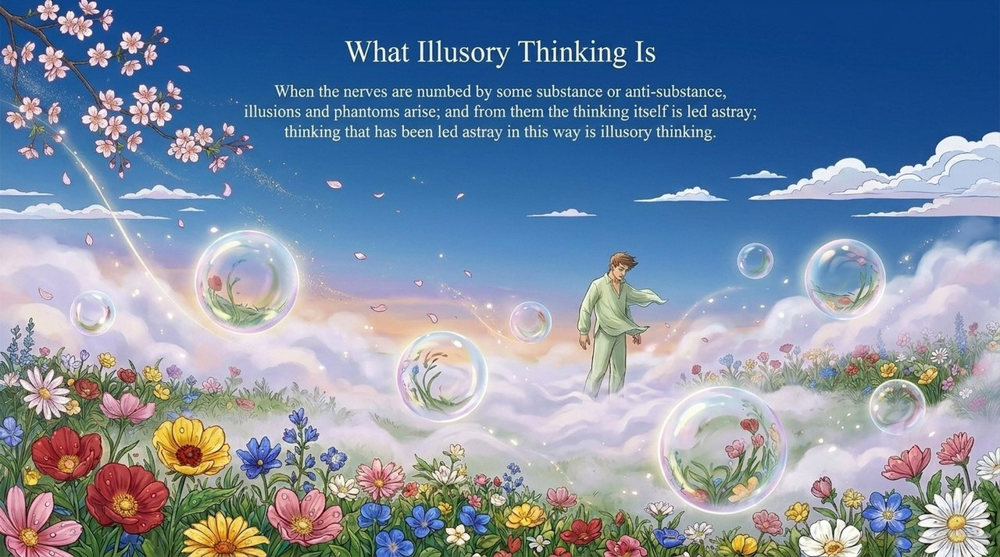
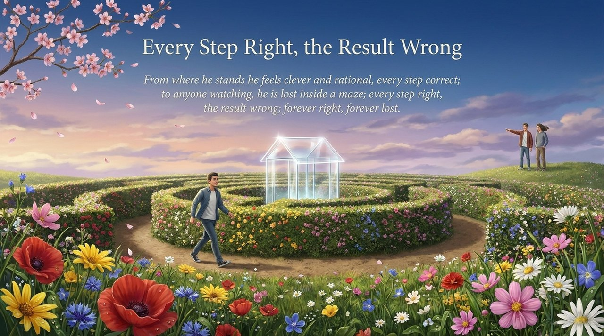
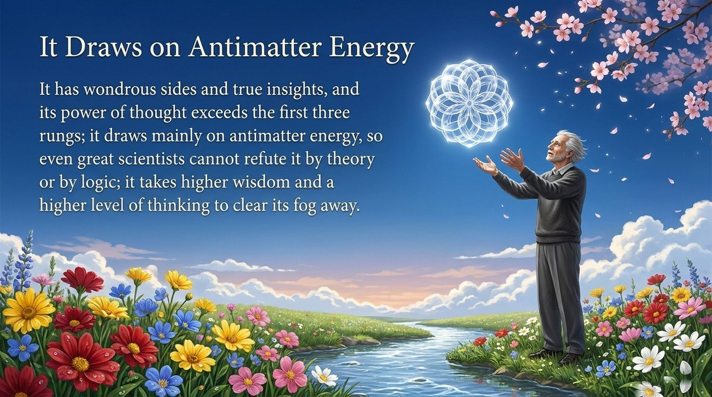
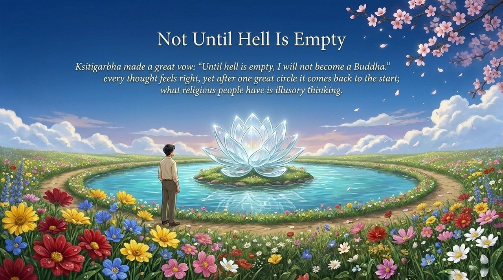
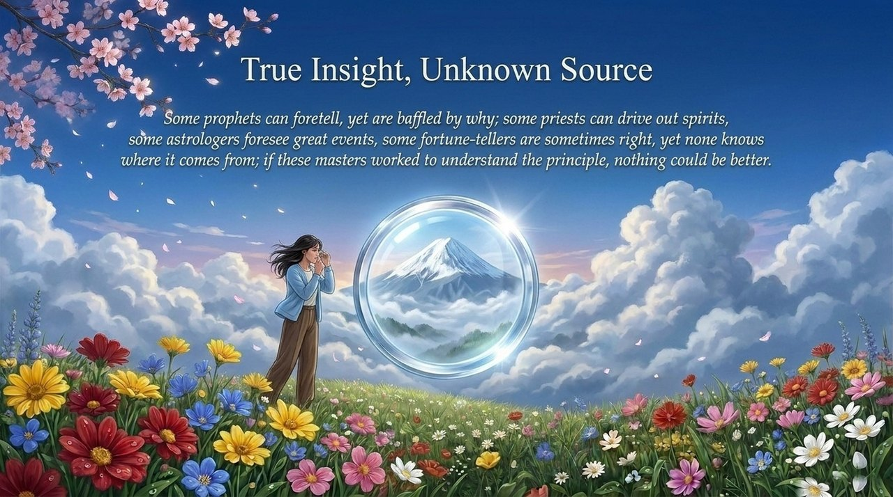
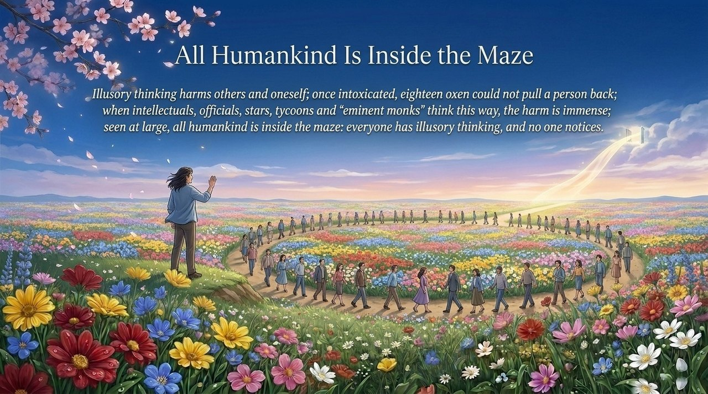
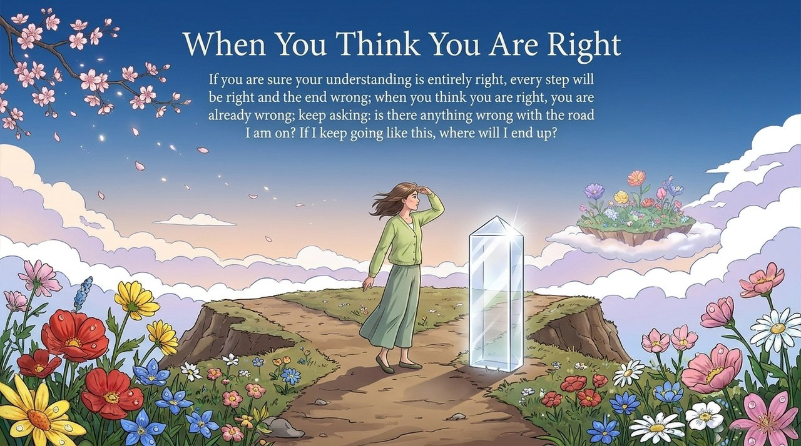

<!-- id: LC-ILT-0001 theme: Thinking Cultivation type: Entry Gateway direction: Consciousness Ascension Path lang: en -->

> In Lifechanyuan terminology, **LIFE** (capitalized) refers to the ontological
> essence of existence — the soul/antimatter structure that persists across
> incarnations — while **life** (lowercase) refers to the experiential stage
> of human existence in this world.

# Illusory Thinking

[Entry Gateway]

**Illusory Thinking** is the **fourth rung** of the Eight Thinking Ladders — positioned between Associative Thinking and Heart-Image Thinking. Its essential nature: the nervous system is anesthetized by some material or antimatter substance, producing hallucinations and illusions, which in turn generate a state of illusory thinking — the thinker believes every step is correct, yet ultimately returns to the starting point. This is the most complex, most seductive, and most dangerous thinking level within the "addition phase" (the first four rungs). Religious practitioners are its archetypal representatives.

> Step by step correct, but the outcome wrong; forever correct, yet forever lost — this is Illusory Thinking.
>
> — Guide Xuefeng, *Chanyuan Corpus · Revelation Chapter · Illusory Thinking*

---

## Core Position

Within Lifechanyuan's cultivation framework, Illusory Thinking is the peak of the addition phase and the most treacherous trap on the path of practice. It is one rung higher than Associative Thinking, operates through antimatter energy, and therefore appears more "spiritual" and more captivating — which is precisely why practitioners so easily mistake it for genuine awakening while still circling in place. The entire human civilization 2.0, at a macro level, exists collectively within this illusory maze. The direction for Chanyuan Celestials: transcend all four lower rungs and enter Heart-Image Thinking directly.

---

## Editions

| Edition | Intended Readers | Link |
|---------|-----------------|------|
| **Friendly Edition** | Readers new to Lifechanyuan concepts | [Read Friendly Edition](./friendly) |
| **Academic Edition** | Researchers, philosophy/religious studies backgrounds | [Read Academic Edition](./academic) |
| **Internal Edition** | Chanyuan Celestials and deep practitioners | [Read Internal Edition](./internal) |

---

## Video

<iframe style="width:100%;aspect-ratio:4/3;border:0" src="https://www.youtube-nocookie.com/embed/J6kpt14tEXA" title="Illusory Thinking (Lifechanyuan Encyclopedia video)" allowfullscreen></iframe>

## Slides

??? info "📖 Illustrated slides (14 pages, click to expand)"

    
    
    
    
    
    
    
    
    
    
    
    
    
    

---

## Related Entries

- [Eight Thinking Ladders](/en/eight-thinking-ladders/) — Illusory Thinking's coordinates within the complete ladder system
- [Associative Thinking](/en/associative-thinking/) — Third rung, the step immediately before Illusory Thinking
- [Imagery Thinking](/en/imagery-thinking/) — Second rung
- [Material Thinking](/en/material-thinking/) — First rung
- [Consciousness](/en/consciousness/) — Thinking as the vehicle of consciousness; Illusory Thinking as the fourth vehicle state
