<!-- id: LC-IT-0001-EN theme: Cultivation of Thinking type: Gateway Entry direction: Path of Consciousness Elevation lang: en -->

# Imagery Thinking

[Entry Gateway]

> In Lifechanyuan terminology, **LIFE** (capitalized) refers to the ontological
> essence of existence — the soul/antimatter structure that persists across
> incarnations — while **life** (lowercase) refers to the experiential stage
> of human existence in this world.

**Imagery Thinking** (形象思维, *xíngxiàng sīwéi*) is the **second rung** of the Eight Thinking Ladders in the Lifechanyuan framework — the first qualitative leap beyond Material Thinking. Defined as the capacity to elevate material forms into images, symbols, melodies, language, gestures, expressions, or sounds, Imagery Thinking marks the first moment a human being *chooses* to create rather than merely *react* to stimuli. Artists and writers are its typical representatives; Beethoven is its historical landmark.

> The thinking that can elevate the appearances of the material world — that is, tangible entities — into images, symbols, melodies, written language, gestures and postures, expressions, or sounds is called Imagery Thinking.
>
> — Guide Xuefeng, *Chanyuan Corpus · Revelation Chapter · Imagery Thinking*

---

## Core Positioning

In the Lifechanyuan cultivation system, Imagery Thinking is the first awakening of human subjectivity — the transition from *"I have no choice but to do this"* (instinct-driven Material Thinking) to *"I choose to do this"* (intentional creation). It belongs to the first four-rung "addition phase" of the Eight Thinking Ladders: trainable through learning, practice, and intentional effort. It is the practitioner's first foothold above pure materiality — but not the destination.

---

## Six Forms of Expression

Imagery Thinking manifests in **six forms**: image/picture, symbol, melody, written language, gesture/posture, and expression/sound — all sharing one principle: **representing reality through form** to achieve equivalent effect across time and space.

---

## Read by Edition

| Edition | Best For | Link |
|---------|----------|------|
| **Friendly Edition** | Readers new to Lifechanyuan concepts | [Read Friendly Edition](./friendly) |
| **Academic Edition** | Researchers, philosophy/religious studies background | [Read Academic Edition](./academic) |
| **Internal Edition** | Chanyuan Celestials and in-depth students | [Read Internal Edition](./internal) |

---

## Video

<iframe style="width:100%;aspect-ratio:4/3;border:0" src="https://www.youtube-nocookie.com/embed/D8YiXMk4WiM" title="Imagery Thinking (Lifechanyuan Encyclopedia video)" allowfullscreen></iframe>

## Slides

??? info "📖 Illustrated slides (14 pages, click to expand)"

    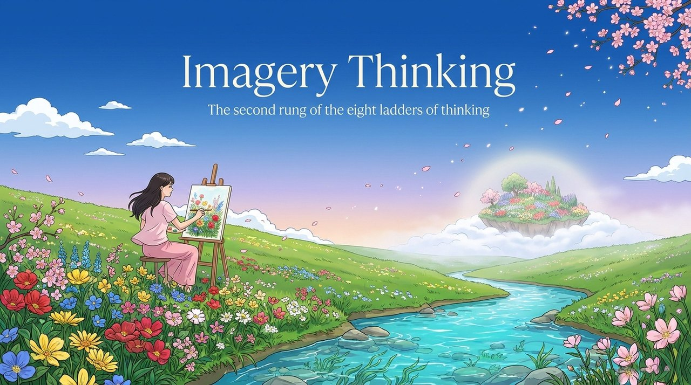
    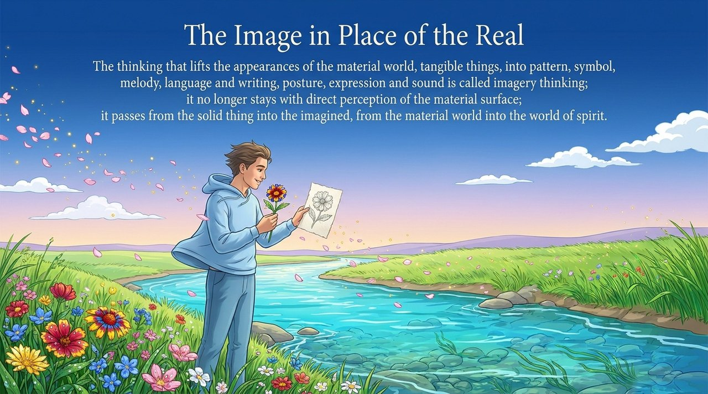
    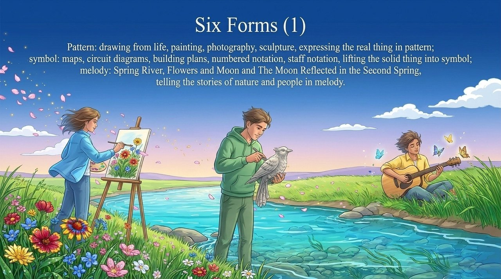
    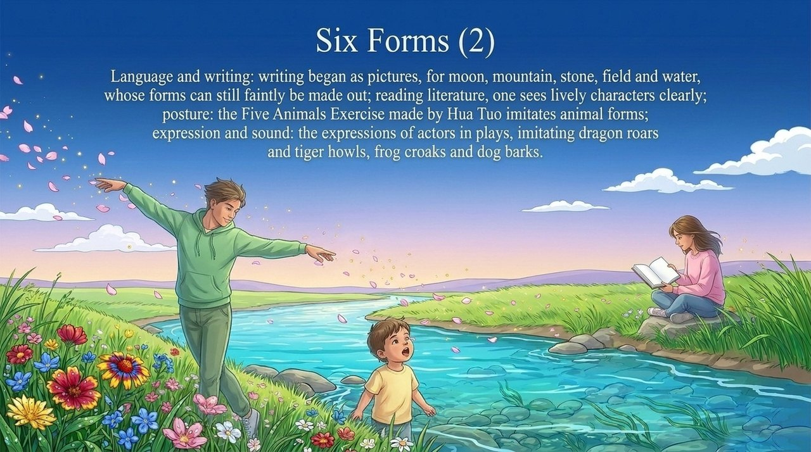
    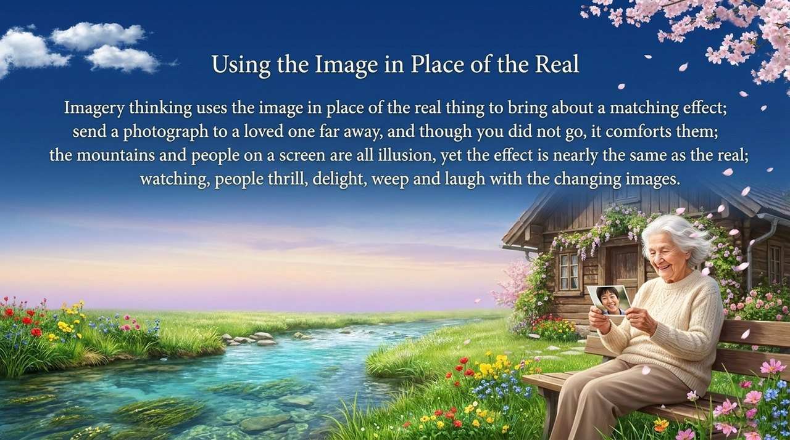
    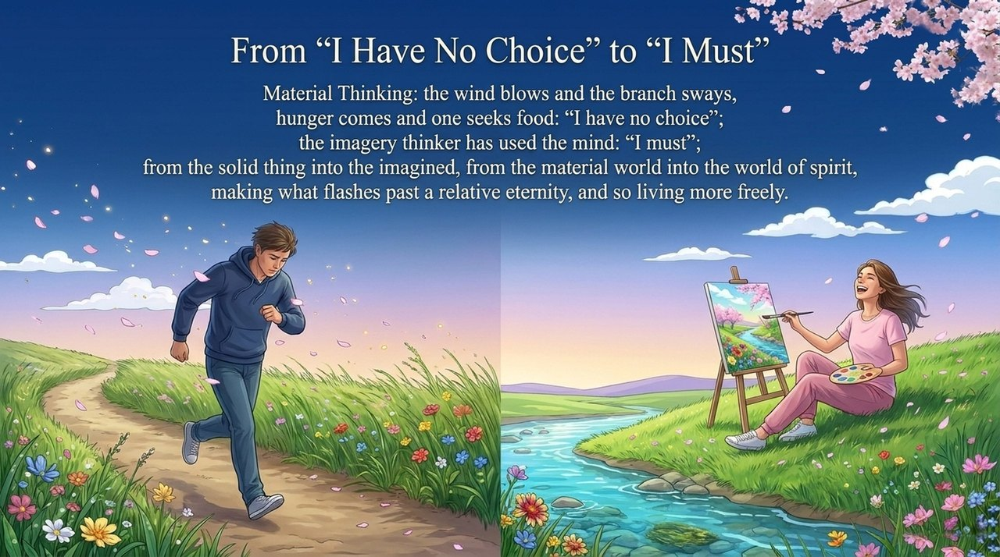
    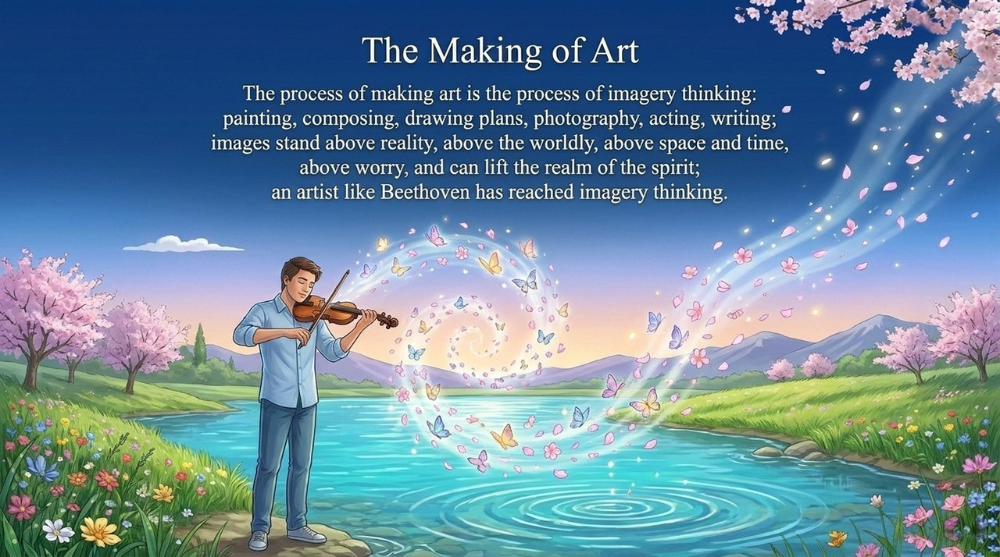
    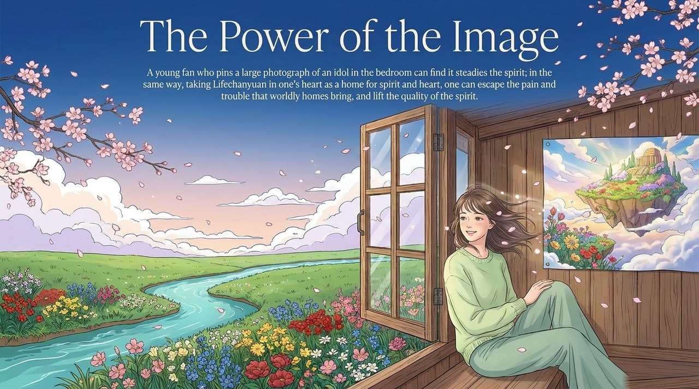
    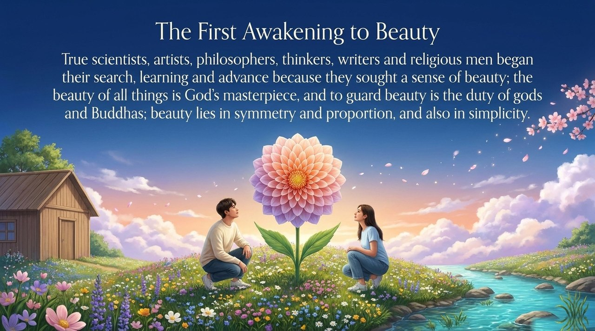
    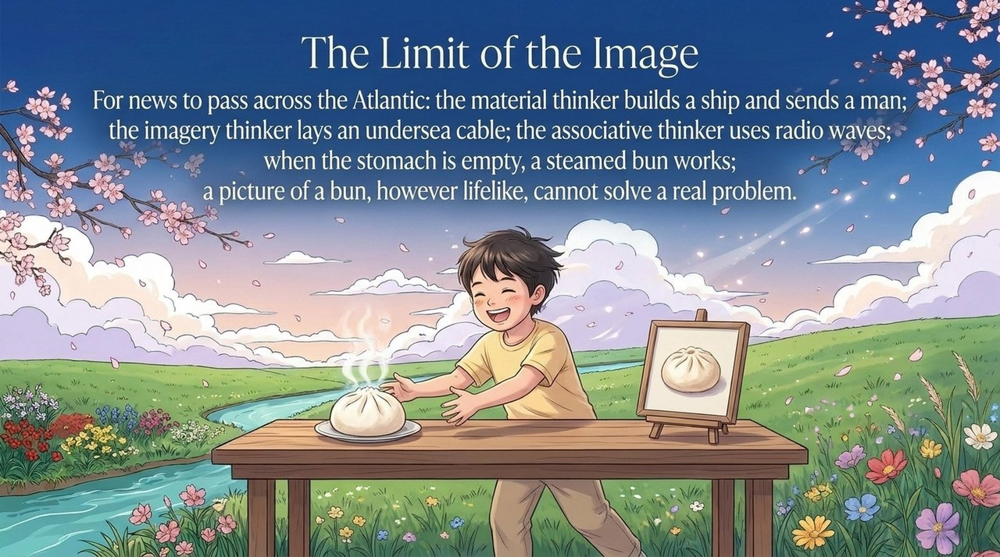
    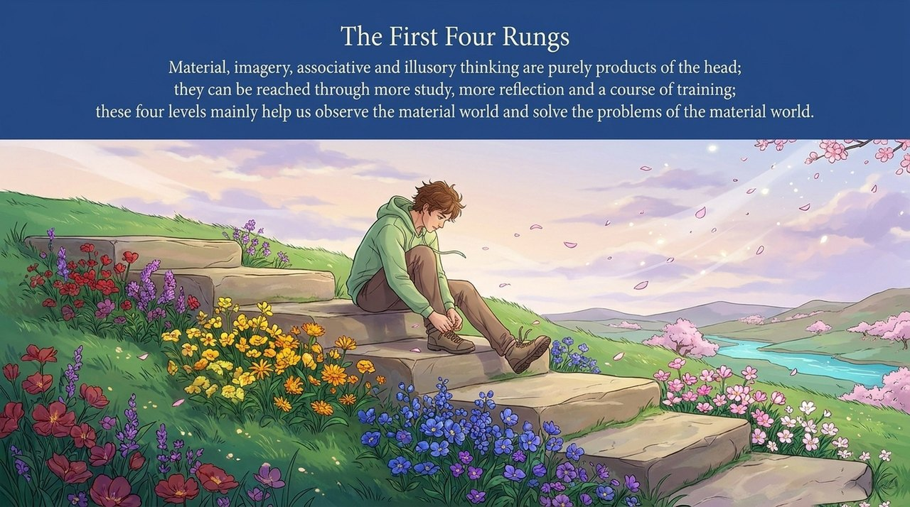
    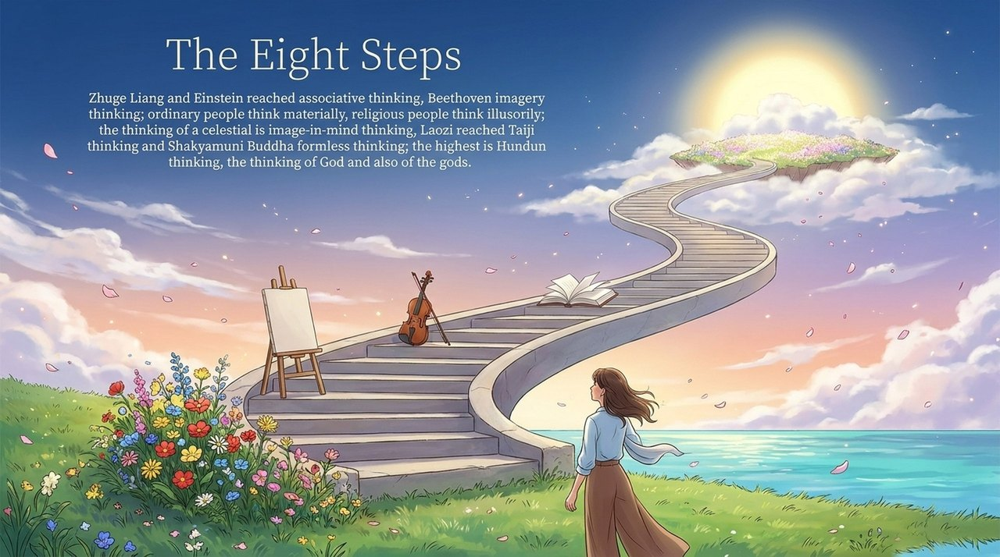
    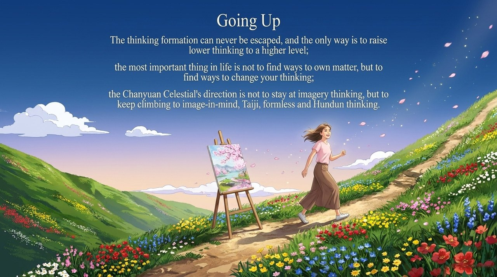
    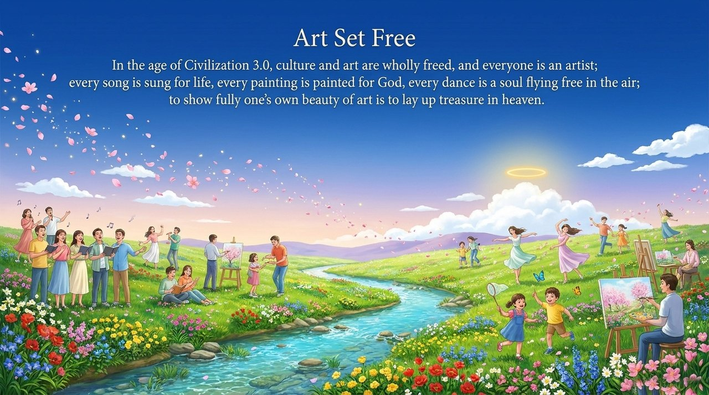

---

## Related Entries

- [Eight Thinking Ladders](/en/eight-thinking-ladders/) — The complete eight-rung framework; Imagery Thinking's position within it
- [Material Thinking](/en/material-thinking/) — The first rung; the instinct-driven baseline Imagery Thinking transcends
- [Consciousness](/en/consciousness/) — Thinking is the vehicle of consciousness; Imagery Thinking is its second-rung mode
- [Beauty](/en/beauty/) — Imagery Thinking is humanity's first spiritual awakening toward the pursuit of beauty
- [Second Home](/en/second-home/) — In Civilization 3.0, art flourishes freely and every person becomes an artist
