<!-- id: LC-INV-0005 theme: Cognitive Cultivation type: entry direction: Path of Consciousness Elevation lang: en -->

# Inverted Thinking

> Nothing is something; something is nothing. Up is down; down is up. Success is failure; failure is success.
>
> — Xuefeng, *Chanyuan Corpus · Chapter on Anti-Conventional Thinking · XV. Inverted Thinking*

> In Lifechanyuan terminology, **LIFE** (capitalized) refers to the ontological essence of existence — the soul/antimatter structure that persists across incarnations — while **life** (lowercase) refers to the experiential stage of human existence in this world.

**Inverted Thinking** is the core operational tool of Lifechanyuan's *Chapter on Anti-Conventional Thinking*. It is the practice of deliberately rotating the "front face" of conventional thought by 180 degrees to simultaneously perceive the concealed "reverse face" — until front and back merge beyond distinction, entering the state of Hundun (primordial chaos). Its cosmological foundation is the **Möbius Strip**: opposition is the surface appearance of the universe; unity is its true substance.

Inverted Thinking was the first form of anti-conventional thinking that guide Xuefeng awakened to during his high-altitude cultivation in the Qilian Mountains. It is the opening gateway of the entire *Chanyuan Corpus*, and the first key by which Chanyuan Grasses break free from unilateral thinking on the path toward the wise and the saintly.

---

## Video

<iframe style="width:100%;aspect-ratio:4/3;border:0" src="https://www.youtube-nocookie.com/embed/JCIRvF7tgrE" title="Inverted Thinking (Lifechanyuan Encyclopedia video)" allowfullscreen></iframe>

## Slides

??? info "📖 Illustrated slides (14 pages, click to expand)"

    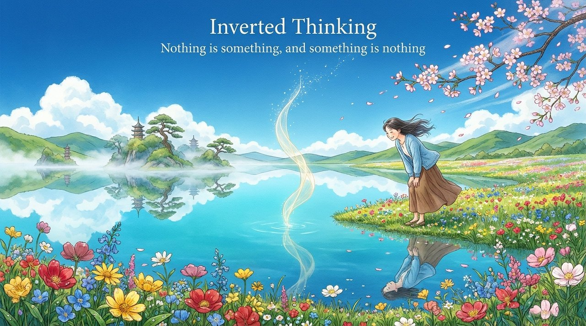
    
    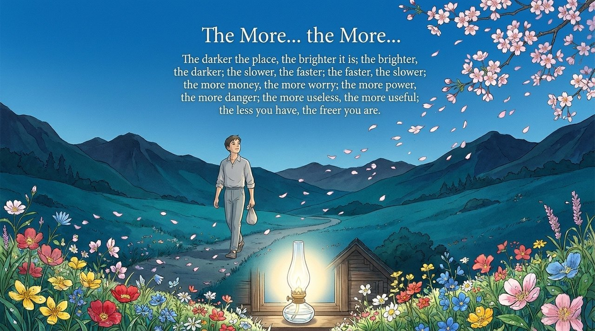
    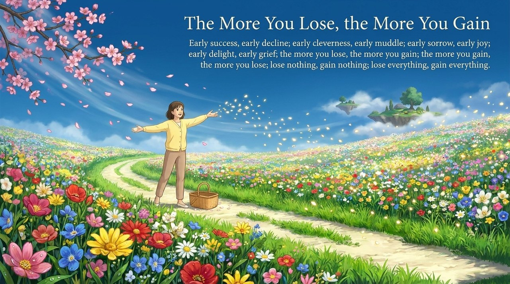
    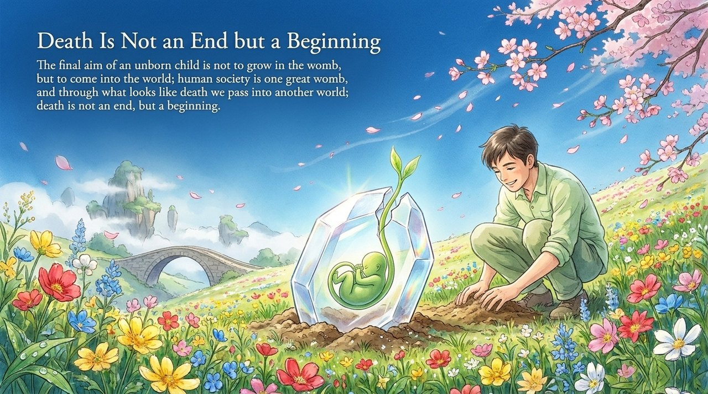
    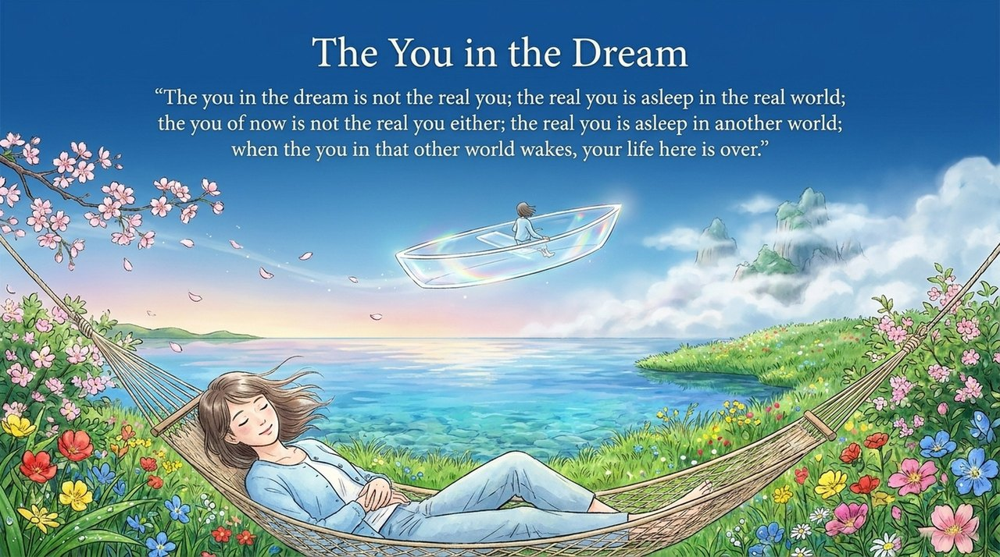
    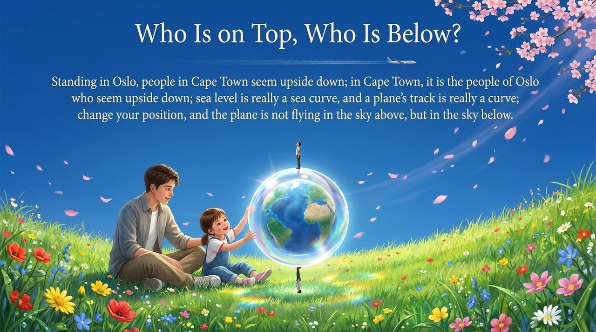
    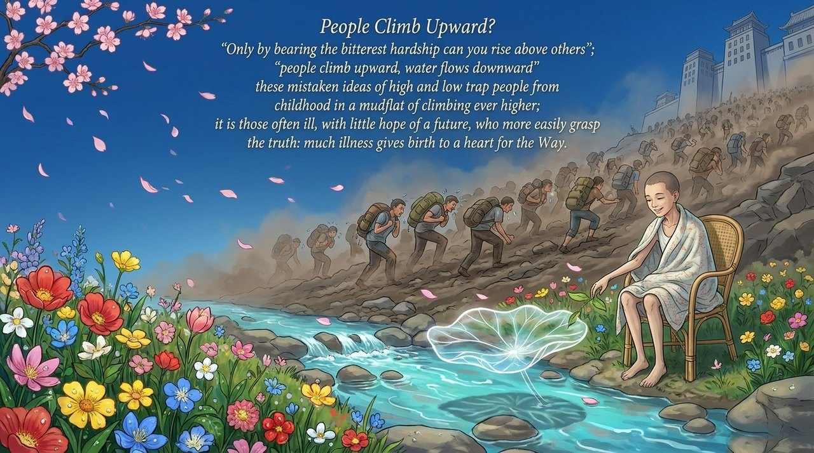
    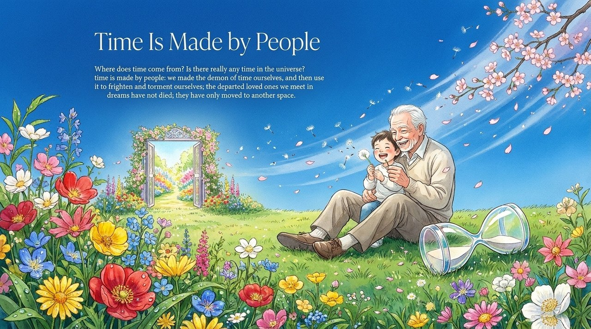
    
    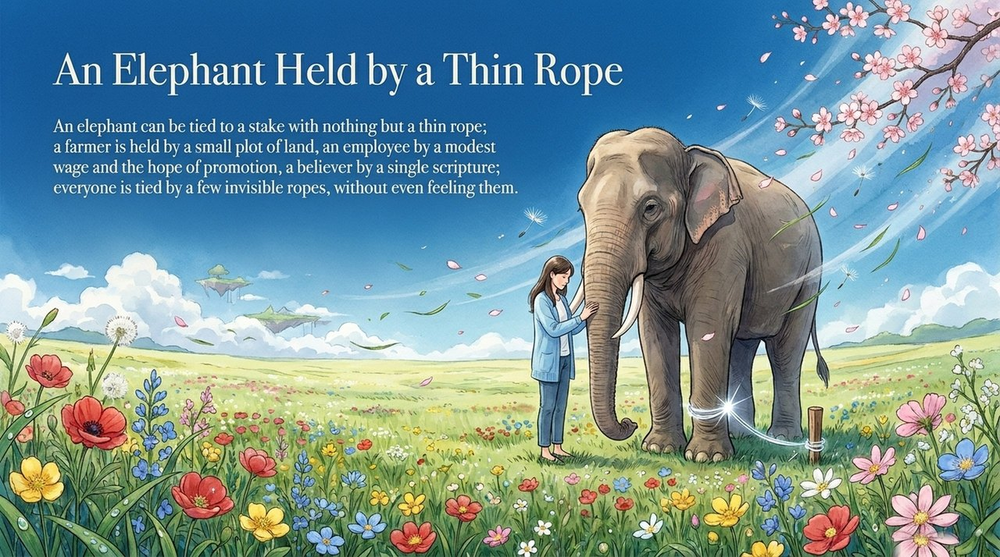
    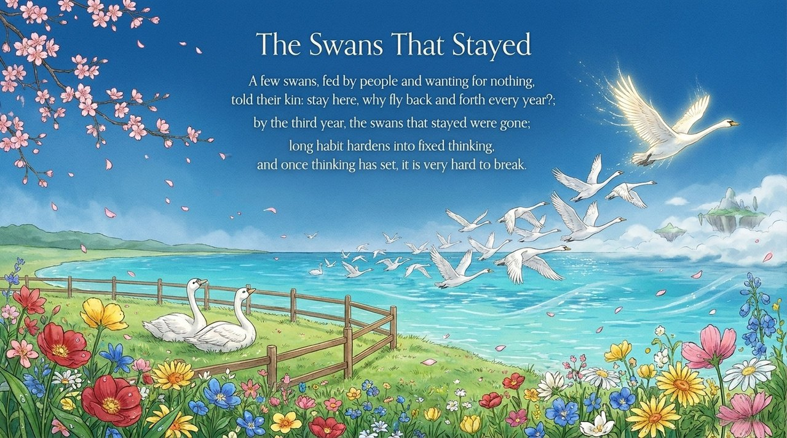
    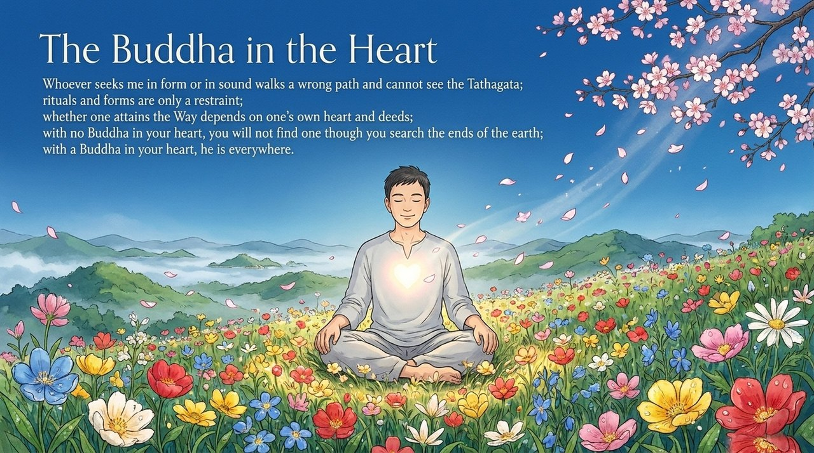
    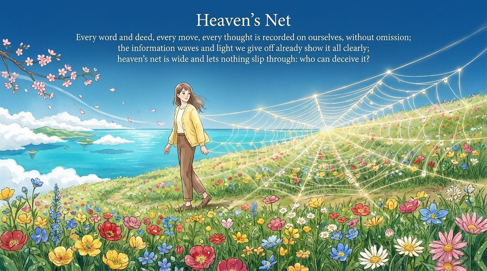

---

## Versions

| Version | Audience | Focus |
|---------|----------|-------|
| [Friendly Edition](/en/inverted-thinking/friendly/) | New readers | What is Inverted Thinking? Why invert? |
| [Academic Edition](/en/inverted-thinking/academic/) | Researchers | Comparison with Hegelian dialectics, deconstruction, Zen, Taoism |
| [Internal Edition](/en/inverted-thinking/internal/) | Chanyuan Grasses | Complete source text, all 20 sections fully preserved |

---

## Related Entries

- [Anti-Conventional Thinking](/en/abnormal-thinking/)
- [Taiji Thinking](/en/taiji-thinking/)
- [1+1 Thinking](/en/one-plus-one-thinking/)
- [Fixed Mindset](/en/fixed-mindset/)
