<!-- id: LC-JE-0001-EN theme: Cultivation type: Navigation direction: Character Cultivation lang: en -->

# Jealousy and Envy

Jealousy and envy (忌妒·嫉妒) are the direct offspring of a comparing mind — a portrait of the soul's ugliness, and one of the core obstacles that prevent life from ascending. From emotional jealousy to fierce envy, they lock the life into its current level, drain energy, and stand in absolute opposition to the nature of a celestial being.

---

## Version Navigator

## Video

<iframe style="width:100%;aspect-ratio:4/3;border:0" src="https://www.youtube-nocookie.com/embed/g6F777vQe3U" title="Jealousy and Envy (Lifechanyuan Encyclopedia video)" allowfullscreen></iframe>

## Slides

??? info "📖 Illustrated slides (14 pages, click to expand)"

    
    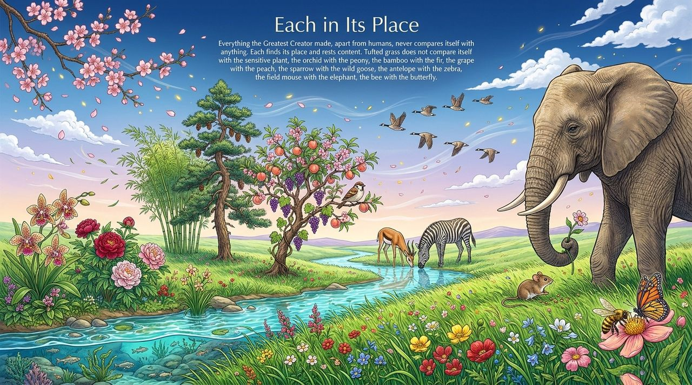
    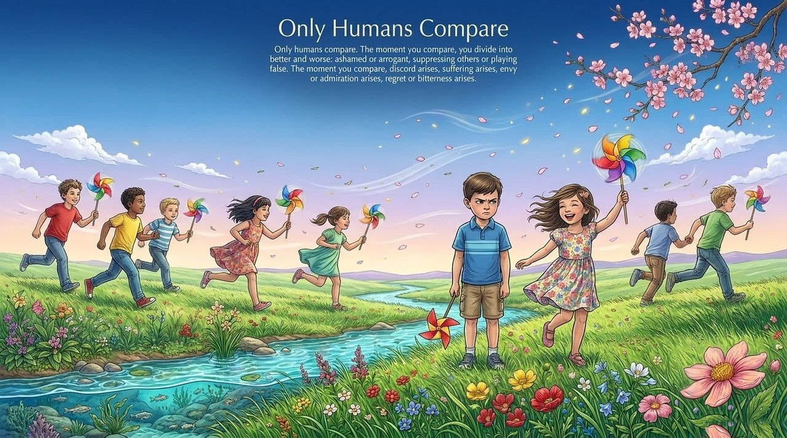
    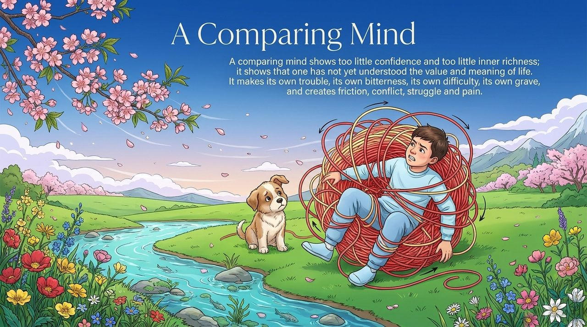
    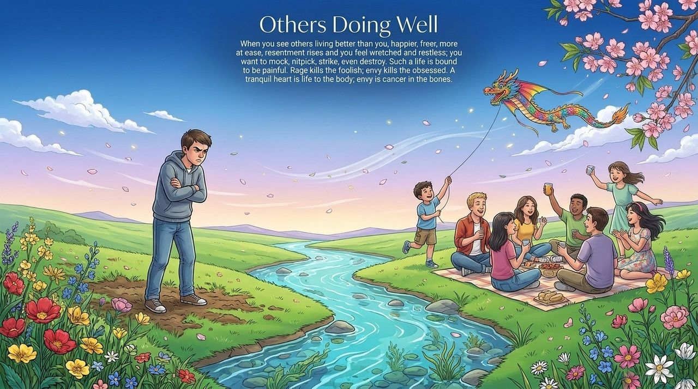
    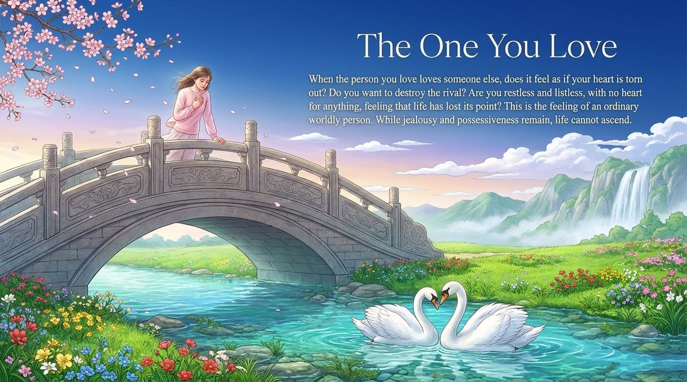
    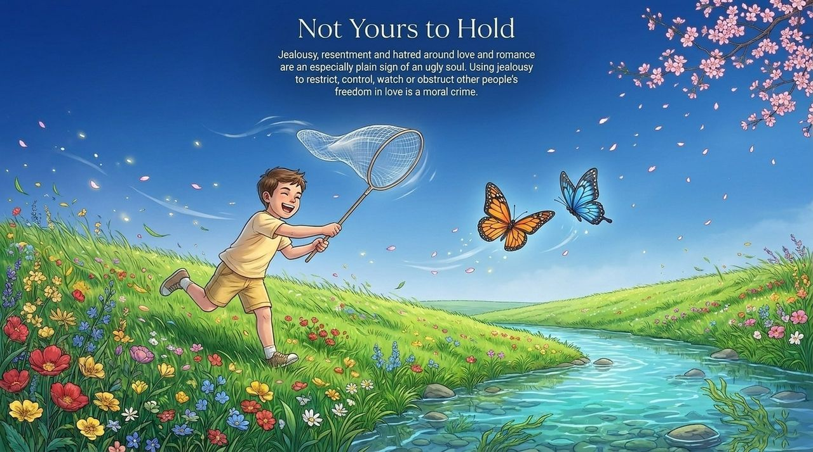
    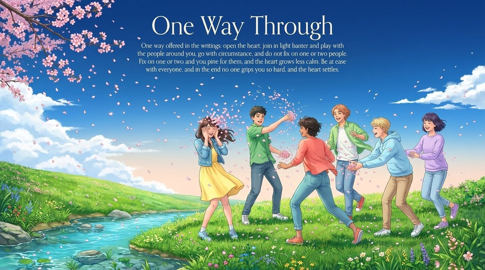
    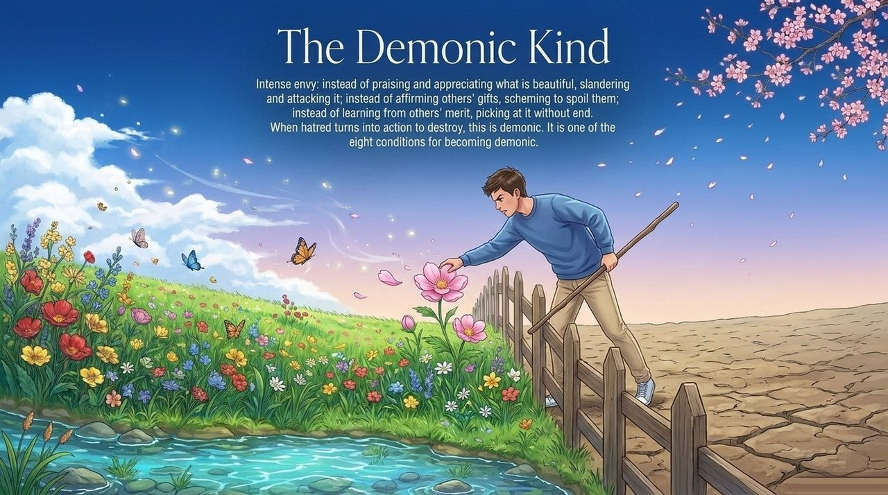
    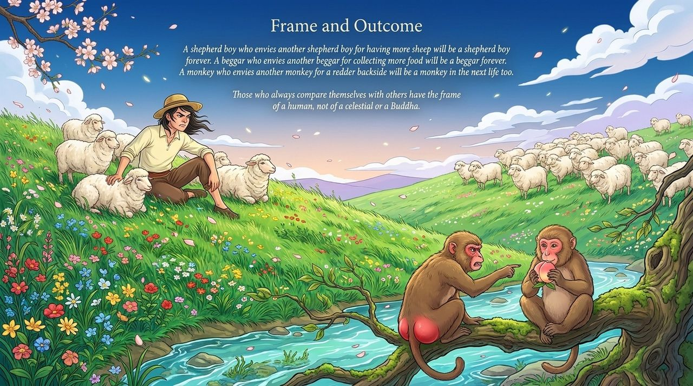
    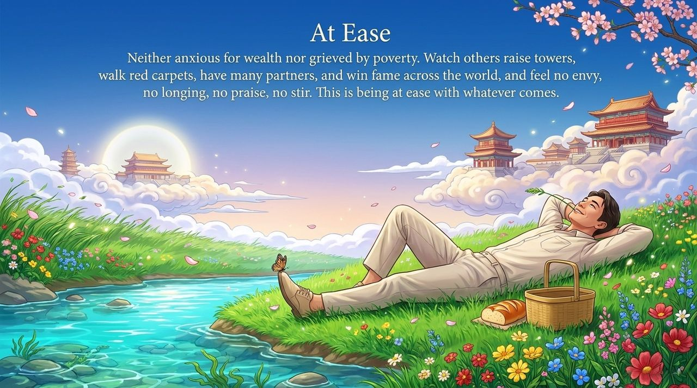
    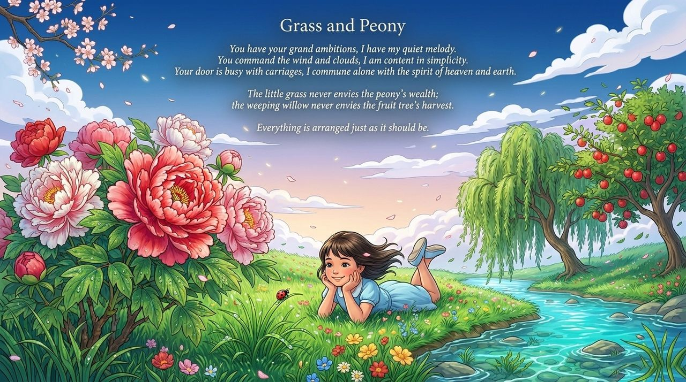
    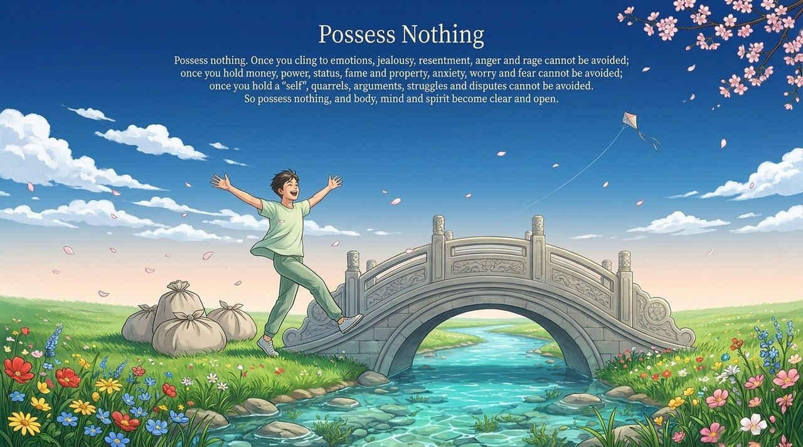
    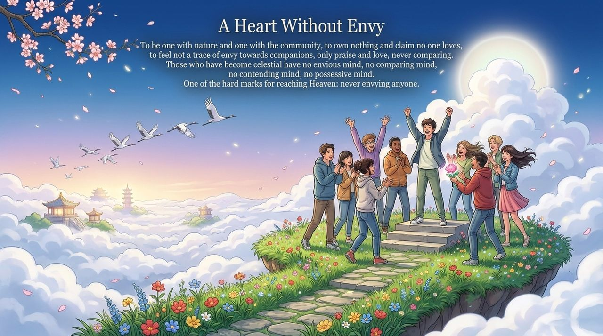

---

| Version | Best for | Focus |
|---------|----------|-------|
| [Friendly](friendly.md) | First-time readers | Emotional jealousy · The harm of comparison · Practical cultivation path |
| [Academic](academic.md) | Scholars · Cross-cultural comparison | Buddhism, Christianity, psychology — and Lifechanyuan's unique framework |
| [Internal](internal.md) | Practitioners · Researchers | Full citations · Six-section framework · In-system understanding |

---

## Related Entries

[Arrogance](/en/aoman/) · [Selfishness and Selflessness](/en/zisi-wusi/) · [Demonic Nature](/en/moxing/) · [Following One's Nature](/en/suixing-er-dong/) · [Raise Vibration Frequency](/en/raise-vibration-frequency/) · [Soul Garden](/en/soul-garden/) · [Celestial Nature](/en/xianxing/) · [Becoming a Celestial Being](/en/becoming-celestial/)
