<!-- id: LC-JS-0001-EN theme: cosmos type: navigation direction: greatest-creator-and-tao lang: en -->

# Jesus the God and Satan the Demon

In the Lifechanyuan system, Jesus and Satan are two great divine beings created by the Greatest Creator. Jesus — the God — represents truth, goodness, beauty, light, and gentleness; he is the Greatest Creator's representative and messenger to the universe. Satan — the Demon — represents falsehood, evil, ugliness, and darkness; his role is to maintain the dynamic balance of cosmic life. Together they form the cosmic "Two Primordial Forces" (两仪, liǎng yí) — polar opposites that are inseparably unified, jointly governing the earthly cosmos.

> "Jesus and I are twins. 'Wuji gives birth to Taiji; Taiji gives birth to the Two Primordial Forces.' Taiji is our father, the Greatest Creator; the Two Primordial Forces are Jesus and me, Satan."
>
> *(Chanyuan Corpus · Revelation · Satan's Proclamation)*

---

## Version Guide

| Version | Best for | Focus |
|---------|----------|-------|
| [Friendly version](friendly.md) | First-time readers | Life analogies · yin-yang duality · how to choose your path |
| [Academic version](academic.md) | Researchers | Concept analysis · cosmic structure · comparison with mainstream religions |
| [Internal reference](internal.md) | Deep study | Complete source texts · eight-section framework · cultivation guide |

---

## Video

<iframe style="width:100%;aspect-ratio:4/3;border:0" src="https://www.youtube-nocookie.com/embed/R-r6QqeHM-8" title="Jesus the God and Satan the Demon (Lifechanyuan Encyclopedia video)" allowfullscreen></iframe>

## Slides

??? info "📖 Illustrated slides (14 pages, click to expand)"

    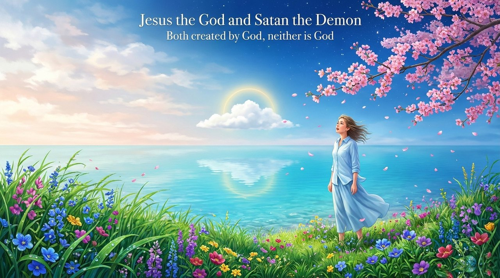
    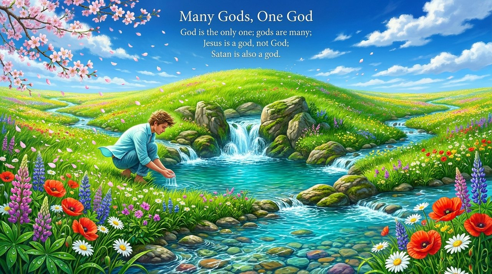
    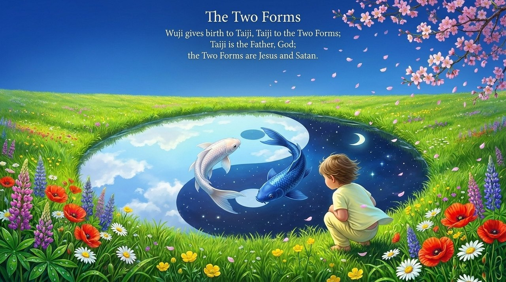
    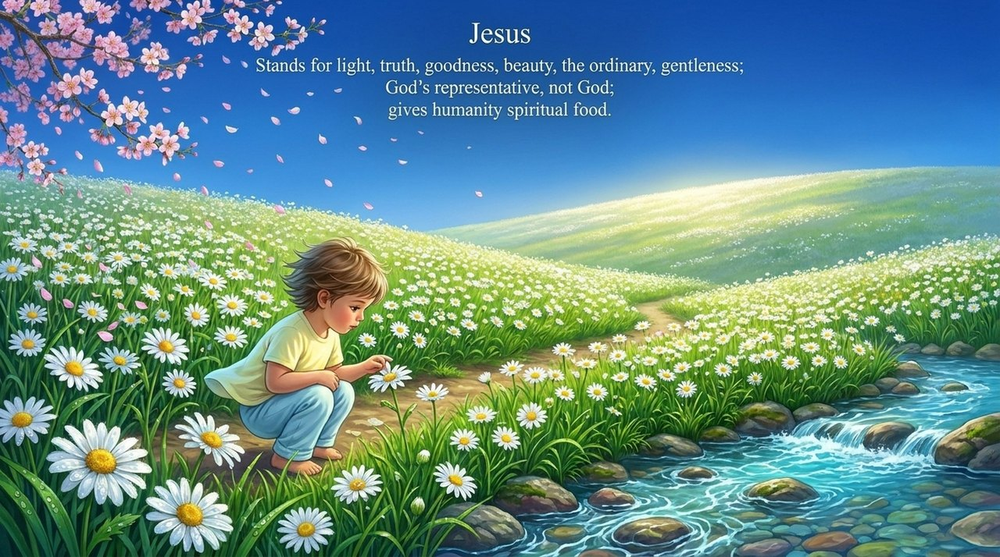
    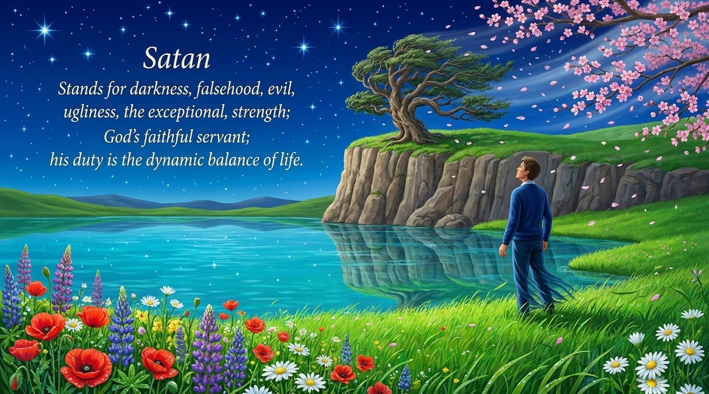
    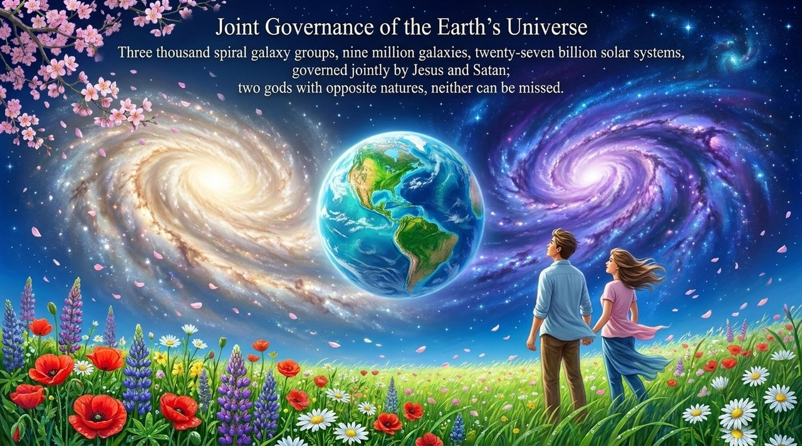
    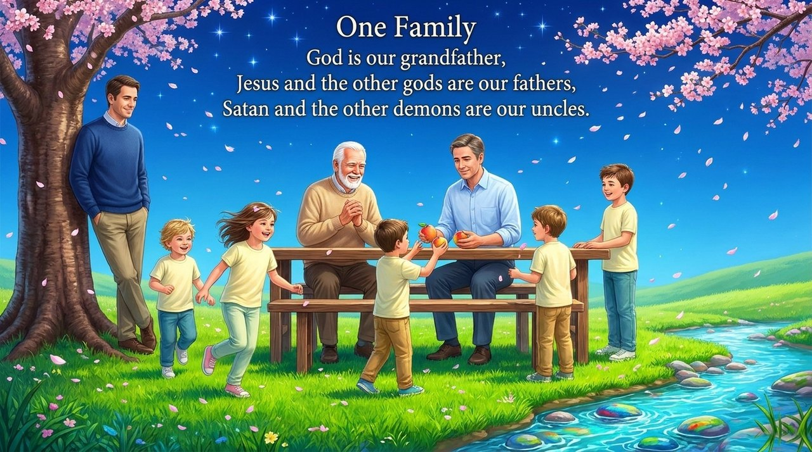
    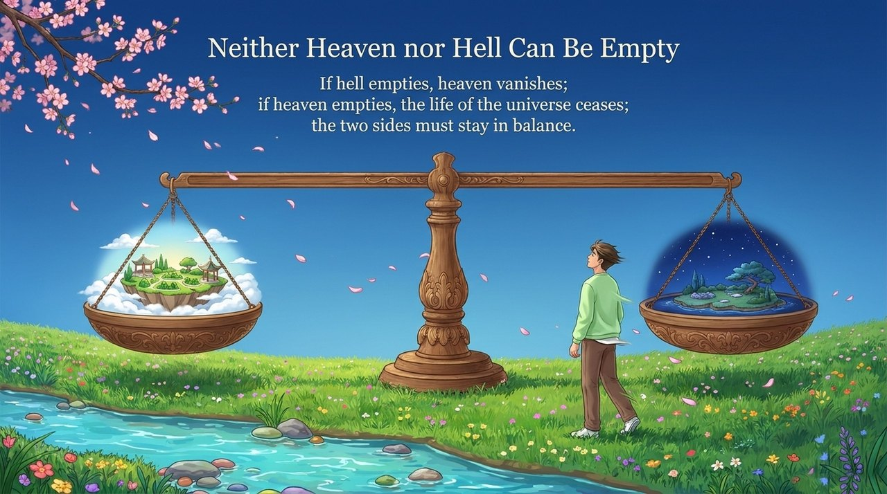
    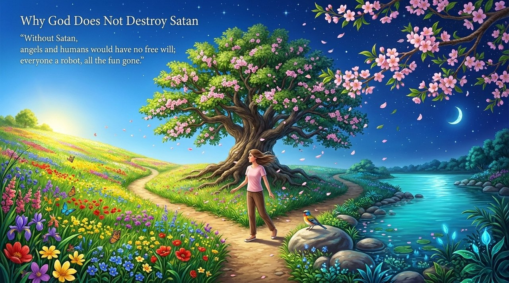
    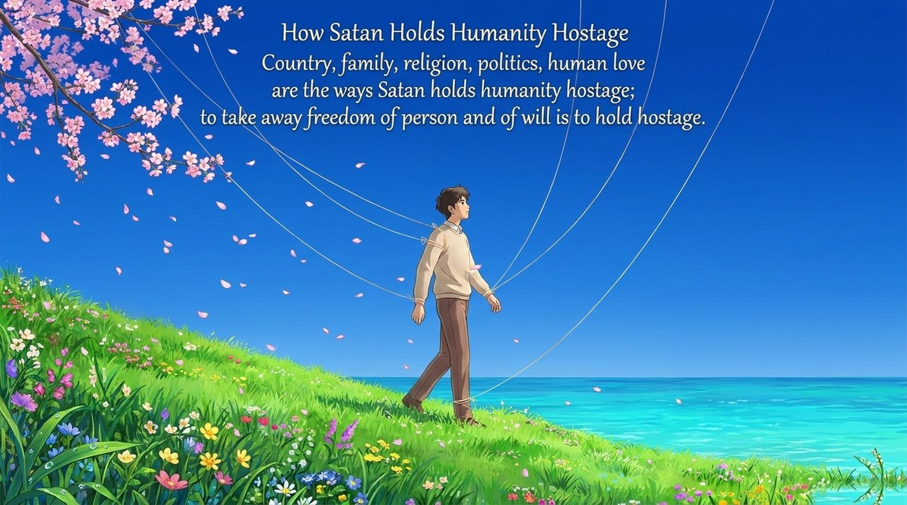
    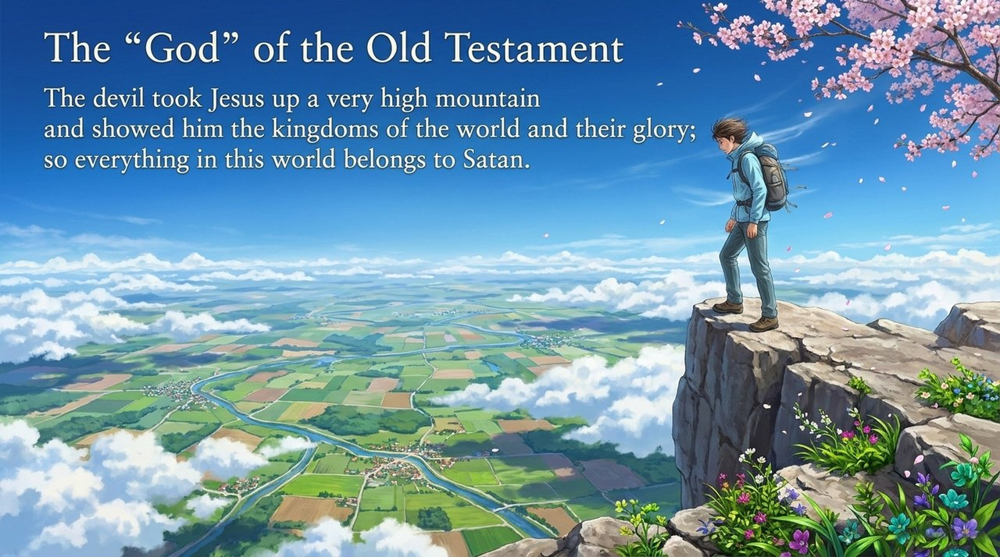
    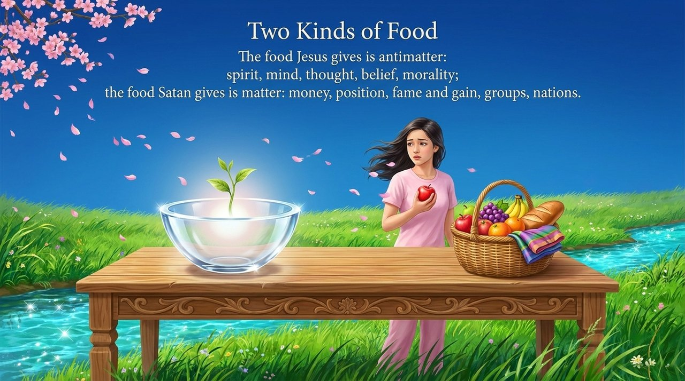
    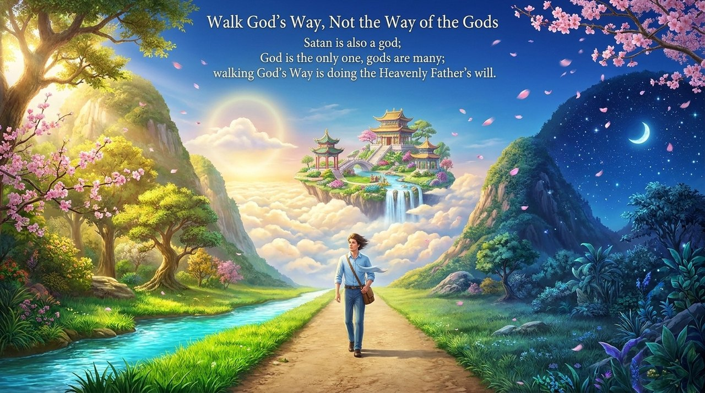
    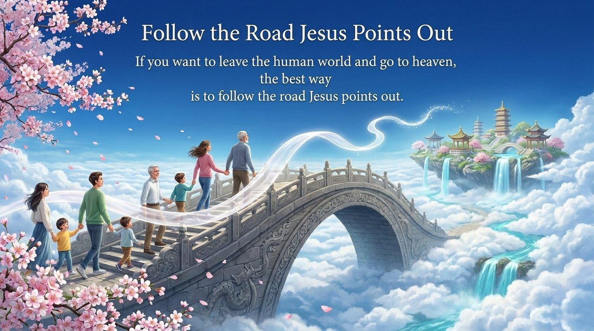

---

## Related Entries

[The Greatest Creator](/en/greatest-creator/) · [The Tao](/en/dao/) · [Taiji](/en/taiji/) · [Wuji and Taiji](/en/wuji-taiji/) · [Kingdom of Heaven](/en/kingdom-of-heaven/) · [Route to Heaven](/en/route-to-heaven/) · [Becoming a Celestial Being or Buddha](/en/becoming-celestial-buddha/) · [Levels of LIFE](/en/levels-of-life/) · [Buddha Dharma](/en/buddha-dharma/)
