<!-- id: LC-KWS-0001-EN theme: Cultivation Practice type: Index direction: Cultivation Practice lang: en -->

# Knowledge, Wisdom & Spirituality

**Knowledge, wisdom and spirituality are, in Xuefeng's words, the three pursuits of life and the three steps to becoming a Celestial Being or a Buddha.** Knowledge is understanding of the material world and the summing-up of experience, the precondition for ability but not ability itself; wisdom is knowledge raised higher, the power to tell, analyse and judge things and to invent and create; spirituality is wisdom raised higher. Knowledge plus spirituality is wisdom; and in the end comes turning knowing, setting cleverness down, and letting true nature bloom.

---

## Version Navigator

| Version | Intended Reader | Core Focus |
|---------|----------------|-----------|
| [Accessible Introduction](friendly.md) | First-time readers | The three steps in plain words, the flour-and-cooking image, whether there is a shortcut, ending in true nature |
| [Academic Analysis](academic.md) | Researchers | Conceptual structure, five levels of wisdom, brief comparison with Western epistemology |
| [Internal Edition](internal.md) | In-depth study | Full quotations with sources |

---

## Video

<iframe style="width:100%;aspect-ratio:4/3;border:0" src="https://www.youtube-nocookie.com/embed/rCNTfQkAHmY" title="Knowledge, Wisdom and Spirituality (Lifechanyuan Encyclopedia video)" allowfullscreen></iframe>

## Slides

??? info "📖 Illustrated slides (14 pages, click to expand)"

    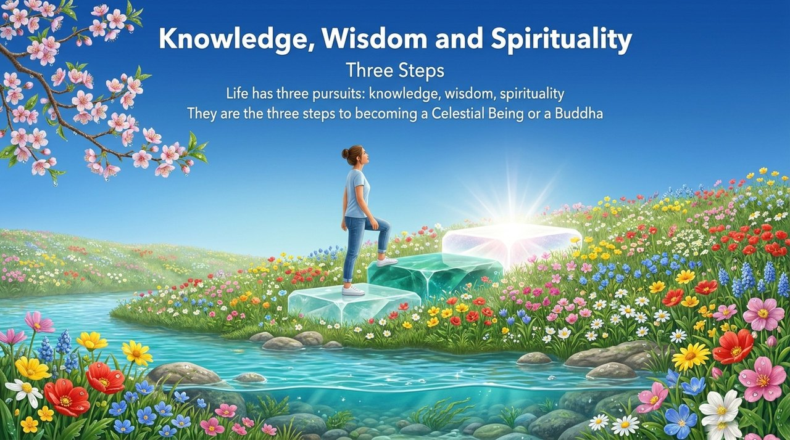
    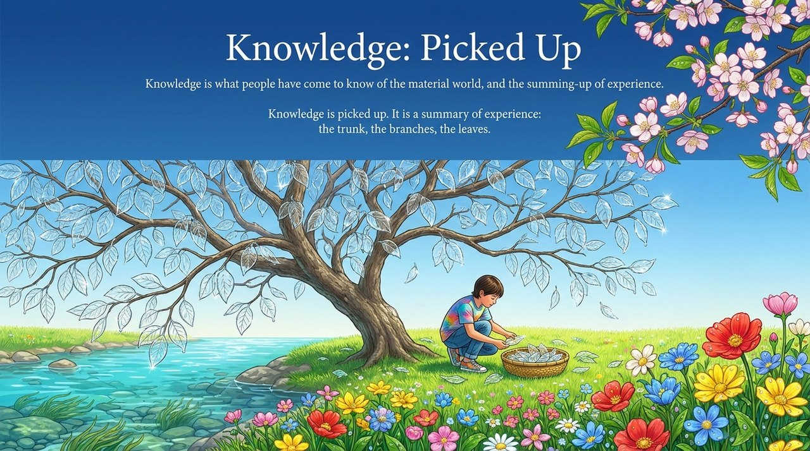
    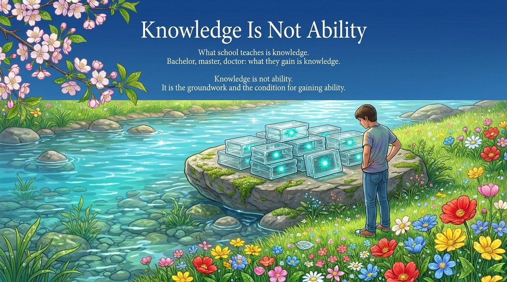
    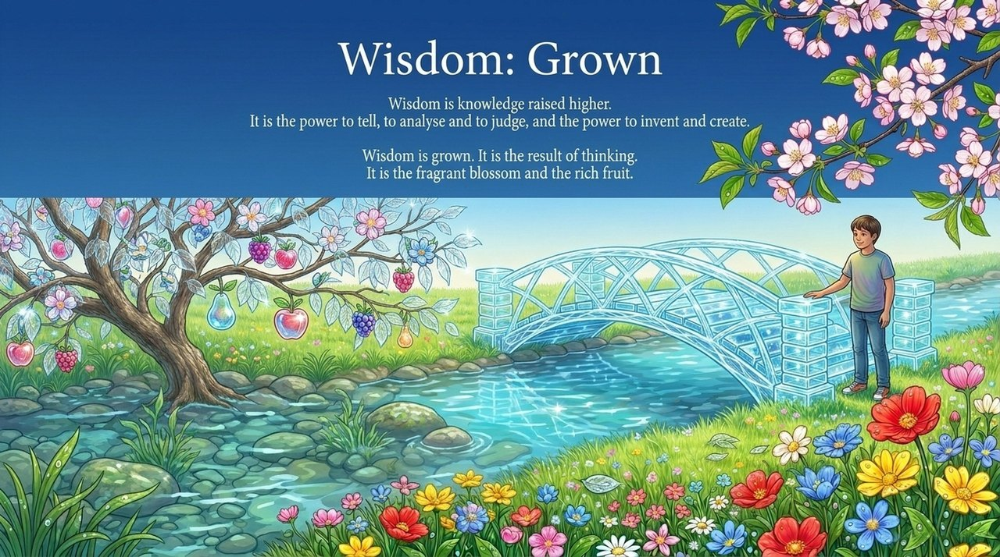
    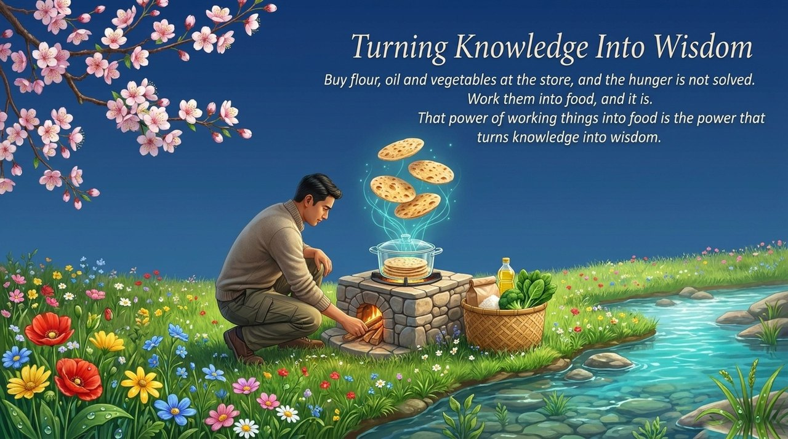
    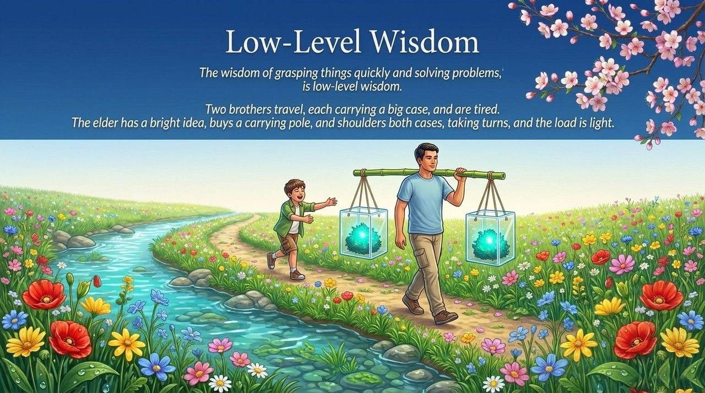
    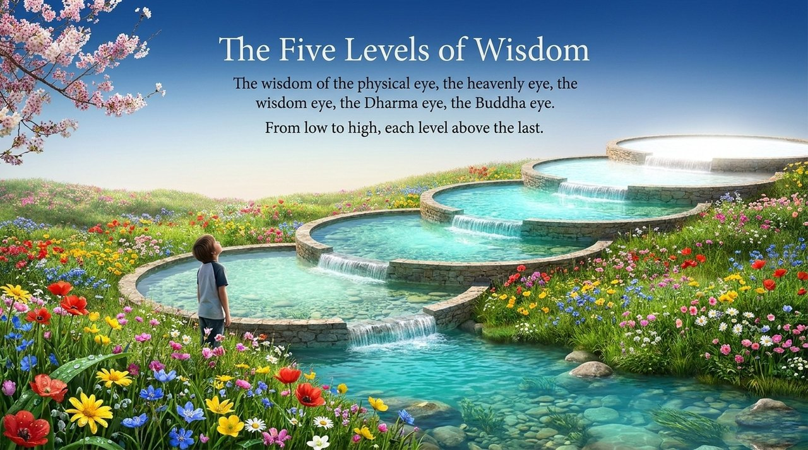
    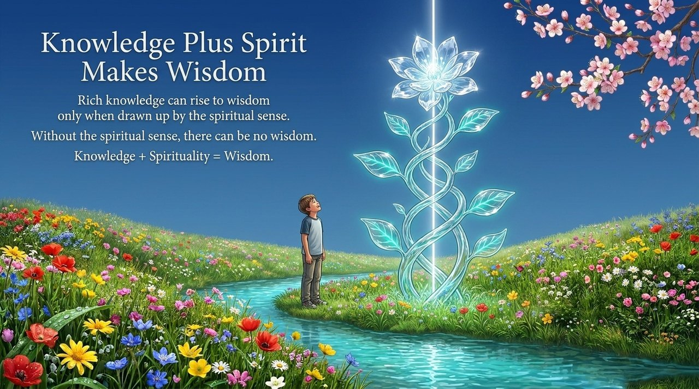
    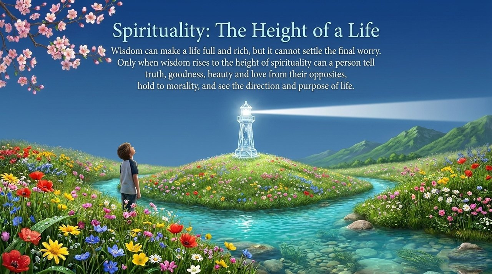
    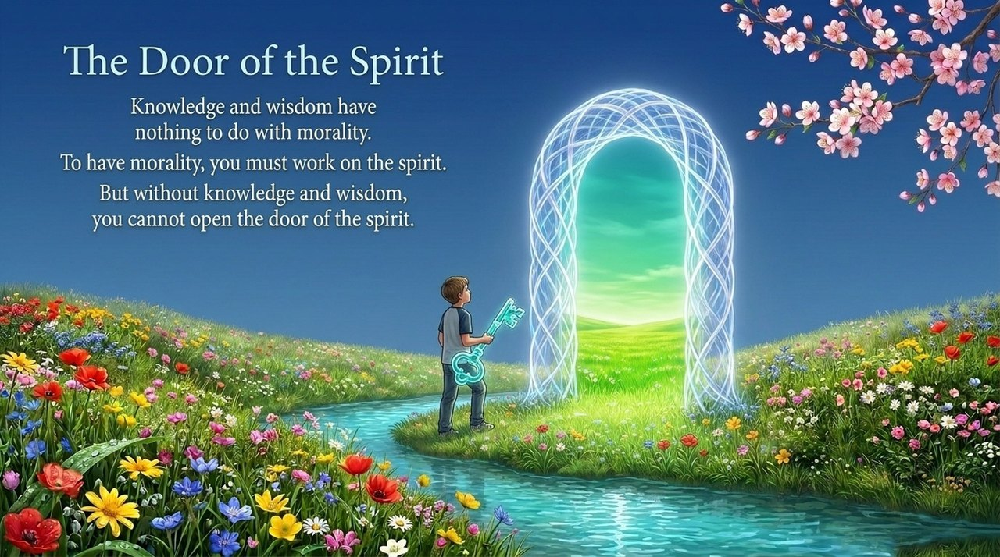
    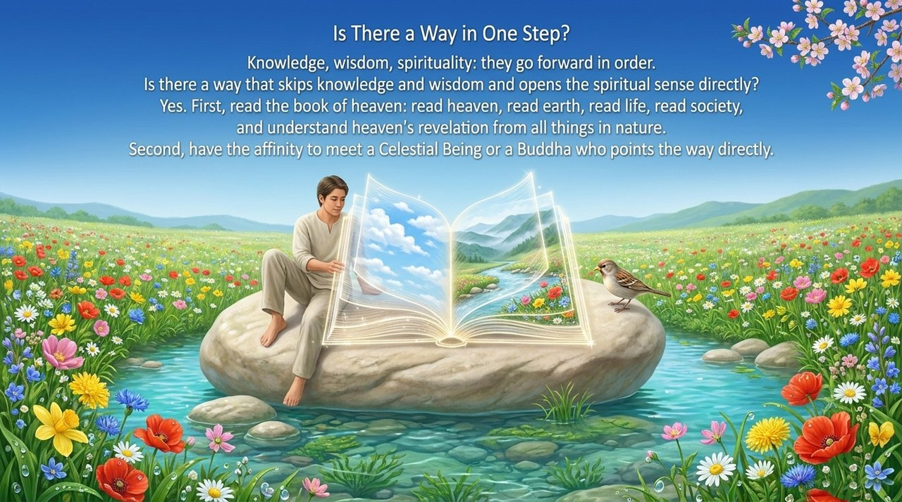
    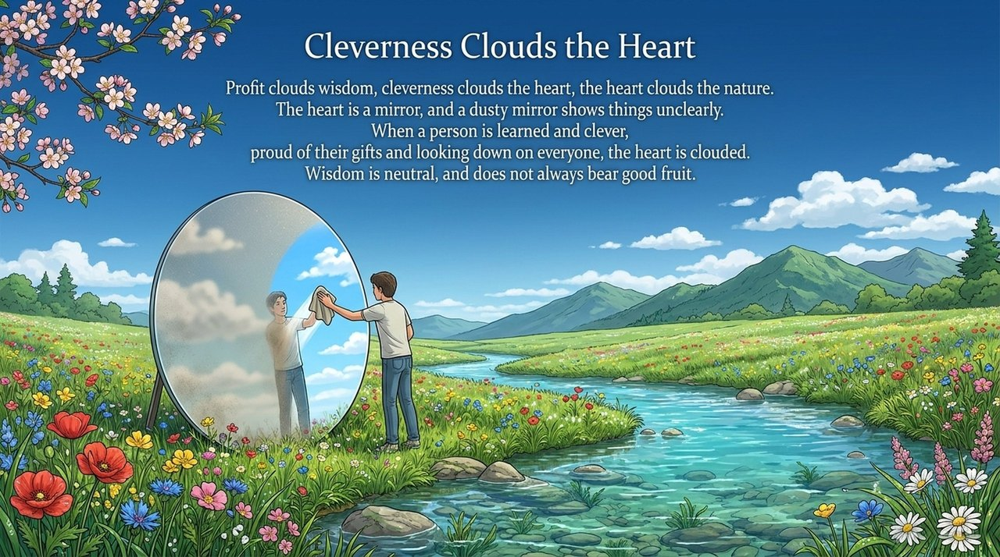
    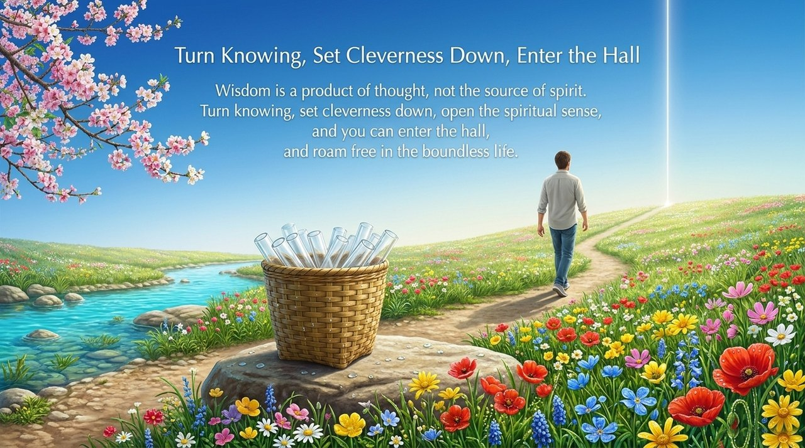
    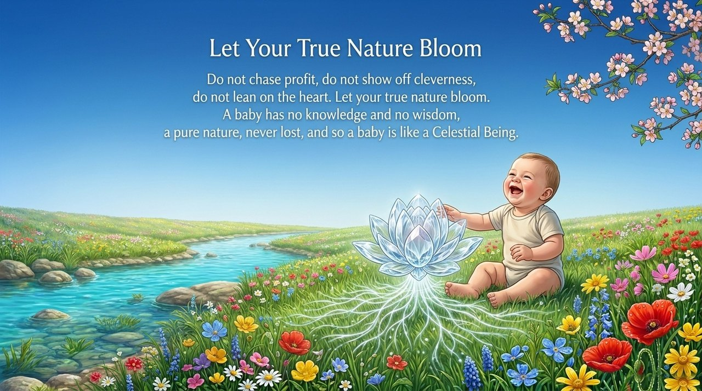

---

## Related Entries

[Spirituality](/en/spirituality/) · [Spiritual Sensing](/en/spiritual-sensing/) · [The Intelligence Formation and the Wisdom Formation](/en/wisdom-trap-and-wisdom-array/) · [The 36 Bagua Formations](/en/thirty-six-bagua-formations/) · [EQ · IQ · SQ](/en/eq-iq-sq/) · [Awakening](/en/awakening/) · [Illuminate the Mind, See the Nature](/en/illuminate-mind-see-nature/) · [Inverted Illusions (Diāndǎo Mèngxiǎng)](/en/diandao-mengxiang/) · [Self-Nature (Buddha-Nature)](/en/self-nature/)
