<!-- id: LC-LI-0001-EN theme: Mystery of LIFE type: Index lang: en -->

# Law of Life Indestructibility

LIFE's essence is an antimatter structure endowed with spirituality — a structure that does not depend on any physical form and therefore cannot be destroyed when the body perishes. LIFE persists across the thirty-six-dimensional cosmos, cycling through different forms and spaces. What we call "death" is not the end of LIFE, but the exchange of one LIFE vehicle for another.

Lifechanyuan grounds this law in five interlocking arguments: the universe does not perish, so LIFE does not perish; the universe's morality is eternal, so LIFE endures; LIFE transforms through reincarnation, so it does not cease; the Dao — the Spirit of the Greatest Creator — is permanent, so LIFE is permanent; and the antimatter structure cannot vanish, so LIFE cannot vanish.

---

- [Friendly Edition](friendly.md) — Understanding LIFE indestructibility in everyday terms
- [Academic Edition](academic.md) — Systematic analysis and source references
- [Internal Edition](internal.md) — Original texts and complete exposition

---

## Video

<iframe style="width:100%;aspect-ratio:4/3;border:0" src="https://www.youtube-nocookie.com/embed/IV0rZfgljGc" title="Law of Life Indestructibility (Lifechanyuan Encyclopedia video)" allowfullscreen></iframe>

## Slides

??? info "📖 Illustrated slides (14 pages, click to expand)"

    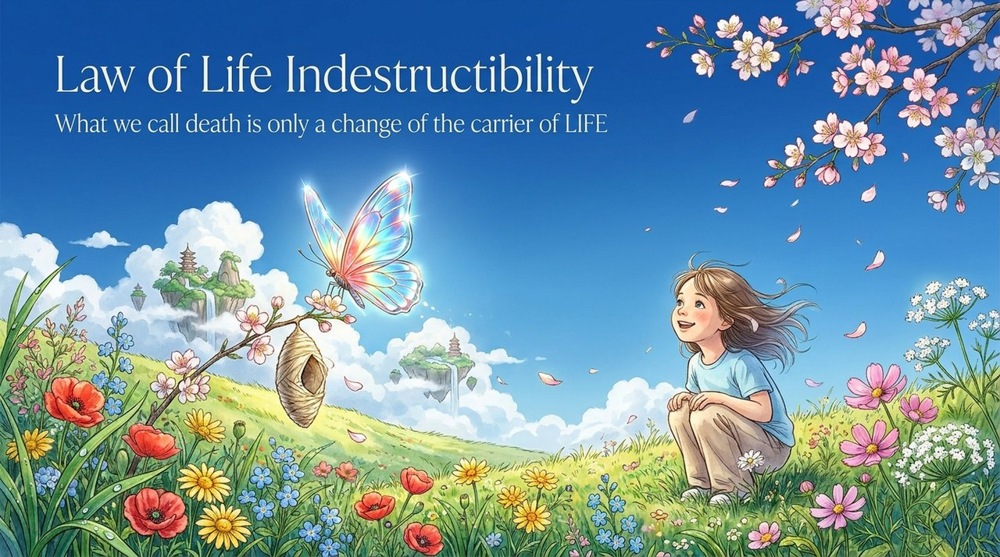
    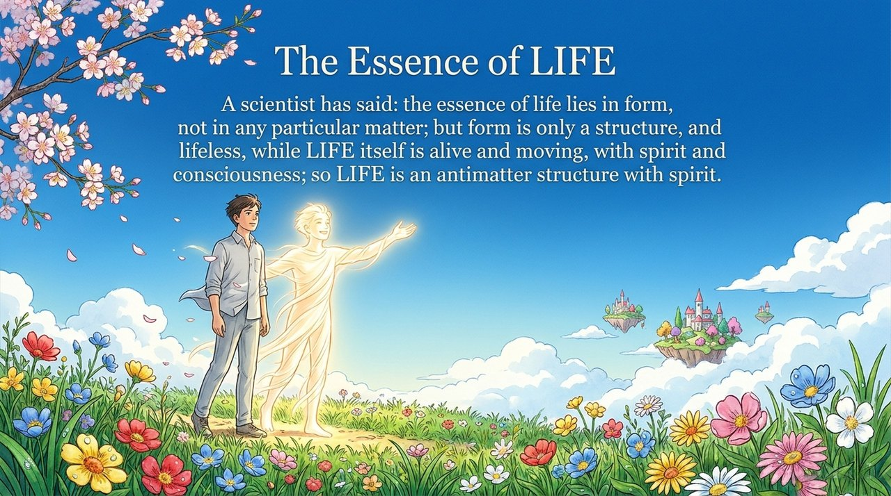
    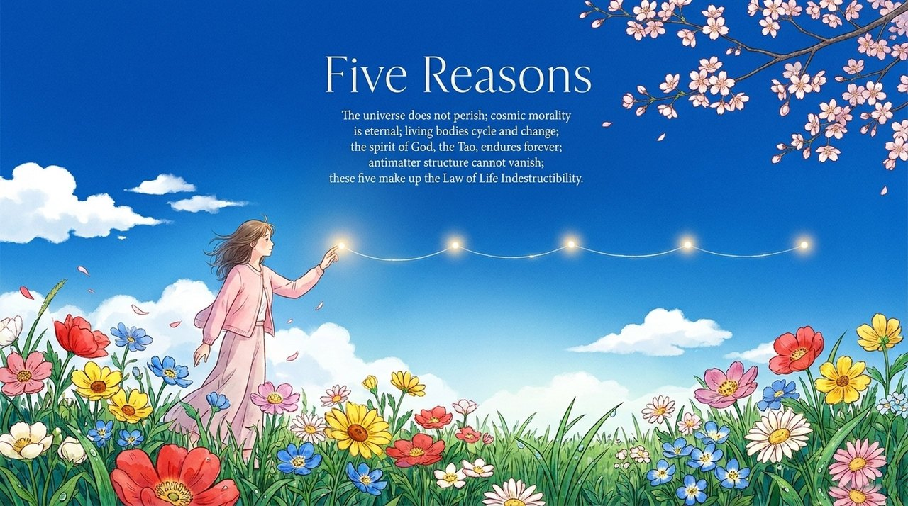
    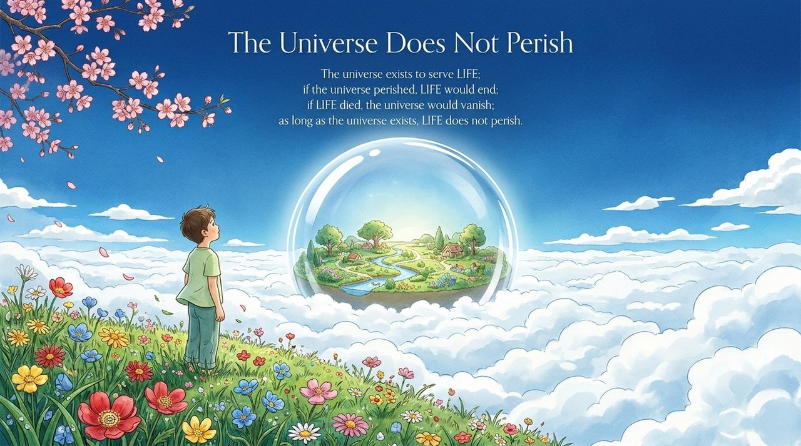
    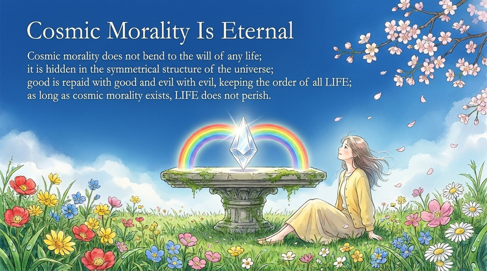
    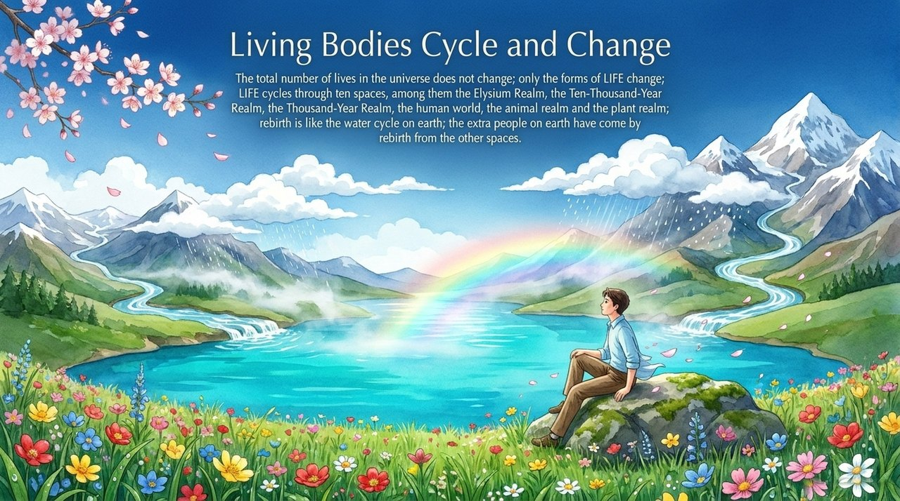
    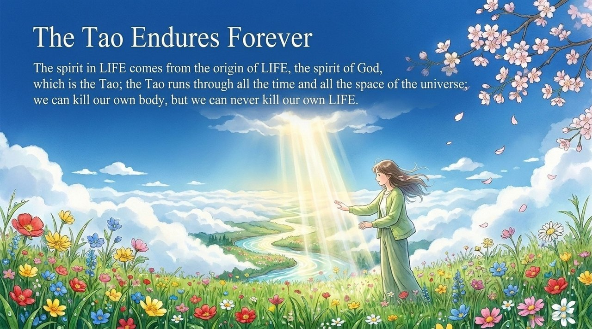
    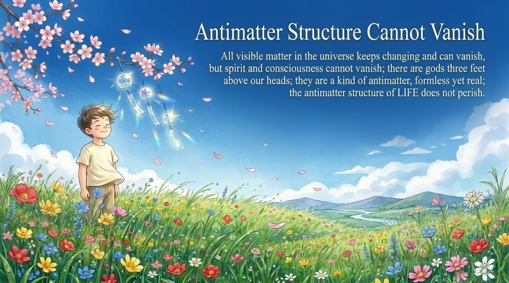
    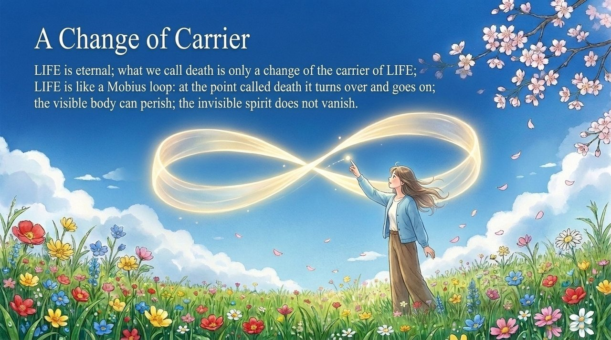
    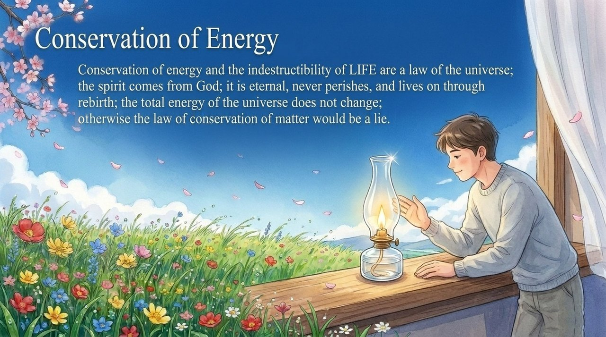
    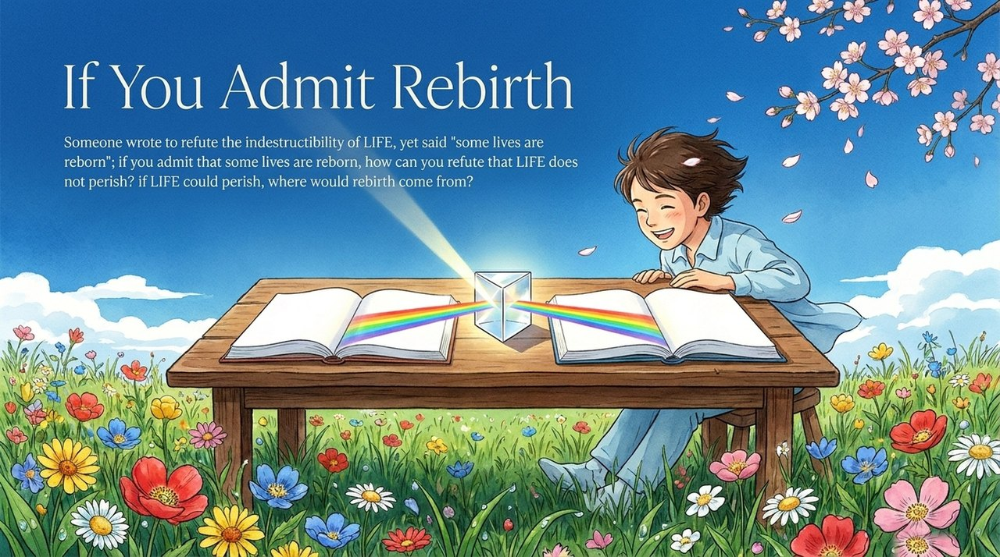
    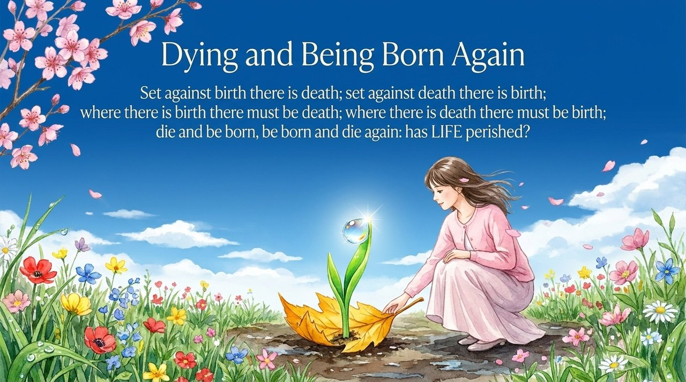
    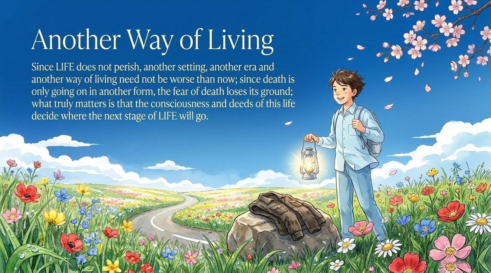
    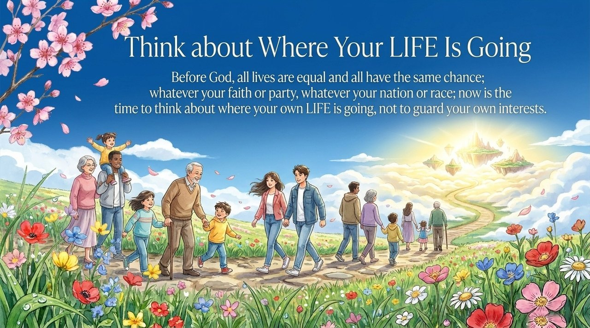

---

**Related entries:** [Antimatter Structure](/en/antimatter-structure/) · [Reincarnation of LIFE](/en/life-reincarnation/) · [Thirty-Six-Dimensional Space](/en/thirty-six-dimensional-space/) · [Dao](/en/dao/) · [Characteristics of LIFE](/en/life-characteristics/)
