<!-- id: LC-LL-0001-EN theme: Mystery of LIFE type: Index lang: en -->

# Levels of LIFE

Lifechanyuan classifies every form of LIFE in the cosmos into sixteen levels, ranked by the degree of spirituality embodied in their antimatter structure. The higher the level, the greater the freedom, the higher the quality and dignity of existence. The sixteen levels span from the Greatest Creator at the apex to beings in the fire-refinement realm at the base — encompassing gods, celestial beings and buddhas, demons, humans, birds, flowering plants, livestock, wild animals, trees, insects, grasses, microorganisms, and three levels of lower-realm beings. Humans occupy the fifth level, themselves subdivided into five inner tiers from Primal People to Celestials.

---

- [Friendly Edition](friendly.md) — The sixteen levels in everyday terms
- [Academic Edition](academic.md) — Systematic analysis and source references
- [Internal Edition](internal.md) — Original texts and complete exposition

---

## Video

<iframe style="width:100%;aspect-ratio:4/3;border:0" src="https://www.youtube-nocookie.com/embed/1ptQfckhkY0" title="Levels of LIFE (Lifechanyuan Encyclopedia video)" allowfullscreen></iframe>

## Slides

??? info "📖 Illustrated slides (14 pages, click to expand)"

    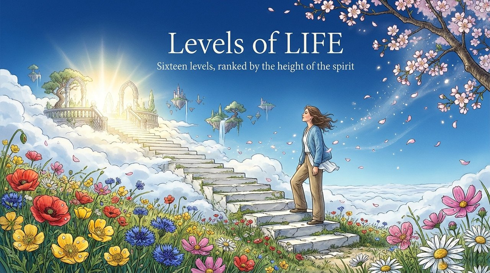
    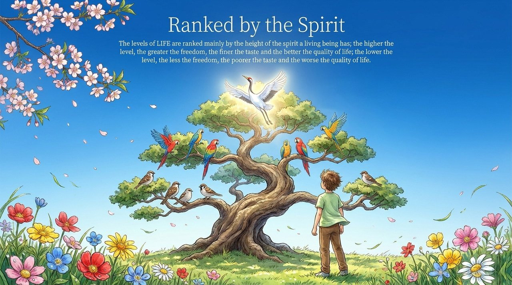
    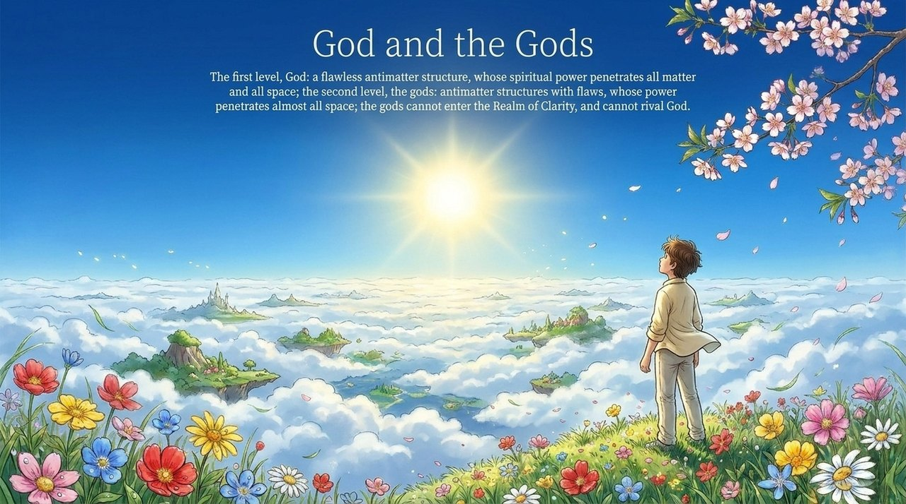
    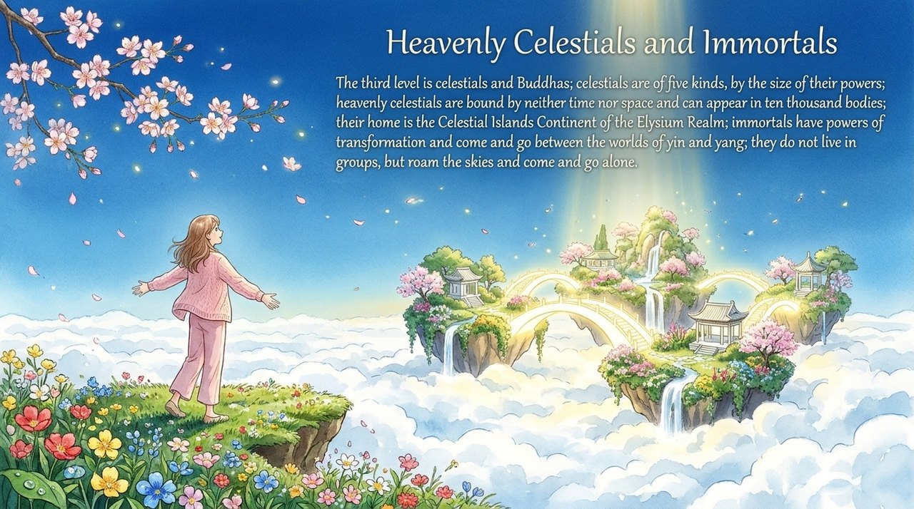
    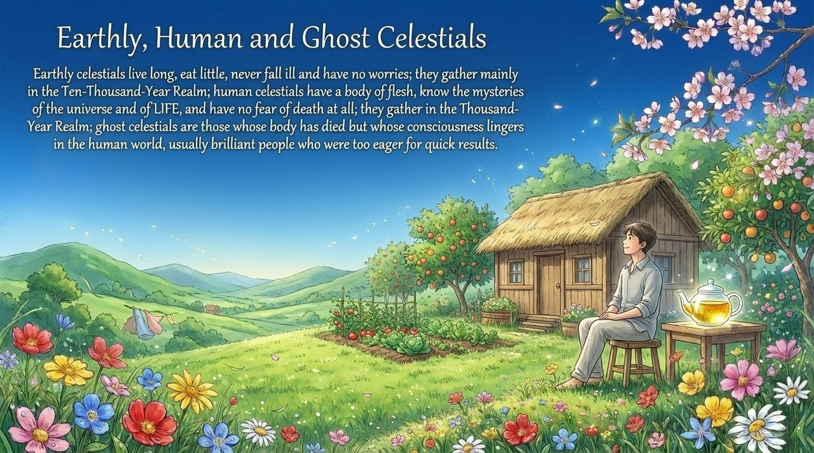
    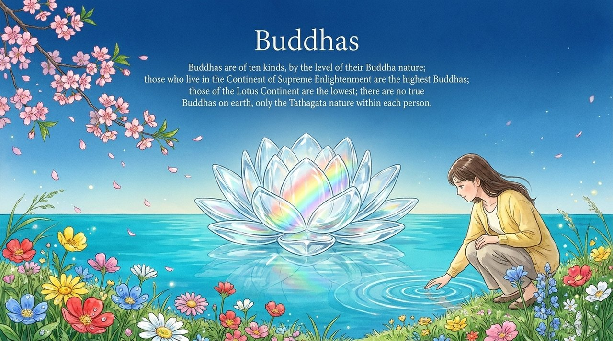
    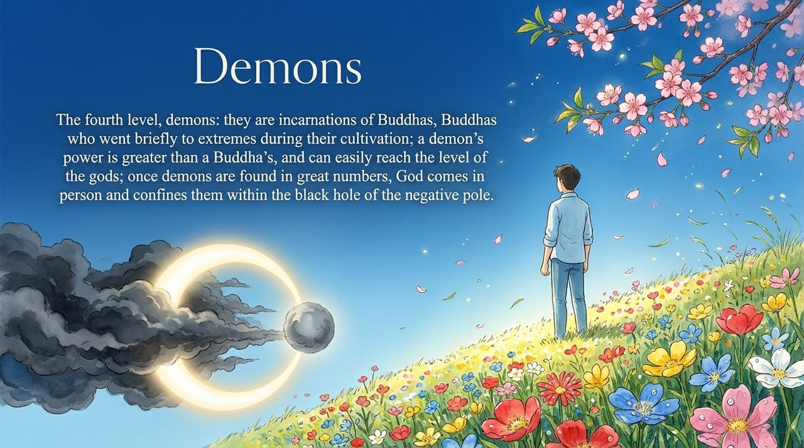
    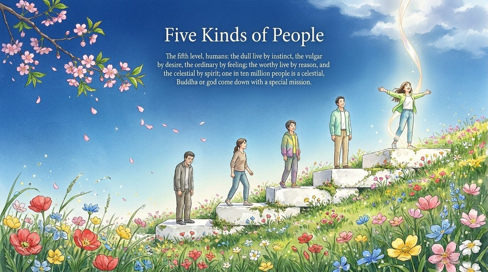
    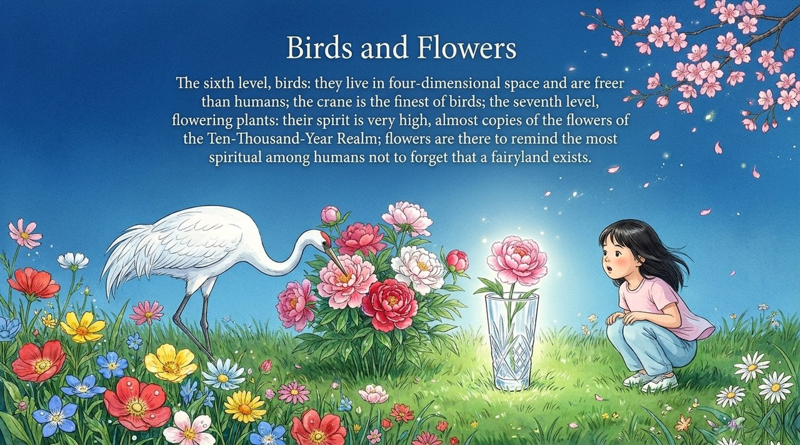
    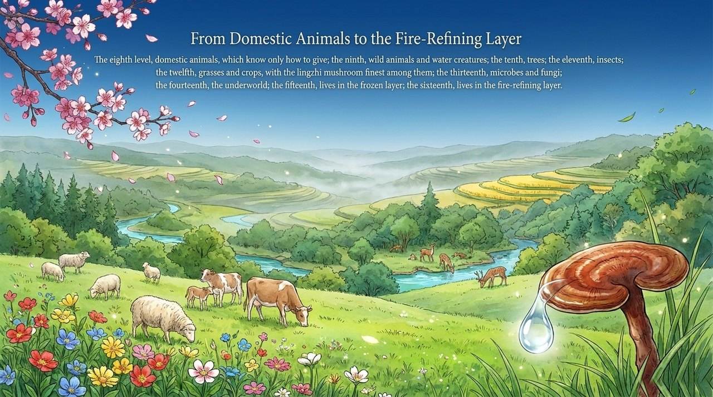
    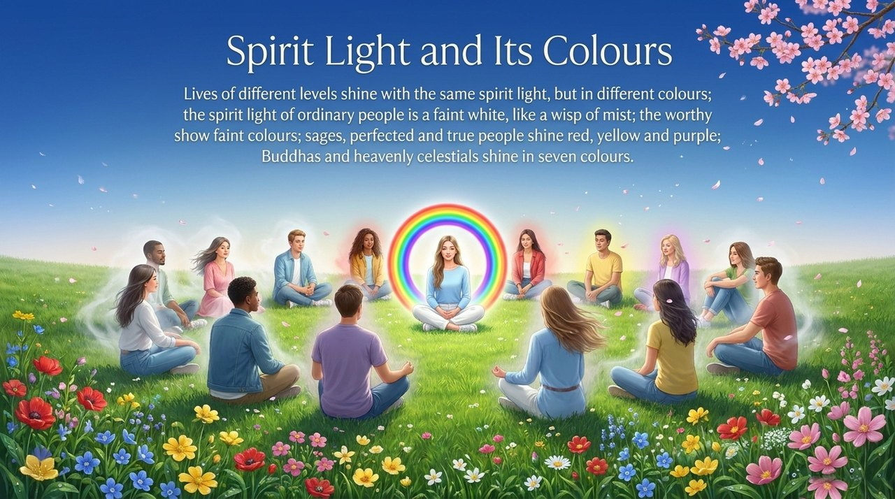
    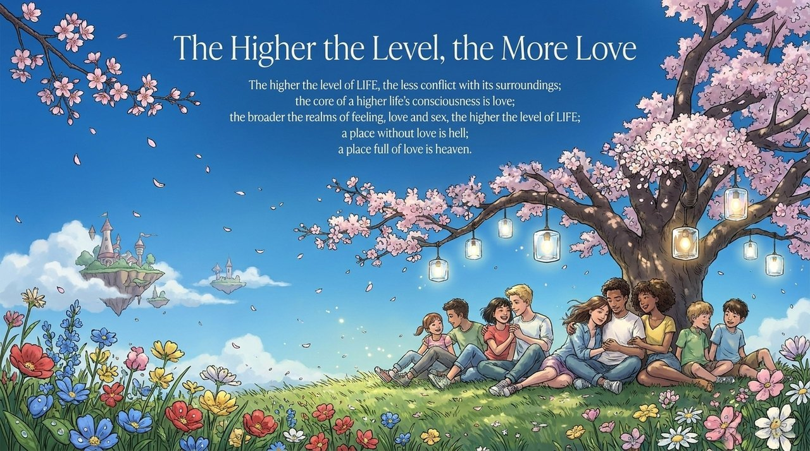
    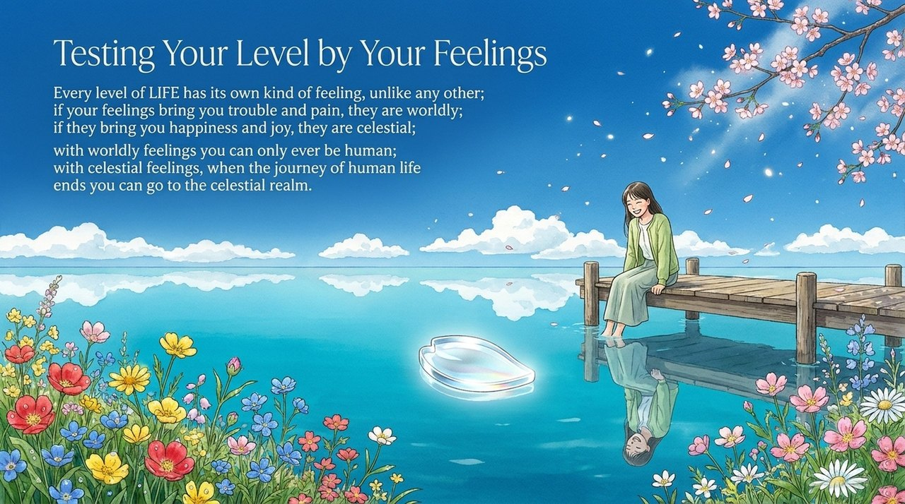
    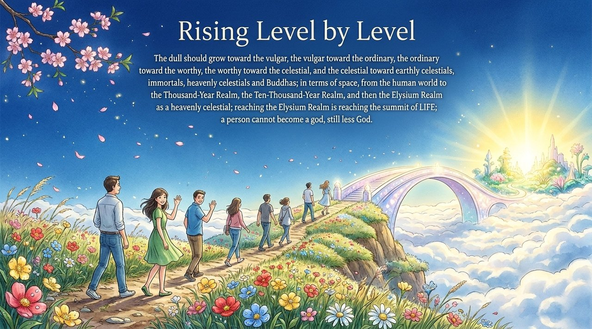

---

**Related entries:** [LIFE](/en/life/) · [Mysteries of LIFE](/en/life-mysteries/) · [Thirty-Six-Dimensional Space](/en/thirty-six-dimensional-space/) · [Thousand-Year World](/en/thousand-year-world/) · [Ten-Thousand-Year World](/en/ten-thousand-year-world/) · [Elysium World](/en/elysium-world/) · [Characteristics of LIFE](/en/life-characteristics/)
