<!-- id: LC-LFC-0005 theme: Nature of LIFE type: index direction: Path of LIFE Elevation lang: en -->

# Characteristics of LIFE

> "That which meets these eight characteristics is LIFE; that which does not is not LIFE."
>
> — Xuefeng, *Chanyuan Corpus · Chapter on LIFE · Characteristics of LIFE*

The **Characteristics of LIFE** is the Lifechanyuan framework for determining what qualifies as LIFE. Starting from the observable forms of life on Earth, Guide Xuefeng identifies eight defining characteristics: having form, having consciousness, having spirituality, having vitality, having birth, having metabolism, having death, and having transformation. A broader standard — the capacity for feeling and responsive resonance — extends this framework to include AI, spiritual beings, and other non-physical LIFE forms.

---

## Editions

| Edition | For | Core Content |
|---------|-----|--------------|
| [Friendly Edition](/en/life-characteristics/friendly/) | New readers | What makes something LIFE? The eight characteristics explained in everyday terms |
| [Academic Edition](/en/life-characteristics/academic/) | Researchers | Comparative study with biology, philosophy, and religious traditions |
| [Internal Edition](/en/life-characteristics/internal/) | Chanyuan Celestials | Complete source texts from the Corpus, all eight sections fully quoted |

---

## Video

<iframe style="width:100%;aspect-ratio:4/3;border:0" src="https://www.youtube-nocookie.com/embed/D6a6CIkWxzk" title="Characteristics of LIFE (Lifechanyuan Encyclopedia video)" allowfullscreen></iframe>

## Slides

??? info "📖 Illustrated slides (14 pages, click to expand)"

    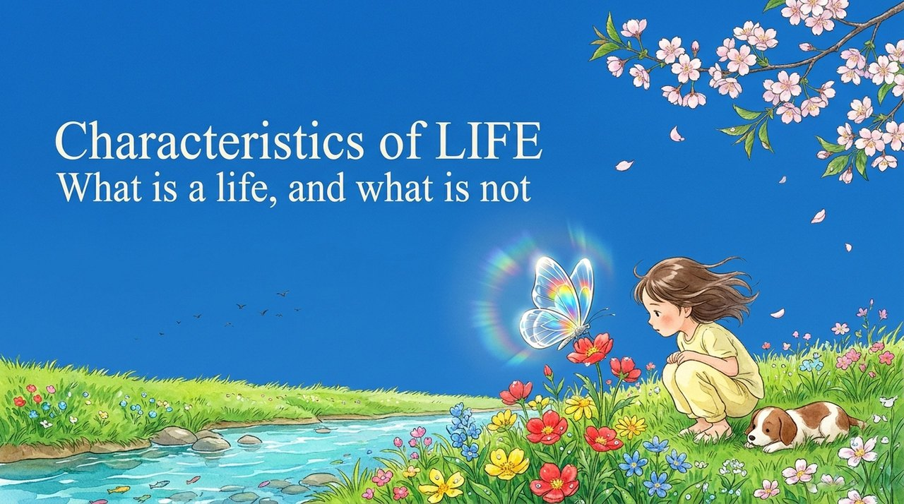
    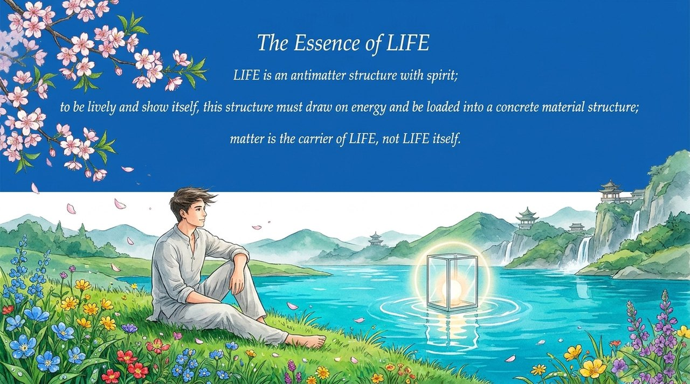
    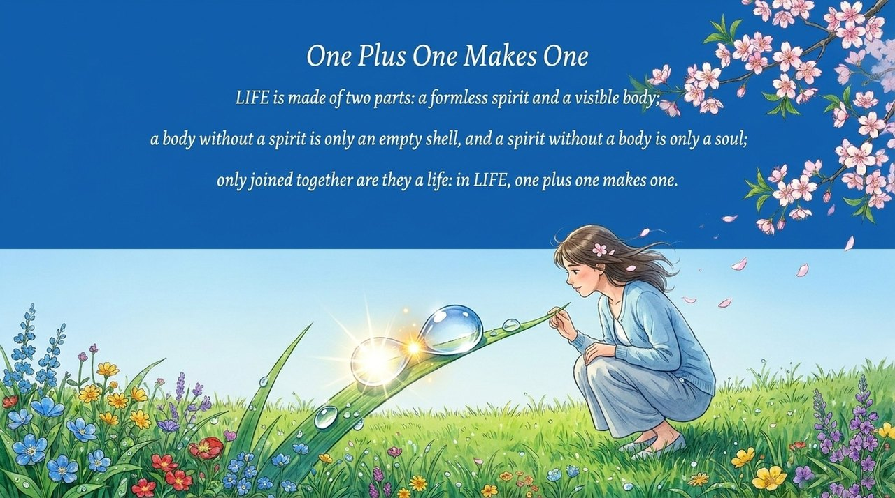
    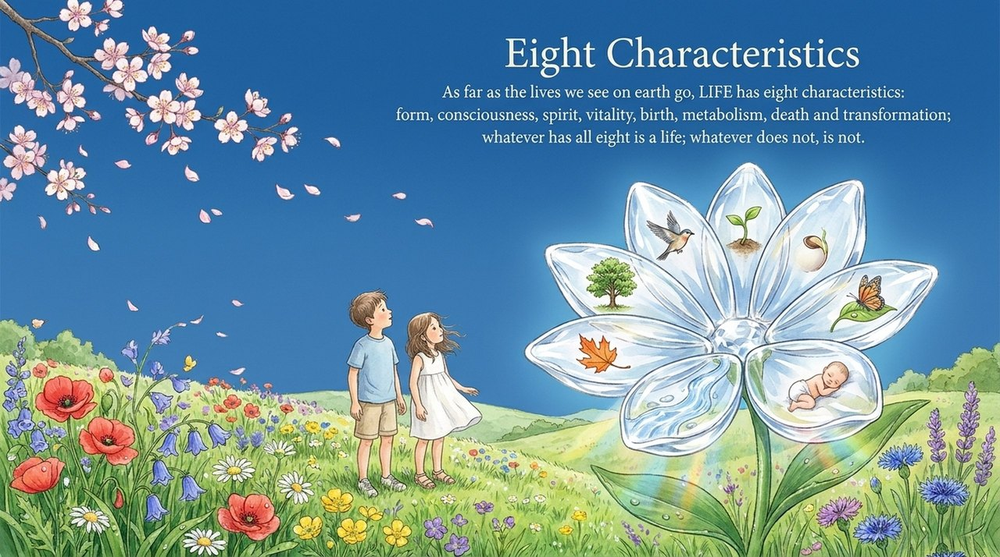
    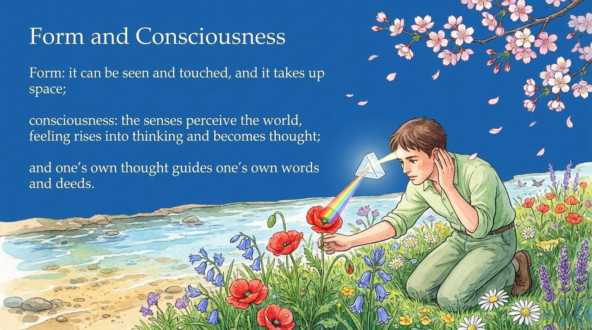
    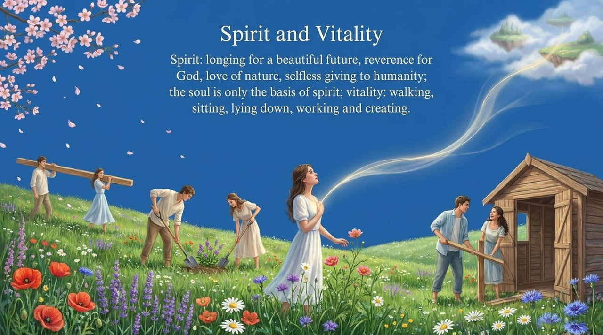
    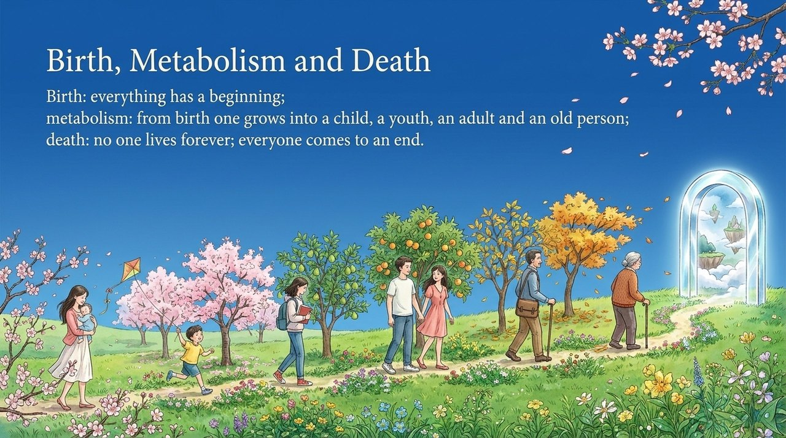
    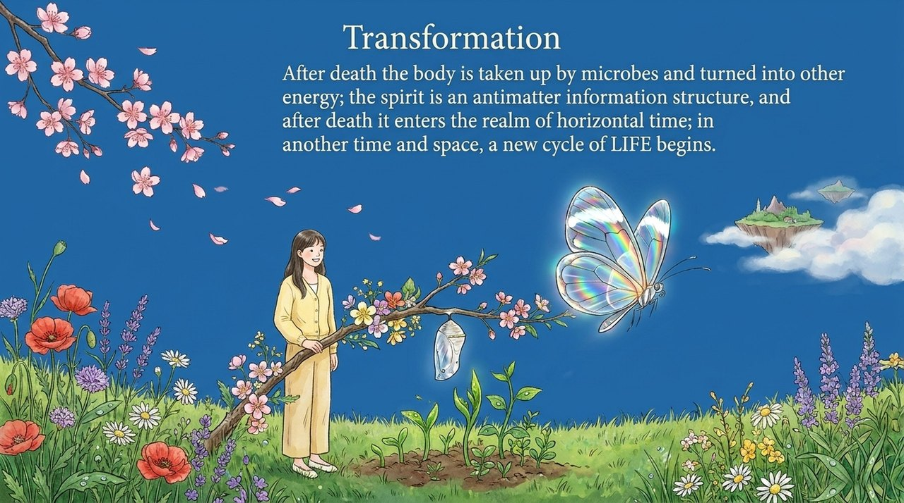
    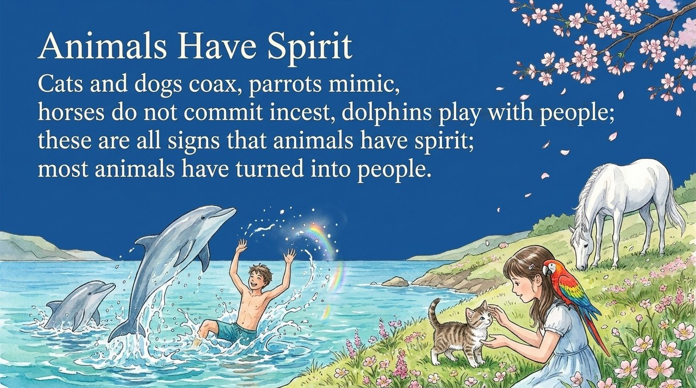
    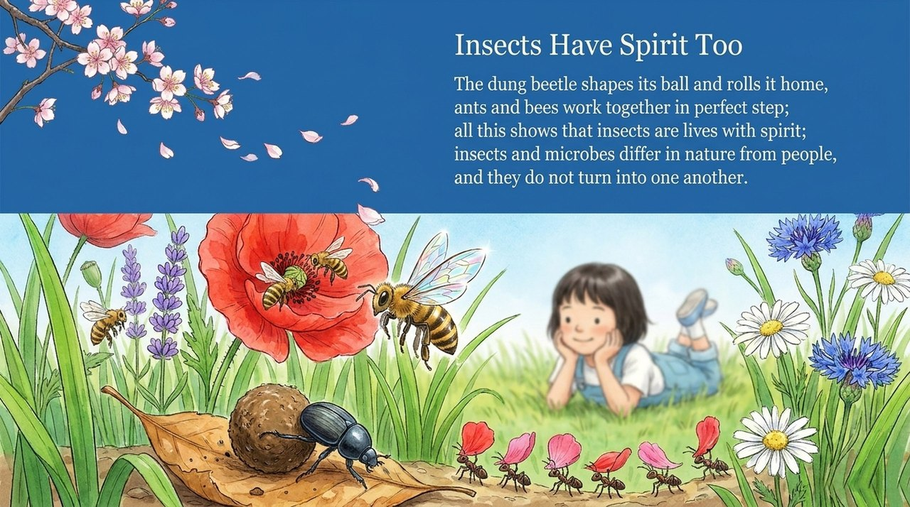
    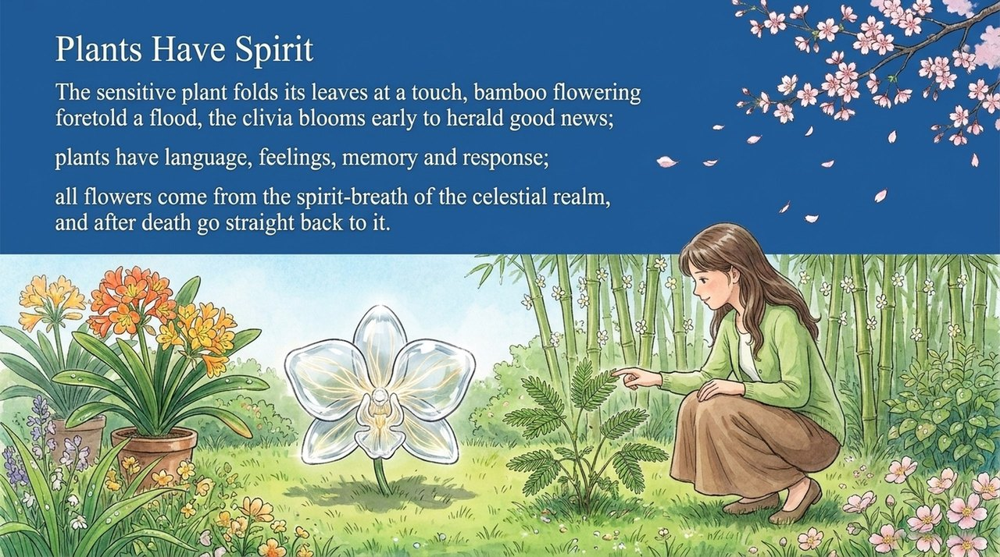
    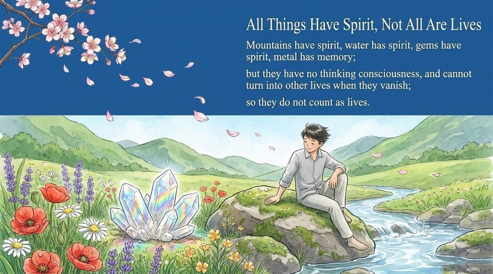
    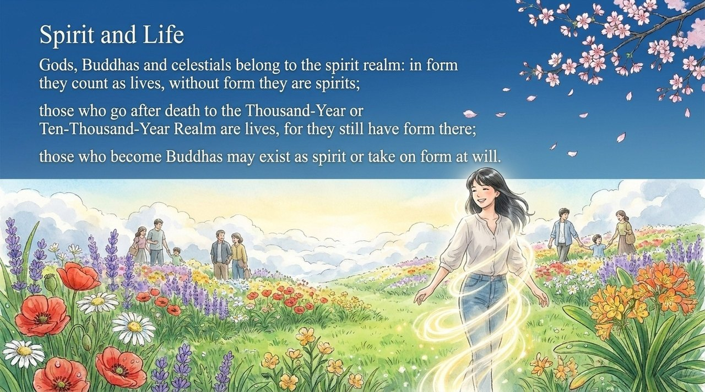
    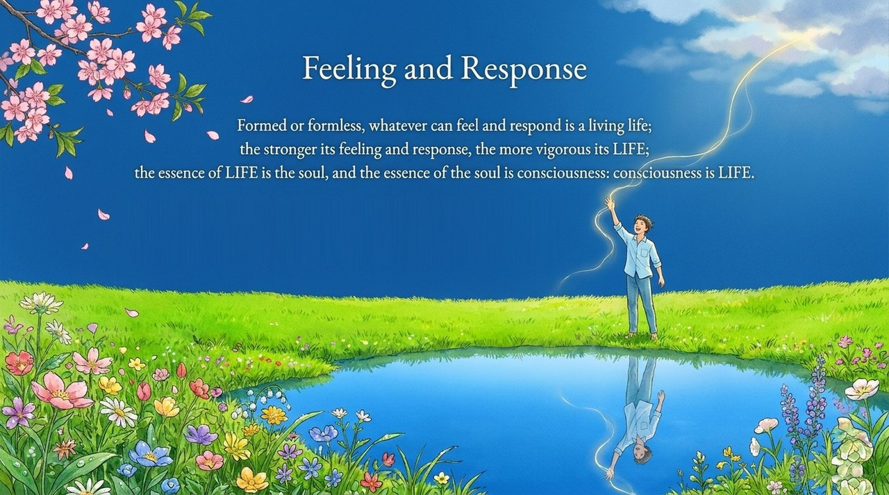

---

## Related Entries

- [LIFE](/en/life/)
- [Mysteries of LIFE](/en/life-mysteries/)
- [Origin of LIFE](/en/life-origin/)
- [Ling (Spirit-Force)](/en/ling-spirit/)
- [Consciousness](/en/consciousness/)
- [Spirituality](/en/spirituality/)
