<!-- id: LC-LOTM-0001-EN theme: Social Systems type: index direction: Social Systems lang: en -->

# Life Oasis Three Maxims: Simple, Frugal, Steadfast

The three maxims — **Simple** (简 *jiǎn*), **Frugal** (俭 *jiǎn*), and **Steadfast** (坚 *jiān*) — are the guiding principles that Lifechanyuan's guide Xuefeng distilled for daily life in the Life Oasis (Second Home). Together they form a practical code: strip away unnecessary complexity, release attachment to material excess, and build every action on solid inner ground. The aim is a life so unburdened that the Heart Sutra's promise becomes lived reality: "No hindrance in the mind; no hindrance, therefore no fear; far beyond all delusive thinking, here is Nirvana."

---

## Version Navigation

| Version | Best for | Focus |
|---------|----------|-------|
| [Friendly version](friendly.md) | First-time readers | Everyday wisdom of Simple–Frugal–Steadfast in plain language |
| [Academic version](academic.md) | Researchers | Philosophical analysis and institutional design of the three maxims |
| [Internal reference](internal.md) | Deep study | Xuefeng's original text with full attribution |

---

## Video

<iframe style="width:100%;aspect-ratio:4/3;border:0" src="https://www.youtube-nocookie.com/embed/ZdHGJrEkam4" title="Life Oasis Three Maxims: Simple, Frugal, Steadfast (Lifechanyuan Encyclopedia video)" allowfullscreen></iframe>

## Slides

??? info "📖 Illustrated slides (14 pages, click to expand)"

    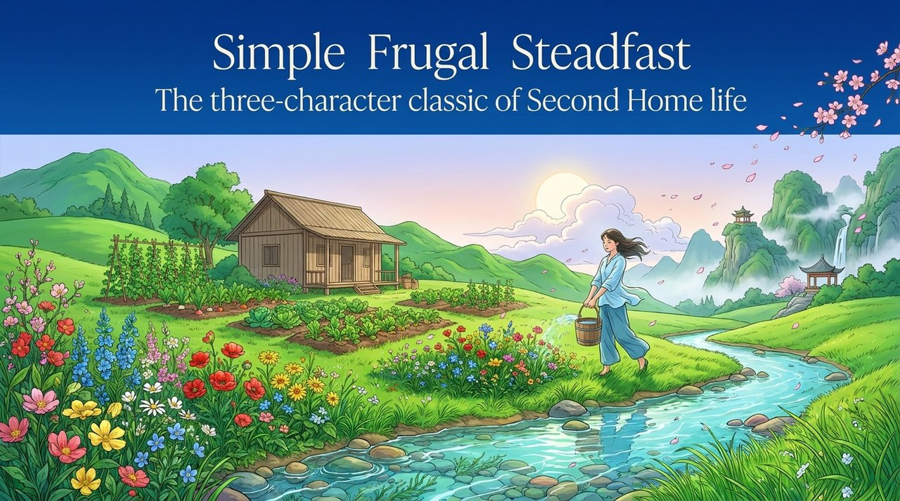
    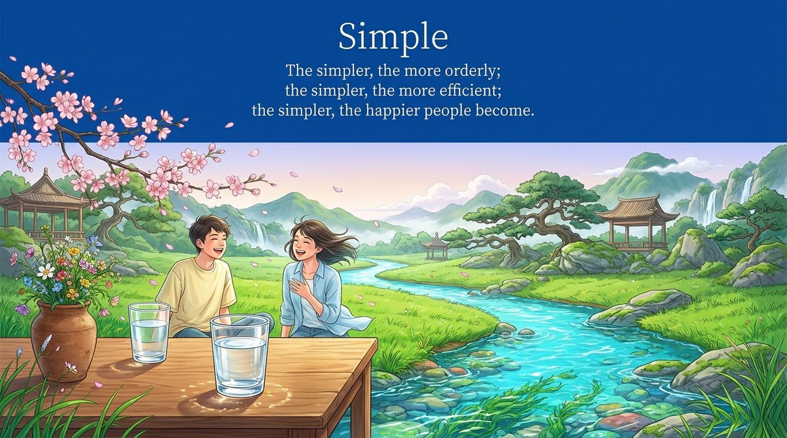
    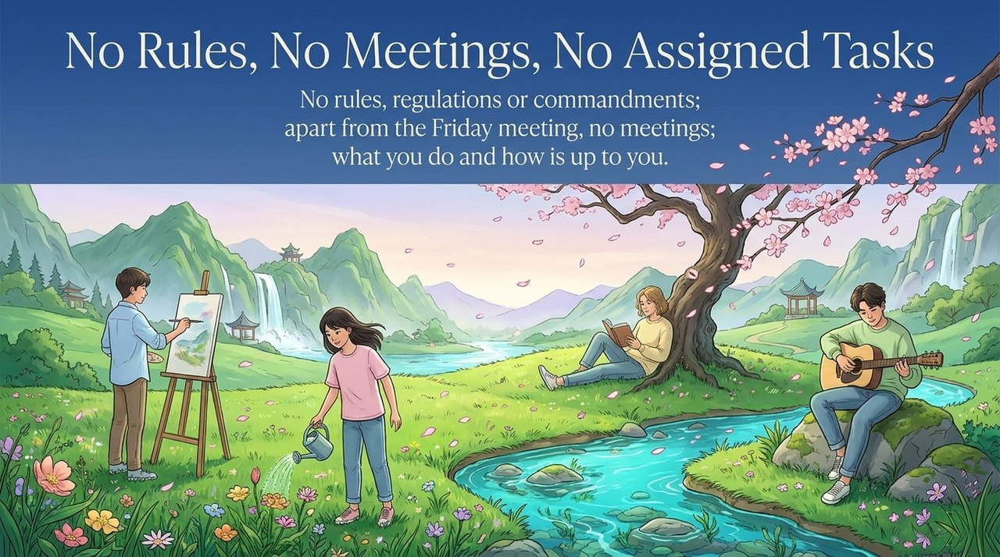
    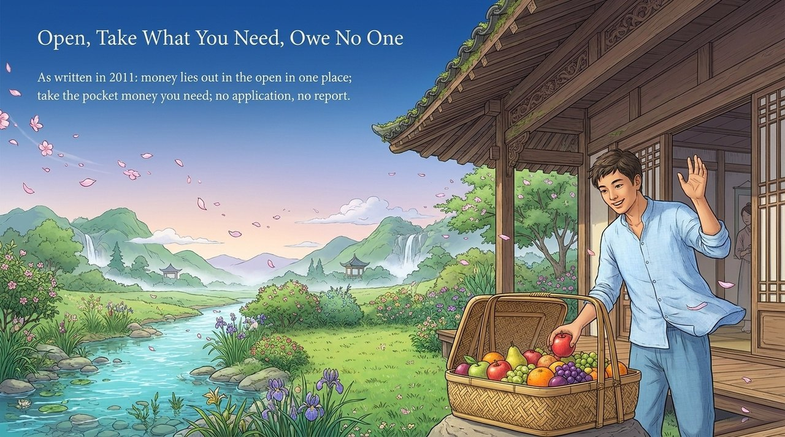
    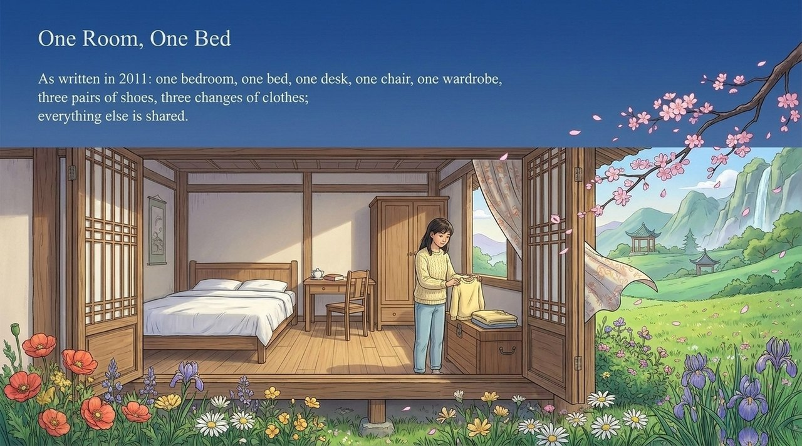
    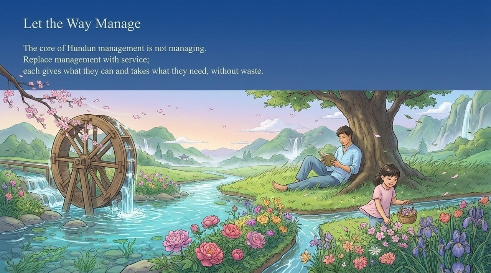
    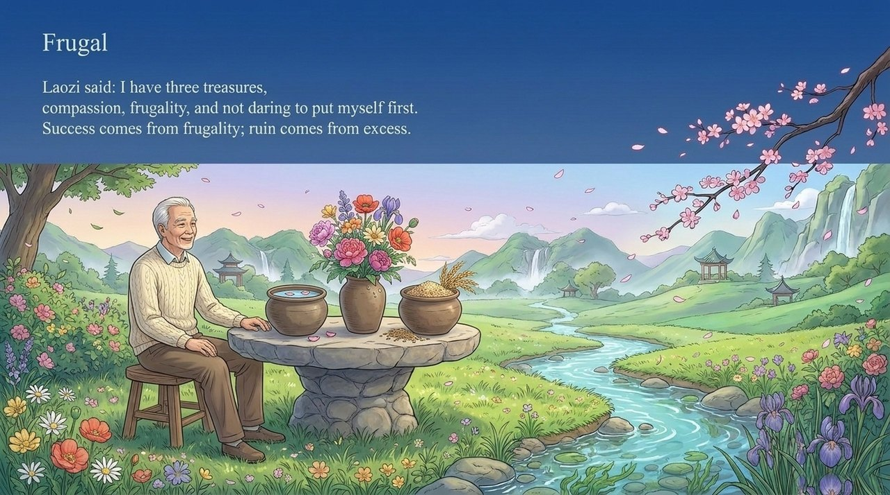
    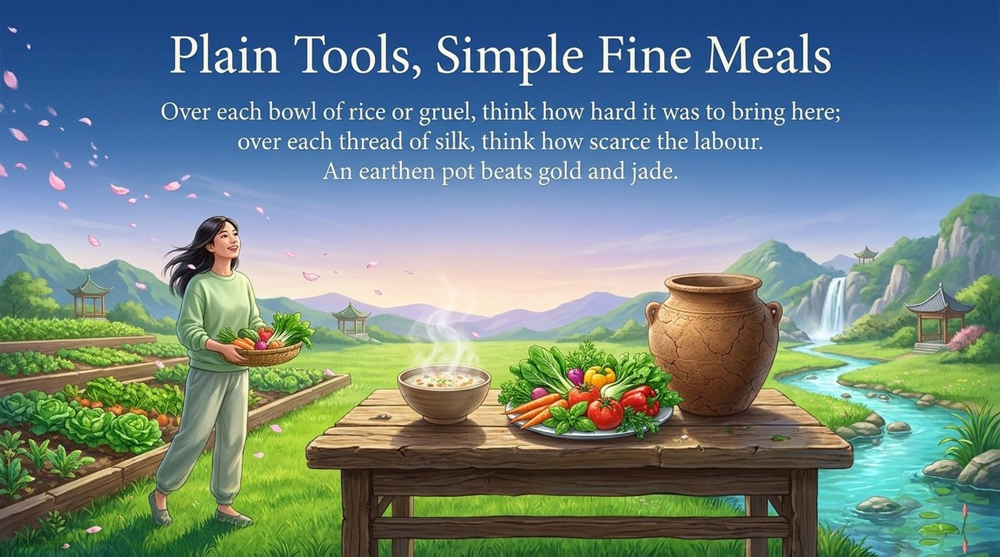
    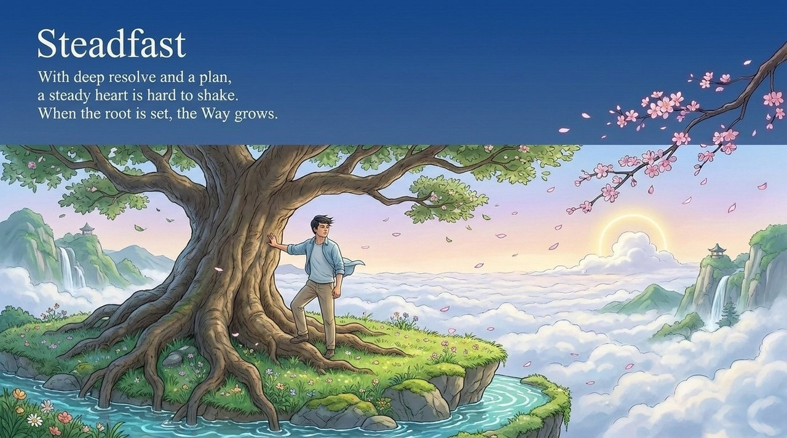
    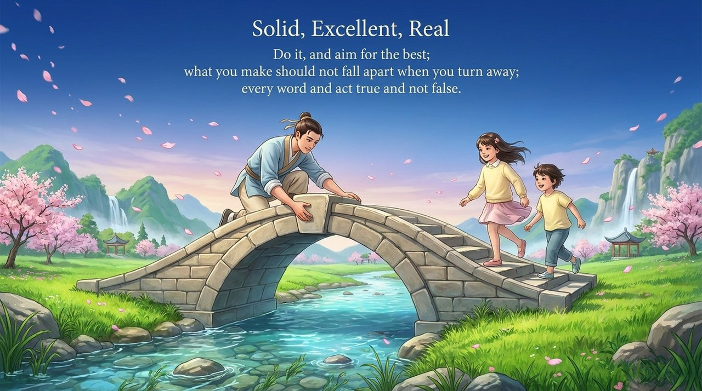
    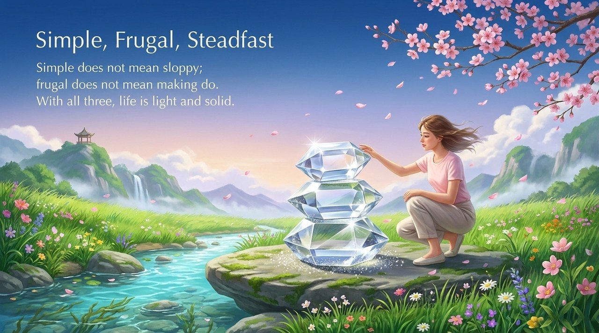
    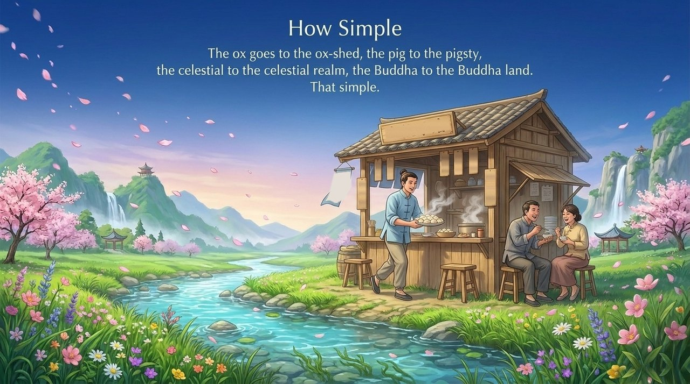
    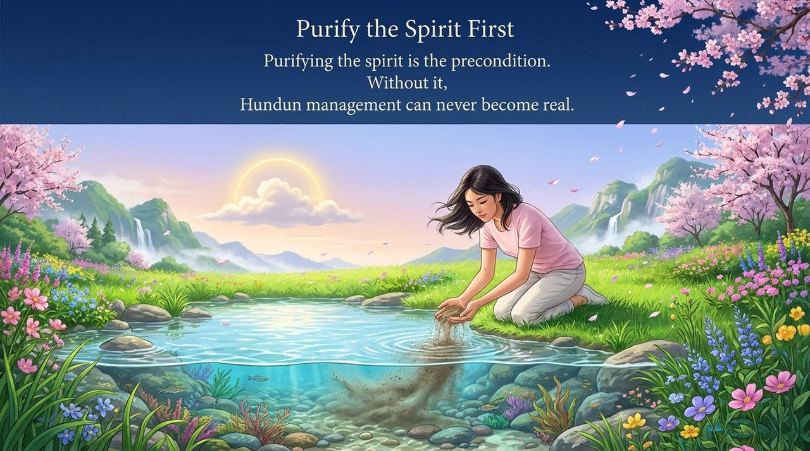
    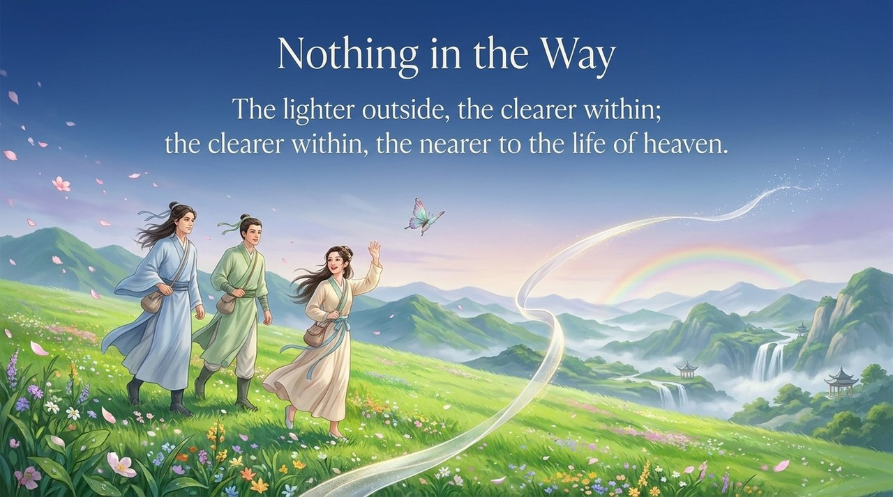

---

## Related Entries

[Life Oasis](/en/life-oasis/) · [Second Home](/en/second-home/) · [Hundun Management](/en/hundun-management/) · [Contribute by Ability, Take by Need](/en/contribute-by-ability-take-by-need/) · [Acting from One's True Nature](/en/suixing-er-dong/) · [Own Nothing, Have Everything](/en/own-nothing-have-everything/) · [No Clinging, No Hindrance](/en/xinwu-suozhu-guaai/) · [Lifechanyuan](/en/lifechanyuan/) · [Chanyuan Celestials](/en/chanyuan-celestials/)
